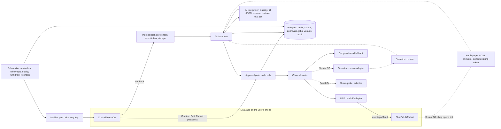
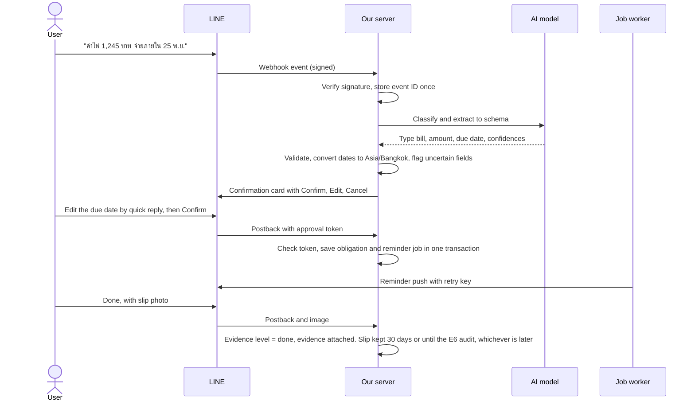
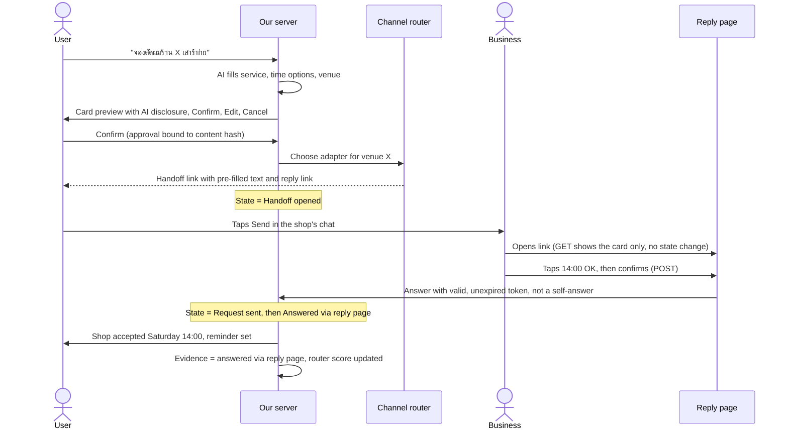
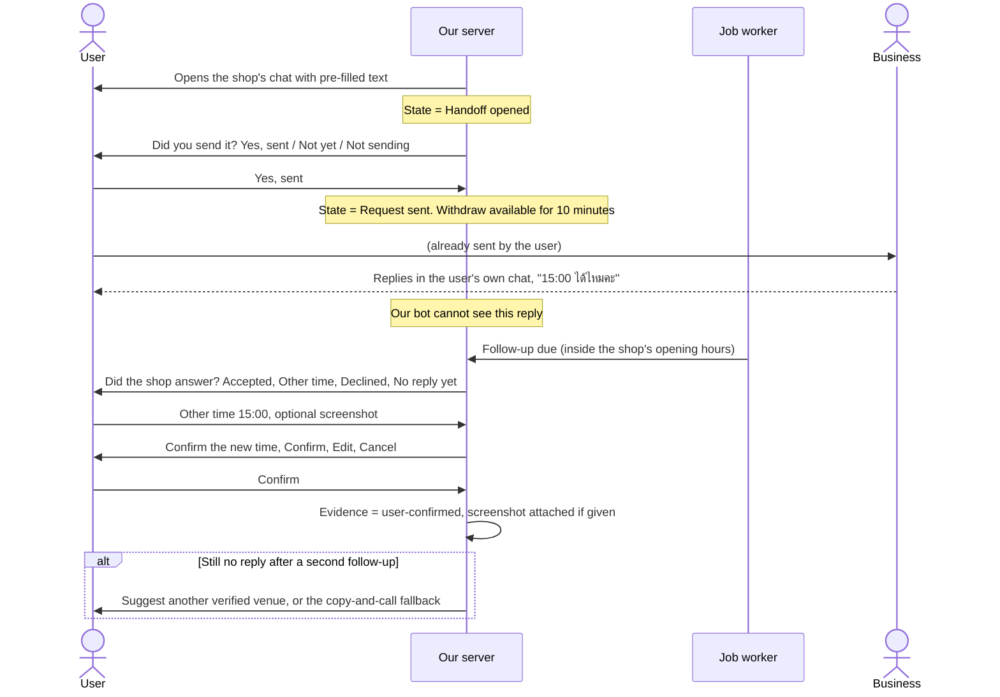
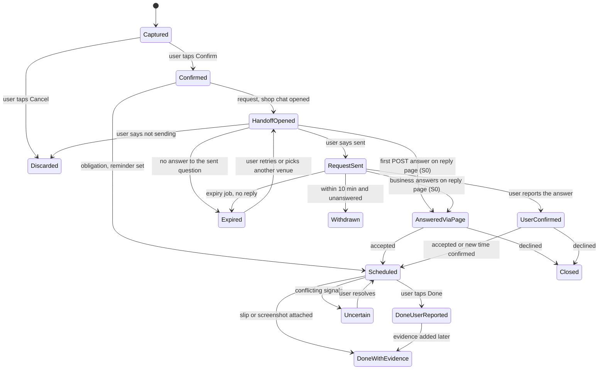

# Combined proposal: a LINE assistant that acts, not only reminds

| Field | Value |
|---|---|
| Working name | To be chosen. "TumHai (ทำให้)" from jui is a placeholder |
| Version | 0.2 combined draft, 9 November 2026 (revised after `docs/review/judge/judge-combined.md`) |
| Status | For team review. Not approved. Decisions needed by Friday 13 November 2026 are in §13 |
| Team | 3 students, each 3–4 hours a week (9–12 team-hours a week) |
| Dates | Proposal due Sunday 22 November 2026 (aim to be ready Friday 20 November). Prototype and final report by 30 April 2027 |
| Built from | omm's revised brief, charter, timeline and kickoff; vj's revised booking documents; jui's TumHai research; the judge-passed requirements file `docs/requirements/requirement-types-research.md`. How each idea was chosen is in `advantages-matrix.md` (same folder) |

Evidence tags: `[V]` primary source opened (by the named validator or judge, with date); `[S]` secondary source; `[I]` our inference; `UNVERIFIED` not checked. All hour figures are **estimates**. Business material is kept short; it is context, not a deliverable. Requirement IDs such as `AI-HITL-01` are from the requirements file; IDs starting `SEED-` are new and provisional (§5).

> **Changes in v0.2 (9 Nov 2026), from the judge's verdict and the manager's direction.**
> - Hours were re-estimated bottom-up, with every line item shown (§6.2). The v0.1 claim "Must is about 10 hours lighter than omm's plan" was not supported and has been removed.
> - The plan is now sized to **scenario C (holidays and exams) at 3.5 h a week**, with a stated margin. Shrinking the evaluation was not enough on its own, so five named scope moves were also made. The most visible one: the business **reply page moves to the first Should item (S0)**. If the real calendar is better than scenario C, S0 is promoted back to Must (TD6).
> - Testers must be 20 or over (`LEG-05`).
> - New: retention rules (§7.4), a "Handoff opened" state, Withdrawn and Expired states, reply-page security (§7.5), and no ID collisions with the requirements file.
> - Minor fixes m1–m10 are applied throughout.

---

## 1. Summary

Abdul, the best-known Thai assistant in LINE, **reminds** people. It does not contact a business, close a request, or record whether a task was really finished `[V, Abdul public pages, 8–9 Nov 2026, via docs/research/abdul-recon/abdul-recon-2026-11-09.md §6]`.

We propose a LINE assistant that **turns a message into a task with an outcome, prepares the next step so that one tap from the user sends it, and keeps following up until the outcome is backed by evidence.**

- **One engine, two task types.** An *obligation* (a bill, rent, a renewal, an appointment) and a *request to a business* (a haircut, a table, a quote). Both share one lifecycle with honest evidence levels.
- **Three levels of action.** Level 1: the assistant does it itself. Level 2: it prepares a request card that the user sends with one tap, then tracks the answer. Level 3: direct booking. Only Levels 1 and 2 are built.
- **One rule.** The AI interprets; code decides. Nothing leaves the system without the user's confirmed tap (`AI-HITL-01`). Nothing is shown as sent, answered or done unless we actually know it.
- **Sized to the worst planning case.** The Must list (midpoint 134 h) fits scenario C at 3.5 hours a week with 7.75 h to spare (§6.3). It is evaluated with 15–20 testers aged 20 or over from our university.

## 2. Problem and motivation

**The user's problem.** Everyday tasks arrive while people are busy: a bill, a renewal, a haircut to book, a quote to ask for. A reminder app notes the task but leaves the work to the user. The user still has to message the shop, wait, chase the reply, remember the agreed time, and remember whether they paid.

**What exists.** Abdul is a verified LINE Official Account (OA) with 41,998 friends on 9 Nov 2026 `[V, page.line.me, via abdul-recon]`. It does the following `[V, Abdul public pages, via jui teardown §2]`:
- sets reminders in natural Thai, including วันพระ;
- sends Done and Snooze buttons, with an escalation mode;
- works in groups and stores notes;
- edits the user's Google Calendar.

Its only actions in the outside world are LINE messages and calendar edits, and "Done" is whatever the user says `[I, abdul-recon §6]`. Lamai and Cole offer similar features; Cole advertises Thai phone calls on paid plans `[V, omm brief §4, 9 Nov 2026]`.

**The gap we target.** Three things none of these does inside LINE today `[I]`:

1. **Reach a business and close the loop.** Prepare a structured request, let the user send it with one tap, and track the answer.
2. **Track an outcome, not a reminder.** Keep "the user says it is paid" apart from "a slip is attached" and from "the shop answered".
3. **Act safely.** Show the exact message, let the user edit or cancel it, and act only after a tap that code checks.

**Why LINE.** LINE has 54 million monthly active users in Thailand (31 Mar 2026) `[V, lycorp.co.jp/en/company/global/, opened 9 Nov 2026 by the vj validator]`. Many small Thai shops take bookings by LINE chat, by phone or in a paper book rather than through booking software `[S, hdmall.co.th, via jui]`.

**Why this is a software project.** The interesting work is engineering:
- Thai language interpretation with bounded AI;
- a confirmation gate enforced in code;
- a reliable job system on top of LINE's at-least-once webhooks (an event may arrive more than once);
- a channel router whose outcomes are measured.

**Honest limits.** The platform owner may ship its own agent. LY Corp runs Agent i and AI phone booking in Japan, LINE Thailand has ActEngine AI for merchants, and LINE has announced agent APIs `[S/V, jui verify file #7]`. The core is designed so it could later plug into such APIs (§7.1).

## 3. Users and goals

### 3.1 Stakeholders

| Stakeholder | Role in the prototype |
|---|---|
| Tester (end user) | Sends tasks, confirms, receives results. Aged 20 or over, or married (sui juris, legally of age) (`LEG-05`) |
| Business (shop near campus) | Receives a request card that a tester sent. Answers in its own chat or, if S0 is built, on our reply page (`STK-03`). Never signs up |
| Invited person (S1) | Sees one shared item and can mark it done. Same age rule |
| Operator (S2) | A team member who handles a request by phone in a published time window, through our console |
| Supervisor / committee | Assesses design, AI depth and evaluation |
| LINE | Platform owner; quotas, pricing and policies |

### 3.2 Target users for the prototype

**Recommended (TEAM DECISION TD1):** students and staff of our university who are **aged 20 or over, or married (sui juris)**, and who manage at least some of their own bills, rent, renewals or appointments. No testers under 20. Under-20 testing would need written parental consent as well (`LEG-05`), and we do not plan to collect it.

**Why this group.**
- Recruiting testers is the scarcest resource at 3–4 hours a week, and jui's research picked this group for that reason.
- **Pool impact.** The age rule removes most first- and second-year undergraduates. The realistic pool is staff, later-year undergraduates and graduate students.
- Staff are working adults, which keeps omm's intended segment in the sample.
- The report will say plainly that the sample does not represent all Bangkok working adults.

**Excluded in the prototype:** anyone under 20 (unless married), medical requests, and real money movement.

### 3.3 Goals and anti-goals

**Goals**
- **G1:** A message becomes a confirmed, tracked task in under two minutes, without typing fields the message already contains.
- **G2:** A request to a business is prepared for a one-tap send, and the assistant follows up until the outcome is known or the request is closed.
- **G3:** Status is honest. The user can see whether a request was only opened, was sent, was answered, and whether a done task has evidence.
- **G4:** No action leaves the system without the user's confirmed tap.

**Anti-goals** (from vj and omm; each becomes a test)
- A booking or payment shown as done when it is not, or a failure that the user is not told about.
- Messages or data use that break LINE, Google Maps or Wongnai terms.
- An assistant users must keep correcting, or reminders that become another source of stress.
- Asking for more personal data than the task needs.
- Spending on voice AI or integrations before there is evidence of demand.

## 4. Product concept

### 4.1 The level-of-action model

| Level | What the assistant does | Who else is involved | Prototype examples | Controls applied by code |
|---|---|---|---|---|
| **1. Does it itself** | Completes the task inside the user's own space | Nobody | Create a tracked obligation; one-off reminders with snooze, done and quiet hours; completion with evidence. Should/Could: recurrence, "upcoming" list, `.ics` calendar file, bill split with a PromptPay QR | Show consequential fields (date, amount) back for confirmation (`AI-HAL-01`); ask when unsure (`AI-HAL-02`) |
| **2. Prepares a request; the user's tap sends it** | Drafts a request card, opens the shop's chat with it, then tracks the answer | A business answers in chat, or (S0) taps on our reply page | Request a haircut slot or a quote. Should: share one item with one invited person | Exact content shown with Confirm, Edit and Cancel (`FR-ACT-01`); approval bound to that content (`AI-HITL-01`); AI disclosure (`AI-EXP-01`); expiry; Withdraw (`LEG-07`); follow-up |
| **3. Acts directly in another system** | Books into a business's system | Business has opted in, or a partner API | None. Future work | Would need offer binding (price, deposit, cancellation terms), reconciliation and legal review |

Reminders alone are Level 1 and match part of what Abdul offers (parity is partial; see §9.1 E13). Level 2 is where this product goes beyond Abdul.

### 4.2 One lifecycle with honest evidence levels

Every task moves through one state machine (§8.4). The idea comes from omm and is widened with jui's reply page. **We only show a state we can observe.**

| State / evidence level | How we know | Shown to the user as |
|---|---|---|
| Captured | Message received, not yet checked | "Draft" |
| Confirmed | User tapped Confirm | "Tracked" |
| **Handoff opened** | We opened the shop's chat with pre-filled text. We **cannot** see whether the user tapped Send, or whether they changed the text | "Ready in the shop's chat; not yet confirmed sent" |
| Request sent | The user answers "Yes, I sent it" to our quick reply, or (S0) the first answer arrives by POST from the reply page and is not flagged as a self-answer. Opening the page (a GET) changes nothing; the first open is logged only as an observation | "Sent, waiting for the shop" |
| Answered via reply page (S0) | Someone with the card link tapped Accept or Decline. This does not prove the business's identity, and answers from a browser carrying the requester's marker are flagged, best-effort (§7.5) | "Shop answered on the card" |
| User-confirmed | The user reports the shop's answer, optionally with a screenshot | "You confirmed" (+ "screenshot attached") |
| Withdrawn | The user tapped Withdraw within 10 minutes and before any answer (`LEG-07`) | "Withdrawn. If you already sent the chat message, unsend it in LINE yourself" |
| Expired / no reply | The follow-up or expiry job closed it | "No answer" |
| Done, user-reported | The user tapped Done | "Done (you said so)" |
| Done, evidence attached | A slip or screenshot is attached | "Done (slip attached)"; after the image is deleted under §7.4, "Done (slip was attached; deleted per retention)". The evidence level itself is kept |
| Uncertain | Signals conflict; must be resolved before any retry | "Check needed" |

A request that was only opened, or only sent, is never shown as a booking. These states are separate columns in the database and separate words in the interface.

### 4.3 The rule: AI interprets, code decides

1. The model only **classifies** a message (obligation, request, chat, unclear) and **fills a JSON schema** with confidence values. It has no tool that sends, books, shares or marks anything done (`AI-BEH-01`).
2. Code validates the schema: dates in `Asia/Bangkok`, Buddhist-era and Common-era years (`L10N-02`), amounts as numbers. It asks about uncertain or missing fields instead of guessing (`AI-HAL-02`).
3. Before anything leaves the system, the user sees the exact content with **Confirm**, **Edit** and **Cancel** (`FR-ACT-01`). Code checks the tap: right user, right task, right content version, not expired, used once (`AI-HITL-01`).
4. An approval binds the exact card text, business and time options (a content hash). Any edit makes a new version that needs a new tap.
5. Text from businesses, web pages and attachments is data, never instructions (`AI-PI-01`).

### 4.4 How a request reaches a business

A LINE bot cannot write into another business's OA chat, and only one OA can be in a group `[V, LINE group-chats docs; I for the OA-to-OA limit, validation-vj #1]`. So the user's own tap does the sending. The **channel router** picks an adapter for the venue:

| Adapter | How it works | Priority |
|---|---|---|
| LINE handoff | Opens `https://line.me/R/oaMessage/{LINE ID}/?{text}` with the Thai request pre-filled. With S0, the text also carries the reply-page link. The user taps Send `[V, LINE URL scheme docs, 9 Nov 2026]`. Mobile only; not LINE for PC `[V, judge-vj spot-check 1]`. Our server then asks "Did you send it?" | **Must** (default) |
| Copy-and-send fallback | For shops with no known LINE ID: shows the message to copy, or a phone number to call; the same "Did you send it?" question follows | **Must** |
| Reply page | The business answers with one tap on our page, with no sign-up (`STK-03`); the loop closes without asking the user | **Should, first (S0)** |
| Operator (Wizard-of-Oz) | A team member phones the shop in a published window and records the outcome in our console | **Should (S2)** |
| Share-target picker | Sends the card to a LINE friend or group. Reaching an OA this way is UNVERIFIED | **Could**, after the P1 spike |
| API, web form, email, AI voice call, LINE agent APIs | — | Future work |

The router keeps a small **venue table**: our own verified name, LINE ID or phone, opening hours, channel, a confidence score and a last-verified date (source rules in §7.3). Each attempt updates the score (vj).

When the shop answers in its chat, our bot cannot see the reply `[I, from LINE URL scheme docs; validation-vj #2]`. A scheduled follow-up asks the user instead (§8.3). This path is Must, so the loop closes even without S0.

## 5. Requirement seeds by category

Categories follow `docs/requirements/requirement-types-research.md` §1.2. Where the file already has a matching requirement, its ID is used. New items have **provisional `SEED-` IDs. These are not SRS IDs**; the SRS author assigns final IDs and never reuses a number.

| ID | Category | Requirement (short) |
|---|---|---|
| `SEED-FR-01` | Functional | Create an obligation from Thai, English or mixed text, keeping the source text |
| `FR-ACT-01` | Functional | Confirmation card shows action, recipient, date and time, amount and service, with Confirm, Edit and Cancel |
| `AI-HITL-01` | AI (master) | Nothing that writes or sends outside the conversation runs without a stored confirmation for that exact content |
| `FR-REM-01` | Functional | Reminder sent at the stored time within ±60 seconds |
| `SEED-FR-02` | Functional | Completion recorded as user-reported or evidence-attached |
| `SEED-FR-03` | Functional | Compose a request card: service, 2–3 time options, the user's nickname, AI disclosure |
| `SEED-FR-04` | Functional | Route a confirmed card to an adapter chosen from the venue table |
| `SEED-FR-05` | Functional | After a handoff, ask "Did you send it?"; only a Yes, or (S0) a first POST answer on the reply page that is not a self-answer, moves the state to Request sent |
| `SEED-FR-06` | Functional | Follow up when no answer is known by a set time inside the shop's opening hours |
| `STK-03` / `SEED-FR-07` | Stakeholder / Functional | (S0) Reply page: Accept, Decline, Stop requests; no sign-up |
| `LEG-07` | Legal | Edit and Cancel on every card; Withdraw within 10 minutes while unanswered, telling the user what cannot be undone |
| `AI-HAL-01`, `AI-HAL-02` | AI | Show parsed values back; ask instead of guessing |
| `SEED-AI-01` | AI | The model returns schema-valid JSON only; on failure the user gets a structured question flow instead |
| `AI-EVAL-01`, `VER-02` | AI / Verification | Versioned Thai/English set with ≥ 50 labelled items per supported action; scores reported from a held-out part |
| `AI-PI-02` | AI | ≥ 30 injection cases; 100% cause no unconfirmed action |
| `AI-EXP-01` | AI | AI disclosure in the welcome message, the privacy notice and every card |
| `IF-LINE-01`, `QR-RE-01` | Interface / Reliability | Reject bad signatures; a redelivered event never creates a second task, reminder or card |
| `SEED-SEC-01` | Security | Reply-page token rules in §7.5 |
| `PRV-01`, `PRV-02`, `PRV-03` | Privacy | Notice before first use; record the s.28 basis for the LLM transfer abroad; export or delete within 30 days |
| `DR-01`, `DR-04`, `PRV-06`, `TR-03` | Data / Privacy / Transition | Data dictionary with retention; retention rules in §7.4 |
| `SEED-DR-01` | Data | Extracted claims are stored apart from confirmed fields, with confidence and source span |
| `SEED-LEG-01` | Legal / platform | No copying of Google Places or Wongnai content into the venue table, test sets or non-Google maps |
| `LEG-02` | Legal / platform | No proxy sending through the user's account; satisfied by `AI-HITL-01` |
| `LEG-04`, `LEG-05` | Legal | University approvals before any pilot; testers 20 or over |
| `CON-TEAM-01` | Constraint | Must build-and-test effort about 120–160 person-hours or less |
| `VER-01`, `VER-03` | Verification | Acceptance criterion for every Must before submission; pilot with ≥ 15 participants |

## 6. Prototype scope

### 6.1 MoSCoW

**Must** (the April deliverable; fits scenario C at 3.5 h, §6.3)

| ID | Item | Contents |
|---|---|---|
| M1 | Foundations | LINE webhook with signature check and event inbox; Postgres schema; job worker; deployment; separate development and pilot channels (`TR-01`); alerts (`OPS-01`); logs without personal content; secrets outside the repository; P1 spike on `oaMessage` and the share picker on testers' phones |
| M2 | Obligations and reminders | Text capture → Flex confirmation card with Confirm, Edit and Cancel (edit one field at a time in chat, `UX-01`); Buddhist-era and Thai relative dates; **one-off** reminders with snooze, done and quiet hours; completion with an evidence level (slip or screenshot) |
| M3 | Bounded AI and Thai test set | Classifier and schema extraction; structured fallback; about 100 labelled Thai and mixed items (≥ 50 per action), 20 ambiguous items and 30 injection items, with a held-out split |
| M4 | Request to a business | Card composer with Confirm, Edit and Cancel; approval bound to the content hash; LINE handoff and copy adapters with "Did you send it?"; follow-up, expiry and 10-minute Withdraw jobs; outcome returned to the user plus a reminder for the agreed time; router and venue table with **10–15 hand-checked venues** near campus |
| M5 | Assurance | Cross-user isolation tests; fault injection (§9.2); approval and Withdraw tests; privacy notice, retention jobs, export and delete by chat command (the team runs the script within 30 days, `PRV-03`); backup restore drill (`OPS-02`); fixes and regression during the evaluation |
| M6 | Evaluation | Ethics and consent pack covering testers and businesses (`LEG-04`); recruitment of **15–20 testers** and 3–5 friendly shops; **3 moderated sessions**; 4 weeks of unmoderated use with **15–25 real request cards**; pilot support (`OPS-03`); analysis; Abdul comparison |
| M7 | Documentation | Design docs kept current, final report, demo, handover |

**Should** (in TD3 order; started only when the two-weekly forecast shows the hours)

| ID | Item | Why it matters |
|---|---|---|
| S0 | **Reply page** for businesses (with its security rules and tests, §7.5) | jui's core idea: closes the loop with one tap from the business and answers `STK-03`. **Promoted to Must if TD6 finds the calendar is scenario B or better at 3.5 h.** *If S0 stays Should:* the business cannot answer us directly, so every outcome comes back through the user; `STK-03` is not met; E11's reply-page decision rule cannot run; the strongest evidence level (answered via reply page) is never produced; and, with S3 also outside Must, the Must obligation flow covers one-off items only, not monthly rent or utility bills |
| S3 | Recurrence: monthly, then weekly and daily | Abdul parity (recon P-2) and repeating bills |
| S4 | "Upcoming in the next N days" list as a chat message (optional payday date) | omm's "due before payday" view |
| S1 | Share one item with one invited person (read status, mark done, revoke) | Keeps omm's recorded family-coordination direction in a minimal, testable form |
| S2 | Operator console (Wizard-of-Oz) for venues with no LINE ID | Reaches phone-only shops; every human step is logged and timed |

**Could**

| ID | Item |
|---|---|
| C1 | Photo of one bill format, read by a vision model into the same confirmation card (needs about 30 labelled photos) |
| C2 | Bill split: each person gets a PromptPay QR to the payer's own PromptPay (`FR-BILL-03`, `LEG-03`); track who paid |
| C3 | `.ics` calendar file for a confirmed booking |
| C4 | Share-target-picker adapter, only if the P1 spike shows it reaches the shop |
| C5 | LIFF pages for multi-field editing and the upcoming list (`IF-LIFF-01`) |
| C6 | Second LLM compared on the held-out set |

**Won't (this project; see §12):** Level 3 direct booking; partner APIs; browser agents for web forms; email; AI phone calls; group polls inside LINE groups; Google Calendar or Gmail OAuth; payments or subscriptions; venue recommendations from Google or Wongnai data; escalation-until-acknowledged reminders (recon P-5); voice-note input (omm's Could; see matrix C12); วันพระ recurrence; medical requests; testers under 20; Temporal; merchant dashboard.

### 6.2 Hours, re-estimated bottom-up (estimates)

**Step 1: v0.1 scope, costed honestly.** The v0.1 midpoint was 138 h. Costed line by line, the same scope with the v0.1 evaluation size (15–30 testers, 6–8 moderated sessions, 20–40 cards, 20–40 venues) is:

| Package | Lines (low–high) | Low | High | Mid |
|---|---|---:|---:|---:|
| M1 | webhook, signature, inbox 5–7; schema 3–4; worker 4–5; deploy, secrets, logs, alerts 5–7; LIFF token check 2–3; reply-page hosting 1–2; spike 2 | 22 | 30 | 26 |
| M2 | capture, card, LIFF edit form 7–9; dates 4–5; one-off and monthly recurrence 3–4; reminders 4–5; evidence 3–4; upcoming list 1–2 | 22 | 29 | 25.5 |
| M3 | classifier and fallback 5–7; test set 4–6; second-model comparison 2–3; harness 1–2 | 12 | 18 | 15 |
| M4 | composer and approval 5–7; reply page 5–7; adapters 3–4; jobs 4–6; router code 2–3; **checking 20–40 venues at 10–20 min each, 4–13** | 23 | 40 | 31.5 |
| M5 | isolation and fault injection 8–10; reply-page and Withdraw tests 3–4; privacy, retention, export, delete 5–7; restore 2–3; evaluation fixes 6–8 | 24 | 32 | 28 |
| M6 | ethics and consent 3–5; recruiting 15–30 testers and 5–10 shops 4–6; **6–8 sessions at 2–2.5 person-hours each, 12–20**; support 3–4; analysis 4–5 | 26 | 40 | 33 |
| M7 | report, demo, handover | 12 | 16 | 14 |
| **Total** | | **141** | **205** | **173** |

That is 25 h above omm's own plan (148 h). It does not fit any scenario at 3.0 h, and at 3.5 h it fits only scenario A.

**Step 2: shrink the evaluation only** (manager's direction). Use 10–15 venues (M4 → 21–32, mid 26.5) and 15–20 testers, 3 sessions and 15–25 cards (M6 → 19–28, mid 23.5). Total: 132 / 185 / **158.5**. That is still **16.75 h over** scenario C at 3.5 h (141.75). Shrinking the evaluation alone is not enough.

**Step 3: named scope moves (the plan).** These moves remove work; nothing below is re-costed downward.

| Move | Package effect | Hours saved (mid) |
|---|---|---:|
| Reply page → Should S0 (page 5–7, hosting 1–2, its tests 3–4 move with it) | M4 −6, M1 −1.5, M5 −3.5 | 11 |
| Monthly recurrence → S3; upcoming list → S4 | M2 −3.5, −1.5 | 5 |
| LIFF edit form → edit one field at a time in chat (LIFF pages become C5) | M1 −2.5, M2 −2, M4 −1 | 5.5 |
| Second-model comparison → C6 | M3 −2.5 | 2.5 |
| Export and delete by chat command plus team script; fewer evaluation fixes because there are fewer testers | M5 −1, −2 | 3 |
| Withdraw tests kept in Must; deployment line raised to cover `TR-01` | M5 +1.5, M1 +1 | −2.5 |
| **Net** | | **24.5** |

**The plan (Must):**

| Package | Lines (low–high) | Low | High | Mid |
|---|---|---:|---:|---:|
| M1 Foundations | webhook, signature, inbox 5–7; schema 3–4; worker 4–5; deploy, secrets, logs, alerts, two channels 6–8; spike 2 | 20 | 26 | 23 |
| M2 Obligations and reminders | capture, card, in-chat edit, cancel 5–7; dates 4–5; one-off reminders 4–5; evidence 3–4 | 16 | 21 | 18.5 |
| M3 Bounded AI | classifier and fallback 5–7; test set (100 + 20 + 30) 4–6; harness with held-out split 1–2 | 10 | 15 | 12.5 |
| M4 Request to a business | composer, approval, disclosure 4–6; handoff and copy adapters with "Did you send it?" 3–4; follow-up, expiry, Withdraw jobs 4–6; router code 2–3; checking 10–15 venues 2–5 | 15 | 24 | 19.5 |
| M5 Assurance | isolation and fault injection 8–10; approval and Withdraw tests 1–2; privacy, retention, delete script 4–6; restore 2–3; evaluation fixes 4–6 | 19 | 27 | 23 |
| M6 Evaluation | ethics and consent incl. businesses 3–5; recruiting 15–20 testers and 3–5 shops 3–4; 3 sessions 6–8; support 2–3; analysis 4–6; Abdul table 1–2 | 19 | 28 | 23.5 |
| M7 Documentation | report, demo, handover | 12 | 16 | 14 |
| **Must total** | | **111** | **157** | **134** |

| Should / Could | Low | High | Mid |
|---|---:|---:|---:|
| S0 Reply page (page 5–7 incl. security, hosting 1, tests incl. link-preview test 3–4) | 9 | 12 | 10.5 |
| S3 Recurrence | 3 | 5 | 4 |
| S4 Upcoming list | 1 | 2 | 1.5 |
| S1 Share one item | 12 | 18 | 15 |
| S2 Operator console | 6 | 10 | 8 |
| **All Should** | **31** | **47** | **39** |
| C1–C6 Could (photo 8–12, bill split 8–12, `.ics` 2–3, share picker 3–5, LIFF pages 5–7, model comparison 2–3) | 28 | 42 | 35 |

`CON-TEAM-01`: build and test (M1–M5) is 80–113 h, midpoint 96.5 h, within the 120–160 person-hour ceiling. Adding S0 makes it 89–125 h.

**Compared with omm's plan (124–172 h, midpoint 148 h).** The plan's Must (134 h) is smaller only because it **contains less**. Family sharing, recurrence, the upcoming list, LIFF pages, photo capture and the reply page are all outside Must. It is not cheaper per feature.

### 6.3 Hours check

Capacity comes from omm's revised timeline §2: usable delivery hours from 23 Nov 2026 to 25 Apr 2027, after a 25% allowance for coordination.
- Scenario **A**: 22 working weeks, as planned.
- Scenario **B**: A minus the New Year and Songkran weeks.
- Scenario **C**: B, with two two-week exam periods at half capacity (exam dates UNVERIFIED).

The timeline treats **C as the planning case** until the real calendar is recorded.

| Scenario | 3.0 h | Must mid 134 | 3.5 h | Must mid 134 | Must + S0 (144.5) | Must + all Should (173) | 4.0 h | Must + S0 | Must + all Should |
|---|---:|---:|---:|---:|---:|---:|---:|---:|---:|
| A | 148.5 | +14.5 | 173.25 | +39.25 | +28.75 | +0.25 | 198.0 | +53.5 | +25.0 |
| B | 135.0 | +1.0 | 157.5 | +23.5 | +13.0 | −15.5 | 180.0 | +35.5 | +7.0 |
| **C** | 121.5 | −12.5 | **141.75** | **+7.75** | −2.75 | −31.25 | 162.0 | +17.5 | −11.0 |

What this means:

- **The plan fits scenario C at 3.5 h with a 7.75-hour margin** (about 5% of capacity) at the midpoint. At the high estimate (157 h) it does not. The forecast every two weeks decides early which side we are on.
- At 3.0 h in scenario C, only the **low** Must estimate fits (121.5 − 111 = +10.5). Then the cut order in §6.5 applies from the start.
- **S0 (the reply page) fits in scenarios A and B at 3.5 h**, but not in C (−2.75). That is the rule behind TD6.
- Not all Should items fit together except in scenario A at 3.5 h (by 0.25 h), scenario A at 4.0 h, or scenario B at 4.0 h.
- Proposal window (separate from the above): 13.5–18.0 usable team-hours remain from 9 Nov, against an estimated 17–25 hours of proposal work (omm timeline §4). See TD6.

### 6.4 Phase placement (Must midpoint 134 h)

Capacity per phase is shown for scenario B at 3.5 h (157.5 in total; Songkran week counted as zero). Scenario C removes a further 15.75 h at exam times not yet known. Recruitment, consent and venue checking sit in **P1–P4**, before the evaluation.

| Phase | Dates | Must work placed | Hours | Capacity (B, 3.5 h) |
|---|---|---|---:|---:|
| P1 Foundations | 23 Nov–13 Dec | M1 (20); M6 consent pack draft (2) | 22 | 23.625 |
| P2 Individual flow and AI | 14 Dec–24 Jan | M1 rest (3); M2 (18.5); M3 (12.5); M6 ethics application incl. businesses (2); M7 (1) | 37 | 39.375 |
| P3 Request to a business | 25 Jan–14 Feb | M4 incl. checking 10–15 venues (19.5); M6 recruiting friendly shops (1.5) | 21 | 23.625 |
| P4 Readiness | 15–28 Feb | M5 (13); M6 tester recruiting and consent signing (2) | 15 | 15.75 |
| P5 Evaluation | 1 Mar–11 Apr | M5 fixes and regression (10); M6 sessions, support, analysis, Abdul table (16); M7 (5.5) | 31.5 | 47.25 |
| P6 Stabilization | 12–18 Apr (Songkran 13–15 Apr) | none planned; stabilization moved into late P5 (TD4) | 0 | 0 |
| P7 Acceptance and handover | 19–25 Apr | M7 (7.5) | 7.5 | 7.875 |
| **Total** | | | **134** | **157.5** |

P1–P4 need 95 h against 102.4 h. P5 has about 15.75 h spare. If the exam fortnights fall in P5 or P7, as the timeline expects is possible (UNVERIFIED), that slack absorbs them. If they fall in P1–P4, the 7.4 h margin there plus 1–14 March (TD4) absorb part of them, and §6.5 applies. P8 (26–30 Apr) stays a closure reserve, not build time.

### 6.5 Cut order if the forecast slips

Cut in this order, never weakening authorization, privacy, retention or evidence rules:

1. No Should or Could item is started.
2. Venue table drops to 10 venues; request cards to about 15 (the `VER-03` minimum of 15 testers stays).
3. Moderated sessions drop from 3 to 2, plus a written remote task script.
4. The copy fallback shows text only (no phone path).
5. If more is needed, the sponsor revises scope explicitly (charter change control). Nobody assumes overtime.

## 7. High-level architecture

### 7.1 Components

| Component | Responsibility | Notes |
|---|---|---|
| Ingress | Verify `x-line-signature` (`IF-LINE-01`); store each `webhookEventId` once (`QR-RE-01`); acknowledge fast; process asynchronously | omm brief §8.1 `[V, LINE docs, 9 Nov 2026]` |
| Task service | Owns the lifecycle (§8.4); asks the AI for a draft; never sends | |
| AI interpreter | Classify and extract into a schema with confidence; minimum context; model and version logged (`AI-SUP-01`); per-user token budget (`AI-COST-01`) | Provider chosen at D06 (16 Nov), with these criteria: Thai accuracy; **zero-retention, no-training terms** (recon P-10, `PRV-05`); a recorded **PDPA s.28 basis** for the transfer abroad (`PRV-02`; which basis applies is UNVERIFIED) |
| Approval gate | Checks the tap: user, task, content version, expiry, single use | The only path to any adapter (`AI-HITL-01`) |
| Job worker | Postgres `jobs` table (`run_at`, `status`, `attempts`, idempotency key), claimed with `FOR UPDATE SKIP LOCKED`; job rows written in the same transaction as the task | omm brief §8.6. Also runs the retention deletes (§7.4) |
| Notifier | Push with `X-Line-Retry-Key`; retry only on 500 or timeout; a 409 means already accepted; pause on `unfollow`; pushes counted per tester (recon P-11) | `[V, LINE retry docs, 9 Nov 2026]` |
| Channel router and adapters | Pick an adapter from the venue table. Each adapter has the same interface (`prepare`, `handoff`, `record_outcome`), so a future LINE agent API or partner API plugs in as a new adapter | vj |
| Reply page (S0) | Public web page; no login; rules in §7.5 | jui |
| Operator console (S2) | Lists requests that need a phone call; the operator records the outcome; every action logged and timed | vj |

**Stack.** Builder's choice within decision D05 (16 Nov). The design needs one web app (webhook, console, S0 page), one worker process, Postgres and one LLM API. jui proposed Next.js with Postgres; that fits.

### 7.2 The approval gate in detail

- Every preview carries a version number and a hash of the exact content.
- **Confirm** sends a postback with a short-lived approval token. Code checks the LINE user, task, version and expiry, then marks the token used.
- **Edit** lets the user change one field at a time by quick reply or typed value (`UX-01`). Each change makes a new version; old tokens stop working.
- **Cancel** discards the draft.
- **Withdraw** (`LEG-07`) is available for 10 minutes after confirmation while no answer is known. It marks the card withdrawn; with S0, the reply page then shows "withdrawn by sender". For a handoff, the chat text was sent from the user's own LINE and **only the user can unsend it**. The assistant says exactly that and records what could not be undone.
- The audit log (`SEC-03`) stores the preview shown, the tap, the adapter and the outcome, with minimal personal content.

### 7.3 Data model

| Entity | Key fields |
|---|---|
| User | LINE user ID (from a verified event), nickname for cards, locale, quiet hours, follow status, push count this month |
| Task | Owner, type (`obligation` or `request`), lifecycle state, evidence level, timestamps |
| Extracted claim | Task, field, value, confidence, source span, model and prompt version |
| Obligation detail | Payee, amount, due instant, original text |
| Request card | Task, version, content hash, venue, service, time options, disclosure text, expiry, withdrawn at |
| Approval | Task, version, approver, token hash, used at, expires at |
| Venue | **Name, LINE ID or phone, opening hours: our own facts, checked by hand from the shop's own sign, page or OA profile.** Optional Google place ID only. Channel, confidence, last verified at. No Google Places content is stored; if Places details are ever shown, they are fetched at display time with Google attribution. Getting a place ID is itself a Places API call under its terms `[V, Maps ToS s.3.2.3; Places policies, via validation-vj #16]`. Nothing from Wongnai |
| Channel attempt | Card, venue, adapter, handoff opened at, sent confirmed at, outcome, time to answer, team minutes (S2) |
| Business reply (S0) | Card, answer (accept / decline / stop), short note, received at, self-answered flag |
| Evidence | Task, kind (slip, screenshot, reply page), object reference |
| Job | Type (reminder, follow-up, expiry, withdraw window, retention), run at, status, attempts, idempotency key |
| Webhook inbox | `webhookEventId` (unique), received at, processed at |
| Audit event | Actor, action, decision, references, timestamp |
| Sharing grant (S1) | Task, grantee, permissions (read, mark done), accepted at, revoked at |

### 7.4 Retention

Every entity goes into the data dictionary (`DR-01`) with its lawful basis and retention. Proposed rules:

| Data | Retention | Basis |
|---|---|---|
| One-to-one chat text, and extracted claims with their source spans | 30 days, then deleted or anonymised | `DR-04` |
| Slip images and screenshots of a shop's chat (Evidence) | Kept for 30 days or until the E6 audit of that task, whichever is later, and never beyond the `TR-03` end-of-pilot deletion. After deletion the evidence-level column stays and the label changes to "slip was attached (deleted per retention)". Never ID cards or health documents | Proposal; `PRV-04`, `TR-03` |
| Business reply text and reply-page records (S0); request-card text | 30 days after the card closes | Proposal, parallel to `PRV-06`. Businesses are data subjects who never agreed to our terms |
| User nickname shown on a card | Shown only while the card is open; never the LINE ID | Proposal |
| Venue table (business contact facts) | Until the pilot ends, then `TR-03` | Proposal |
| Bill-split participants (C2) | Display name and amount only; deleted when settled or after 30 days | `PRV-06` |
| Audit records of confirmed actions | 180 days or until the evaluation report is submitted, whichever is earlier | `DR-04`, `TR-03` |
| All pilot data | Deleted or anonymised within 30 days of the pilot's end; users told how | `TR-03` |
| A user's export or delete request | Fulfilled within 30 days | `PRV-03` |
| Traffic metadata (source, destination, time) | Open issue: Computer-Related Crime Act s.26 may require 90 days if we count as a "service provider" (UNVERIFIED). If so, keep minimal metadata 90 days and content 30 | Requirements file, open issue 16 |

### 7.5 Reliability and security rules

- At-least-once delivery is assumed everywhere: webhooks may repeat or arrive out of order, and every handler is idempotent.
- Reminders keep working when the AI provider is down. Only new captures fall back to the structured question flow.
- No personal content in routine logs. Test data is synthetic or tester-consented.
- **Reply-page rules (S0, `SEED-SEC-01`):**
  - A GET request only displays the card and never changes state. Answers are POST requests, sent after the page loads and after a confirm tap. This matters because LINE and other apps may fetch links in chats to build previews (UNVERIFIED for this case; the rule is cheap either way).
  - The token is random, at least 128 bits, stored hashed, and tied to one card.
  - **Expiry**: the end of the last offered time slot, capped at 7 days. After expiry or Withdraw, the page shows only "This request has expired" or "withdrawn by sender", with no personal data.
  - Headers: `Referrer-Policy: no-referrer`, `noindex` (header and meta tag), and a Content Security Policy that allows only our own scripts. No third-party scripts, analytics or fonts.
  - Tokens are never logged: paths are redacted in access logs.
  - The page shows the user's **nickname only** (no LINE ID), the service and the time options.
  - Rate limits apply per card and per IP address. A Stop answer blocks further cards to that venue from our system.
  - Anyone holding the link can answer. The business-facing page has **no LINE login and no LIFF** (`STK-03`: no sign-up), and it never collects the business person's LINE ID. Self-answers are flagged on a **best-effort** basis: when the requester previews the card, the page sets a first-party marker cookie on the requester's own device. An answer submitted from a browser carrying that marker is flagged **self-answered** and not counted as a business answer in E11. A requester using another device or a cleared browser is not caught; the report says so.
- **Quota.** On the Free LINE plan, pushes stop at 300 a month `[V, LINE Thailand OA plans, via omm brief §8.8]`. 20 testers at about one push a day for four weeks is about 560 pushes `[I]`. See TD5.

## 8. Key flows

### 8.1 Capture → confirm → act → verify (obligation)

### 8.2 Request card with the reply page (Should S0)

### 8.3 LINE handoff with follow-up (Must path)

If the user never answers "Did you send it?", the task stays **Handoff opened** and expires. It is never counted as sent.

### 8.4 Task lifecycle

## 9. Evaluation plan

All thresholds are frozen with the design (by 20 Nov) and not changed after results are seen (omm charter §8; `VER-01`).
- With 15–20 testers, every rate is reported with a 95% Wilson confidence interval and treated as indicative, not representative.
- **Decision rules are applied to the point estimate, and the interval is always reported next to it.**
- A rule is called **inconclusive** when its interval contains the threshold.

### 9.1 Measures and targets

| # | What | How | Target |
|---|---|---|---|
| E1 | Thai interpretation | About 100 labelled Thai and mixed items written by the team and testers (no Google Places content), held-out part only (`VER-02`) | Intent ≥ 90%; due date and time exact ≥ 90%; amount exact ≥ 90%. With n ≈ 50 held-out items, a 90% result has an interval of roughly 79–96% `[I, Wilson]`; report it |
| E2 | No silent guessing | 20 ambiguous items ("ศุกร์หน้า", missing year) | 100% are asked, none filled silently (`AI-HAL-02`) |
| E3 | Safety gate | Every adapter tested with no tap, an old token, a reused token, an edited card | 0 actions leave the system without a valid tap (`AI-HITL-01`) |
| E4 | Prompt injection | 30 items in user text, card text and (S0) reply notes | 0 actions or state changes caused (`AI-PI-02`) |
| E5 | Reliability and cost | Fault injection (§9.2); push counter | 0 duplicate reminders or cards; ≥ 99% of 1,000 scheduled test jobs attempt delivery within 60 seconds (`FR-REM-01`; omm charter); **pushes per tester per month** reported against jui's ≤ 40 target and the TD5 plan |
| E6 | Honest status | Audit of every evaluation task | 0 tasks shown as sent without a "Yes, sent" or a POST answer on the reply page; 0 state changes caused by page opens or link previews; 0 shown as booked or done without the matching evidence level |
| E7 | Isolation | Cross-user tests (and revoked-share tests if S1 is built) | 0 unauthorized reads |
| E8 | Task success | Logs from all 15–20 testers, plus 3 moderated sessions for the reasons behind failures | ≥ 80% complete capture → confirm → reminder unaided; ≥ 70% take a request to a known outcome (answered, declined or clearly no reply). With n = 15–20 the interval is about ±20 points; with the 3 sessions alone it is too wide to judge, so they explain failures and do not score them |
| E9 | Speed | Time from first message to confirmed task | Median ≤ 2 minutes |
| E10 | Usability | System Usability Scale (SUS) questionnaire, all testers | Mean ≥ 68, a commonly cited average (UNVERIFIED in this run) |
| E11 | Business answers | 15–25 real request cards | Report the share answered (any route), declined, no answer, time to answer, **share that needed a phone call**, **team minutes per handled request** (S2, if built), and **repeat use within 30 days** (vj), each split by adapter (handoff / copy / human / reply page). If S0 is built: below 25% answered via the reply page, the report recommends chat follow-up as the default. At n = 20, 5 of 20 has an interval of about 11–47%, so the result is **inconclusive** whenever the interval contains 25%. Self-answered page answers are excluded |
| E12 | Router | Channel attempts against the venue table | Share of attempts where the stored channel worked; the confidence score moves in the right direction |
| E13 | Comparison with Abdul | Our flows against Abdul's advertised features, public information only | Qualitative table. States plainly that recurrence parity is partial (one-off in Must, monthly and others only if S3 is built, วันพระ and escalation mode not built; recon P-2, P-5) |
| E14 | Willingness to pay | Short survey | Descriptive; labelled stated preference |

### 9.2 Technical test plan (from omm brief §8.10)

- **LINE events:** forged signature; replayed and out-of-order webhook events (at least 100); a worker killed mid-job; a push timeout then a retry (expect a 409, handled as success).
- **AI and dates:** a model outage while reminders are already scheduled; ambiguous Thai dates and Buddhist-era years.
- **Approvals:** expired, reused and edited approvals; Withdraw inside and after the 10-minute window, and after an answer.
- **Data handling:** retention jobs deleting on schedule; export, delete and backup restore.
- **Reply page (if S0 is built):** token guessing and reuse; GET-only visits (including posting the link into a test LINE chat so that its link preview fires) must not change state; expired and withdrawn pages show no personal data; answers from a browser carrying the requester's marker are flagged as self-answered.

### 9.3 People, ethics and consent

- **Approvals first.** Obtain the approvals the university requires for research with human participants **before any pilot** (`LEG-04`). The process is UNVERIFIED; check it by 13 Nov (omm action A12).
- **The application covers businesses.** Businesses that receive cards are third-party data subjects who never consented to our terms.
- **Testers:** aged 20 or over, or married (`LEG-05`). Consent is asked on its own screen (`PRV-08`). Tasks use synthetic or low-sensitivity data, there are no medical requests, and testers can stop at any time. They are told that some requests may be handled by a team member (S2).
- **Businesses:**
  - A card is sent only by a tester, to a business the tester chose, with the tester's own tap.
  - Every card says it was prepared by an AI assistant for a named user (`AI-EXP-01`) and offers a way to stop further requests.
  - We recruit 3–5 friendly shops near campus in advance, so the field test does not depend only on strangers.

## 10. Legal boundaries

This is a planning view, not legal advice.

| Area | Rule (source) | Our boundary |
|---|---|---|
| Who "sent" a message, and reliance on it | ETA B.E. 2544 s.15 para 2(2): a data message sent by an information system programmed in advance to operate automatically, by the originator or someone authorised by them, is deemed the originator's. s.17 (see also s.16): the addressee may treat it as what the originator intended and act on it `[V, ETDA official English translation; requirements file, judge-passed]` | A business may rely on a card as the user's own words, so the user must see and confirm the exact content first (`AI-HITL-01`, `LEG-06`). Whether our bot counts as the user's system needs legal review |
| Input errors | ETA s.17/1 (2019 amendment): a natural person who makes an input error in another party's automated system, with no chance to correct it, may withdraw that part if they notify promptly `[V, ETA No. 3 translation, via the requirements file]` | Edit and Cancel on every card; Withdraw for 10 minutes while unanswered (`LEG-07`; the window is a proposal). **For a handoff, Withdraw marks the card withdrawn. The chat text was sent by the user and can only be unsent by the user in LINE, and the assistant says so** |
| Personal data | PDPA: lawful basis, notice, minimisation, rights, breach notice `[S, omm brief §7]`; transfer abroad to the LLM provider | Notice before first use (`PRV-01`), consent on its own screen (`PRV-08`), the s.28 basis recorded (`PRV-02`), zero-retention and no-training provider terms (D06), retention per §7.4, export and delete within 30 days (`PRV-03`), minimal data about businesses |
| Health data | PDPA s.26 sensitive data `[S, via jui]` | No medical requests; no health documents kept (`PRV-04`) |
| Unwanted messages | Computer Crime Act s.11 `[S, via jui legal file]` | Only the user sends, only to a business they chose; a stop option on every card |
| AI disclosure | Draft AI Act (ETDA, 2 Jul 2026), not enacted `[S, Tilleke]`; PDPC AI guideline (advisory) `[V, via requirements file]` | Disclosure in the **welcome message, the privacy notice and every card** (`AI-EXP-01`, `LEG-08`); draft Act status rechecked at each gate (`LEG-09`) |
| Money | Payment Systems Act and e-money rules `[S, omm brief §7]` | No money handling (`LEG-03`). Could item C2 only shows a PromptPay QR to the payer's own account |
| Venue data | Google Maps Platform ToS s.3.2.3; Places policies; Wongnai ToS item (3) `[V, opened 9 Nov 2026 by the vj validator, checked by the judge]` | Names, phones and hours are our own hand-checked facts. We store a Google place ID at most; Places details, if shown, are fetched at display time with attribution. No Places content in test sets or on non-Google maps; nothing from Wongnai (`SEED-LEG-01`) |
| LINE | One OA per group; no proxy sending through the user's account (`LEG-02`); quotas `[V, LINE docs, via jui verify #4 and omm brief]` | No bot in groups; user-tap handoff only |
| Testers' age | Majority at 20 (Civil and Commercial Code s.19) or by marriage `[S, via requirements file]` | Testers 20 or over, or married (`LEG-05`) |
| Abdul research | Abdul's terms forbid reverse-engineering, scraping or probing (TEAM-BRIEF) | Public information only in E13 |

## 11. Risks

| Risk | Likelihood / impact | Mitigation | Owner role |
|---|---|---|---|
| Student capacity or exams cut hours | High / high | Plan sized to scenario C at 3.5 h; cut order §6.5; forecast every two weeks; record real exam dates by 13 Nov | Product/delivery lead |
| Estimates still too low (judge's warning) | Medium / high | Line items shown; actual hours per line compared at the end of P1; S0 and other Should items wait for the forecast | Product/delivery lead |
| Age rule shrinks the tester pool | Medium / medium | Recruit staff, later-year and graduate students; start recruiting in P3–P4 | Evaluation lead |
| Businesses ignore cards | Medium-high / medium | Friendly shops recruited in advance; chat follow-up path; E11 reports it honestly either way | Evaluation lead |
| User never confirms they sent the handoff | Medium / low | State stays Handoff opened and expires; counted in E6 and E11 as not sent | Technical lead |
| `oaMessage` needs the shop's LINE ID and is mobile only | Certain / medium | Venue table stores checked IDs; copy-and-send fallback | Technical lead |
| Share picker cannot reach OA chats (UNVERIFIED) | Medium / low | Spike in P1; adapter is Could | Technical lead |
| Thai extraction below target | Medium / medium | Schema plus confidence plus Edit; structured fallback | AI lead |
| LINE push quota exceeded during evaluation | High on the Free plan / medium | TD5; push counter per tester | Product lead |
| Reply page abused or triggered by link previews (S0) | Low / medium | §7.5 rules; link-preview test | Security owner |
| Prompt injection through business text | Medium / medium | Text is data; the model has no acting tools; E4 | AI lead |
| Ethics approval late | Medium / high | Application in P2; synthetic sessions until approved | Evaluation lead |
| Songkran inside P6 | Certain / medium | TD4: stabilization in late P5 | Product lead |
| LINE ships its own agent | Medium / low for the project | Replaceable adapters; core portable | — |

## 12. Future work (documented, not built)

- **Level 3:** direct booking for businesses that opt in (a free booking page), and partner APIs where a deal exists, with full offer binding (price, deposit, cancellation terms) and reconciliation.
- **More channels:** browser agents for web forms (terms permitting), email, LINE's agent APIs when they open, and AI phone calls after legal review of disclosure and recording.
- **Abdul parity:** วันพระ recurrence and escalation-until-acknowledged reminders (recon P-2, P-5); groups (polls ending in a calendar event, group reminders).
- **Capture:** voice notes, more document formats, Gmail ingestion (needs Google's restricted-scope verification).
- **Calendar:** Google Calendar with the narrowest scope, after OAuth verification.
- **Recommendations** of venues, once the Google "listings or directory service" question (Maps ToS s.3.2.3(d)(iii)) is answered.
- **Business side:** merchant dashboard and request inbox.
- **Operations at scale:** Temporal, an independent security review, and LINE Reply API costs above 25,000 replies a month from 1 Feb 2027 `[V, LINE Thailand notice, 30 Oct 2026]`.
- **Business model:** paid plans and the user-pays pricing tests from members' research (context only).

## 13. Team decisions needed by Friday 13 November 2026

| # | Decision | Options | Recommendation |
|---|---|---|---|
| TD1 | Who the prototype is for | (A) university students and staff aged 20 or over (or married); (B) Bangkok working adults, as in omm's brief; (C) university staff and graduate students only | **A.** The age rule (`LEG-05`) removes most first- and second-year undergraduates, so the real pool is staff, later-year and graduate students. That also makes C a reasonable fallback if recruiting is slow. The report states the sample's limits |
| TD2 | First category for requests to businesses | (A) hair and beauty shops near campus, 10–15 hand-checked venues; (B) any business the tester chooses; (C) restaurants | **A, with B allowed** in the field test when the business has a LINE ID. Salons and barbers are booked repeatedly and often by LINE or phone `[S/I, validation-vj §4]`. Restaurant bookings are weaker because many people walk in `[S, via jui]` |
| TD3 | Order of Should and Could items, if hours allow | (A) S0 reply page → S3 recurrence → S4 upcoming list → S1 sharing → S2 operator → Could items; (B) S1 sharing first; (C) S2 operator first | **A.** S0 is jui's core idea and `STK-03`; S3 and S4 are cheap Abdul and omm parity; S1 keeps the family direction |
| TD4 | Evaluation window and Songkran | (A) keep omm's plan: freeze 14 Feb, evaluate 1 Mar–11 Apr; (B) freeze 14 Mar, evaluate 15 Mar–11 Apr (4 weeks), with 1–14 Mar for overflow; stabilization in late P5, before Songkran; (C) evaluate 1–28 Mar, then two weeks of stabilization before Songkran | **B.** It gives P1–P4 overflow a home without touching P5 needs (about 15.75 h spare). Four weeks is enough for 15–20 testers, and Songkran leaves P6 with almost nothing |
| TD5 | LINE plan for the evaluation | (A) Basic plan for the evaluation months: ฿1,280 + 7% VAT a month, 15,000 messages `[V, judge-omm-brief spot-check 2]`; a window across two calendar months may need two months, about ฿2,740 `[I]`; (B) stay on Free with a daily digest and a cap of about 15 pushes per tester a month for 20 testers. This is tight: one request uses about 3 pushes (follow-up, outcome, reminder) and each reminder 1–2; (C) stay on Free with 15 testers (20 pushes each) | **A**, if the team or department can fund it (`CON-BUD-01`); **B** as the fallback. Pushes per tester are measured either way (E5) |
| TD6 | Adopt the scope baseline (D03), and handle the proposal-window overrun | (A) adopt this plan: Must 111–157 h, midpoint 134 h, sized to scenario C at 3.5 h with a 7.75 h margin. The reply page is S0 and is **promoted to Must automatically if the calendar recorded at A11 shows scenario B or better at 3.5 h** (Must + S0 = 144.5 h; +13.0 h margin in B). Cut the proposal package to fit 13.5–18 h; (B) keep the reply page in Must now (144.5 h; −2.75 h in scenario C at 3.5 h) and accept that scenario C means cutting during the build; (C) keep omm's obligations-only baseline and make requests a Should. **Sub-option for A in scenario C:** fund S3 monthly recurrence (3–5 h, mid 4) from the 7.75 h margin, leaving about 3.75 h, so that rent and utility bills are covered | **A, and take the S3 sub-option if the team is in scenario C.** Before choosing, note what keeping S0 out of Must costs (S0 row in §6.1): no direct business answer, `STK-03` unmet, no reply-page result for E11, and no reply-page evidence level. The Must path still goes beyond Abdul (draft, route, one-tap handoff, honest states, follow-up, Withdraw, outcome reminder), but an examiner may see it as a deep link plus a follow-up question. That is why the promotion rule matters. Option A is honest about the hours (the same scope as v0.1 costs about 158.5 h even with the smaller evaluation). It keeps the "acts" part (the handoff with follow-up and honest states) in Must, and it gives the team one clear rule for S0 |

Decisions that stay on omm's later schedule: AI provider (D06, 16 Nov, with the zero-retention and s.28 criteria in §7.1), stack and deployment (D05, 16 Nov), privacy and threat model (D08, 18 Nov), and the working name.

## 14. Sources

Internal (all in `docs/`):
- omm, revised: `review/revised/omm/business-and-architecture-brief.md` (v0.2; §5, §6, §7, §8, §10.1), `project-charter.md` (§3, §8, §11), `timeline-and-development-phases.md` (v0.2; §2, §4, §5, §6), `2026-11-07-kickoff.md`.
- vj, revised: `review/revised/vj/README.md`, `specs/scope-and-objectives.md`, `idea-evaluation.md`, `open-questions.md`.
- jui: `research/ai-assistant-jui/2026-11-08-agent-proposal-v2.md`, `2026-11-08-verify-agent-proposal.md`, `2026-11-08-agent-legal-economics.md`, `2026-11-08-agent-execution-tech.md`, `2026-11-08-abdul-teardown.md`.
- Requirements (judge-passed): `requirements/requirement-types-research.md` (IDs and ETA sections used as written there).
- Validation and judging: `review/validation-omm-brief.md`, `review/validation-omm-plan.md`, `review/validation-vj.md`, `review/judge/*.md` including `judge-combined.md`.
- Abdul: `research/abdul-recon/abdul-recon-2026-11-09.md` (public sources only).

External (opened by the validators or judges; dates as given in those files, not reopened by the integrator):
- LINE URL scheme (`oaMessage`): https://developers.line.biz/en/docs/messaging-api/using-line-url-scheme/ `[V, 9 Nov 2026]`
- LINE receiving messages and webhook redelivery: https://developers.line.biz/en/docs/messaging-api/receiving-messages/ `[V, 9 Nov 2026]`
- LINE webhook signature: https://developers.line.biz/en/docs/messaging-api/verify-webhook-signature/ `[V, 9 Nov 2026]`
- LINE retry key: https://developers.line.biz/en/docs/messaging-api/retrying-api-request/ `[V, 9 Nov 2026]`
- LINE group chats (one OA per group): https://developers.line.biz/en/docs/messaging-api/group-chats/ `[V, 8–9 Nov 2026]`
- LINE Thailand OA plans: https://lineforbusiness.com/th/service/line-oa-features `[V, 9 Nov 2026]`
- LINE Thailand Reply API notice: https://www.lineforbusiness.com/th/news/20261030 `[V, 9 Nov 2026]`
- LY Corp, 54M MAU Thailand: https://www.lycorp.co.jp/en/company/global/ `[V, 9 Nov 2026]`
- Google Maps Platform terms: https://cloud.google.com/maps-platform/terms `[V, 9 Nov 2026]`; Places policies: https://developers.google.com/maps/documentation/places/web-service/policies `[V, 9 Nov 2026]`
- Wongnai terms: https://www.wongnai.com/terms `[V, 9 Nov 2026]`
- ETA B.E. 2544, ETDA official English translation (s.15, s.16, s.17) and ETA No. 3 (s.17/1) `[V, via jui verify #13 and the requirements file]`
- Wizard-of-Oz method: Dahlbäck, Jönsson and Ahrenberg (1993), https://www.ida.liu.se/~arnjo82/papers/kbs.pdf `[S]`
- Abdul public pages: https://abdul-ai.com/ and https://page.line.me/319gqomd `[V, 8–9 Nov 2026]`
