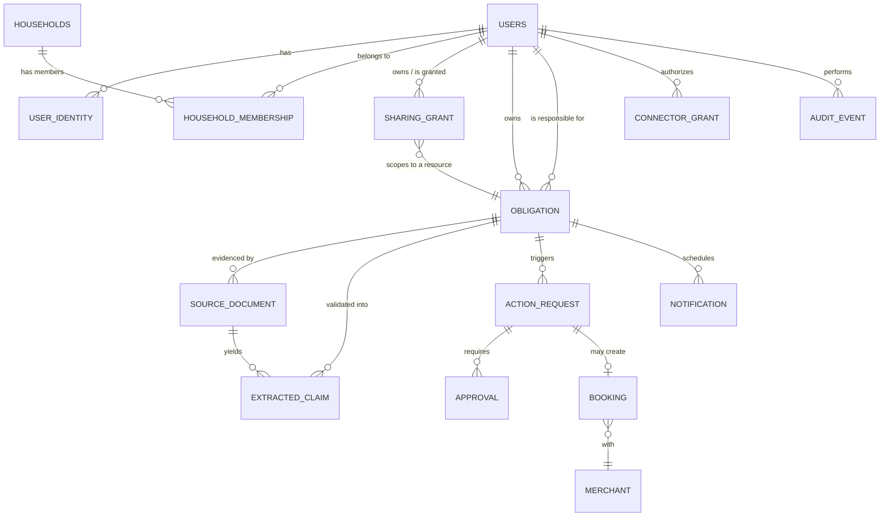

# Database Design — Draft for Team Review

| Field | Value |
|---|---|
| Status | Draft for team review; not an approved implementation specification |
| Version | 0.1 |
| Date | 12 November 2026 |
| Scope | Schema, database-type analysis, and provider recommendation for the prototype and its scale-up path |
| Inputs | [Business and Architecture Brief](../research/business-and-architecture-brief.md) §8.2–8.9, [Project Charter](../governance/project-charter.md) §3, §G2 |

This document turns the brief's logical core data model (§8.2) into a concrete relational schema, explains why a relational database is the right primary store for this product, and recommends a specific managed provider with a path to commercial scale. It is written to feed the 20 November design-approval gate (G2) and the 22 November proposal submission — it is not itself an approved decision.

## 1. Design constraints carried over from the brief

These are not re-derived here; they are binding inputs from the architecture brief and charter:

- **Relational database is the source of truth** (§8.2). Documents live in encrypted object storage; OCR text and search indexes are derived data with the same access controls. A vector index is never the authoritative ledger for payment or booking state.
- **Status states must stay distinct**: captured, confirmed obligation, action pending, user-reported completion, supporting evidence attached, externally verified completion, uncertain outcome (§5).
- **Authorization is server-enforced and resource-specific**, not household-wide (§8.3). Read, edit, completion-acknowledgement, and transact-authority are separate permissions.
- **Idempotency and atomic state transitions** are required for anything touching workflow/booking/payment state (§8.6).
- **Dates**: store precise instants (`timestamptz`) and local recurrence rules separately; default timezone `Asia/Bangkok`, but store it explicitly per user (§5).
- **Deletion must propagate** to source files, extracted text, indexes, and caches, and reach backups through an expiry mechanism (§8.9). This pushes toward soft-delete columns plus a documented hard-purge job, not a single `DELETE`.
- **Team capacity**: 3 people × 3–4 h/week. The schema and provider choice must not require dedicated ops headcount.

## 2. Entity-relationship diagram



## 3. Schema

All tables use `uuid` primary keys (`gen_random_uuid()`), `timestamptz` for every instant, and a `deleted_at timestamptz` soft-delete column where PDPA erasure applies. Money is `numeric(12,2)` plus an explicit `currency` column — never floating point.

### 3.1 Identity and household

```sql
create table users (
    id                  uuid primary key default gen_random_uuid(),
    display_name        text not null,
    locale              text not null default 'th-TH',
    timezone            text not null default 'Asia/Bangkok',
    notification_prefs  jsonb not null default '{}',   -- quiet hours, urgency, snooze defaults
    status              text not null default 'active' check (status in ('active','suspended','deleted')),
    created_at          timestamptz not null default now(),
    deleted_at          timestamptz
);

-- Separate from `users` so a second channel (web, future WhatsApp) doesn't
-- require a schema change — it only requires a new identity row.
create table user_identity (
    id                  uuid primary key default gen_random_uuid(),
    user_id             uuid not null references users(id),
    provider            text not null check (provider in ('line','web')),
    provider_user_id    text not null,
    verified_at         timestamptz,
    created_at          timestamptz not null default now(),
    unique (provider, provider_user_id)
);

create table households (
    id                  uuid primary key default gen_random_uuid(),
    name                text not null,
    created_by          uuid not null references users(id),
    created_at          timestamptz not null default now()
);

-- Membership only. Deliberately carries NO permission columns — §8.3
-- requires every access to route through sharing_grant instead.
create table household_membership (
    household_id        uuid not null references households(id),
    user_id              uuid not null references users(id),
    joined_at            timestamptz not null default now(),
    primary key (household_id, user_id)
);
```

### 3.2 Authorization

```sql
create table sharing_grant (
    id                  uuid primary key default gen_random_uuid(),
    resource_type       text not null check (resource_type in ('obligation','booking')),
    resource_id         uuid not null,              -- polymorphic FK, enforced in app layer + trigger
    owner_user_id        uuid not null references users(id),
    grantee_user_id       uuid not null references users(id),
    allowed_actions      text[] not null,            -- e.g. {'read','acknowledge_completion'}
    status               text not null default 'pending'
                             check (status in ('pending','accepted','revoked','expired')),
    created_at           timestamptz not null default now(),
    accepted_at          timestamptz,
    expires_at           timestamptz,
    revoked_at           timestamptz
);
create index on sharing_grant (grantee_user_id, status);
create index on sharing_grant (resource_type, resource_id);
```

Every read of a shared obligation joins through this table rather than through household membership — this is what makes "a family member sees a shared bill's status without the owner's financial history" (§8.3) a query-level guarantee instead of an application convention. See §4 for how this becomes a Postgres Row-Level Security policy.

### 3.3 Obligations and evidence

```sql
create table obligation (
    id                   uuid primary key default gen_random_uuid(),
    owner_user_id         uuid not null references users(id),
    responsible_user_id   uuid references users(id),   -- may differ from owner once a grant is accepted
    type                  text not null check (type in ('bill','rent','document_renewal','appointment','tax','other')),
    title                 text not null,
    amount                numeric(12,2),
    currency              text default 'THB',
    payee                 text,
    due_at                timestamptz,
    recurrence_rule       text,                         -- RFC 5545 RRULE string; instances derived, not stored
    status                text not null default 'captured'
                             check (status in (
                               'captured','confirmed','action_pending',
                               'user_reported_complete','evidence_attached',
                               'externally_verified','uncertain'
                             )),
    source_text           text,                         -- original forwarded message, retained per §8.4
    created_at            timestamptz not null default now(),
    updated_at            timestamptz not null default now(),
    deleted_at            timestamptz
);
create index on obligation (owner_user_id, status);
create index on obligation (due_at);

create table source_document (
    id                   uuid primary key default gen_random_uuid(),
    owner_user_id         uuid not null references users(id),
    obligation_id         uuid references obligation(id),
    object_storage_key    text not null,                -- pointer only; bytes live in object storage
    mime_type             text not null,
    retention_class       text not null default 'standard',
    extraction_version    text not null,
    uploaded_at           timestamptz not null default now(),
    deleted_at            timestamptz
);

create table extracted_claim (
    id                   uuid primary key default gen_random_uuid(),
    source_document_id    uuid not null references source_document(id),
    obligation_id         uuid references obligation(id),
    field_name            text not null,                -- 'amount' | 'due_date' | 'payee' | ...
    value_text            text not null,
    confidence            numeric(4,3) not null,
    source_location       jsonb,                        -- bounding box / char offsets for traceability
    validated             boolean not null default false,
    validated_at          timestamptz,
    validated_by          uuid references users(id)
);
create index on extracted_claim (obligation_id);
```

### 3.4 Actions, approvals, bookings

```sql
create table action_request (
    id                   uuid primary key default gen_random_uuid(),
    obligation_id         uuid references obligation(id),
    requested_by          uuid not null references users(id),
    operation_type         text not null,                -- 'pay_handoff' | 'book_slot' | 'cancel_booking' | ...
    parameters             jsonb not null,
    idempotency_key         text not null unique,          -- required per §8.6
    required_authority      text not null,
    status                  text not null default 'pending'
                               check (status in ('pending','approved','in_progress','succeeded','failed','uncertain','expired')),
    created_at              timestamptz not null default now(),
    updated_at              timestamptz not null default now()
);

create table approval (
    id                     uuid primary key default gen_random_uuid(),
    action_request_id       uuid not null references action_request(id),
    approver_user_id          uuid not null references users(id),
    action_version_ref        text not null,               -- hash of the exact offer/action approved
    constraints                jsonb not null default '{}', -- price ceiling, deposit, cancellation terms
    approved_at                timestamptz not null default now(),
    expires_at                 timestamptz not null,
    revoked_at                 timestamptz
);

create table merchant (
    id                     uuid primary key default gen_random_uuid(),
    name                    text not null,
    category                text not null,
    integration_type         text not null check (integration_type in ('direct_api','hosted_handoff','telephone','manual','line_oa_relay')),
    contact_info             jsonb
);

create table booking (
    id                      uuid primary key default gen_random_uuid(),
    obligation_id            uuid references obligation(id),
    merchant_id              uuid not null references merchant(id),
    action_request_id          uuid references action_request(id),
    offer                      jsonb not null,             -- bound merchant/branch/service/price/deposit/cancellation terms
    provider_reference          text,
    status                     text not null default 'requested'
                                  check (status in (
                                    'requested','checking_availability','offer_presented',
                                    'awaiting_approval','submitted','confirmed','rejected',
                                    'expired','uncertain','completed','changed','cancelled','refund_pending'
                                  )),
    confirmation_evidence         jsonb,
    created_at                   timestamptz not null default now(),
    updated_at                   timestamptz not null default now()
);
```

### 3.5 Connectors, notifications, audit

```sql
create table connector_grant (
    id                     uuid primary key default gen_random_uuid(),
    user_id                  uuid not null references users(id),
    provider                  text not null,               -- 'google_calendar' | 'line_pay' | ...
    scopes                    text[] not null,
    token_reference            text not null,               -- opaque reference into a secrets vault, never the token itself
    status                    text not null default 'active' check (status in ('active','revoked','expired')),
    created_at                timestamptz not null default now(),
    expires_at                 timestamptz,
    revoked_at                 timestamptz
);

create table notification (
    id                     uuid primary key default gen_random_uuid(),
    obligation_id            uuid references obligation(id),
    user_id                   uuid not null references users(id),
    scheduled_at              timestamptz not null,
    channel                   text not null default 'line',
    urgency                   text not null default 'normal',
    delivery_status            text not null default 'scheduled'
                                  check (delivery_status in ('scheduled','sent','failed','acknowledged')),
    attempts                   int not null default 0,
    acknowledged_at             timestamptz,
    created_at                  timestamptz not null default now()
) partition by range (scheduled_at);   -- monthly partitions; this table has the highest write/row-growth rate

create table audit_event (
    id                     uuid primary key default gen_random_uuid(),
    actor_user_id            uuid references users(id),
    event_type                text not null,
    resource_type              text not null,
    resource_id                uuid,
    decision                  text,                        -- 'allowed' | 'denied' | null for non-authz events
    metadata                   jsonb not null default '{}', -- kept minimal per §8.9
    created_at                  timestamptz not null default now()
) partition by range (created_at);     -- monthly partitions; append-only, short justified retention
```

## 4. Why relational, not document/NoSQL or vector-first

| Requirement from the brief | Relational (Postgres) | Document store (MongoDB/Firestore) | Vector-first (Pinecone/pgvector-only) |
|---|---|---|---|
| Server-enforced, resource-level sharing grants (§8.3) | Native FK + join + Row-Level Security — the access rule *is* a query, enforced by the engine, not app code | Possible but re-implemented by hand per query/collection; easy to leave a path unguarded | Not designed for authorization at all |
| Idempotent, atomic multi-table state transitions for approvals/bookings/payments (§8.6) | Multi-statement ACID transactions are the core feature | Multi-document transactions exist but are the exception path, not the default mental model | Not a transactional store |
| Distinct, enumerable status states that must never silently merge (§5) | `check` constraints make an invalid status a write-time error | Enforced only by application discipline | N/A |
| Money, approvals, audit — can't be lost or double-applied | Mature, battle-tested durability and constraint model | Durable, but weaker enforcement of invariants | N/A |
| Semi-structured fields (extracted claims, offers, metadata) | `jsonb` columns cover this inside the same engine | This is the storage model's strength | N/A |
| Small team, no dedicated DBA/SRE, prototype-first | One engine for everything, huge hiring/learning-material base, the three current members already know SQL from general app development | An additional engine with its own operational model to learn | An additional engine, and the brief explicitly rules it out as the ledger (§8.2, §8.6) |

**Conclusion: a single Postgres database is the primary store**, exactly as the brief already specifies (§8.2) — this document just makes it concrete. `jsonb` columns absorb the semi-structured parts (extracted-claim locations, booking offers, audit metadata) so a separate document database is not needed. If free-text semantic search over obligations/documents becomes a real feature later, add the `pgvector` extension to this same database rather than standing up a separate vector database — the brief is explicit that a vector index must never become the ledger, and co-locating it keeps that invariant trivial to enforce instead of needing cross-system reconciliation.

Object storage (not the relational DB) holds the actual document bytes (`source_document.object_storage_key` points at it); encrypted at rest, access-controlled, lifecycle-managed for retention per §8.9.

## 5. Row-Level Security maps directly onto §8.3

Postgres RLS turns the brief's authorization rules into policies the database itself enforces, instead of trusting every application code path to remember them:

```sql
alter table obligation enable row level security;

create policy obligation_owner_full_access on obligation
    using (owner_user_id = current_setting('app.current_user_id')::uuid);

create policy obligation_shared_read on obligation
    for select
    using (
        exists (
            select 1 from sharing_grant g
            where g.resource_type = 'obligation'
              and g.resource_id = obligation.id
              and g.grantee_user_id = current_setting('app.current_user_id')::uuid
              and g.status = 'accepted'
              and 'read' = any(g.allowed_actions)
        )
    );
```

This is the mechanism behind "revocation affects future access immediately" (§8.3): revoking a grant (`update sharing_grant set status='revoked'`) removes access on the very next query, with no cache or denormalized permission flag to invalidate separately.

## 6. Scalability analysis and provider recommendation

### 6.1 Workload shape

- **Volume now**: a synthetic-data, invited pilot cohort (per charter §"Prototype operation boundary") — low hundreds of users, thousands of obligations/notifications. Trivial for any managed Postgres tier.
- **Volume at commercial pilot** (brief §10): the ฿300k/month illustrative fixed-cost scenario implies a target around 4,800 paying users before profitability — still comfortably single-node Postgres territory (tens of thousands of rows per table, not millions).
- **Fastest-growing tables**: `notification` and `audit_event` — both are write-once, append-mostly, and time-ordered, which is why both are defined range-partitioned by month above. This is the standard Postgres answer to unbounded time-series growth and keeps indexes small without needing a separate time-series database.
- **Read pattern**: overwhelmingly point lookups by `user_id` ("my obligations", "my notifications") — index-friendly, not analytical/OLAP. No case yet for a columnar or NoSQL engine.

### 6.2 Database type recommendation

**PostgreSQL**, for the reasons in §4. It is also the only option that lets a 3-person, 9–12-hours/week team satisfy the brief's authorization, idempotency, and status-integrity requirements using engine features instead of hand-written enforcement code they would have to build and test themselves.

### 6.3 Provider recommendation

| Option | Fit for prototype (now → Apr 2027) | Fit for commercial scale (post-pilot) |
|---|---|---|
| **Supabase (Postgres)** — recommended for the prototype | Free/low-cost tier covers the pilot's load with no budget approval needed (charter §10 budget rows are currently "Unset"); built-in Auth can front LINE identity exchange; built-in Storage for `source_document` bytes in the same project; RLS is a first-class, UI-supported feature — directly matches §5 above; a Singapore region is selectable, helping the PDPA cross-border story in brief §7 | Scales vertically on the paid tiers (larger compute/storage, read replicas, point-in-time recovery) well past the 4,800-user commercial-pilot scenario before any migration is needed |
| **AWS RDS / Aurora PostgreSQL (ap-southeast-1, Singapore)** — recommended graduation target | Viable but adds IAM/VPC/networking setup the team doesn't need yet for a synthetic-data pilot | Same SQL dialect as Supabase (it *is* Postgres) — migration is `pg_dump`/`pg_restore`, not a rewrite. Aurora adds read replicas, multi-AZ failover, and finer-grained scaling knobs appropriate once there's paying-customer SLA pressure |
| Self-hosted Postgres (own VM/container) | Avoid for the prototype — adds backup, patching, and failover work the charter's QO role (already thinly staffed) would have to own alone | Avoid unless cost at very large scale justifies the added ops burden; the managed options above outscale the team's likely needs for years |
| MongoDB / Firestore | Not recommended — would require re-implementing the FK/RLS/ACID guarantees from §4 in application code | Same objection persists at scale; the problem isn't volume, it's the authorization and transactional-integrity model |
| Dedicated vector DB (Pinecone, etc.) | Not needed yet; no feature currently requires it | If semantic search is added later, prefer `pgvector` inside the same Postgres instance over a separate system (§4) |

**Recommendation: build on Supabase (hosted Postgres, Singapore region) for the prototype, with Aurora PostgreSQL in `ap-southeast-1` as the named graduation target if/when the product moves from evaluated prototype to a funded commercial pilot.** Both speak the same SQL dialect and the schema in §3 runs unmodified on either, so this is a deliberate build-up path, not a rewrite risk.

Before committing to a specific vendor, confirm its subprocessor list and data-transfer terms satisfy the PDPA cross-border requirements already flagged in brief §7 — this applies equally to Supabase and AWS, and is a compliance/legal decision (PS role, §4 of the charter), not just a technical one.

### 6.4 Scale-up path beyond the commercial pilot

In order of when they'd actually be needed, not pre-built now:

1. **Connection pooling** (Supavisor/PgBouncer, already bundled with Supabase) once concurrent connections from serverless/edge functions exceed Postgres's native connection limit.
2. **Read replicas** for the "upcoming obligations" / dashboard read paths once they start contending with write traffic.
3. **Partition pruning tuning** on `notification` and `audit_event` as months accumulate — already designed for in §3.5, just needs a scheduled job to create future partitions and drop/archive expired ones per the §8.9 retention schedule.
4. **Redis (or equivalent) cache** for session/rate-limiting state only — never for anything in §3's tables, which must remain the single source of truth per §8.2.
5. **Horizontal sharding (Citus, or a managed distributed-Postgres offering)** — only if a single large instance's vertical scaling is genuinely insufficient. Given the unit economics in brief §9 (a few thousand paying users), this is not expected to be reached within this project's funded horizon, and is flagged here only so the migration path isn't closed off by an early design choice (all tables use UUID keys and no sequence-based identity, which is what a later shard migration would require anyway).

## 7. Open items for the team before 20 November (G2)

- Confirm the Supabase vs. self-managed decision against the as-yet-"Unset" hosting budget line (charter §10).
- PS to confirm the selected provider/region satisfies PDPA cross-border requirements (brief §7) before this is treated as approved.
- TL to confirm `idempotency_key` generation strategy for `action_request` against the specific connectors chosen for the pilot's one booking category (brief §6).
- Confirm retention periods per data class so the partition-drop/archive job in §6.4 has concrete numbers rather than "short justified retention."
