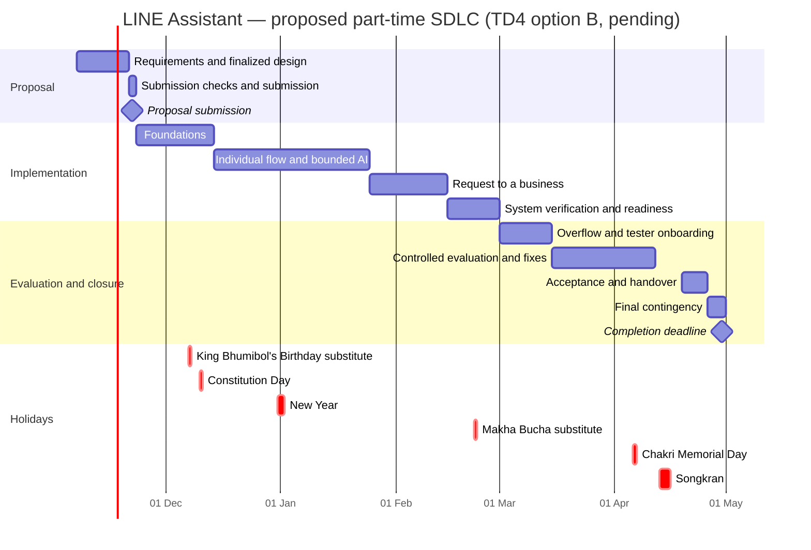

# Project Timeline and Development Phases

> **Revision notes (v0.3, 10 Nov 2026).** This version aligns omm's timeline with the combined direction in [`../combined/combined-proposal.md`](../combined/combined-proposal.md) (v0.2, §6.1–6.5) and with [Governance and Charter v0.3](../governance/project-charter.md). It starts from the 9 Nov review copy (`../review/revised/omm/timeline-and-development-phases.md`, v0.2), so the validator's fixes (capacity scenarios, holiday table, weekday corrections, proposal-window arithmetic) are kept.
>
> **Nothing here is approved.** The combined proposal's recommended options for team decisions TD1–TD6 (due Fri 13 Nov) are used as the working baseline and are marked **[TDn, pending]**.
>
> What changed from v0.2:
>
> 1. **Scope** (§1, §3): the obligations-only prototype with family sharing becomes the combined prototype: obligations plus requests to a business, with the user's tap as the only way anything is sent.
> 2. **Phases** (§5): P3 changes from "minimal family coordination" to "request to a business". P5 changes from 5–8 testers over six weeks to 15–20 testers over four weeks [TD4, pending]. P6 has no planned work.
> 3. **Work packages** (§6): W1–W7 (124–172 h, midpoint 148 h) are replaced by M1–M7 (111–157 h, midpoint 134 h), with a bottom-up estimate in the combined proposal §6.2. The phase allocation, capacity columns and scenario table are recomputed.
> 4. **Optional work** (§6): "conditional features, no hours" is replaced by costed Should and Could items.
> 5. **Dependencies and phase content** (§7, §8): family-sharing steps are replaced by handoff, venue-checking, shop-recruiting, ethics and LINE-plan steps.
> 6. **Forecast rule** (§9): Should items start only when the two-weekly forecast shows the hours; the cut order follows the combined proposal §6.5.
> 7. **Unchanged:** calendar facts, the 25% allowance, holiday table, scenarios A–C, SDLC choice, the proposal-window arithmetic and the 22 Nov deadline.

**Project:** Thailand LINE AI Personal Assistant (working name to be chosen; "TumHai" is a placeholder)  
**Version:** 0.3 — 10 November 2026; draft aligned to the combined proposal v0.2  
**Status:** Capacity-based SDLC proposal for team approval. Not approved  
**Timezone:** Asia/Bangkok  
**Proposal submission:** 22 November 2026  
**Project completion:** 30 April 2027 — confirmed  
**Available team:** Three app-development-capable members, each at 3–4 hours/week; 9–12 total team-hours/week  
**Scope status:** Combined direction adopted as the working baseline; scope decision D03 / TD6 due 13 November

Related files: [Meeting and Discussion](../meetings/2026-11-07-kickoff.md) (not yet updated to the combined scope), [Governance and Charter](../governance/project-charter.md), [combined proposal](../combined/combined-proposal.md), [SRS v0.9](../requirements/SRS-v0.9.md), [research and architecture brief](../research/business-and-architecture-brief.md).

## 1. Scheduling conclusion

The confirmed capacity supports a **small evaluated prototype**, not the full commercial product described in the research brief. The recommended April deliverable is a LINE assistant that turns a message into a tracked task and, for a business request, prepares the message so that one tap from the user sends it and then follows up until the outcome is known. It includes bounded AI interpretation, reminders, honest evidence-aware status, basic operational controls, and an evaluation with 15–20 testers and a handover package. Direct booking, partner APIs, phone calls, payments and a merchant side are not part of it.

The team must approve the completion definition and the feature baseline (decisions D01, D03, TD6). If a broader pilot with autonomous booking is mandatory, add substantial capacity or revise the scope. Do not assume AI coding tools eliminate design, verification, integration, review, or support work.

The full product architecture can remain a long-term reference. By 20 November, the **architecture and detailed core design of the submitted implementation scope** must be finalized. Any future architecture (the combined proposal §12) should be labeled as future scope rather than an April delivery promise.

## 2. Capacity and estimation basis

### Confirmed calendar

- **7 November 2026–30 April 2027:** 175 calendar days inclusive, or 25 weeks.
- **7–22 November:** 16-day proposal/design window (Saturday 7 Nov to Sunday 22 Nov).
- **23 November–25 April:** 22 complete delivery weeks (Monday 23 Nov to Sunday 25 Apr; each phase runs Monday to Sunday).
- **26–30 April:** five-day final contingency and closure window.

Weekly hours include meetings, reviews, documentation, learning, and development. Calendar windows do not require weekend work. Schedule actual sessions around the members' availability.

### Usable delivery capacity

Apply a provisional **25% allowance** for coordination, task switching, and availability variation. The remaining 75% is available for planned deliverables, including implementation, tests, documentation, and evaluation. Do not subtract test/documentation effort a second time; those are explicitly estimated in §6.

| Scenario | Hours/person/week | Team-hours/week | Gross hours over 22 weeks | Planned delivery hours after allowance |
|---|---:|---:|---:|---:|
| Lower availability | 3.0 | 9.0 | 198.0 | 148.5 |
| Planning midpoint | 3.5 | 10.5 | 231.0 | 173.25 |
| Higher availability | 4.0 | 12.0 | 264.0 | 198.0 |

**Formula:** members × weekly hours × weeks × 0.75.

The proposal window provides approximately **15.4–20.6 planned delivery hours**, after the same allowance, across the entire team. Keep the submission focused; a large specification or speculative prototype would consume time needed to finalize decisions.

**Remaining from 9 November (14 days, 2 weeks):** 9 × 2 × 0.75 = **13.5** to 12 × 2 × 0.75 = **18.0** usable team-hours (15.75 at the midpoint). The lean estimate in §4 is 15–21 hours and about 17–25 hours with the added items listed there. Either cut the package to fit (TD6 option A) or record an explicit, voluntary agreement to work extra hours this fortnight.

The final five-day reserve is approximately **4.8–6.4 usable team-hours** if availability is spread evenly over the week. Actual slots must be booked. It is a small contingency, not another full development iteration.

### Important assumptions

- Each member can sustain the stated hours; names, absence dates, and exact weekly slots are still unknown.
- All are familiar with app development, but security, AI evaluation, and LINE expertise are not assumed.
- Managed services can be used within an approved budget. Procurement and platform access must be checked early.
- A usable baseline does not depend on a merchant booking API, a partner API, full inbox access, live subscription billing, OCR, or the business answering our cards.
- The evaluation uses synthetic or low-sensitivity records with testers aged 20 or over (or married) and 3–5 friendly shops.
- The 25% allowance is not a statement about Thai public holidays. Record actual holiday, leave, exam, and work constraints on the team's calendar and reforecast.

### Holidays and exams (estimates)

| Holiday | Date | Phase | Source |
|---|---|---|---|
| King Bhumibol's Birthday (substitute day; the holiday itself is Sat 5 Dec) | Mon 7 Dec 2026 | P1 | [S] OfficeHolidays Thailand 2026, accessed 9 Nov 2026 |
| Constitution Day | Thu 10 Dec 2026 | P1 | [S] OfficeHolidays Thailand 2026, accessed 9 Nov 2026 |
| New Year's Eve / New Year | Thu 31 Dec 2026 – Fri 1 Jan 2027 | P2 | [S] Bank of Thailand list via Nation Thailand, accessed 9 Nov 2026 |
| Makha Bucha + substitute day | Sun 21 – Mon 22 Feb 2027 | P4 | [S] Time Out Bangkok; OfficeHolidays, accessed 9 Nov 2026 |
| Chakri Memorial Day | Tue 6 Apr 2027 | P5 | [S] Bank of Thailand list via Nation Thailand, accessed 9 Nov 2026 |
| Songkran | Tue 13 – Thu 15 Apr 2027 | **P6** | [S] Time Out Bangkok; OfficeHolidays, accessed 9 Nov 2026 |

University exam periods are **UNVERIFIED**. Record the real dates from the academic calendar by 13 November (action A11).

| Scenario | Effective weeks | Usable at 3.0 h | Usable at 3.5 h | Usable at 4.0 h |
|---|---:|---:|---:|---:|
| A — as planned above | 22 | 148.5 | 173.25 | 198.0 |
| B — New Year week and Songkran week at zero (assumes members are away over New Year; if they are free during the break, B understates capacity) | 20 | 135.0 | 157.5 | 180.0 |
| C — B plus two two-week exam periods at half capacity | 18 | 121.5 | 141.75 | 162.0 |

The combined proposal is **sized to scenario C at 3.5 h**: the Must list (midpoint 134 h) leaves a 7.75 h margin there (§6, §9). Treat scenario C as the planning case until the real calendar is recorded.

## 3. Recommended SDLC

Use **iterative development with formal phase gates**:

1. Resolve requirements and design before the proposal deadline.
2. Build small end-to-end increments, rather than complete all interfaces before connecting the system.
3. Test the approval gate, isolation, ambiguity, persistence, and failure behavior as each increment is built.
4. Freeze features before controlled evaluation.
5. Evaluate, fix, document, and hand over before the final deadline.

Alternatives considered:

| Approach | Trade-off | Selection |
|---|---|---|
| Fully sequential SDLC | Clear stage separation, but integration and user feedback arrive late | Not recommended for the limited capacity and external dependencies |
| Open-ended agile delivery | Flexible scope, but insufficient protection for fixed proposal/completion dates | Not recommended as the only governance model |
| Iterative SDLC with approval gates | Fixed design/submission milestones plus incremental implementation and evidence | Recommended |

This is a phase and governance plan. It is not a file-by-file implementation plan. Write detailed engineering tasks after the architecture, stack, and required behaviors are approved.

## 4. Proposal preparation: 7–22 November 2026

| Window | Work | Lead role | Exit evidence |
|---|---|---|---|
| 7–9 Nov (Sat–Mon) | Kickoff; confirm completion definition; assign three members; obtain rubric/cutoff; record availability | PD/SP | D01–D02, roster, submission instructions |
| 10–13 Nov (Tue–Fri) | Review the combined proposal and SRS v0.9; decide TD1–TD6; record exam dates and advisor checkpoints (A11); check the ethics process (A12); classify scope | PD/UX with all | G1 requirements baseline; TD1–TD6 recorded |
| 14–16 Nov (Sat–Mon) | Select stack and deployment (D05), AI provider and data terms (D06), integration approach and handoff fallback (D07) | TL/AI/PS | D05–D07 decisions with evidence |
| 17–18 Nov (Tue–Wed) | Complete flows, threat model (D08), approval-gate and lifecycle design, evaluation approach and thresholds E1–E14, effort, costs, and traceability; freeze decisions | All | D08–D10; no critical design choices left unresolved |
| 19–20 Nov (Thu–Fri) | Cross-review and correct the complete design/proposal package | SP/TL/QO/PS | G2 approved architecture/design and frozen submission package |
| 21 Nov (Sat) | Check required format, links, attachments, access, filename, and submission procedure | Submitter + backup | Submission-ready version |
| 22 Nov (Sun) | Submit before verified cutoff; preserve receipt | Submitter + backup | Accepted submission evidence |

**Submission falls on Sunday, 22 November.** Verify the actual cutoff, timezone, and portal access (action A01). Aim to have the package submission-ready on Friday 20 November; submit earlier if permitted. The 21 November checks are optional weekend work. Submission on 22 November is mandatory unless it was done earlier. Do not rely on a Sunday technical recovery window.

### Lean proposal effort estimate

| Package | Team delivery hours |
|---|---:|
| Scope, rubric, and completion definition | 2–3 |
| Requirements and complete core flows | 3–4 |
| Architecture, data, approval gate, and interfaces | 4–5 |
| AI feasibility, threat model, and verification strategy | 3–4 |
| Roles, estimates, costs, and timeline | 1–2 |
| Assembly, independent cross-review, and submission preparation | 2–3 |
| **Total** | **15–21** |

This is tight against the 15.4–20.6 available hours, and from 9 November only 13.5–18.0 remain (§2).

**Added proposal work (estimate).** The requirements specification belongs inside "Requirements and complete core flows". The test plan and traceability skeleton belong inside "AI feasibility, threat model, and verification strategy". Three tasks are separate: A11 (university calendar and advisor checkpoints), A12 (consent and ethics approach), and A13 (merging the three directions). Together they are about **2–4 team-hours**, so the lean estimate is about **17–25 hours** against **13.5–18.0 usable hours** from 9 November.

**Drafts already exist.** The combined proposal and SRS v0.9 were drafted on 9 November, so much of the writing is done. The remaining work is team review, decisions, corrections, and assembly. This revision does not reduce the 17–25 hour estimate, because the review time is real and untested. Re-estimate the remaining proposal work at A11 (13 Nov). Before 13 November, cut the proposal package (TD6 option A) or record an explicit, voluntary agreement to work extra hours.

Reuse the existing research and these governance documents. Prioritize finalized decisions and concise diagrams over document length. If the required rubric is larger, reduce speculative scope or explicitly agree extra time.

### What “finalized design” means

- The selected user (TD1), first request category (TD2), release scope, exclusions, and completion criteria are recorded.
- System boundaries, components, data model, identity, the approval gate, the task lifecycle and evidence levels, handoff adapters, deployment, and recovery approach are selected.
- The primary flows (obligation; request to a business with handoff and follow-up) include ambiguity, errors, confirmation, cancellation, Withdraw and expiry.
- AI behavior, allowed actions (the AI interprets; code decides), provider/data handling, and failure fallback are defined.
- External dependencies (LINE handoff, LINE plan and quota) have evidenced access or a chosen supported fallback.
- Acceptance thresholds E1–E14, evaluation dataset policy, test strategy, roles, capacity, and risks are approved.

The submitted scope cannot rely on “we will decide the architecture later.” Normal implementation detail can be left to the builders, and later material changes follow the charter's change-control process.

## 5. Phased implementation schedule

All dates are in 2026/2027 as shown. Phase end dates are calendar-window boundaries; complete reviews during available work sessions before those boundaries.

| Phase | Dates | Duration | Main deliverable | Primary owners | Gate / dependency |
|---|---|---|---|---|---|
| P0 — initiation, requirements, architecture/design | 7–22 Nov 2026 | 16 days | Approved design and submitted proposal | All; PD coordinates | G0–G2 and submission receipt |
| P1 — foundations | 23 Nov–13 Dec | 3 weeks | Signature-checked LINE webhook, event inbox, schema, job worker, deployment with separate development and pilot channels, alerts, handoff spike result | Member 2; Members 1/3 review and assist | G3; approved scope/stack and accounts |
| P2 — individual flow and bounded AI | 14 Dec–24 Jan 2027 | 6 weeks | Text capture, confirmation card with Confirm/Edit/Cancel, one-off reminders, snooze, evidence-aware completion, Thai test set and held-out run; ethics application filed | Members 1/2/3 | G4; durable records and event handling |
| P3 — request to a business | 25 Jan–14 Feb | 3 weeks | Request-card composer, approval bound to content, LINE handoff and copy adapters, "Did you send it?", follow-up, expiry and Withdraw jobs, router with 10–15 checked venues; friendly shops recruited | Members 1/2; Member 3 verifies the approval gate | G5 feature complete |
| P4 — system verification and evaluation readiness | 15–28 Feb | 2 weeks | Isolation and fault-injection tests, approval and Withdraw tests, privacy materials, retention jobs, restore exercise, tester recruiting and consent signing | Member 3 coordinates; all contribute | G6 before invited user access |
| P5 — controlled evaluation and fixes | 1 Mar–11 Apr | 6 weeks | **[TD4-B, pending]** 1–14 Mar overflow for P1–P4 and tester onboarding; evaluation 15 Mar–11 Apr (four weeks) with 3 moderated sessions and 15–25 real request cards; fixes; stabilization in the late part of the window | Member 1 coordinates; all contribute | G7 evaluation report |
| P6 — stabilization | 12–18 Apr | 1 week | **No work planned**: stabilization moves into late P5, before Songkran (13–15 Apr) [TD4-B] | — | No new features |
| P7 — acceptance and handover | 19–25 Apr | 1 week | Final demo, report, SRS v1.0, source/configuration docs, access handover, known limitations | All; SP accepts | G8 |
| P8 — final contingency and closure | 26–30 Apr | 5 days | Submission/acceptance corrections and closure evidence | Named owners | G9; final deadline 30 Apr |

Verification and documentation run throughout P1–P3. P4 is the final integrated readiness check, not the first testing phase. P5 includes time for controlled fixes, not a new feature backlog.

**If TD4 option A is chosen instead** (keep omm's plan: freeze 14 Feb, evaluate 1 Mar–11 Apr), the evaluation window is six weeks and Songkran falls inside P6 as in v0.2. **Option C** (evaluate 1–28 Mar, then two weeks of stabilization before Songkran) is described in the combined proposal §13. The gate table in the charter §8 follows whichever option is chosen: under option B, G6 moves to 14 Mar.



The chart uses the following day as a bar's exclusive end so it includes the final day listed in the table. The chart does not imply full-time work or work on every calendar day. P6 has no bar because no work is planned in it under option B.

## 6. Work packages and effort estimate

These estimates apply to the **Must scope**, not the full research vision. They are rough planning ranges before implementation experience; update after P1 and at each gate. The line-by-line estimate is in the combined proposal §6.2; the package contents are in the charter §3.

| Package | Scope | Low | High | Mid | Main phases |
|---|---|---:|---:|---:|---|
| M1 | Foundations: webhook with signature check and event inbox, schema, job worker, deployment with two channels, secrets, logs, alerts, handoff spike | 20 | 26 | 23 | P1; 3 h residual in P2 |
| M2 | Obligations and reminders: text capture, confirmation card with in-chat edit, Thai dates, one-off reminders, evidence levels | 16 | 21 | 18.5 | P2 |
| M3 | Bounded AI: classifier and fallback, Thai test set (100 + 20 ambiguous + 30 injection), harness with held-out split | 10 | 15 | 12.5 | P2 |
| M4 | Request to a business: composer and approval, handoff and copy adapters, follow-up/expiry/Withdraw jobs, router, 10–15 checked venues | 15 | 24 | 19.5 | P3 |
| M5 | Assurance: isolation and fault injection, approval and Withdraw tests, privacy, retention, delete script, restore, evaluation fixes | 19 | 27 | 23 | P4; fixes in P5 |
| M6 | Evaluation: ethics and consent incl. businesses, recruiting 15–20 testers and 3–5 shops, 3 sessions, support, analysis, Abdul table | 19 | 28 | 23.5 | P1–P4 (paperwork, recruiting); P5 |
| M7 | Documentation: report, demo, handover; design docs kept current | 12 | 16 | 14 | P2, P5; finalized P7 |
| **Must total** | | **111** | **157** | **134** | |

Package hours include ordinary author-level tests and documentation; M5 covers additional cross-system, approval-gate, security and recovery assurance, and M7 covers consolidated handover and reporting. Avoid counting the same work twice. These are estimates, not fixed promises.

At 10.5 gross hours/week, each three-week window provides approximately 23.6 delivery hours; each six-week window provides approximately 47.3 hours. The high ends of packages can exceed those windows. Move preparatory work forward where dependencies allow, use unallocated headroom, and narrow scope when the forecast no longer fits.

### Balanced contribution by phase at the 134-hour midpoint

Ownership does not mean one member implements an entire package alone. The three app developers share implementation and verification under the named owner. The per-member columns below are an equal split of the team allocation by construction, not a measured forecast. Capacity is for scenario B at 3.5 h (the combined proposal §6.4) and scenario B at 3.0 h (derived; estimate).

| Phase | Work placed (midpoint) | Per member | Team allocation | Capacity B, 3.5 h | Capacity B, 3.0 h |
|---|---|---:|---:|---:|---:|
| P1 | M1 (20); M6 consent pack draft (2) | 7.3 | 22.0 | 23.625 | 20.25 |
| P2 | M1 rest (3); M2 (18.5); M3 (12.5); M6 ethics application incl. businesses (2); M7 (1) | 12.3 | 37.0 | 39.375 | 33.75 |
| P3 | M4 incl. checking 10–15 venues (19.5); M6 recruiting friendly shops (1.5) | 7.0 | 21.0 | 23.625 | 20.25 |
| P4 | M5 (13); M6 tester recruiting and consent signing (2) | 5.0 | 15.0 | 15.750 | 13.50 |
| P5 | M5 fixes and regression (10); M6 sessions, support, analysis, Abdul table (16); M7 (5.5) | 10.5 | 31.5 | 47.250 | 40.50 |
| P6 | none planned (stabilization moved into late P5) | 0 | 0 | 0 (Songkran) | 0 |
| P7 | M7 handover completion (7.5) | 2.5 | 7.5 | 7.875 | 6.75 |
| **Total delivery hours** | | **44.7** | **134.0** | **157.500** | **135.000** |

*Footnote to the P6 row:* scenario B conservatively counts the whole Songkran week (12–18 Apr) as zero; in practice about two working days (Mon 12 and Fri 16 Apr) remain.

**What the table shows (estimates).**

- **P1–P4 need 95 h** against 102.4 h at 3.5 h (7.4 h of margin) and against 87.75 h at 3.0 h (**7.25 h short**). P2 is the tightest phase because the New Year week is removed.
- **P5 has about 15.75 h spare at 3.5 h**. That slack can absorb an exam fortnight that falls in P5 or P7, but it cannot rescue a missed earlier prerequisite. If exams fall in P1–P4, the 1–14 March overflow period (TD4-B) and the cut order in §9 apply.
- Proposal work and the 25% coordination/availability allowance are separate from these hours.

**Planning basis.** This allocation is scenario B. Rebaseline it to the real calendar at A11 (13 Nov). Until then, check especially whether university exams overlap the proposal window (now to 22 Nov) or P7–P8 (19–30 Apr); first-semester and second-semester finals at many Thai universities may fall in those periods (UNVERIFIED).

### Work-package placement and assurance split

M5 totals 23 h at the midpoint: **13 h** of pre-evaluation assurance in P4 (isolation, fault injection, approval and Withdraw tests, privacy and retention, delete script, restore) and **10 h** reserved for fixes and regression found during evaluation in P5. Author-level tests inside M1–M4 are additional to this. The later allocation must never conceal unfinished isolation, approval-gate, deletion, privacy, or recovery prerequisites. If required readiness evidence cannot be completed in the allocated early hours, narrow scope or delay external evaluation and record the consequence.

Daily implementation notes are included in M1–M4; M7 covers consolidated reports and handover. Final documentation is not expected to be written from scratch in the last week.

### Should and Could items: costed, started only on the forecast

Optional work is no longer "no hours committed". Each item below is costed, but none is in the commitment. Start Should items in the TD3 order only when the two-weekly forecast shows the hours (§9). Do not spend the final closure reserve on new features.

| Item | What | Low | High | Mid | Note |
|---|---|---:|---:|---:|---|
| S0 | Reply page for businesses (with security rules and link-preview test) | 9 | 12 | 10.5 | Promoted to Must if the recorded calendar is scenario B or better at 3.5 h (Must + S0 = 144.5 h) [TD6] |
| S3 | Recurrence: monthly, then weekly and daily | 3 | 5 | 4 | Needed for monthly rent and utility bills |
| S4 | "Upcoming in the next N days" list | 1 | 2 | 1.5 | |
| S1 | Share one item with one invited person | 12 | 18 | 15 | Keeps the family-coordination direction in a minimal form |
| S2 | Operator console for phone-only shops | 6 | 10 | 8 | Every human step logged and timed |
| **All Should** | | **31** | **47** | **39** | Must + all Should = 173 h |
| C1–C6 | Photo of one bill format, bill split QR, `.ics` file, share-picker adapter, LIFF pages, second model | 28 | 42 | 35 | Only after all Should items |

## 7. Critical dependencies and decision deadlines

```text
Submission requirements + actual availability
  -> TD1–TD6 decided; approved requirements and scope
  -> selected architecture, approval gate, providers, and fallback
  -> approved design/proposal
  -> LINE webhook, job worker, persistent records (+ handoff spike)
  -> individual obligation workflow + Thai test set
  -> request to a business: handoff, follow-up, Withdraw
  -> evaluation readiness (isolation, approval tests, consent, testers and shops)
  -> controlled evaluation and fixes
  -> acceptance, report, and handover
```

| Dependency | Needed by | Owner | Fallback / response |
|---|---|---|---|
| Proposal rubric, cutoff, and recipient | 9 Nov (verify now) | Member 1 / PD | Escalate to recipient; do not guess required artifacts |
| Member names, roles, and weekly slots | 9 Nov (verify now) | All | Use the confirmed 3-hour lower bound for commitments; the phase allocation in §6 is at 3.5 h and must be rebaselined to 3.0 h or the commitment basis stated explicitly |
| University calendar: exam periods, advisor checkpoints, course milestones (A11) | 13 Nov | PD | Plan with scenario C (§2) until known; decides whether S0 is promoted (TD6) |
| TD1–TD6 decisions | 13 Nov | SP/PD | Use the recommended options in the combined proposal §13 and record that they were defaults |
| Ethics approval process for human participants, including businesses as third-party data subjects (A12) | Check by 13 Nov; file in P2; approved before G6 | PS with Member 1 | Use synthetic sessions until approved; pause recruitment |
| Test plan and traceability skeleton | 20 Nov | QO | Required for G2 |
| LINE account/channel and deployment feasibility | 16 Nov for design; available by 23 Nov for build | Member 2 | Resolve access before committing; local simulation is an explicitly declared limitation, not equivalent acceptance |
| AI provider and data terms (zero retention, no training, PDPA transfer basis) | 16 Nov | Member 3 with PS/TL | Confirmed structured input remains the non-AI fallback; AI capability changes require a scope decision |
| LINE handoff spike: `oaMessage` and the share picker on testers' phones | P1 (by 13 Dec) | Member 2 | Copy-and-send fallback; the share-picker adapter stays Could |
| Venue table: 10–15 hand-checked venues in the chosen category | P3 (by 14 Feb) | Member 1 | Cut to 10 venues (cut order, §9); no Google Places or Wongnai content copied |
| Friendly shops (3–5) recruited | P3 | Member 1 | Rely on shops that the testers choose and that have a LINE ID, and disclose the limit |
| Tester recruiting (15–20 testers aged 20 or over) and consent signed | P3–P4; before G6 | Member 1 | Narrow to staff and graduate students (TD1 option C); report the actual sample |
| LINE plan decision and funding (TD5) | 13 Nov decision; paid plan active before evaluation | SP | Free plan with a daily digest and a per-tester push cap |
| Final UX, data, recovery, and evaluation choices | 18 Nov | All | Resolve or remove affected scope before 20 Nov approval |
| Evaluation readiness | 28 Feb (14 Mar under TD4-B) | SP with QO/PS checks | No external access until safe; use internal synthetic evaluation and record schedule impact |
| Final recipient/acceptance instructions | 31 Mar | Member 1 | Obtain clarification before handover week |

## 8. What each phase must demonstrate

### P1: foundations

A LINE webhook with a valid signature creates an event record; forged or replayed events are rejected or handled once. The job worker runs a test job. The team can deploy to separate development and pilot channels, see an alert fire, and restore a basic backup. Secrets are outside the repository. The handoff spike reports whether `oaMessage` and the share picker reach a shop's chat on testers' phones.

### P2: individual workflow

A user sends text, sees a confirmation card with the interpreted fields, and can Confirm, Edit one field at a time, or Cancel. A confirmed obligation produces a one-off reminder with snooze, done and quiet hours. Completion records an evidence level. AI proposes structured values within defined bounds; it cannot grant permission, send anything, or invent completion. Existing reminders run if model processing fails. The Thai test set is run against the thresholds recorded in advance. The ethics application is filed.

### P3: request to a business

A user drafts a request, sees the exact message, and confirms with a tap. The assistant hands it off through LINE (or copy-and-send), asks "Did you send it?", follows up, expires or records the answer, and sets a reminder for the agreed time. The user can Withdraw within the ten-minute window while it is unanswered. Status shows sent, answered or done only with matching evidence. The router uses the venue table of 10–15 checked venues. No message reaches a business without the user's own tap.

### P4: readiness

The team tests cross-user isolation, forged and replayed webhooks, expired, reused and edited approvals, Withdraw inside and after the window, ambiguous dates, model outages, retention jobs, export and delete, and backup restoration. Complete the charter's agreed acceptance evidence. Testers and shops are recruited, consent is signed, and the evaluation has named support windows and a stop procedure.

### P5: evaluation

Use **15–20 testers** aged 20 or over (or married), with synthetic or low-sensitivity tasks, subject to team capacity and consent. Run **3 moderated sessions** and observe **four weeks** of unmoderated use [TD4-B], collecting **15–25 real request cards**. Record corrections, completion errors, answer rates by route, push counts, costs, and defects. Report every rate with a 95% confidence interval and treat the results as indicative.

This is not a paid market-validation pilot. It cannot establish representative market demand, paid retention, or commercial readiness; willingness to pay is a stated-preference survey. If recruitment or safety readiness is delayed, report the actual sample and observation duration rather than claiming a completed four-week trial.

### P6–P8: stabilization and closure

Fix accepted defects; freeze features; complete documentation, demonstration, and final report; baseline SRS v1.0; obtain acceptance; transfer or close access safely. Preserve known limitations and deferred work (the combined proposal §12). Resolve final submission issues within the five-day reserve.

## 9. Forecasting, contingency, and scope control

### Check the forecast every two weeks

Track hours used, completed deliverables, unresolved risks, and estimated hours remaining. Recalculate remaining capacity from actual individual availability rather than relying on original averages. Compare actual hours per line item with the estimate at the end of P1.

Use these proposed triggers:

- If remaining estimated work exceeds usable remaining capacity, start no Should or Could item and rebaseline.
- Start a Should item only when the forecast shows its hours, in the TD3 order.
- If the calendar recorded at A11 is scenario B or better at 3.5 h, promote S0 to Must automatically [TD6].
- If a critical dependency is blocked for more than one available work session, PD/TL choose a fallback or escalate.
- If a phase is forecast to slip by more than one week, SP approves an explicit scope/date/resource response.
- If any mandatory security or privacy criterion fails, fix or disable the affected capability before evaluation. Do not trade it away for an on-time demo.
- After feature complete (G5, 14 Feb), new features require removing equivalent work and updating the acceptance baseline. The 1–14 March overflow under TD4-B is for finishing P1–P4 work, not for new features. After 11 April, accept only defect fixes and closure work.

### Cut order if the forecast slips

Never weaken authorization, privacy, retention or evidence rules. Cut in this order (the combined proposal §6.5):

1. No Should or Could item is started.
2. Venue table drops to 10 venues; request cards to about 15 (the minimum of 15 testers stays).
3. Moderated sessions drop from 3 to 2, plus a written remote task script.
4. The copy fallback shows text only (no phone path).
5. If more is needed, the sponsor revises scope explicitly through change control. Nobody assumes overtime.

### Capacity scenarios

Margin is usable capacity minus the Must midpoint of 134 h (estimates).

| Hours/person/week | A (22 weeks) | B (holiday weeks removed) | C (holidays and exams) |
|---|---:|---:|---:|
| 3.0 | +14.5 | +1.0 | −12.5 |
| **3.5** | +39.25 | +23.5 | **+7.75** |
| 4.0 | +64.0 | +46.0 | +28.0 |

| Actual pattern | Response |
|---|---|
| All members sustain 4 hours/week | Preserve headroom for uncertainty; start Should items in the TD3 order only after the forecast shows the hours |
| Members average 3.5 hours/week | The Must midpoint fits all scenarios, with 7.75 h of margin in scenario C and none at the 157 h high estimate (−15.25 in scenario C). S0 fits in scenarios A and B (Must + S0 = 144.5 h) but not in C (−2.75) |
| Members average 3 hours/week | Plan to the low end of the Must range and apply the cut order from the start. In scenario C only the low estimate fits (121.5 − 111 = +10.5) |
| Capacity drops below 9 team-hours/week | Re-estimate immediately; reconsider the evaluation scale without weakening approval-gate, isolation or privacy controls |
| Team requires the broad commercial vision by April | Increase funded capacity materially and produce a new plan; the current schedule does not support it |

### No hidden overtime assumption

Equal contribution means each member's total work stays within their agreed hours. Integration, review, debugging, research, and documentation count. Additional work must be volunteered and explicitly reflected in the forecast, not assumed because a deadline is near.

## 10. Approval and baseline maintenance

Before this timeline becomes a commitment:

- [ ] Team approves the evaluated-prototype completion definition.
- [ ] Names, roles, weekly slots, and absences are recorded.
- [ ] TD1–TD6 are decided and recorded in the charter §6.
- [ ] Must, Should and Could items and the Won't list are finalized, including whether the tax-document checklist (earlier F09) is dropped.
- [ ] Architecture and design are approved by 20 November.
- [ ] Acceptance thresholds E1–E14 and evaluation boundaries are fixed.
- [ ] Hours and costs are re-estimated using the selected stack and actual access.
- [ ] Submission/acceptance instructions and responsible people are verified.
- [ ] University exam periods and holidays are recorded and the phase plan rebaselined (A11).
- [ ] The evaluation window under TD4 is chosen, and the charter's gate dates are updated to match.
- [ ] LINE plan funding (TD5) is decided and the owner named.

| Baseline | Approved by | Date | Scope / capacity note |
|---|---|---|---|
| Proposed v0.1 | Not yet approved | 7 Nov 2026 | Three members × 3–4 hours/week; 30 Apr deadline confirmed |
| Review copy v0.2 | Not yet approved | 9 Nov 2026 | Validator corrections; holiday/exam scenarios added |
| Draft v0.3 | Not yet approved | 10 Nov 2026 | Aligned to the combined proposal v0.2: Must 111–157 h (midpoint 134 h), fits scenario C at 3.5 h with 7.75 h margin |
| Approved v1.0 | ______ | ______ | ______ |

PD maintains the dates and forecast; TL owns technical dependency estimates; each member reports their real availability. Update this timeline together with the charter when an approved decision changes the plan.
