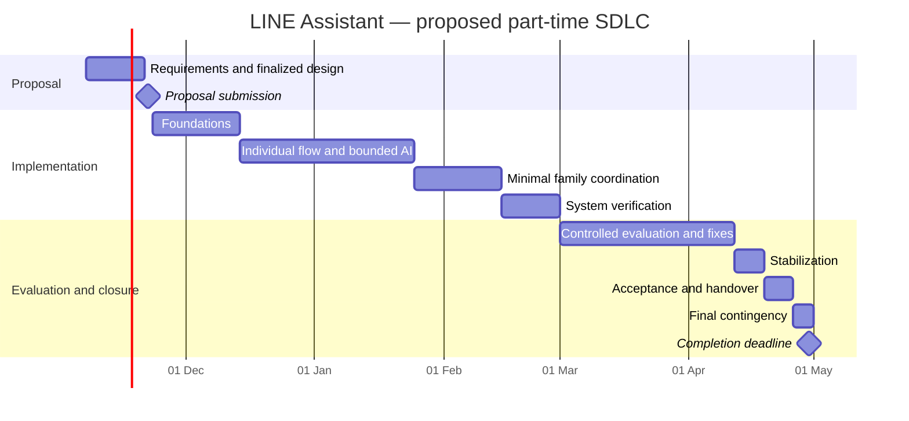

# Project Timeline and Development Phases

**Project:** Thailand LINE AI Personal Assistant  
**Version:** 0.1 — 7 November 2026  
**Status:** Capacity-based SDLC proposal for team approval  
**Timezone:** Asia/Bangkok  
**Proposal submission:** 22 November 2026  
**Project completion:** 30 April 2027 — confirmed  
**Available team:** Three app-development-capable members, each at 3–4 hours/week; 9–12 total team-hours/week

Related files: [Meeting and Discussion](../meetings/2026-11-07-kickoff.md), [Governance and Charter](../governance/project-charter.md), [research and architecture brief](../research/business-and-architecture-brief.md).

## 1. Scheduling conclusion

The confirmed capacity supports a **small evaluated prototype**, not the full commercial product described in the research brief. The recommended April deliverable includes a working individual LINE flow, bounded AI assistance, reminders, evidence-aware status, minimal selective family sharing, basic operational controls, and an evaluation/handover package.

The team must approve the completion definition and feature baseline. If a broader pilot with document extraction and autonomous booking is mandatory, add substantial capacity or revise the scope. Do not assume AI coding tools eliminate design, verification, integration, review, or support work.

The full product architecture can remain a long-term reference. By 20 November, the **architecture and detailed core design of the submitted implementation scope** must be finalized. Any future commercial architecture should be clearly labeled as future scope rather than an April delivery promise.

## 2. Capacity and estimation basis

### Confirmed calendar

- **7 November 2026–30 April 2027:** 175 calendar days inclusive, or 25 weeks.
- **7–22 November:** 16-day proposal/design window.
- **23 November–25 April:** 22 complete delivery weeks.
- **26–30 April:** five-day final contingency and closure window.

Weekly hours include meetings, reviews, documentation, learning, and development. Calendar windows do not require weekend work. Schedule actual sessions around the members' availability.

### Usable delivery capacity

Apply a provisional **25% allowance** for coordination, task switching, and availability variation. The remaining 75% is available for planned deliverables, including implementation, tests, documentation, and evaluation. Do not subtract test/documentation effort a second time; those are explicitly estimated below.

| Scenario | Hours/person/week | Team-hours/week | Gross hours over 22 weeks | Planned delivery hours after allowance |
|---|---:|---:|---:|---:|
| Lower availability | 3.0 | 9.0 | 198.0 | 148.5 |
| Planning midpoint | 3.5 | 10.5 | 231.0 | 173.25 |
| Higher availability | 4.0 | 12.0 | 264.0 | 198.0 |

**Formula:** members × weekly hours × weeks × 0.75.

The proposal window provides approximately **15.4–20.6 planned delivery hours**, after the same allowance, across the entire team. Keep the submission focused; a large specification or speculative prototype would consume time needed to finalize decisions.

The final five-day reserve is approximately **4.8–6.4 usable team-hours** if availability is spread evenly over the week. Actual slots must be booked. It is a small contingency, not another full development iteration.

At the midpoint, the estimated work-package midpoint of **148 hours** leaves **25.25 hours of unallocated delivery headroom** through 25 April, in addition to the separately reserved final five days. At the lower availability level, the same 148-hour workload leaves almost no headroom; favor the lower end of scope and estimates.

### Important assumptions

- Each member can sustain the stated hours; names, absence dates, and exact weekly slots are still unknown.
- All are familiar with app development, but security, AI evaluation, and LINE expertise are not assumed.
- Managed services can be used within an approved budget. Procurement and platform access must be checked early.
- A usable baseline does not depend on a merchant booking API, full inbox access, live subscription billing, or OCR.
- The evaluation uses synthetic or low-sensitivity records with a small invited adult cohort.
- The 25% allowance is not a statement about Thai public holidays. Record actual holiday, leave, exam, and work constraints on the team's calendar and reforecast.

## 3. Recommended SDLC

Use **iterative development with formal phase gates**:

1. Resolve requirements and design before the proposal deadline.
2. Build small end-to-end increments, rather than complete all interfaces before connecting the system.
3. Test permissions, ambiguity, persistence, and failure behavior as each increment is built.
4. Freeze features before controlled evaluation.
5. Evaluate, fix, document, and hand over before the final deadline.

Alternatives considered:

| Approach | Trade-off | Selection |
|---|---|---|
| Fully sequential SDLC | Clear stage separation, but integration and user feedback arrive late | Not recommended for the limited capacity and external dependencies |
| Open-ended agile delivery | Flexible scope, but insufficient protection for fixed proposal/completion dates | Not recommended as the only governance model |
| Iterative SDLC with approval gates | Fixed design/submission milestones plus incremental implementation and evidence | Recommended |

This is a phase and governance plan. It is not a file-by-file implementation plan. Write detailed engineering tasks after the architecture, stack, and required behaviors are approved.

## 4. Proposal preparation: 7–22 November 2026

| Window | Work | Lead role | Exit evidence |
|---|---|---|---|
| 7–9 Nov | Kickoff; confirm completion definition; assign three members; obtain rubric/cutoff; record availability | PD/SP | D01–D02, roster, submission instructions |
| 10–13 Nov | Select initial user and core journeys; bounded research; classify scope; write requirements and acceptance criteria | PD/UX with all | G1 requirements baseline |
| 14–16 Nov | Select architecture, storage/workflow approach, AI provider, sharing model, and integration fallback | TL/AI/PS | D04–D07 decisions with evidence |
| 17–18 Nov | Complete flows, threat model, evaluation approach, effort, costs, and traceability; freeze decisions | All | D08–D10; no critical design choices left unresolved |
| 19–20 Nov | Cross-review and correct the complete design/proposal package | SP/TL/QO/PS | G2 approved architecture/design and frozen submission package |
| 21 Nov | Check required format, links, attachments, access, filename, and submission procedure | Submitter + backup | Submission-ready version |
| 22 Nov | Submit before verified cutoff; preserve receipt | Submitter + backup | Accepted submission evidence |

**Submission falls on Sunday, 22 November.** Verify the actual cutoff, timezone, and portal access by 9 November. Aim to have the package ready on 20 November; submit earlier if permitted. Do not rely on a Sunday technical recovery window.

### Lean proposal effort estimate

| Package | Team delivery hours |
|---|---:|
| Scope, rubric, and completion definition | 2–3 |
| Requirements and complete core flows | 3–4 |
| Architecture, data, permissions, and interfaces | 4–5 |
| AI feasibility, threat model, and verification strategy | 3–4 |
| Roles, estimates, costs, and timeline | 1–2 |
| Assembly, independent cross-review, and submission preparation | 2–3 |
| **Total** | **15–21** |

This is tight against the 15.4–20.6 available hours. Reuse the existing research and these governance documents. Prioritize finalized decisions and concise diagrams over document length. If the required rubric is larger, reduce speculative scope or explicitly agree extra time.

### What “finalized design” means

- The selected user, release scope, exclusions, and completion criteria are recorded.
- System boundaries, components, data model, identity, family permissions, deployment, and recovery approach are selected.
- The primary flows include ambiguity, errors, confirmation, cancellation, and revocation.
- AI behavior, allowed actions, provider/data handling, and failure fallback are defined.
- External dependencies have evidenced access or a chosen supported fallback.
- Acceptance thresholds, evaluation dataset policy, test strategy, roles, capacity, and risks are approved.

The submitted scope cannot rely on “we will decide the architecture later.” Normal implementation detail can be left to the builders, and later material changes follow the charter's change-control process.

## 5. Phased implementation schedule

All dates are in 2026/2027 as shown. Phase end dates are calendar-window boundaries; complete reviews during available work sessions before those boundaries.

| Phase | Dates | Duration | Main deliverable | Primary owners | Gate / dependency |
|---|---|---|---|---|---|
| P0 — initiation, requirements, architecture/design | 7–22 Nov 2026 | 16 days | Approved design and submitted proposal | All; PD coordinates | G0–G2 and submission receipt |
| P1 — foundations and first persisted flow | 23 Nov–13 Dec | 3 weeks | Verified LINE input, private identity, persisted record, repeatable deployment, basic monitoring | Member 2; Members 1/3 review and assist | G3; approved scope/stack and accounts |
| P2 — individual flow and bounded AI | 14 Dec–24 Jan 2027 | 6 weeks | Text capture, confirmed dates, reminders, snooze, evidence-aware completion, basic upcoming view | Members 1/2/3 | G4; durable records and authorization foundation |
| P3 — minimal family coordination | 25 Jan–14 Feb | 3 weeks | Accepted invitation, item-specific sharing, responsibility/status, revocation | Members 1/2; Member 3 verifies isolation | G5 feature complete |
| P4 — system verification and evaluation readiness | 15–28 Feb | 2 weeks | Integrated failure/security tests, restore exercise, privacy materials, evaluated release candidate | Member 3 coordinates; all contribute | G6 before invited user access |
| P5 — controlled evaluation and fixes | 1 Mar–11 Apr | 6 weeks | Supervised sessions/limited observation, issue fixes, usage/error/cost evidence | Member 1 coordinates; all contribute | G7 evaluation report |
| P6 — stabilization | 12–18 Apr | 1 week | Remaining accepted defects resolved; release candidate frozen | All | No new features |
| P7 — acceptance and handover | 19–25 Apr | 1 week | Final demo, report, source/configuration docs, access handover, known limitations | All; SP accepts | G8 |
| P8 — final contingency and closure | 26–30 Apr | 5 days | Submission/acceptance corrections and closure evidence | Named owners | G9; final deadline 30 Apr |

Verification and documentation run throughout P1–P3. P4 is the final integrated readiness check, not the first testing phase. P5 includes time for controlled fixes, not a new feature backlog.



The chart uses the following day as a bar's exclusive end so it includes the final day listed in the table. The chart does not imply full-time work or work on every calendar day.

## 6. Work packages and effort estimate

These estimates apply to the **reduced prototype**, not the full research vision. They are rough planning ranges before implementation experience; update after P1 and at each gate.

| Package | Scope | Estimated team hours | Main phases |
|---|---|---:|---|
| W1 | LINE identity/input, persisted records, deployment, basic logs/configuration | 20–28 | P1; small residual work in P2 |
| W2 | Text-first obligations, bounded recurrence, reminder queue, snooze/completion, upcoming view | 26–36 | P2 |
| W3 | Bounded AI interpretation, source grounding, confirmation, small Thai evaluation set | 12–18 | P2; evaluation updates later |
| W4 | Minimal family invitation/sharing, responsibility, revocation, and interface | 18–24 | P3 |
| W5 | Access/failure tests, privacy/export/deletion, audit, recovery and operational assurance | 24–32 | P1–P4, fixes in P5 |
| W6 | Small invited evaluation, sessions, triage, corrections, evidence summary | 12–18 | P5 |
| W7 | Ongoing technical/user documentation, final report, demonstration, handover | 12–16 | All phases; finalized P6–P7 |
| **Total** | **Required prototype only** | **124–172** | **Midpoint: 148 hours** |

Implementation package hours include ordinary author-level tests and documentation; W5 covers additional cross-system/security/recovery assurance, and W7 covers consolidated handover/reporting. Avoid counting the same work twice.

At 10.5 gross hours/week, each three-week window provides approximately 23.6 delivery hours; each six-week window provides approximately 47.3 hours. The high ends of packages can exceed those windows. Move preparatory work forward where dependencies allow, use unallocated headroom, and narrow scope when the forecast no longer fits. Do not convert package ranges into fixed promises.

### Balanced contribution by phase at the 148-hour midpoint

Ownership does not mean one member implements an entire package alone. The three app developers share implementation and verification under the named owner. This phase allocation fits each member's midpoint capacity, rather than balancing only the final totals.

| Phase | Member 1 | Member 2 | Member 3 | Team allocation | Team capacity at 3.5 hours/person/week |
|---|---:|---:|---:|---:|---:|
| P1 | 7.8 | 7.8 | 7.8 | 23.4 | 23.625 |
| P2 | 15.6 | 15.6 | 15.6 | 46.8 | 47.250 |
| P3 | 7.6 | 7.6 | 7.6 | 22.8 | 23.625 |
| P4 | 5.2 | 5.2 | 5.2 | 15.6 | 15.750 |
| P5 | 8.0 | 8.0 | 8.0 | 24.0 | 47.250 |
| P6 | 2.6 | 2.6 | 2.6 | 7.8 | 7.875 |
| P7 | 2.5 | 2.5 | 2.6 | 7.6 | 7.875 |
| **Total delivery hours** | **49.3** | **49.3** | **49.4** | **148.0** | **173.250** |

The decimals reconcile the planning arithmetic; they are not precision forecasts or timesheet commitments. Most spare capacity falls during evaluation, so it cannot rescue an earlier missed prerequisite. P1–P4 are tight at the midpoint and require rebaselining if members average only three hours. Proposal work and the 25% coordination/availability allowance are separate.

### Work-package placement and assurance split

| Phase | Placement of midpoint package hours | Total |
|---|---|---:|
| P1 | W1 foundations: 23.4 | 23.4 |
| P2 | W1 residual configuration/documentation: 0.6; W2: 31; W3: 15; W7: 0.2 | 46.8 |
| P3 | W4: 21; W5 additional assurance: 1.8 | 22.8 |
| P4 | W5 additional assurance: 12.2; W7 readiness/runbook documentation: 3.4 | 15.6 |
| P5 | W6 evaluation: 15; W5 evaluation-discovered fixes and regression checks: 9 | 24.0 |
| P6 | W5 stabilization/regression: 5; W7 final report preparation: 2.8 | 7.8 |
| P7 | W7 demonstration, report, and handover completion: 7.6 | 7.6 |

W5 therefore includes **14 hours of additional pre-evaluation assurance** and **14 hours reserved for later findings, stabilization, and regression**. This is additional to author-level tests and controls within W1–W4. The later allocation must never conceal unfinished access, deletion, privacy, or recovery prerequisites. If required readiness evidence cannot be completed in the allocated early hours, narrow scope or delay external evaluation and record the consequence.

Daily implementation notes are included in W1–W4; W7 covers consolidated reports and handover. Final documentation is not expected to be written from scratch in the last week.

### Conditional features: no hours committed

Calendar, image/OCR extraction, tax checklists, and booking integrations are not included in W1–W7. Before adding one, estimate its entire lifecycle: design, access, implementation, negative tests, privacy, support, and documentation. Use only confirmed spare capacity and obtain change approval. Do not spend the final closure reserve on new features.

## 7. Critical dependencies and decision deadlines

```text
Submission requirements + actual availability
  -> approved requirements and scope
  -> selected architecture, permissions, providers, and fallback
  -> approved design/proposal
  -> identity + persistent records
  -> individual obligation workflow
  -> minimal family flow + cross-account verification
  -> evaluation readiness
  -> controlled evaluation and fixes
  -> acceptance, report, and handover
```

| Dependency | Needed by | Owner | Fallback / response |
|---|---|---|---|
| Proposal rubric, cutoff, and recipient | 9 Nov | Member 1 / PD | Escalate to recipient; do not guess required artifacts |
| Member names, roles, and weekly slots | 9 Nov | All | Use confirmed 3-hour lower bound for commitments |
| Scope and primary journey | 13 Nov | SP/PD | Retain the text-first core and narrow family flow |
| LINE account/channel and deployment feasibility | 16 Nov for design; available by 23 Nov for build | Member 2 | Resolve access before committing; local simulation is an explicitly declared limitation, not equivalent acceptance |
| AI provider and data terms | 16 Nov | Member 3 with PS/TL | Confirmed structured input remains the non-AI fallback; AI capability changes require a scope decision |
| Booking/calendar access if proposed | 16 Nov | Member 2 | Select a supported handoff or defer; avoid a dependency on promised future access |
| Final UX, data/permission, recovery, and evaluation choices | 18 Nov | All | Resolve or remove affected scope before 20 Nov approval |
| Evaluation participants and consent/data process | 14 Feb | Member 1 | Small supervised sessions with synthetic tasks; disclose limits |
| Evaluation readiness | 28 Feb | SP with QO/PS checks | No external access until safe; use internal synthetic evaluation and record schedule impact |
| Final recipient/acceptance instructions | 31 Mar | Member 1 | Obtain clarification before handover week |

## 8. What each phase must demonstrate

### P1: foundations

An authenticated LINE interaction creates and retrieves a private persisted record. Another account cannot read it. The team can deploy, inspect a failure, and restore a basic backup. A repeatable local/test environment exists without production secrets in the repository.

### P2: individual workflow

A user creates an obligation through supported text, confirms important fields, receives a scheduled reminder, snoozes or completes it, and views upcoming items. AI proposes structured values within defined bounds; it cannot grant permission or invent verified completion. Existing reminders run if model processing fails.

### P3: family coordination

An invited adult accepts access to one obligation, sees only permitted fields, and records the agreed status. Revocation blocks later access. Private conversations and unrelated obligations remain inaccessible. Family group-chat ingestion is not required.

### P4: readiness

The team tests isolation, invalid identities, duplicate events, ambiguous dates, revoked sharing, provider outages, export/deletion, and backup restoration. Complete the charter's agreed acceptance evidence. A small evaluation has named support windows and a stop procedure.

### P5: evaluation

Use approximately **5–8 invited adult testers** with synthetic or low-sensitivity tasks, subject to team capacity and consent. Run a small number of structured sessions plus bounded observation over six weeks. Record corrections, completion errors, usefulness, actual costs, and defects.

This is not the earlier brief's proposed paid market-validation pilot. It cannot establish representative market demand, paid retention, or commercial readiness. If recruitment or safety readiness is delayed, report the actual sample and observation duration rather than claiming a completed six-week external trial.

### P6–P8: stabilization and closure

Fix accepted defects; freeze features; complete documentation, demonstration, and final report; obtain acceptance; transfer or close access safely. Preserve known limitations and deferred work. Resolve final submission issues within the five-day reserve.

## 9. Forecasting, contingency, and scope control

### Check the forecast every two weeks

Track hours used, completed deliverables, unresolved risks, and estimated hours remaining. Recalculate remaining capacity from actual individual availability rather than relying on original averages.

Use these proposed triggers:

- If remaining estimated work exceeds usable remaining capacity, stop optional work and rebaseline.
- If a critical dependency is blocked for more than one available work session, PD/TL choose a fallback or escalate.
- If a phase is forecast to slip by more than one week, SP approves an explicit scope/date/resource response.
- If any mandatory security or privacy criterion fails, fix or disable the affected capability before evaluation. Do not trade it away for an on-time demo.
- After 14 February, new features require removing equivalent work and updating the acceptance baseline; after 11 April, accept only defect fixes and closure work.

### Capacity scenarios

| Actual pattern | Response |
|---|---|
| All members sustain 4 hours/week | Preserve headroom for uncertainty; add a conditional feature only after an incremental estimate and approval |
| Members average 3.5 hours/week | Aim for the 148-hour midpoint; protect the 25.25-hour unallocated headroom |
| Members average 3 hours/week | Target the lower effort range, narrow recurrence/input/UI choices, and defer all conditionals |
| Capacity drops below 9 team-hours/week | Re-estimate immediately; reconsider prototype behaviors and evaluation scale without weakening access/privacy controls |
| Team requires the broad commercial vision by April | Increase funded capacity materially and produce a new plan; the current schedule does not support it |

### No hidden overtime assumption

Equal contribution means each member's total work stays within their agreed hours. Integration, review, debugging, research, and documentation count. Additional work must be volunteered and explicitly reflected in the forecast, not assumed because a deadline is near.

## 10. Approval and baseline maintenance

Before this timeline becomes a commitment:

- [ ] Team approves the evaluated-prototype completion definition.
- [ ] Names, roles, weekly slots, and absences are recorded.
- [ ] Required features and all conditional/deferred decisions are finalized.
- [ ] Architecture and design are approved by 20 November.
- [ ] Acceptance thresholds and evaluation boundaries are fixed.
- [ ] Hours and costs are re-estimated using the selected stack and actual access.
- [ ] Submission/acceptance instructions and responsible people are verified.

| Baseline | Approved by | Date | Scope / capacity note |
|---|---|---|---|
| Proposed v0.1 | Not yet approved | 7 Nov 2026 | Three members × 3–4 hours/week; 30 Apr deadline confirmed |
| Approved v1.0 | ______ | ______ | ______ |

PD maintains the dates and forecast; TL owns technical dependency estimates; each member reports their real availability. Update this timeline together with the charter when an approved decision changes the plan.
