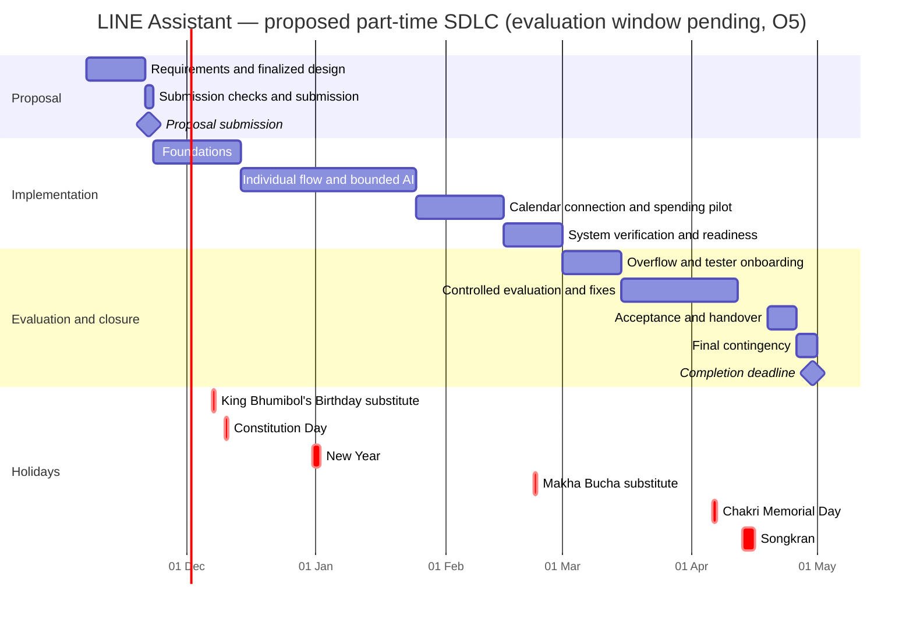

# Project Timeline and Development Phases

**Project:** Thailand LINE AI Personal Assistant (working name to be chosen)  
**Version:** 0.4 — 17 November 2026; draft reconciled to the 15 November direction  
**Status:** Capacity-based SDLC proposal for team approval. Not approved  
**Timezone:** Asia/Bangkok  
**Proposal submission:** 22 November 2026  
**Project completion:** 30 April 2027 — confirmed  
**Available team:** Three app-development-capable members, each at 3–4 hours/week; 9–12 total team-hours/week

Related files: [Proposed features](proposed-features.md) (scope source), [AI implementation](../design/ai-implementation.md), [database design](../design/database-design.md), [advisor briefing](../governance/advisor-briefing-2026-11.md), [kickoff agenda](../meetings/2026-11-07-kickoff.md), [research brief](../research/business-and-architecture-brief.md).

> **Revision notes (v0.4, 17 Nov 2026).** The charter was withdrawn and v0.3 of this timeline was written to match it and to a combined proposal that is not on `main`. This version follows the project owner's 15 November direction in [Proposed features](proposed-features.md): **calendar-connected reminders are the current scope, a spending-and-bills assistant is proposed, and booking moves to phase 2.**
>
> What changed from v0.3:
>
> 1. **Scope** (§1, §6): the "request to a business" package (M4), the business reply page (S0) and the operator console (S2) leave the plan with booking. Calendar-connected reminders and the proposed spending pilot take their place.
> 2. **Phases** (§5): P3 changes from "request to a business" to "calendar connection and the spending pilot".
> 3. **Effort** (§6): Must packages M1–M3 and M5–M7 keep their v0.3 sizing, so they are conservative (some assurance and evaluation items were business-request specific and have not been stripped out). M4 is removed. The calendar connection (MC) is approximated at **17–27 h** (§6). The spending pilot carries the 65–110 h estimate from the feature proposal.
> 4. **Gates and roles** (§5, §7): gate definitions that lived in the charter are kept here in short form, and role abbreviations are replaced by plain role names.
> 5. **Removed:** the TD1–TD6 decision register and the E1–E14 measures, which belonged to the unmerged combined proposal. Open decisions are now listed in §7.
> 6. **Unchanged:** calendar facts, the 25% allowance, holiday table, capacity scenarios A–C, the SDLC choice, the proposal-window arithmetic, and the 22 Nov and 30 Apr dates.

## 1. Scheduling conclusion

The confirmed capacity supports a **small evaluated prototype**, not the full commercial product described in the research brief. The recommended April deliverable is a LINE assistant that turns a message into a tracked obligation, sends reminders connected to the user's calendar, and records completion honestly. It includes bounded AI interpretation, basic operational controls, and a supervised evaluation with a handover package. Booking, partner APIs, phone calls, payments and a merchant side are phase 2.

The spending-and-bills assistant is a **proposal**, not a commitment. Its estimate (65–110 h) is large relative to the remaining margin (§6), so the team must choose between running it as a limited pilot, narrowing it to bills and subscriptions only, or leaving it for phase 2. That is decision O3 in §7.

The team must approve the completion definition and the feature baseline. If a broader pilot is mandatory, add substantial capacity or revise the scope. Do not assume AI coding tools eliminate design, verification, integration, review, or support work.

By 20 November, the **architecture and detailed core design of the submitted implementation scope** must be finalized. Future architecture (booking, wider integrations) should be labeled as phase 2 or future scope rather than an April delivery promise.

## 2. Capacity and estimation basis

### Confirmed calendar

- **7 November 2026–30 April 2027:** 175 calendar days inclusive, or 25 weeks.
- **7–22 November:** 16-day proposal/design window (Saturday 7 Nov to Sunday 22 Nov).
- **23 November–25 April:** 22 complete delivery weeks (Monday 23 Nov to Sunday 25 Apr; each phase runs Monday to Sunday).
- **26–30 April:** five-day final contingency and closure window.

Weekly hours include meetings, reviews, documentation, learning, and development. Calendar windows do not require weekend work. Schedule actual sessions around the members' availability.

### Usable delivery capacity

Apply a provisional **25% allowance** for coordination, task switching, and availability variation. The remaining 75% is available for planned deliverables, including implementation, tests, documentation, and evaluation. Do not subtract test/documentation effort a second time; those are explicitly estimated in §6.

| Scenario | Hours/person/week | Team-hours/week | Gross hours over 22 weeks | Planned delivery hours after allowance |
|---|---:|---:|---:|---:|
| Lower availability | 3.0 | 9.0 | 198.0 | 148.5 |
| Planning midpoint | 3.5 | 10.5 | 231.0 | 173.25 |
| Higher availability | 4.0 | 12.0 | 264.0 | 198.0 |

**Formula:** members × weekly hours × weeks × 0.75.

The proposal window provides approximately **15.4–20.6 planned delivery hours**, after the same allowance, across the entire team. Keep the submission focused; a large specification or speculative prototype would consume time needed to finalize decisions. From 17 to 22 November (six days, under one week of 9–12 team-hours) at most 6.75–9.0 usable team-hours remain (one week × 0.75), so the proposal package must already be close to complete.

The final five-day reserve is approximately **4.8–6.4 usable team-hours** if availability is spread evenly over the week. Actual slots must be booked. It is a small contingency, not another full development iteration.

### Important assumptions

- Each member can sustain the stated hours; names, absence dates, and exact weekly slots are still unknown.
- All are familiar with app development, but security, AI evaluation, and LINE expertise are not assumed.
- Managed services can be used within an approved budget. Procurement and platform access must be checked early.
- A usable baseline does not depend on a merchant booking API, a partner API, full inbox access, live subscription billing, or OCR. It must still work if Gmail access cannot be verified in time.
- The evaluation uses synthetic or low-sensitivity records with adult testers who match the working audience (office workers and individuals managing everyday obligations).
- The 25% allowance is not a statement about Thai public holidays. Record actual holiday, leave, exam, and work constraints on the team's calendar and reforecast.

### Holidays and exams (estimates)

| Holiday | Date | Phase | Source |
|---|---|---|---|
| King Bhumibol's Birthday (substitute day; the holiday itself is Sat 5 Dec) | Mon 7 Dec 2026 | P1 | [S] OfficeHolidays Thailand 2026, accessed 9 Nov 2026 |
| Constitution Day | Thu 10 Dec 2026 | P1 | [S] OfficeHolidays Thailand 2026, accessed 9 Nov 2026 |
| New Year's Eve / New Year | Thu 31 Dec 2026 – Fri 1 Jan 2027 | P2 | [S] Bank of Thailand list via Nation Thailand, accessed 9 Nov 2026 |
| Makha Bucha + substitute day | Sun 21 – Mon 22 Feb 2027 | P4 | [S] Time Out Bangkok; OfficeHolidays, accessed 9 Nov 2026 |
| Chakri Memorial Day | Tue 6 Apr 2027 | P5 | [S] Bank of Thailand list via Nation Thailand, accessed 9 Nov 2026 |
| Songkran | Tue 13 – Thu 15 Apr 2027 | **P6** | [S] Time Out Bangkok; OfficeHolidays, accessed 9 Nov 2026 |

University exam periods are **UNVERIFIED**. Record the real dates from the academic calendar (open decision O6).

| Scenario | Effective weeks | Usable at 3.0 h | Usable at 3.5 h | Usable at 4.0 h |
|---|---:|---:|---:|---:|
| A — as planned above | 22 | 148.5 | 173.25 | 198.0 |
| B — New Year week and Songkran week at zero (assumes members are away over New Year; if they are free during the break, B understates capacity) | 20 | 135.0 | 157.5 | 180.0 |
| C — B plus two two-week exam periods at half capacity | 18 | 121.5 | 141.75 | 162.0 |

Treat scenario C as the planning case until the real calendar is recorded.

## 3. Recommended SDLC

Use **iterative development with formal phase gates**:

1. Resolve requirements and design before the proposal deadline.
2. Build small end-to-end increments, rather than complete all interfaces before connecting the system.
3. Test authorization, ambiguity, persistence, and failure behavior as each increment is built.
4. Freeze features before controlled evaluation.
5. Evaluate, fix, document, and hand over before the final deadline.

Alternatives considered:

| Approach | Trade-off | Selection |
|---|---|---|
| Fully sequential SDLC | Clear stage separation, but integration and user feedback arrive late | Not recommended for the limited capacity and external dependencies |
| Open-ended agile delivery | Flexible scope, but insufficient protection for fixed proposal/completion dates | Not recommended as the only governance model |
| Iterative SDLC with approval gates | Fixed design/submission milestones plus incremental implementation and evidence | Recommended |

This is a phase and governance plan. It is not a file-by-file implementation plan. Write detailed engineering tasks after the architecture, stack, and required behaviors are approved.

## 4. Proposal preparation: 7–22 November 2026

| Window | Work | Exit evidence |
|---|---|---|
| 7–9 Nov (Sat–Mon) | Kickoff; confirm completion definition; assign three members; obtain rubric/cutoff; record availability | Roster and submission instructions |
| 10–15 Nov (Tue–Sun) | Research brief, advisor briefing, database draft, 15 Nov feature direction and AI design recorded | Documents on `main` or in review |
| 16–18 Nov (Mon–Wed) | Reconcile documents to one direction (this revision); decide stack and deployment, AI provider and data terms, Gmail/Calendar integration approach; complete flows, privacy and threat model, evaluation approach; freeze decisions | No critical design choices left unresolved |
| 19–20 Nov (Thu–Fri) | Cross-review and correct the complete design/proposal package | G2: approved architecture/design and frozen submission package |
| 21 Nov (Sat) | Check required format, links, attachments, access, filename, and submission procedure | Submission-ready version |
| 22 Nov (Sun) | Submit before verified cutoff; preserve receipt | Accepted submission evidence |

**Submission falls on Sunday, 22 November.** Verify the actual cutoff, timezone, and portal access. Aim to have the package submission-ready on Friday 20 November; submit earlier if permitted. The 21 November checks are optional weekend work. Do not rely on a Sunday technical recovery window.

### Lean proposal effort estimate

| Package | Team delivery hours |
|---|---:|
| Scope, rubric, and completion definition | 2–3 |
| Requirements and complete core flows | 3–4 |
| Architecture, data, and interfaces | 4–5 |
| AI feasibility, threat model, and verification strategy | 3–4 |
| Roles, estimates, costs, and timeline | 1–2 |
| Assembly, independent cross-review, and submission preparation | 2–3 |
| **Total** | **15–21** |

This is tight against the 15.4–20.6 hours available across the whole window. Reuse the existing research and design documents; prioritize finalized decisions and concise diagrams over document length. If the required rubric is larger, reduce speculative scope or explicitly agree extra time.

### What “finalized design” means

- The user group, the current release scope (calendar-connected reminders), the proposed additions and their decision status, exclusions (booking in phase 2), and completion criteria are recorded.
- System boundaries, components, data model, identity, the task lifecycle and evidence levels, calendar and email connector approach, AI routing, deployment, and recovery approach are selected.
- The primary flows (capture an obligation, confirm, remind, complete; calendar write; and, if approved, receipt capture) include ambiguity, errors, confirmation, and cancellation.
- AI behavior, allowed actions (the AI interprets; application code decides and calculates), provider/data handling, and failure fallback are defined.
- External dependencies (LINE channel and plan, Google OAuth scopes and verification) have evidenced access or a chosen supported fallback.
- Acceptance criteria, evaluation dataset policy, test strategy, roles, capacity, and risks are approved. Numerical thresholds are set after a baseline dataset exists ([Proposed features](proposed-features.md)); record that rule rather than inventing thresholds.

The submitted scope cannot rely on “we will decide the architecture later.” Normal implementation detail can be left to the builders; later material changes go to the sponsor for an explicit decision.

## 5. Phased implementation schedule

All dates are in 2026/2027 as shown. Phase end dates are calendar-window boundaries; complete reviews during available work sessions before those boundaries.

| Phase | Dates | Duration | Main deliverable | Gate / dependency |
|---|---|---|---|---|
| P0 — initiation, requirements, architecture/design | 7–22 Nov 2026 | 16 days | Approved design and submitted proposal | G0–G2 and submission receipt |
| P1 — foundations | 23 Nov–13 Dec | 3 weeks | Signature-checked LINE webhook, event inbox, schema, job worker, deployment with separate development and pilot channels, alerts; Google Calendar and Gmail authorization spike | G3; approved scope/stack and accounts |
| P2 — individual flow and bounded AI | 14 Dec–24 Jan 2027 | 6 weeks | Text capture, confirmation, one-off reminders, snooze, evidence-aware completion, Thai test set; model routing and structured task results | G4; durable records and event handling |
| P3 — calendar connection and spending pilot | 25 Jan–14 Feb | 3 weeks | Calendar-connected reminders; if approved (O3), email receipt capture, correction flow, bills and subscriptions, budget summary | G5 feature complete |
| P4 — system verification and evaluation readiness | 15–28 Feb | 2 weeks | Isolation and fault-injection tests, privacy materials, retention jobs, restore exercise, tester recruiting and consent | G6 before invited user access |
| P5 — controlled evaluation and fixes | 1 Mar–11 Apr | 6 weeks | 1–14 Mar overflow for P1–P4 and tester onboarding; evaluation 15 Mar–11 Apr (four weeks); fixes; stabilization in the late part of the window | G7 evaluation report |
| P6 — stabilization | 12–18 Apr | 1 week | **No work planned**: stabilization moves into late P5, before Songkran (13–15 Apr) | No new features |
| P7 — acceptance and handover | 19–25 Apr | 1 week | Final demo, report, requirements baseline, source/configuration docs, access handover, known limitations | G8 |
| P8 — final contingency and closure | 26–30 Apr | 5 days | Submission/acceptance corrections and closure evidence | G9; final deadline 30 Apr |

The evaluation window (1–14 Mar overflow, 15 Mar–11 Apr evaluation) is carried over from v0.3 and is still a proposal (O5). If it changes, change the gate dates below with it.

Verification and documentation run throughout P1–P3. P4 is the final integrated readiness check, not the first testing phase. P5 includes time for controlled fixes, not a new feature backlog.

### Gates

The charter's gate table was removed with the charter. The dates are unchanged; the evidence is restated for the current scope.

| Gate | Target | Evidence |
|---|---|---|
| G0 | 9 Nov | Roster, actual capacity, completion definition, submission instructions |
| G1 | 13 Nov | Requirements baseline and feature classification accepted |
| G2 | 20 Nov | Final architecture, data model, flows, threat model, evaluation approach, test plan, approved scope, estimate and this timeline; advisor sign-off if the course requires it |
| G3 | 13 Dec | Foundations demonstrated: verified webhook, repeatable deployment, persisted records, alerts |
| G4 | 24 Jan | Capture, confirmation, reminders and completion demonstrated end to end; Thai test set run |
| G5 | 14 Feb | Calendar-connected reminders (and any approved spending features) integrated; no new feature work planned |
| G6 | 28 Feb (14 Mar if the O5 overflow is adopted) | Isolation and recovery evidence, privacy notice and consent, ethics approval if required, testers recruited, LINE plan decided |
| G7 | 11 Apr | Evaluation complete, defects and costs recorded, results reported with their limits |
| G8 | 25 Apr | Accepted prototype, documentation, access transfer, known-issues record |
| G9 | 30 Apr | Closure items resolved and final evidence archived |

Gate reviews take place on the Friday before the Sunday target. Add the course's own milestones once known.



The chart uses the following day as a bar's exclusive end so it includes the final day listed in the table. The chart does not imply full-time work or work on every calendar day. P6 has no bar because no work is planned in it.

## 6. Work packages and effort estimate

These estimates are rough planning ranges before implementation experience; update after P1 and at each gate. M1–M3 and M5–M7 keep the sizing used in v0.3. That sizing was built for a plan that included requests to a business, so parts of M5 (approval and Withdraw tests), M6 (shop recruiting) and M1 (handoff spike) are no longer needed. They have **not** been stripped out, so these figures overstate the base plan. Re-estimate after the technical spike.

| Package | Scope | Low | High | Mid | Main phases |
|---|---|---:|---:|---:|---|
| M1 | Foundations: webhook with signature check and event inbox, schema, job worker, deployment with two channels, secrets, logs, alerts | 20 | 26 | 23 | P1; 3 h residual in P2 |
| M2 | Obligations and reminders: text capture, confirmation with in-chat edit, Thai dates, one-off reminders, evidence levels | 16 | 21 | 18.5 | P2 |
| M3 | Bounded AI: classifier and fallback, Thai test set, evaluation harness with held-out split | 10 | 15 | 12.5 | P2 |
| M5 | Assurance: isolation and fault injection, privacy, retention, delete script, restore, evaluation fixes | 19 | 27 | 23 | P4; fixes in P5 |
| M6 | Evaluation: ethics and consent, recruiting testers, sessions, support, analysis | 19 | 28 | 23.5 | P1–P4 (paperwork, recruiting); P5 |
| M7 | Documentation: report, demo, handover; design docs kept current | 12 | 16 | 14 | P2, P5; finalized P7 |
| **Base total (M1–M3, M5–M7)** | | **96** | **133** | **114.5** | |
| MC | **Calendar-connected reminders** (approximation, see below): Google Calendar link/unlink and encrypted tokens, event write/update/delete, idempotent writes, reconnection, tests | 17 | 27 | 22 | P1 spike; P3 |
| **Base + MC (the committed scope)** | | **113** | **160** | **136.5** | |

| MS | **Spending pilot (proposed)**: Gmail authorization and import, extraction and reconciliation, budgets and LINE summaries, data controls and testing | 65 | 110 | 87.5 | P3 and later |

M4 (requests to a business: composer, handoff, follow-up, router, 15–24 h in v0.3) is removed with booking.

**How MC was approximated (17 Nov; estimate, to be replaced by the P1 spike result).** No source sizes calendar-connected reminders directly, so the figure is built from parts and cross-checked against two reference points.

| Part | Low | High |
|---|---:|---:|
| Google Cloud project and consent screen, link/unlink flow from a LINE button (web page or LIFF), encrypted token storage, revoke on unlink or account delete | 7 | 10 |
| Write a confirmed obligation as a calendar event; update or delete it when the obligation is edited, completed or cancelled | 5 | 8 |
| Idempotent writes (one event per obligation and version; retries and redelivery never duplicate) | 2 | 3 |
| Detect expired or revoked authorization and prompt the user to reconnect | 2 | 3 |
| Tests against a fake calendar API (failures, retries, revocation) and documentation | 1 | 3 |
| **MC total** | **17** | **27** |

Reference points: the `vj` branch's unmerged connector estimate for link/unlink, reading events and writing a confirmed item is 14–22 h (reading events is not needed here, but update, idempotency and reconnection are added). The Gmail row in the feature proposal (15–25 h for authorization, import, background updates and reconnection) is a comparable size, and a calendar write is simpler than an email import.

Assumptions and exclusions:

- **Google verification waiting time is excluded.** The plan assumes Google's Testing mode with a named tester list. Testing mode generally expires authorization after seven days ([Proposed features](proposed-features.md), Gmail section; to confirm for Calendar scopes), so the reconnect prompt is a requirement, not polish. A public release would need app verification, which is outside the April prototype.
- **Overlap with MS.** If the spending pilot also proceeds, the shared Google authorization work could save an estimated 3–5 h across MC and MS. That saving is not subtracted.
- **Read access to calendar events** (for example daily planning, PF-10) is not included.

The 65–110 h figure for MS assumes the bot, database and reminder scheduler already work and does not include calendar work. MS comes from [Proposed features](proposed-features.md), excludes external verification waiting time, and does not include model-routing, personality or infrastructure work ([AI implementation](../design/ai-implementation.md)); those need their own estimate.

### Margin after the committed scope

Usable capacity minus the Base + MC midpoint of 136.5 h, **before** adding the spending pilot (MS) (estimates):

| Hours/person/week | A (22 weeks) | B (holiday weeks removed) | C (holidays and exams) |
|---|---:|---:|---:|
| 3.0 | +12.0 | −1.5 | −15.0 |
| 3.5 | +36.75 | +21.0 | +5.25 |
| 4.0 | +61.5 | +43.5 | +25.5 |

At the high end of the range (160 h) every margin above is 23.5 h lower; at the low end (113 h) it is 23.5 h higher.

- **The committed scope fits at 3.5 h and 4.0 h** at the midpoint in every scenario, but the margin in the planning-case scenario C at 3.5 h is only 5.25 h, and the high estimate does not fit there (−18.25).
- **At 3.0 h it fits only in scenario A.** In scenarios B and C only the low estimate fits (+22.0 and +8.5), so the cut order in §9 applies from the start.
- **The spending pilot (MS, 65–110 h) does not fit at the midpoint in any scenario**: the largest margin is +61.5 h (scenario A at 4.0 h), below even MS's low estimate of 65 h. It fits only if Base + MC land at their low end (113 h) **and** the team sustains 4.0 h/week in scenario A or B (+85.0 or +67.0 h), and then only against MS's low estimate. The feature proposal's own fallback applies: if email coverage is weak, concentrate on identifiable bills, subscriptions and reimbursements. That narrower scope has no estimate yet. Sizing it is the most useful next step for decision O3.

### Should and Could items

None is in the commitment. Start items only when the two-weekly forecast shows the hours (§9). Do not spend the closure reserve on new features.

| Item | What | Low | High | Note |
|---|---|---:|---:|---|
| Recurrence | Monthly, then weekly and daily | 3 | 5 | Needed for monthly rent and utility bills; first in line |
| Upcoming list | "Upcoming in the next N days" as a chat message | 1 | 2 | |
| Family sharing | Share one obligation with one invited person (read status, mark done, revoke) | 12 | 18 | **Deferred: not a priority (17 Nov).** Listed only so the earlier estimate is not lost. Do not start it |
| Personality selection | Three selectable assistant personalities (PF-14) | not estimated | not estimated | Provisional in the AI design |

Items from earlier plans that left with booking (business reply page, operator console, handoff adapters, venue table, `.ics` booking file) are phase 2.

## 7. Dependencies and open decisions

```text
Submission requirements + actual availability
  -> approved requirements and scope (O1–O3)
  -> selected architecture, providers, and fallback
  -> approved design/proposal
  -> LINE webhook, job worker, persistent records (+ Calendar/Gmail authorization spike)
  -> individual obligation workflow + Thai test set
  -> calendar connection (+ spending pilot if approved)
  -> evaluation readiness (isolation, consent, testers)
  -> controlled evaluation and fixes
  -> acceptance, report, and handover
```

### Open decisions

| ID | Decision | Needed by | Note |
|---|---|---|---|
| O1 | Completion definition: small evaluated prototype (recommended) vs broader pilot | Before G2 | Broader pilot needs more capacity |
| O2 | Named roster, roles, weekly slots, proposal submitter and backup | Now | All still unassigned |
| O3 | Spending pilot: run as proposed, narrow to bills and subscriptions, or defer to phase 2 | 18 Nov | Depends on the §6 margin and on measured email coverage |
| O4 | Family sharing | **Decided 17 Nov: deferred, not a priority** | Out of the April scope; revisit after the evaluation |
| O5 | Evaluation window and Songkran handling (the 1–14 Mar overflow in §5, or the earlier six-week plan) | 18 Nov | Moves G6 |
| O6 | University exam periods and advisor checkpoints | Now | Rebaseline §2 when known |
| O7 | Hosting, managed services, LINE plan and budget lines | 18 Nov | All budget lines unset |
| O8 | Gmail integration provider and OAuth verification route | 18 Nov | Restricted scope; may not clear before April |
| O9 | Exact models, personalities and provider data terms | After benchmark | See AI design |

| Dependency | Needed by | Fallback / response |
|---|---|---|
| Proposal rubric, cutoff, and recipient | Verify now | Escalate to recipient; do not guess required artifacts |
| Member names, roles, and weekly slots | Now | Use the 3-hour lower bound for commitments |
| LINE account/channel and deployment feasibility | 16 Nov for design; available by 23 Nov for build | Local simulation is an explicitly declared limitation, not equivalent acceptance |
| AI provider and data terms (retention, training, PDPA transfer basis) | 18 Nov | Confirmed structured input remains the non-AI fallback; AI capability changes require a scope decision |
| Google OAuth scopes and verification (Calendar; Gmail if MS proceeds) | Spike in P1 | App-created calendar scope only; manual capture through LINE instead of Gmail |
| Ethics approval for human participants (if the course requires it) | Check now; file in P2; approved before G6 | Use synthetic sessions until approved; pause recruitment |
| Tester recruiting and consent signed | P3–P4; before G6 | Report the actual sample |
| Evaluation readiness | 28 Feb | No external access until safe; use internal synthetic evaluation and record schedule impact |

## 8. What each phase must demonstrate

### P1: foundations

A LINE webhook with a valid signature creates an event record; forged or replayed events are rejected or handled once. The job worker runs a test job. The team can deploy to separate development and pilot channels, see an alert fire, and restore a basic backup. Secrets are outside the repository. The authorization spike reports which Calendar and Gmail scopes are available to a test project and what verification would be needed.

### P2: individual workflow

A user sends text, sees a confirmation with the interpreted fields, and can Confirm, Edit, or Cancel. A confirmed obligation produces a reminder with snooze and done. Completion records an evidence level. AI proposes structured values within defined bounds; it cannot grant permission, send anything, or invent completion. Dates and amounts are validated in code. Existing reminders run if model processing fails. The Thai test set is run against the thresholds recorded in advance.

### P3: calendar connection and spending pilot

An authorized user's confirmed obligations appear as calendar events, with idempotent writes (a retry never creates a duplicate), and a revoked or expired connection fails visibly rather than silently. If O3 approves the spending pilot: the user connects a supported email account, imported receipts become editable records with a source reference, duplicates and uncertain entries go to review, and the assistant reports totals only for the sources it has covered.

### P4: readiness

The team tests cross-user isolation, forged and replayed webhooks, ambiguous dates, model outages, connector failure and disconnection, retention jobs, export and delete, and backup restoration. Testers are recruited, consent is signed, and the evaluation has named support windows and a stop procedure.

### P5: evaluation

Run supervised sessions and observe unmoderated use over the four-week window, with synthetic or low-sensitivity tasks and adult testers. Record corrections, completion errors, notification counts, costs and defects. This is not a paid market-validation pilot and cannot establish demand or commercial readiness. If recruitment or readiness is delayed, report the actual sample and duration rather than claiming a completed trial.

### P6–P8: stabilization and closure

Fix accepted defects; freeze features; complete documentation, demonstration, and final report; obtain acceptance; transfer or close access safely. Preserve known limitations and deferred work (booking in phase 2). Resolve final submission issues within the five-day reserve.

## 9. Forecasting, contingency, and scope control

### Check the forecast every two weeks

Track hours used, completed deliverables, unresolved risks, and estimated hours remaining. Recalculate remaining capacity from actual individual availability rather than relying on original averages. Compare actual hours per line item with the estimate at the end of P1.

- If remaining estimated work exceeds usable remaining capacity, start no Should or Could item and rebaseline.
- Start the spending pilot only after the P1 spike has confirmed the MC estimate and the forecast shows the hours for both.
- If a critical dependency is blocked for more than one available work session, the technical lead chooses a fallback or escalates to the sponsor.
- If a phase is forecast to slip by more than one week, the sponsor approves an explicit scope/date/resource response.
- If any mandatory security or privacy criterion fails, fix or disable the affected capability before evaluation. Do not trade it away for an on-time demo.
- After feature complete (G5, 14 Feb), new features require removing equivalent work. After 11 April, accept only defect fixes and closure work.

### Cut order if the forecast slips

Never weaken authorization, privacy, retention or evidence rules. Cut in this order:

1. No Should or Could item is started.
2. The spending pilot narrows to bills and subscriptions, then to manual expense capture in LINE (PF-07), then moves to phase 2.
3. Personality selection becomes one default personality.
4. Evaluation scale and number of moderated sessions shrink; report the actual sample.
5. If more is needed, the sponsor revises scope explicitly. Nobody assumes overtime.

| Actual pattern | Response |
|---|---|
| Members average 4 hours/week | The committed scope fits every scenario (minimum margin +25.5 h). The spending pilot fits only if the base lands at its low end and holiday losses are small (scenario A or B); otherwise narrow it or defer it |
| Members average 3.5 hours/week | The committed scope fits at the midpoint, with only 5.25 h of margin in scenario C and none at the high estimate. Start no Should or Could item; leave the spending pilot for phase 2 or narrow it |
| Members average 3 hours/week | The committed scope fits at the midpoint only in scenario A. Plan to the low end of the range (113 h) and apply the cut order from the start |
| Capacity drops below 9 team-hours/week | Re-estimate immediately; reconsider the evaluation scale without weakening privacy or isolation controls |
| Team requires the broad commercial vision by April | Increase funded capacity materially and produce a new plan; the current schedule does not support it |

### No hidden overtime assumption

Equal contribution means each member's total work stays within their agreed hours. Integration, review, debugging, research, and documentation count. Additional work must be volunteered and explicitly reflected in the forecast, not assumed because a deadline is near.

## 10. Approval and baseline maintenance

Before this timeline becomes a commitment:

- [ ] Team approves the evaluated-prototype completion definition (O1).
- [ ] Names, roles, weekly slots, and absences are recorded (O2).
- [ ] Spending pilot decided (O3). Family sharing is deferred (O4).
- [ ] Architecture and design are approved by 20 November.
- [ ] Hours and costs are re-estimated using the selected stack, including the P1 spike result for MC (O7, O8).
- [ ] University exam periods and holidays are recorded and the phase plan rebaselined (O6).
- [ ] The evaluation window is chosen and the gate dates are updated to match (O5).
- [ ] Submission/acceptance instructions and responsible people are verified.

| Baseline | Approved by | Date | Scope / capacity note |
|---|---|---|---|
| Proposed v0.1 | Not yet approved | 7 Nov 2026 | Three members × 3–4 hours/week; 30 Apr deadline confirmed |
| Review copy v0.2 and draft v0.3 | Not approved; withdrawn | 9–10 Nov 2026 | Based on a combined proposal that is not on `main`; superseded |
| Draft v0.4 | Not yet approved | 17 Nov 2026 | Reconciled to the 15 Nov direction: calendar reminders current (MC approximated at 17–27 h; Base + MC midpoint 136.5 h), spending proposed, booking phase 2, family sharing deferred |
| Approved v1.0 | ______ | ______ | ______ |

The product/delivery lead maintains the dates and forecast; the technical lead owns technical dependency estimates; each member reports their real availability. Update this timeline together with [Proposed features](proposed-features.md) when an approved decision changes the plan.
