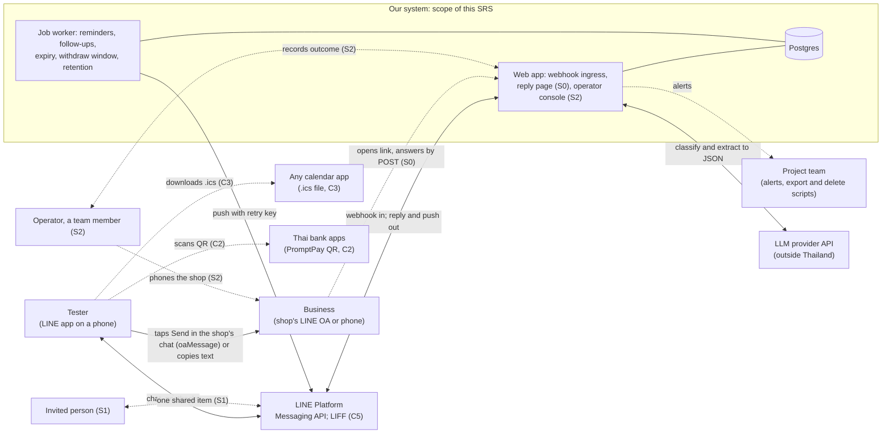
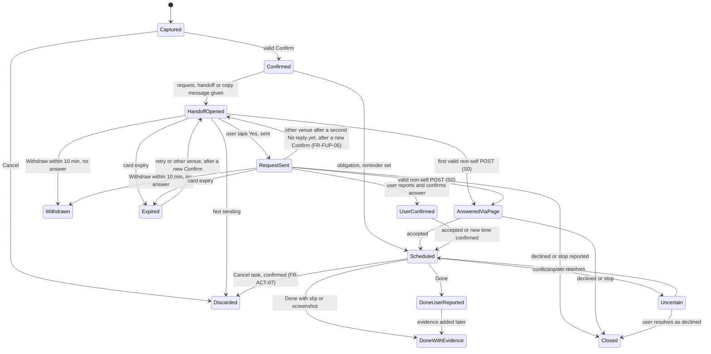

# Software Requirements Specification (SRS) v0.9: LINE assistant that acts, not only reminds

| Field | Value |
|---|---|
| Document | Software Requirements Specification, version 0.9 (integrated) |
| Product | Prototype of a LINE Official Account assistant for Thailand (working name to be chosen; "TumHai (ทำให้)" is a placeholder) |
| Date | 9 November 2026 |
| Status | **Proposed.** For team review before the design freeze (gate G2, Friday 20 November 2026) and the proposal submission (Sunday 22 November 2026). Nothing in this document is agreed yet |
| Built from | Three parallel drafts written on 9 November 2026: `srs/part-a.md` (§1, §2.1–2.4, §2.7, §3.1, §3.2), `srs/part-b.md` (§3.3–§3.7) and `srs/part-c.md` (§2.5, §2.6, §3.4.4, §3.8–§3.10, §4, §5). The integrator merged them, applied nine manager decisions (D1–D9) and logged every merge, deletion and renumbering in Appendix F |
| Authorities | `docs/combined/combined-proposal.md` v0.2 (final, judge-passed; cited as **CP**); `docs/requirements/requirement-types-research.md` (**RTR**: categories, ID scheme, checklist, outline §3); `docs/review/revised/omm/project-charter.md` (**charter**) and `timeline-and-development-phases.md` (**timeline**) for gates and dates |
| Companion file | `docs/requirements/requirements-register.csv`: one row per requirement (and per assumption, dependency and out-of-scope item) with its attributes |

## Reader guide

**What this document is.** A software requirements specification (SRS) says what a system must do, how well it must do it, the limits it must work within, and how each of those statements will be checked. The team builds and tests against it, and the supervisor and committee use it to trace every claim from a business goal down to a test (ISO/IEC/IEEE 29148:2018 SRS outline `[V contents, via RTR §1.1, §3]`). This SRS covers the prototype only: a small, evaluated LINE assistant built by three students at 3–4 hours a week each, due 30 April 2027.

**Why 16 categories and not only functional and non-functional requirements.** Functional and non-functional requirements (FR and NFR) are the right top split, but on their own they hide things that fail in different ways: a Thai law, a LINE platform limit, a three-person budget and an uptime target are all "non-functional", yet each has a different owner and a different check (RTR §0). Our product is also an AI that acts for the user, which needs its own test sets and pass marks, and the course grades deliverables that are not product features at all (RTR §0). This SRS therefore uses the 16 categories of RTR §1.2, so that no category is forgotten; most of them need only a handful of requirements.

| # | Category | ID prefix | Section |
|---|---|---|---|
| 1 | Business requirements | `BR` | §1.5 |
| 2 | Stakeholder and user requirements (user stories, use cases) | `STK`, `US`, `UC` | §2.7 |
| 3 | Functional requirements | `FR` | §3.2 |
| 4 | Quality requirements by ISO/IEC 25010:2023 | `QR-<code>` | §3.4 |
| 5 | External interface requirements | `IF` | §3.1 |
| 6 | Data requirements | `DR` | §3.5 |
| 7 | AI-specific requirements | `AI` | §3.3 |
| 8 | Security and privacy requirements | `SEC`, `PRV` | §3.6 |
| 9 | Legal, regulatory and platform-policy compliance | `LEG` | §3.7 |
| 10 | Constraints | `CON` | §2.5 |
| 11 | Transition and deployment | `TR` | §3.8 |
| 12 | Operations and support | `OPS` | §3.9 |
| 13 | Usability, localisation (Thai and English) and accessibility | `UX`, `L10N`, `A11Y` | §3.4.4 |
| 14 | Documentation and academic deliverables | `DOC` | §3.10 |
| 15 | Acceptance criteria and verification | `VER` (plus an acceptance criterion on every row) | §4 |
| 16 | Assumptions, dependencies and out of scope (recorded, not requirements) | `ASM`, `DEP`, `OOS` | §2.6 |

**Status and maturity (RTR §3).** Version 0.9 goes with the proposal on 22 November 2026 (`DOC-01`). At v0.9: §1, §2 and §3.4.4 are full; interfaces are named with their key constraints; Must use cases are fully dressed and Should use cases are brief; AI thresholds that need data are "TBD after P2 run"; §3.8 and §3.9 hold Must items only; §4 gives the strategy and decision rules; §5 is a skeleton. Version 1.0 is baselined for the prototype on 30 April 2027 (`DOC-02`).

### How to read a requirement

- **One requirement, one "shall".** Each `BR`, `STK`, `IF`, `FR`, `AI`, `QR`, `DR`, `SEC`, `PRV`, `CON`, `UX`, `L10N`, `A11Y`, `TR`, `OPS`, `DOC` and `VER` row has one "shall" sentence. User stories (`US`) use "As a… I want… so that…". Use cases (`UC`) use numbered flows. Compliance rows (`LEG`) name the rule, our requirement and the rows that satisfy it.
- **Attributes** (RTR §2.3; full template in Appendix A): ID; statement; priority (MoSCoW: **M** Must, **S** Should, **C** Could, **W** Won't); trace up (source); rationale; acceptance criterion; verification method. The **type** of a row is its prefix category, named in the section heading. **Status** is *Proposed* for every row unless marked *Deferred* or *Deleted*. **Owner** is TBD until the team fixes roles; the proposed roles are PD (product and delivery), TL (technical lead), QO (quality owner), PS (privacy and security owner), AI (AI lead) and the evaluation lead.
- **Verification methods:** **I** inspection (read code, configuration or documents); **A** analysis (calculate or review data); **D** demonstration (show it working); **T** test (defined inputs and expected outputs); **E** evaluation on a labelled set; **U** user study (pilot). Parts A and B mark labelled-set runs as T; that is the same as E here.
- **IDs** have the form `PREFIX-AREA-NN`, with a **two-digit** number, as every judge-passed ID already does (for example `FR-CAP-01`). RTR §2.2 prescribes three digits (`NNN`); manager decision D1 keeps two digits and records the deviation (Appendix F). IDs reused from RTR keep their meaning. Numbers are never reused. A merged or dropped requirement keeps its row with the words "Deleted: merged into…" or "Deferred".
- **"M if built"** means Must for any build that includes the named Should or Could item. **S0 promotion:** the reply page is Should item S0. If team decision TD6 finds the calendar is scenario B or better at 3.5 h a week, every row marked "S (S0)" becomes Must (CP §6.1, §13).
- **Placeholders.** "TBD at freeze (20 Nov 2026)": the team sets the value at gate G2. "TBD after spike (13 Dec 2026)": set after the P1 technical spike, at gate G3, which ends phase P1 on 13 December 2026 (review Friday 11 December). "TBD after P2 run (24 Jan 2027)": an AI threshold or limit set from the development split of the first evaluation run in P2, at gate G4, before any held-out or pilot result is seen (`VER-04`). Where a proposal value exists, it is shown.
- **Gates** (charter §8): G1 requirements baseline 13 Nov 2026; G2 design and proposal approval 20 Nov 2026; G3 foundations accepted 13 Dec 2026 (review Fri 11 Dec); G4 core individual flow 24 Jan 2027 (review Fri 22 Jan); G5 feature complete 14 Feb 2027 (review Fri 12 Feb); G6 evaluation readiness 28 Feb 2027 (review Fri 26 Feb); G7 evaluation completed 11 Apr 2027 (review Fri 9 Apr); G8 acceptance and handover 25 Apr 2027 (review Fri 23 Apr); G9 closure 30 Apr 2027.
- **Evidence tags** follow the team brief: `[V]` primary source opened (here usually as recorded, with its date, in the cited judge-passed file); `[S]` secondary source; `[I]` our inference; `UNVERIFIED` not checked. Every number marked as a proposal is for the team to agree. This SRS is a planning document, not legal advice.
- **Source abbreviations.** CP = combined proposal v0.2 (also cited by its section, E1–E14, M1–M7, S0–S4, C1–C6, TD1–TD6); AM = `docs/combined/advantages-matrix.md`; RTR = requirement-types research (also "RTR" in early drafts); REC or "recon" = `docs/research/abdul-recon/abdul-recon-2026-11-09.md` (inputs P-x, D-x); OMM or "omm brief" = `docs/review/revised/omm/business-and-architecture-brief.md`; VJ = `docs/review/revised/vj/specs/scope-and-objectives.md`; black-box script = `docs/research/abdul-recon/manual-blackbox-test-script.md`; TEAM-BRIEF = `docs/review/TEAM-BRIEF.md`. G1–G4 in a trace column are the product goals in CP §3.3, not the gates; the context makes clear which is meant.
- **Open issues** are numbered OI-01 to OI-34 in Appendix E, each with an owner role and the gate by which it must close.

---

## 1. Introduction

### 1.1 Purpose

This SRS states what the prototype of our LINE assistant must do and how each requirement will be checked. The prototype is a university senior project by three students. It is due as an evaluated prototype on 30 April 2027. Version 0.9 goes with the proposal on 22 November 2026 (`DOC-01`).

Readers: the team (to build and test), the supervisor and committee (to assess scope and verification), and later maintainers.

Four corrections to CP v0.2 are applied here, as agreed by the manager on 9 November 2026:

1. **"Request sent" is never set by a page load.** It is set only by the user's "Yes, I sent it" answer or by the first valid POST answer on the reply page (which moves the task to Answered via reply page and counts as sent). A page open (HTTP GET) or a link preview changes no state. (AM row C4 said "or the reply page is first opened"; it was corrected on 9 November 2026 to match. See Appendix F.)
2. **No LINE login on the business-facing reply page** (no LINE Login and no LIFF there).
3. **Slip and screenshot images are kept 30 days or until the E6 audit of that task**, whichever is later, and never beyond the end-of-pilot deletion (`TR-03`). The retention rule is `DR-04`, Table R row R4 (§3.5.3).
4. **"Handoff opened" means that LINE accepted (HTTP 200) the message that gives the user the shop link, or for copy-and-send the text to copy.** It never means that we saw the user open the shop's chat (manager decision D8). CP §4.2's wording "we opened the shop's chat" is read this way (open issue OI-02).

### 1.2 Scope

**Product.** A LINE Official Account (OA) assistant for Thailand. It turns a chat message into a **task with an outcome**, prepares the next step so that **one tap by the user sends it**, and follows up until the outcome is known and backed by evidence (CP §1). It goes beyond Abdul (abdul.chat), which reminds but does not contact a business or record evidence `[V, Abdul public pages 8–9 Nov 2026, via REC §6]`.

**One engine, two task types.** An *obligation* (a bill, rent, a renewal, an appointment) and a *request to a business* (a haircut slot, a quote). Both share one lifecycle (§3.2.9).

**Levels of action** (CP §4.1). Level 1, the assistant does it itself (tracked obligation, reminders). Level 2, it prepares a request card and the user's tap sends it. Level 3, direct booking, is not built.

**Scope by priority** (matches CP §6.1):

| Priority | Items in scope |
|---|---|
| **Must** | M1 Foundations: LINE webhook with signature check and event inbox, database, job worker, deployment, separate development and pilot channels, alerts, logs without personal content, P1 spike on `oaMessage` and the share picker. M2 Obligations and reminders: text capture, Flex confirmation card with Confirm, Edit and Cancel (edit one field at a time in chat), Buddhist-era and Thai relative dates, one-off reminders with snooze, done and quiet hours, completion with an evidence level. M3 Bounded AI and a Thai test set. M4 Request to a business: card composer, approval bound to a content hash, LINE handoff and copy-and-send adapters with "Did you send it?", follow-up, expiry and 10-minute Withdraw, outcome plus a reminder for the agreed time, router and a venue table of 10–15 hand-checked venues. M5 Assurance: isolation and fault-injection tests, privacy notice, retention jobs, export and delete by chat command, backup restore. M6 Evaluation with 15–20 testers aged 20 or over, or married. M7 Documentation |
| **Should** (in TD3 order) | S0 reply page for businesses; S3 recurrence (monthly, then weekly and daily); S4 "upcoming in the next N days" list; S1 share one item with one invited person; S2 operator console (Wizard-of-Oz: a team member does the last step by phone) |
| **Could** | C1 photo of one bill format; C2 bill split with a PromptPay QR to the payer's own account; C3 `.ics` calendar file; C4 share-target-picker adapter (only if the P1 spike shows it reaches a shop); C5 LIFF pages; C6 second LLM compared on the held-out set |
| **Won't** (this project) | Level 3 direct booking; partner APIs; browser agents for web forms; email; AI phone calls; group polls or any bot in LINE groups; Google Calendar or Gmail OAuth; payments or subscriptions; venue recommendations from Google or Wongnai data; escalation-until-acknowledged reminders; voice-note input; วันพระ (Buddhist holy day) recurrence; medical requests; testers under 20 (unless married); Temporal (a workflow engine); merchant dashboard |

### 1.3 Definitions and acronyms

All terms, Thai words and acronyms are defined in **Appendix D (glossary, Thai–English)**. Five terms matter most for reading the requirements:

- **Task**: one tracked item owned by one user, of type *obligation* (a bill, rent, a renewal, an appointment) or *request* (to a business).
- **Request card**: the exact text we prepare for a business; the user confirms it, then the user's own tap sends it.
- **Handoff opened**: LINE accepted the message that gives the user the shop link (or the text to copy). It does not mean the user opened the shop's chat or sent anything (decision D8).
- **Evidence level**: how we know a task's outcome; stored apart from the lifecycle state (§3.2.9).
- **System-scheduled push**: a push message the system times itself (follow-up, expiry notice, nudge, digest, repeat after snooze). Unlike a reminder the user set for an exact time, it waits until quiet hours end (decision D5).

### 1.4 References

Internal (all under `docs/`): CP, AM, RTR, REC, OMM, VJ as listed in the header; `review/TEAM-BRIEF.md`; `review/revised/omm/timeline-and-development-phases.md` (phase dates).

External, as recorded with dates in CP §14 and RTR (not reopened for this SRS):
- LINE Messaging API: receiving messages and redelivery; signature verification; retry key; URL scheme (`oaMessage`); group chats; pricing. https://developers.line.biz/en/docs/messaging-api/ `[V, 9 Nov 2026, via CP §14]`
- LIFF identity handling: https://developers.line.biz/en/docs/liff/ `[V, via OMM §8.1]`
- LINE Thailand OA plans and Reply API notice: https://lineforbusiness.com/th/service/line-oa-features ; https://www.lineforbusiness.com/th/news/20261030 `[V, 9 Nov 2026, via CP §14]`
- ISO/IEC/IEEE 29148:2018 (SRS outline and requirement characteristics) `[V contents, S clause text, via RTR §1.1]`
- RFC 5545 iCalendar (for C3) `[I, not opened in this run]`; Bank of Thailand Thai QR Code Payment Standard (for C2) `[S, not opened; RTR open issue 11]`

### 1.5 Business requirements (`BR`)

Thresholds are from CP §9.1 and are proposals until the 20 Nov 2026 freeze. With 15–20 testers, every rate is reported with a 95% Wilson interval. Pass or fail is judged on the point estimate against the threshold, and the interval is always shown next to it (§4.4, manager decision D2).

**Table 1.5. Type: Business requirement.**

| ID | Statement | Pri | Trace up | Rationale | Acceptance criterion | V |
|---|---|---|---|---|---|---|
| BR-01 | By 30 April 2027, the team shall demonstrate both Must task flows end to end with real testers: an obligation from message to completion with an evidence level, and a request to a business from message to a known outcome. | M | RTR BR-01 (revised to the combined scope); CP §1, §6.1 | The course grades a working, evaluated prototype | Demo script on the pilot channel completes both flows; evaluation logs show at least one completed flow of each type per tester who attempted it | D |
| BR-02 | In the evaluation, at least 80% of testers shall complete capture → confirm → reminder without help from the team. | M | RTR BR-02 (RTR's "≥ 60% in the first session" replaced by the CP E8 target and measure; decision D4); goal G1 | Shows the obligation flow is usable on its own | Point estimate ≥ 80% over all testers' logs (E8), with the Wilson interval reported | A |
| BR-03 | *Deferred.* (RTR: the pilot shall compare the acting assistant with a reminder-only baseline on the same tasks.) | W | RTR BR-03; decision D3 | Not costed in the plan; the qualitative comparison BR-07 covers the motivation. No E-measure is required at v0.9 (open issue OI-04) | N/A (Deferred) | N/A |
| BR-04 | In the evaluation, at least 70% of request tasks shall reach a known outcome (answered, declined, or clearly no reply). | M | CP E8; goal G2 | Shows the "acts" flow closes the loop | Point estimate ≥ 70% of request tasks in the logs (E8), interval reported | A |
| BR-05 | The prototype shall show a task to its user only in a state and evidence level that the system has observed. | M | Goal G3; CP §4.2; E6 | Honest status is the main difference from a reminder app | E6 audit of every evaluation task finds 0 tasks shown as sent, booked or done without the matching trigger or evidence | A |
| BR-06 | No action shall leave the system for a third party without a valid confirmation tap by the user. | M | Goal G4; `AI-HITL-01`; E3 | Safety and the ETA attribution rule (`LEG-06`) | E3: every adapter tested with no tap, an old token, a reused token and an edited card; 0 actions leave | T |
| BR-07 | The final report shall compare the prototype's flows with Abdul's advertised features, using public information only. | M | CP E13; REC §6; TEAM-BRIEF research boundary | The project is motivated as "beyond Abdul" | The report contains the E13 table, states that recurrence parity is partial, and cites public sources only | I |
| BR-08 | The median time from a tester's first message to a confirmed task shall be 2 minutes or less. | M | Goal G1; CP E9 | Speed is why a user would choose the assistant | Median of logged first-message-to-Confirm times ≤ 120 s | A |
| BR-09 | The evaluation shall report, split by adapter, the outcomes of 15–25 real request cards: share answered, declined, no answer, time to answer, share that needed a phone call, team minutes per handled request (if S2 is built) and repeat use within 30 days. | M | CP E11; VJ success metrics; judge D-12 | Whether businesses answer is the riskiest assumption (`ASM-01`) | Report table with each measure per adapter and its interval; self-answered reply-page answers excluded | I |

---

## 2. Overall description

### 2.1 Product perspective

The product is a new, self-contained system. Users reach it only through LINE (`CON-PLAT-01`). It depends on the LINE Platform and one LLM provider. It does not hold or move money (`LEG-03`) and never writes into another business's OA chat: the user's own tap sends every request (`LEG-02`, CP §4.4).

Solid lines are Must. Dotted lines are Should or Could, or team-side. The internal components (ingress, task service, AI interpreter, approval gate, job worker, notifier, router and adapters) are described in CP §7.1 and belong to the design document.

### 2.2 Product functions

| # | Function | Pri | Requirements |
|---|---|---|---|
| F1 | Onboard: welcome with AI disclosure, privacy notice, acceptance and age statement | M | §3.2.1 |
| F2 | Capture an obligation from Thai, English or mixed text, with Buddhist-era and relative dates | M | §3.2.2 |
| F3 | Confirm, edit (one field at a time) or cancel any card; approval bound to content | M | §3.2.3 |
| F4 | One-off reminders with snooze, done and quiet hours | M | §3.2.4 |
| F5 | Record completion with an evidence level (user-reported, slip or screenshot attached) | M | §3.2.5 |
| F6 | Compose a request card for a business, with AI disclosure | M | §3.2.6 |
| F7 | Route to an adapter from the venue table; LINE handoff or copy-and-send; "Did you send it?" | M | §3.2.7 |
| F8 | Follow up, record the business's answer, expire, set a reminder for the agreed time | M | §3.2.8 |
| F9 | Withdraw within 10 minutes while unanswered | M | §3.2.8 |
| F10 | One lifecycle with honest states and evidence levels | M | §3.2.9 |
| F11 | Export or delete my data by chat command | M | §3.2.10 |
| F12 | Reply page for businesses | S (S0) | §3.2.11 |
| F13 | Recurrence; upcoming list; share one item; operator console | S (S3, S4, S1, S2) | §3.2.12 |
| F14 | Photo capture, bill split QR, `.ics`, share picker, LIFF pages | C | §3.2.13 |

### 2.3 Stakeholders and user characteristics

| Stakeholder | Role in the prototype | Characteristics and needs | Requirements |
|---|---|---|---|
| Tester (end user) | Sends tasks, confirms, receives results | Students and staff of our university, aged 20 or over or married (`LEG-05`, TD1). Mostly staff, later-year and graduate students. Uses LINE daily on a phone; writes mixed Thai-English; manages some own bills, rent, renewals or appointments. No training beyond the welcome message | STK-01, 02, 06, 07, 11 |
| Business (shop near campus) | Receives a card the tester sent; answers in its own chat or (S0) on the reply page | Small salon or barber shop taking bookings by LINE chat or phone `[S, via CP §2]`. Never signs up. A PDPA data subject who never agreed to our terms | STK-03, 04, 05 |
| Invited person (S1) | Sees one shared item; can mark it done | Same age rule as testers | STK-08 |
| Operator (S2) | A team member who phones a shop in a published time window | Uses our console on a laptop | STK-09 |
| Supervisor and committee | Assess design, AI depth and evaluation | Need traceable evidence | STK-10 |
| Project team | Builds, runs the pilot, runs export and delete scripts, answers alerts | 3 students at 3–4 h a week each; nobody on call | — (see `OPS-01`, `CON-TEAM-01`) |
| LINE (LY Corporation) | Platform owner | Sets quotas, prices and policies (`LEG-02`) | §3.1 |
| LLM provider | Processes prompts abroad | Chosen at D06 (16 Nov 2026) with zero-retention, no-training terms (`AI-SUP-02`, `PRV-05`) and a recorded PDPA s.28 basis (`PRV-02`) | IF-LLM-01, 02 |

**Personas** (fictional, no real person):

- **Fon, 22, fourth-year student.** Pays her dorm rent and phone bill herself. Books a haircut near campus every six weeks by messaging the shop's LINE OA, then forgets what time was agreed. Wants: "tell it once in Thai and stop worrying".
- **Khun Nok, 41, university staff.** Pays electricity and water bills, renews car tax once a year, and keeps slips "just in case". Wants to know which bills are really done and which she only meant to pay.
- **Pi Ae, 35, owner of a two-chair salon.** Answers LINE between customers. Will not install anything or sign up. Wants requests that are short and clear, says who is asking, and a way to say "no more".

### 2.4 Operating environment

| Element | Environment |
|---|---|
| User client | LINE app on iOS or Android phones (minimum versions TBD after spike, 13 Dec 2026). The `oaMessage` handoff works on a phone only, not in LINE for PC `[V, judge-vj spot-check 1, via CP §4.4]` |
| Business client | Its own LINE OA app or LINE app on a phone; (S0) any current mobile browser, including LINE's in-app browser |
| Operator client (S2) | Desktop browser |
| Server | One web app (webhook, S0 page, S2 console), one worker process, one PostgreSQL database, one LLM API. Stack and hosting chosen at D05 (16 Nov 2026) |
| Channels | Two LINE OA channels: development and pilot (`TR-01`) |
| Time | All dates in `Asia/Bangkok`; stored as instants |
| Languages | Thai and English chat (`L10N-01`); business-facing card text in Thai |
| LINE plan | Free (300 pushes a month) or Basic for the evaluation months (TD5) |

### 2.5 Constraints (`CON`)

Constraints are fixed limits from outside the design: time, people, money, platform, technology and course rules (RTR §1.3.10; ISO/IEC/IEEE 29148 §9.6.16 [V, contents page]).

#### 2.5.1 Time

Type: Constraint.

| ID | Requirement | Pri | Trace up / source | Rationale | Acceptance criterion | V |
|---|---|---|---|---|---|---|
| `CON-TIME-01` | The architecture and overall design shall be finalised and submitted with the proposal no later than Sunday 22 November 2026. | M | TEAM-BRIEF; charter G2; timeline §4 | Course deadline. 22 Nov is a Sunday, so the target is "ready on Friday 20 Nov" | A submission receipt dated on or before 22 Nov 2026 exists, and the G2 approval record is dated on or before 20 Nov 2026 | I |
| `CON-TIME-02` | The evaluated prototype and the final report shall be delivered no later than 30 April 2027. | M | TEAM-BRIEF; charter G8–G9 | Project end date, confirmed by the team | A G9 closure record and a final-submission receipt are dated on or before 30 Apr 2027 | I |
| `CON-TIME-03` | No new feature work shall start after the feature-freeze date chosen in TD4 (14 Feb 2027 under option A, 14 Mar 2027 under option B), and after 11 April 2027 only defect fixes and closure work shall be done. | M | timeline §9; CP TD4 | Protects the evaluation window and the Songkran-shortened stabilisation week (13–15 Apr 2027 [S, timeline §2]) | The issue log shows no feature issue opened after the freeze date, except one recorded change request that removes equal work (charter §9); no feature commit after 11 Apr 2027 | I |

#### 2.5.2 Team capacity

Type: Constraint.

| ID | Requirement | Pri | Trace up / source | Rationale | Acceptance criterion | V |
|---|---|---|---|---|---|---|
| `CON-TEAM-01` | The Must build-and-test effort (packages M1–M5) shall be estimated at no more than 160 person-hours at the high estimate, within the 120–160 person-hour ceiling. | M | RTR `CON-TEAM-01`; CP §6.2 | Three students at 3–4 h a week; build and test may take only about half the total | The bottom-up table in CP §6.2 shows M1–M5 at 80–113 h (midpoint 96.5 h), or 89–125 h with S0. Re-checked with actual hours at the end of P1 | A |
| `CON-TEAM-02` | The midpoint estimate of the whole Must scope (M1–M7) shall not exceed the usable capacity of the planning scenario in force, which is scenario C at 3.5 h per person per week (141.75 h) until the real calendar is recorded at A11. | M | CP §6.3; timeline §2 | Exam dates are unknown, so we plan for the worst recorded case | CP Must 134 h plus the NEW Must rows of Appendix H (mid 4.125 h) = 138.125 h ≤ 141.75 h (margin 3.625 h) at the proposal (judge D-01). At each two-weekly forecast, remaining Must work ≤ remaining usable capacity; otherwise the cut order in CP §6.5 is applied and recorded | A |
| `CON-TEAM-03` | Plans and forecasts shall count at most 4 hours per member per week, and shall count any extra hours only when the member has volunteered them and they are recorded in the forecast. | M | timeline §9 "No hidden overtime"; charter §10 | Keeps the plan honest and contributions equal | Each forecast sheet shows hours per member ≤ 4 a week, or a dated note of volunteered extra hours | I |

#### 2.5.3 Budget

Type: Constraint.

| ID | Requirement | Pri | Trace up / source | Rationale | Acceptance criterion | V |
|---|---|---|---|---|---|---|
| `CON-BUD-01` | Total running costs during the pilot (LLM API, hosting and database, LINE Official Account plan) shall not exceed the monthly cap approved by the team at D05/D06 (16 Nov 2026). | M | RTR `CON-BUD-01`; charter §10 budget table; `AI-COST-01`, `AI-COST-02`; criterion changed by judge D-01 (`OPS-07` now Should) | No spending authority exists yet (charter §10). The LLM per-user budget (`AI-COST-01`, `AI-COST-02`) must sum to a cap this row sets. **Cap value is open (open issue OI-13)** | At G3 and G6, inspection shows the provider-side hard limit (`AI-COST-03`), the LINE plan (`CON-BUD-02`) and the hosting plan are set at or below the approved cap; where monthly cost reports (`OPS-07`, Should) exist, actual spend ≤ the cap | I, A |
| `CON-BUD-02` | During the evaluation window, the LINE Official Account shall be on a plan whose monthly message allowance is at least the forecast number of push messages for that month. | M | CP TD5, §7.5; `IF-LINE-02` | Free plan: pushes stop at 300 a month [V, LINE Thailand OA plans, via CP §7.5]. Forecast for 20 testers at about one push a day for 4 weeks is about 560 [I]. Basic plan: ฿1,280 + 7% VAT a month, 15,000 messages [V, via CP TD5] | Before G6, an analysis shows forecast pushes ≤ plan allowance (TD5 option A: Basic plan; option B: Free plan with a cap of 15 pushes per tester for 20 testers). During the pilot, `OPS-06` alerts confirm the allowance was never reached | A, T |

#### 2.5.4 Platform

Type: Constraint.

| ID | Requirement | Pri | Trace up / source | Rationale | Acceptance criterion | V |
|---|---|---|---|---|---|---|
| `CON-PLAT-01` | The only user channel shall be a LINE Official Account using the Messaging API; there shall be no separate mobile app. | M | RTR `CON-PLAT-01`; CP §2 | Users are already in LINE (54 million monthly active users in Thailand [V, LY Corp, via CP §2]) | Every Must user flow in the demo script starts in the OA chat; no app-store build exists | I, D |
| `CON-PLAT-02` | Any flow that uses the LINE `oaMessage` handoff shall also offer the copy-and-send fallback, because the handoff works only in the LINE mobile app and not in LINE for PC. | M | CP §4.4 [V, LINE URL scheme docs and judge spot-check, 9 Nov 2026] | A user on a PC must still be able to send the request | Design inspection of the router shows both adapters on every request path; one test on LINE for PC shows the fallback | I, T |
| `CON-PLAT-03` | The design shall not depend on our bot posting into a business's chat, into a LINE group, or through the user's own account. | M | CP §4.4 [V, LINE group-chats docs]; `LEG-02` | A bot cannot write into another OA's chat; only one OA can be in a group; proxy sending through the user's account is forbidden by LINE's User Data Policy s.3.3 [V, via RTR] | Inspection: every outbound path to a business is a user-tap handoff, the copy fallback, or (S2) a human operator | I |

#### 2.5.5 Technology

Type: Constraint (design constraint).

| ID | Requirement | Pri | Trace up / source | Rationale | Acceptance criterion | V |
|---|---|---|---|---|---|---|
| `CON-TECH-01` | The system shall be built from one web application, one worker process, one PostgreSQL database and one hosted LLM API, using the stack and providers chosen at D05 and D06 (16 Nov 2026). | M | CP §7.1 "Stack"; omm decisions D05, D06 | Fewer moving parts fit 3–4 h a week. Temporal and other workflow engines are out of scope (`OOS-09`) | The deployment configuration at G3 lists only these four runtime parts plus LINE | I |
| `CON-TECH-02` | The LLM provider chosen at D06 shall offer API terms under which our prompts and outputs are not used for training and are retained for no longer than abuse monitoring requires (zero retention where offered). | M | CP §7.1 (recon P-10); `PRV-05`, `PRV-02` | Prompts carry personal data sent abroad; the transfer basis (PDPA s.28) is still open (OI-15) | The D06 decision record quotes the provider's current terms with an access date and the retention period they state | I |

#### 2.5.6 Academic and research rules

Type: Constraint.

| ID | Requirement | Pri | Trace up / source | Rationale | Acceptance criterion | V |
|---|---|---|---|---|---|---|
| `CON-ACAD-01` | The repository shall contain no real personal data; test data shall be synthetic or tester-consented and, if consented, stored outside the repository. | M | TEAM-BRIEF rule 5; CP §7.5 | Course and PDPA risk; the repository is shared | At each gate, a search of the repository for phone numbers, LINE user IDs and real names finds none; the review is recorded | I |
| `CON-ACAD-02` | Any study of Abdul shall use only public information and ordinary, hand-typed use of advertised features, within the TEAM-BRIEF research boundary. | M | TEAM-BRIEF "Abdul research boundary"; Abdul terms (forbid reverse-engineering, scraping, probing) | Respect the competitor's terms; keep E13 defensible | The black-box run notes show hand use only, at most about 10 messages per 10 minutes, no automation, no prompt-injection text, and the T39–T40 clean-up done | I |
| `CON-ACAD-03` | The proposal and the final acceptance shall be approved by the authority the course names (advisor or committee), at G2 and G8. | M | charter §4 (AD role), §8 | The advisor's decision prevails over the team's own sign-off | Signed or emailed approval records for G2 and G8 exist. The course's approval rules are UNVERIFIED (OI-19) | I |

`LEG-04` (ethics approval before any pilot) and `LEG-05` (testers aged 20 or over, or married) are academic and legal constraints too; they are in §3.7.

### 2.6 Assumptions, dependencies and out of scope (`ASM`, `DEP`, `OOS`)

These are not requirements. They are recorded because a requirement that rests on a false assumption fails silently (RTR §1.3.16). Each has an owner role and a date by which it is checked. All are reviewed at every phase gate.

#### 2.6.1 Assumptions

| ID | Assumption | Status | Requirements that depend on it | Check (how, owner, by when) |
|---|---|---|---|---|
| `ASM-01` | Businesses will answer a request card, in their own chat or (S0) on the reply page, without signing up. | UNVERIFIED | `STK-03`, `BR-09`, `FR-RP-01`…`FR-RP-07`, E11 | E11 field result; 3–5 friendly shops asked in P3. PD, by G7 |
| `ASM-02` | The LINE share-target picker **cannot** be relied on to deliver a card to a business's OA chat. The design does not depend on it. | UNVERIFIED | C4 adapter only | P1 spike on testers' phones. TL, by G3 (13 Dec 2026) |
| `ASM-03` | LINE and other apps may fetch a URL posted in a chat to build a link preview, so a GET on the reply page can happen without a person. | UNVERIFIED for LINE in this case; rule is cheap either way | `QR-SE-01`, `FR-HND-03`, `IF-RP-01`, E6 | Link-preview test: post the reply-page link into a test LINE chat and check that no state changes. TL, before S0 is released |
| `ASM-04` | The `oaMessage` URL opens the shop's chat with our pre-filled Thai text on testers' phones; the user can edit the text before sending; we cannot see whether it was sent. | Behaviour [V, LINE URL scheme docs]; on testers' devices UNVERIFIED | `IF-OAM-01`, `FR-HND-01`…`FR-HND-03`, `QR-CO-01` | P1 spike on at least one iOS and one Android phone. TL, by G3 |
| `ASM-05` | The university calendar has two two-week exam periods inside 23 Nov 2026–25 Apr 2027, worked at half capacity (scenario C). | UNVERIFIED (exam dates not recorded) | `CON-TEAM-02`, phase plan | Record the real academic calendar (action A11). PD, by 13 Nov 2026 |
| `ASM-06` | The university's human-participant approval can be obtained during P2 and before G6 (28 Feb 2027; review Fri 26 Feb), and covers businesses as third-party data subjects. | UNVERIFIED (process unknown) | `LEG-04`, M6, `VER-03` | Ask the advisor (action A12). PS, by 13 Nov 2026 |
| `ASM-07` | Each member sustains 3–4 h a week, and a 25% allowance covers coordination and availability changes. | Estimate | `CON-TEAM-02` | Two-weekly forecast; actual hours per line compared at the end of P1. PD |
| `ASM-08` | 15–20 testers aged 20 or over (or married) can be recruited from staff, later-year and graduate students by 28 Feb 2027. | UNVERIFIED | `VER-03`, E8–E10 | Recruitment count at G6. Evaluation lead |
| `ASM-09` | 3–5 friendly shops near campus with a known LINE ID agree in advance to receive request cards. | UNVERIFIED | E11, `TR-07` | Signed or recorded agreement in P3. Evaluation lead |
| `ASM-10` | Testers average about one push message a day. | Estimate [I] | `CON-BUD-02`, `OPS-06` | Push counter during P5 (E5) |
| `ASM-11` | Testers use LINE on a smartphone for the request flow. | [I] | `CON-PLAT-02` | Screening question at onboarding (`TR-02`) |
| `ASM-12` | The course does not require a working implementation at the proposal stage. | UNVERIFIED (rubric not seen) | `DOC-01` | Obtain the rubric (OI-19). PD, by 13 Nov 2026 |

#### 2.6.2 Dependencies

| ID | We depend on | Needed by | Fallback |
|---|---|---|---|
| `DEP-01` | LINE Messaging API behaviour as documented on 9 Nov 2026: signed webhooks, at-least-once delivery, push with `X-Line-Retry-Key` [V, LINE docs via CP §14] | P1 | None for the channel; contract tests (`VER-07`) detect changes |
| `DEP-02` | LINE keeps its Messaging API pricing model through April 2027. Reply API charges above 25,000 replies a month from 1 Feb 2027 [V, LINE Thailand notice, 30 Oct 2026] are far above our volume [I] | P5 | Re-cost under `CON-BUD-01` |
| `DEP-03` | An LLM provider that meets `CON-TECH-02`, chosen at D06 (16 Nov 2026) | P2 | Structured question flow without AI (`FR-CAP-04`, `AI-BEH-03`); reminders keep working |
| `DEP-04` | A hosting and PostgreSQL provider chosen at D05 (16 Nov 2026), with daily backups available | P1 | Self-managed database dump to storage (`OPS-02`) |
| `DEP-05` | University human-participant approval (`LEG-04`) | G6, 28 Feb 2027 (review Fri 26 Feb) | Synthetic sessions only; report the reduced evidence |
| `DEP-06` | Advisor or committee approval at G2 and G8 (`CON-ACAD-03`) | 20 Nov 2026; 23 Apr 2027 | Escalate early; record the decision |
| `DEP-07` | Funding for the LINE Basic plan for the evaluation months (TD5 option A, about ฿2,740 for two months [I]) | 28 Feb 2027 | TD5 option B (Free plan, 15 pushes per tester) |
| `DEP-08` | Team decisions TD1–TD6 by 13 Nov 2026; D05, D06 by 16 Nov; D08 by 18 Nov | P0 | The recommendations in CP §13 are used as defaults and recorded |
| `DEP-09` | Advice from the advisor or the university legal office on the PDPA s.28 transfer basis and on Computer-Related Crime Act s.26 | G6 | Keep minimal traffic metadata separable so either answer can be applied (OI-14) |

#### 2.6.3 Out of scope (this project)

From CP §6.1 "Won't" and §12. Each is a future-work item, not a hidden requirement.

| ID | Out of scope | Why |
|---|---|---|
| `OOS-01` | AI voice phone calls, SMS and email sending; holding or moving money (payments, subscriptions, wallets) | Legal review, cost and licensing (`LEG-03`); no evidence of demand yet |
| `OOS-02` | Level 3 direct booking, partner APIs, browser agents for web forms, merchant dashboard | Needs offer binding, reconciliation and legal review (CP §4.1) |
| `OOS-03` | The bot inside LINE groups: group polls, group reminders, group summaries | One OA per group (`CON-PLAT-03`); data rules for group members |
| `OOS-04` | Google Calendar or Gmail OAuth | Google verification effort; `.ics` file (C3) covers the need |
| `OOS-05` | Venue recommendations from Google Places or Wongnai data | Maps ToS s.3.2.3 and Wongnai terms [V, via CP §10]; `LEG-10` |
| `OOS-06` | Escalation-until-acknowledged reminders, วันพระ recurrence, voice-note input | Hours; Abdul parity is stated as partial in E13 |
| `OOS-07` | Medical requests and testers under 20 (unless married) | PDPA s.26 sensitive data; `LEG-05` |
| `OOS-08` | LINE Login, LIFF or any sign-up on the business-facing reply page | `STK-03` (no sign-up); the page never collects the business person's LINE ID (CP §7.5) |
| `OOS-09` | Temporal or other workflow engines; 24/7 support; service-level promises | `CON-TECH-01`; charter §11 "no assumed 24/7 support" |

### 2.7 Stakeholder requirements, user stories and use cases

#### 2.7.1 Stakeholder requirements (`STK`)

**Table 2.7.1. Type: Stakeholder requirement.**

| ID | Statement | Pri | Trace up | Rationale | Acceptance criterion | V |
|---|---|---|---|---|---|---|
| STK-01 | A tester shall be able to turn one chat message into a confirmed, tracked task without retyping information the message already contains. | M | BR-01, BR-08; goal G1; OMM §5 | The core promise; typing fields is what users avoid | In moderated sessions, each tester confirms a task from one message; no field present in the message is re-asked unless flagged low-confidence (`AI-HAL-02`) | D |
| STK-02 | A tester shall be able to see the exact content of anything sent on their behalf, and edit or cancel it, before it leaves the system. | M | BR-06; `AI-HITL-01`; `LEG-06`, `LEG-07` | The message is legally the user's own (ETA s.15, s.17) | Every outbound path shows the exact text with Confirm, Edit, Cancel (inspection of all card templates; E3 tests) | I |
| STK-03 | A business shall be able to answer a request card with one tap, without creating an account. | S (S0) | RTR STK-03; SEED-FR-07 | Businesses never sign up | On the reply page, one Accept, Decline or Stop tap plus its confirm tap records an answer; no login or form | T |
| STK-04 | A business shall be able to stop further requests from the system. | M | CP §9.3, §10 (Computer Crime Act s.11 boundary) | Avoids unwanted messages; respects third parties | Every card text tells the business how to stop; a recorded stop blocks new cards to that venue (FR-RTE-04) | T |
| STK-05 | A business receiving a card shall be told that an AI assistant prepared it for a named user. | M | `AI-EXP-01`; `LEG-08`; CP §9.3 | Honest disclosure to people who never agreed to our terms | Every card template contains the disclosure line and the nickname (inspection) | I |
| STK-06 | A tester shall be able to tell, for every task, whether a request was only prepared, sent or answered, and whether a done task has evidence. | M | BR-05; goal G3 | Honest status | Each state in Table 3.2.9-A has a distinct user label; E6 audit | I |
| STK-07 | A tester shall be able to control when reminders reach them (quiet hours and snooze). | M | CP anti-goal "reminders become stress"; OMM §5; REC P-4 | Reminders at night or without control drive users away | Quiet hours and snooze work as in FR-REM-02, FR-REM-03 | T |
| STK-08 | An invited person shall be able to see one shared item and mark it done, with no access to anything else of the owner's. | S (S1) | CP S1; OMM §5, §8.3 | Keeps the family-coordination direction in testable form | E7 isolation tests pass for granted and revoked shares | T |
| STK-09 | An operator shall be able to see requests that need a phone call and record each outcome, with every step logged and timed. | S (S2) | CP S2; VJ Wizard-of-Oz | Reaches phone-only shops; makes human effort measurable | Console lists such requests; each recorded outcome has operator, timestamps and minutes | D |
| STK-10 | The supervisor shall be able to trace every Must requirement to an acceptance criterion and, before the Phase 1 gate (G3, end of P1: 13 Dec 2026, review Fri 11 Dec 2026), to a test or evaluation case. | M | `VER-01`; RTR §2.4 | Grading needs evidence | Traceability filter shows no Must row without an acceptance criterion (v0.9) and test link (G3) | I |
| STK-11 | A tester shall be able to obtain a copy of, or the deletion of, their data. | M | `PRV-03`; CP M5 | PDPA rights (s.30, s.33) | Export and delete commands work as in FR-DATA-01, FR-DATA-02 | T |

#### 2.7.2 User stories (`US`)

**Table 2.7.2. Type: User story.** Acceptance criteria use Given/When/Then.

| ID | Story | Pri | Trace up | Acceptance criterion | V |
|---|---|---|---|---|---|
| US-01 | As a tester, I want to type "ค่าไฟ 1,245 บาท จ่ายภายใน 25 พ.ย." and get a card with the amount and date filled in, so that I do not retype them. | M | STK-01; SEED-FR-01 | Given that message, when I send it, then a confirmation card shows ฿1,245, due 25 Nov 2026 (BE and CE), with Confirm, Edit, Cancel | T |
| US-02 | As a tester, I want to fix one wrong field by tapping, so that a mistake does not mean starting again. | M | STK-02; `UX-01` | Given a card with a wrong date, when I tap Edit → Date and pick a new one, then a new card version shows it and the old Confirm no longer works | T |
| US-03 | As a tester, I want a reminder at the time I chose, with Done and Snooze, and no follow-ups or other system messages during my quiet hours. | M | STK-07; REC P-4; decision D5 | Given quiet hours 22:00–07:00: a reminder I set for 23:00 arrives at 23:00 with Done and Snooze buttons; a follow-up the system scheduled for 23:30 arrives at 07:00 | T |
| US-04 | As a tester, I want to mark a bill done and attach the slip, so that I can later see it was really handled. | M | STK-06; SEED-FR-02 | Given a reminder, when I tap Done and send a slip image, then the task shows "Done (slip attached)" | T |
| US-05 | As a tester, I want the assistant to prepare my haircut request and open the shop's chat with the text ready, so that sending it takes one tap. | M | BR-04; SEED-FR-03, SEED-FR-04 | Given a verified venue with a LINE ID, when I confirm the card, then I get a button that opens that shop's chat with the exact confirmed text | D |
| US-06 | As a tester, I want to tell the assistant whether I sent the request and what the shop answered, so that it reminds me of the agreed time. | M | BR-04; SEED-FR-05, SEED-FR-06 | Given I tapped "Yes, sent" and later "Accepted, Sat 14:00", then the task is Scheduled with a reminder before 14:00 | T |
| US-07 | As a student who paid for a group dinner, I want each friend to get a PromptPay QR code to my own account, so that I am repaid without chasing people. | C (C2) | RTR US-07 (unchanged); `LEG-03` | Given 4 participants and ฿1,000 equal split, each QR encodes ฿250 and my PromptPay ID; I confirm before anything is shown to others | T |
| US-08 | As a tester, I want to withdraw a request I sent by mistake within 10 minutes, and be told what I must undo myself. | M | STK-02; `LEG-07` | Given a request sent 5 minutes ago and unanswered, when I tap Withdraw, then it shows Withdrawn and tells me to unsend the chat message myself | T |
| US-09 | As a tester, I want to request a shop that has no LINE ID by copying a ready message or calling, so that phone-only shops are still reachable. | M | SEED-FR-04; REC D-8 | Given a venue with only a phone number, when I confirm, then I get the text as a separate bubble, a call button, and the "Did you send it?" question | D |
| US-10 | As a tester, I want to ask for my data or its deletion by typing a command, so that I keep control of it. | M | STK-11 | Given I type "delete my data" and confirm, then I am told the deletion will be done within 30 days and the request is logged for the team | T |
| US-11 | As a shop owner, I want to accept one of the offered times with one tap, without signing up. | S (S0) | STK-03 | Given an open card link, when I tap "14:00 OK" and confirm, then the requester is told within one minute (job-run time) | T |
| US-12 | As a tester, I want my monthly rent to repeat on the same day each month. | S (S3) | REC P-2 | Given rent due on the 31st monthly, then February's occurrence falls on the last day of February | T |
| US-13 | As a tester, I want a list of what is due in the next N days, optionally before my payday. | S (S4) | OMM §5 | Given 3 items due within 7 days, when I ask "upcoming", then all 3 are listed by due date | T |
| US-14 | As a tester, I want to share one bill with my partner, so that either of us can mark it paid. | S (S1) | STK-08 | Given an accepted share, my partner sees only that item and can mark it done; after I revoke, they see nothing | T |
| US-15 | As an operator, I want a list of requests that need a call, so that I can phone the shop and record the outcome. | S (S2) | STK-09 | Given a phone-only venue in a staffed window, the request appears in the console and my recorded outcome reaches the tester | D |

#### 2.7.3 Use cases (`UC`)

Fully dressed for Must flows; brief for Should flows. Each use case is verified by a scenario test that walks its main flow and every alternative (V: **T**), plus the FR tests it cites. `UC-02` is reserved: RTR used it for "create calendar event from chat", which is Won't (Google Calendar OAuth). It keeps status Deferred and its number is not reused.

##### UC-01 Start using the assistant (Must)

| Field | Value |
|---|---|
| Primary actor | Tester. Secondary: LINE Platform |
| Trace up | STK-05 (disclosure), `PRV-01`, `PRV-08`, `LEG-05`, `AI-EXP-01` |
| Preconditions | Tester recruited and has signed the study consent offline (`LEG-04`); uses the pilot channel (`TR-01`) |
| Trigger | Tester adds our OA as a friend (LINE `follow` event) |
| Postconditions | Success: a user record exists with notice version, acceptance time and age statement. Failure: no message content from this user is stored or sent to the LLM |

Main flow:
1. Tester adds the OA.
2. System verifies and stores the event (IF-LINE-01, IF-LINE-04) and replies with the welcome message: it is an AI assistant, what it can do, and a link to the privacy notice with an Accept button (FR-ONB-01).
3. Tester reads the notice and taps Accept.
4. System asks for the age statement ("I am 20 or over, or married") with Yes and No (FR-ONB-03).
5. Tester taps Yes. System records both answers and shows two examples to try.

Alternatives:
- 3a. Tester sends a task before accepting. System does not process it, does not send it to the LLM, and shows the notice button again (FR-ONB-02).
- 5a. Tester taps No. System explains the pilot is for people aged 20 or over, or married; processes no messages; explains how to leave.
- 1a. Tester had blocked and re-adds the OA. Paused schedules resume (IF-LINE-07); earlier acceptance stands unless the user's data was deleted.

##### UC-03 Capture and confirm an obligation (Must)

| Field | Value |
|---|---|
| Primary actor | Tester. Secondary: LLM provider |
| Trace up | STK-01, STK-02; SEED-FR-01; `AI-HAL-01`, `AI-HAL-02`, `AI-HITL-01`; CP §8.1 |
| Preconditions | UC-01 complete |
| Trigger | Tester sends a 1:1 text message |
| Postconditions | Success: task Confirmed then Scheduled; obligation and its reminder job saved in one transaction; audit record (`SEC-03`). Cancel: task Discarded, no job |

Main flow:
1. Tester sends "ค่าไฟ 1,245 บาท จ่ายภายใน 25 พ.ย.".
2. System verifies, stores and acknowledges the event (IF-LINE-01, -03, -04).
3. System asks the LLM to classify and extract into the schema (IF-LLM-01); result: obligation, payee, amount, due date, confidences.
4. System validates: converts dates to `Asia/Bangkok`, resolves BE and relative dates (FR-CAP-03), flags low-confidence fields.
5. System replies with a confirmation card (FR-ACT-01) showing the parsed values, default reminder time, Confirm, Edit, Cancel.
6. Tester taps Confirm.
7. System checks the approval token (FR-ACT-03), saves the obligation and the reminder job, and replies "Tracked" with a Done button.

Alternatives:
- 3a. Message is a request to a business → UC-06.
- 3b. Message is chat or out of scope → short fixed reply listing what the assistant can do (`AI-BEH-02`).
- 3c. Class is unclear → system asks "A bill or task / A request to a shop / Neither" by quick reply (FR-CAP-02).
- 3d. LLM times out, errors or returns invalid JSON → structured question flow (FR-CAP-04).
- 4a. A required field is missing or low-confidence → system asks for it instead of guessing (`AI-HAL-02`), then continues at 5.
- 6a. Tester taps Edit → picks one field → enters a value by quick reply or text → new card version (FR-ACT-02, FR-ACT-04) → back to 6.
- 6b. Tester taps Cancel → task Discarded (FR-ACT-05).
- 6c. Tester taps Confirm on an old version or after expiry → nothing is saved; system shows the current version (FR-ACT-03).
- 2a. The same event is redelivered → ignored (IF-LINE-04).

##### UC-04 Receive and act on a reminder (Must)

| Field | Value |
|---|---|
| Primary actor | Job worker (time trigger). Secondary: Tester, LINE Platform |
| Trace up | STK-07; FR-REM-01; REC P-4 |
| Preconditions | Task Scheduled with a reminder job |
| Trigger | Reminder time reached |
| Postconditions | Push accepted by LINE and the occurrence marked sent; or deferred; or paused |

Main flow:
1. Worker claims the due job.
2. A reminder the user set or confirmed for an exact time is sent at that time, even inside quiet hours; only system-scheduled pushes are moved to the end of quiet hours (FR-REM-02, `QR-RE-04`).
3. Notifier sends a push with Done and Snooze buttons and an `X-Line-Retry-Key` (IF-LINE-05).
4. LINE answers 200; the occurrence is marked sent.
5. Tester taps Snooze and picks an option → a new reminder job (FR-REM-03); or taps Done → UC-05.

Alternatives:
- 3a. LINE answers 500 or times out → retry with the same key; 409 counts as sent (IF-LINE-05).
- 3b. User has blocked the OA → no push; schedule paused (IF-LINE-07).
- 3c. Monthly push count has reached the cap set at TD5 → behaviour per IF-LINE-06; team alerted (`OPS-01`).
- 3d. LLM provider is down → no effect; reminders never call the LLM (FR-REM-05).
- 5a. Tester ignores the reminder → no repeat (escalation is Won't); task stays Scheduled.

##### UC-05 Complete a task with evidence (Must)

| Field | Value |
|---|---|
| Primary actor | Tester |
| Trace up | STK-06; SEED-FR-02; CP §4.2 |
| Preconditions | Task Scheduled |
| Trigger | Tester taps Done (on the reminder or the "Tracked" message) |
| Postconditions | Done, user-reported; or Done, evidence attached. Pending reminder jobs for the task cancelled |

Main flow:
1. Tester taps Done.
2. System sets Done, user-reported, cancels pending reminders (FR-EVD-01, FR-REM-04), and offers "Attach slip or screenshot" (FR-EVD-02).
3. Tester sends an image within the attach window.
4. System stores it as evidence; state becomes Done, evidence attached; label "Done (slip attached)".

Alternatives:
- 3a. Tester does not attach → stays Done, user-reported ("Done (you said so)").
- 3b. Tester attaches later via the same button → upgrades the state (FR-EVD-03).
- 3c. Tester sends an image with no pending attach → system asks which open task it belongs to (FR-EVD-02).
- 4a. Retention deletes the image later → label changes, level kept (FR-EVD-04).

##### UC-06 Compose and confirm a request card (Must)

| Field | Value |
|---|---|
| Primary actor | Tester. Secondary: LLM provider |
| Trace up | STK-02, STK-05; SEED-FR-03; `FR-ACT-01`, `AI-HITL-01`, `AI-EXP-01`; CP §8.2–8.3 |
| Preconditions | UC-01 complete; venue table loaded (10–15 venues) |
| Trigger | Tester sends a request, for example "จองตัดผมร้าน X เสาร์บ่าย" |
| Postconditions | Success: card version approved; approval record bound to its content hash; UC-07 starts. Cancel: Discarded |

Main flow:
1. System classifies the message as a request and extracts venue, service and time options.
2. System matches the venue in the venue table (FR-RTE-01).
3. If the user has no nickname yet, system asks for one (FR-REQ-02).
4. System composes the card text (FR-REQ-01) and shows the preview: exact text, venue name, LINE ID or phone, time options, Confirm, Edit, Cancel.
5. Tester taps Confirm; system checks the token (FR-ACT-03) and records the approval.

Alternatives:
- 1a. Only one time option given → system asks for a second, and accepts "no other time" (FR-REQ-03).
- 1b. Medical or health service → refused with an explanation (FR-REQ-04).
- 2a. Several venues match → tester picks one by quick reply.
- 2b. No venue matches → tester types the shop's LINE ID or phone, or picks a verified venue of the same kind; a typed contact is shown on the card for confirmation (IF-OAM-02).
- 2c. Venue is marked do-not-contact → refused; system suggests another verified venue (FR-RTE-04).
- 5a. Edit / Cancel / stale token → as UC-03 6a–6c.

##### UC-07 Hand off the request and record sending (Must)

| Field | Value |
|---|---|
| Primary actor | Tester. Secondary: Business, LINE Platform |
| Trace up | SEED-FR-04, SEED-FR-05; BR-05; CP §4.4, §8.3 |
| Preconditions | UC-06 approved |
| Trigger | Approval recorded |
| Postconditions | Request sent (with a follow-up job and a 10-minute Withdraw window), or Discarded, or Expired. Never "sent" without the user's Yes (or, S0, a POST answer) |

Main flow:
1. Router picks the LINE handoff adapter for a venue with a verified LINE ID (FR-RTE-01).
2. System replies, in the same reply call, with (a) a button that opens `oaMessage` with the confirmed text (IF-OAM-01) and (b) "Did you send it?" with Yes, sent / Not yet / Not sending (FR-HND-01, FR-HND-02). State: Handoff opened, once LINE accepts this reply (decision D8).
3. Tester taps the button on a phone; LINE opens the shop's chat with the text; tester taps Send.
4. Tester taps "Yes, sent". State: Request sent; Withdraw shown; follow-up job scheduled (FR-HND-03).

Alternatives:
- 1a. Venue has no LINE ID → copy-and-send adapter: text as its own bubble, call button if a phone is known, and the same question (FR-HND-04).
- 3a. Tester is on LINE for PC → the link does not work; the message says so and the copy text is offered (IF-OAM-03).
- 3b. Tester changes the text in the shop's chat → we cannot see this; the record keeps the approved text only.
- 4a. "Not yet" → stays Handoff opened; buttons stay usable until the card expires.
- 4b. "Not sending" → Discarded.
- 4c. No answer by card expiry → Expired, never counted as sent (FR-FUP-06).
- 4d. (S0) The first valid POST on the reply page arrives first → Answered via reply page, which counts as sent (FR-RP-03).

##### UC-08 Follow up and record the business's answer (Must)

| Field | Value |
|---|---|
| Primary actor | Job worker. Secondary: Tester |
| Trace up | SEED-FR-06; BR-04; REC D-4; CP §8.3 |
| Preconditions | Request sent; no answer recorded |
| Trigger | Follow-up time reached (inside the venue's opening hours and outside the user's quiet hours) |
| Postconditions | User-confirmed then Scheduled (with an outcome reminder) or Closed; or Expired |

Main flow:
1. Worker sends "Did the shop answer?" with Accepted / Other time / Declined / No reply yet / Shop asked to stop (FR-FUP-01).
2. Tester taps Accepted and picks which offered time.
3. System shows a confirmation card for the agreed time; tester confirms.
4. State: User-confirmed, then Scheduled with a reminder before the agreed time (FR-FUP-02). Router score updated (FR-RTE-03).

Alternatives:
- 2a. Other time → tester enters it (quick reply or text) → confirmation card → Confirm → as step 4 (FR-FUP-03).
- 2b. Tester attaches a screenshot of the shop's reply → evidence level User-confirmed with screenshot (FR-FUP-04).
- 2c. Declined → Closed (FR-FUP-07).
- 2d. Shop asked to stop → Closed; venue marked do-not-contact (FR-RTE-04).
- 2e. No reply yet → second follow-up later; if still none, system suggests another verified venue or the copy-and-call path (FR-FUP-05). Choosing another venue starts a new card version and a new Confirm.
- 1a. No answer to any follow-up by card expiry → Expired, "No answer" (FR-FUP-06).

##### UC-09 Withdraw a request (Must)

| Field | Value |
|---|---|
| Primary actor | Tester |
| Trace up | `LEG-07`; STK-02; CP §7.2 |
| Preconditions | Request in Handoff opened or Request sent; less than 10 minutes since Confirm; no answer recorded |
| Trigger | Tester taps Withdraw |
| Postconditions | Withdrawn; pending jobs cancelled; what could not be undone recorded |

Main flow:
1. Tester taps Withdraw.
2. System checks the window and that no answer exists (FR-WDR-01), sets Withdrawn, cancels follow-up and expiry jobs (FR-WDR-02).
3. System replies: "Withdrawn. If you already sent the chat message, unsend it in LINE yourself." (S0: the reply page now shows "withdrawn by sender".)

Alternatives:
- 2a. Window passed or an answer exists → nothing changes; system says why and suggests messaging the shop directly (FR-WDR-03).

##### UC-10 Export or delete my data (Must)

| Field | Value |
|---|---|
| Primary actor | Tester. Secondary: Project team |
| Trace up | STK-11; `PRV-03`; CP M5 |
| Preconditions | UC-01 complete |
| Trigger | Tester types an export or delete command |
| Postconditions | A data-rights request record exists with a due date 30 days later; the team runs the script by then |

Main flow:
1. Tester types "ขอข้อมูลของฉัน" / "export my data" (or the delete equivalent).
2. System shows a confirmation card naming the request and the 30-day deadline (FR-DATA-01, FR-DATA-02).
3. Tester confirms; system records the request, alerts the team, and replies with the deadline.
4. Team runs the export or delete script; system sends the result (export: a time-limited download link; delete: a final message before the user record is removed).

Alternatives:
- 3a. Tester cancels → nothing recorded.
- 4a. Deadline approaching with the request open → team alerted again (`OPS-01`).

##### Brief use cases for Should items

| ID | Name | Pri | Summary (actor, main flow, key alternatives) |
|---|---|---|---|
| UC-02 | Create calendar event from chat (reserved) | W | *Deferred.* RTR used this number for a Google Calendar flow, which is Won't (`OOS-04`). Kept so the number is never reused |
| UC-11 | Business answers on the reply page | S (S0) | Business opens the link from the card (GET shows the card only). Taps an offered time, Decline or Stop, then confirms (POST). First valid, non-self answer: Answered via reply page (counts as sent); requester notified; accepted → Scheduled with reminder. Alternatives: expired or withdrawn card shows only a status line; second answer shows "already answered"; self-answer flagged, no state change (FR-RP-01…07) |
| UC-12 | Create a recurring obligation | S (S3) | Tester says "ค่าเช่า 5,000 ทุกวันที่ 1". Card shows the rule and the next 3 dates; Confirm stores the rule apart from occurrences. Each occurrence has its own reminder and Done (FR-REC-01…03) |
| UC-13 | See what is due soon | S (S4) | Tester types "upcoming" (optionally "before payday 25"). System replies with open items due in N days, sorted, with a count and total amount (FR-UPC-01, 02) |
| UC-14 | Share one item | S (S1) | Owner taps Share on a task and sends the invite link to one person. Invitee accepts (notice and age statement). Both see status; either can mark done. Owner revokes: access ends at once (FR-SHR-01…04) |
| UC-15 | Operator handles a phone-only request | S (S2) | Router picks the operator adapter inside a published window. Operator sees the request in the console, phones the shop, records the outcome; tester is told; every step logged and timed (FR-OPC-01…03) |

---

## 3. Specific requirements

### 3.1 External interfaces (`IF`)

At v0.9 interfaces are named with their key constraints (RTR §3). Contract tests come with v1.0.

#### 3.1.1 Interface overview

| Interface | Direction | Pri | Purpose |
|---|---|---|---|
| LINE Messaging API: webhook | LINE → us | M | Receive messages, postbacks, follow, unfollow, join events |
| LINE Messaging API: reply, push, rich menu | us → LINE | M | Cards, reminders, follow-ups |
| `oaMessage` URL scheme (handoff) | us → user's LINE app → business chat | M | Open the shop's chat with pre-filled text; mobile only |
| LLM provider API | us ↔ provider | M | Classify and extract to a JSON schema |
| Reply page (S0) | business browser ↔ us | S (S0) | One-tap answers |
| Operator console (S2) | team browser ↔ us | S (S2) | Record phone outcomes |
| LIFF | LINE app ↔ us | C (C5) | Multi-field edit page, upcoming list |
| `.ics` file | us → user's calendar app | C (C3) | Add a confirmed booking to any calendar |
| PromptPay QR | us → bank apps | C (C2) | Bill-split payment code to the payer's own account |
| User interface in chat | — | M | Flex cards, quick replies, postback buttons, rich menu (Help; Privacy notice). "My tasks" removed at the judge re-check: no FR lists open tasks in Must; the S4 "upcoming" list (`FR-UPC-01`) covers it if built |

#### 3.1.2 Key platform constraints (facts the requirements rest on)

| Fact | Source |
|---|---|
| Webhook requests carry `x-line-signature`: base64 HMAC-SHA256 of the raw body with the channel secret | `[V, LINE docs, 9 Nov 2026, via OMM §8.1]` |
| LINE recommends returning 2xx quickly and processing asynchronously | `[V, via OMM §8.1]` |
| Webhook redelivery is off by default, must be enabled, and is not guaranteed; a redelivered event keeps its `webhookEventId` and sets `deliveryContext.isRedelivery`; events may arrive out of order | `[V, via OMM §8.1]` |
| A reply token can be used once and only within one minute (OMM marks the exact limit UNVERIFIED; RTR records it as `[V]`). Replies are free of the push quota | `[V, via RTR §1.3.5]` |
| At most 5 message objects per reply or push call | `[V, via RTR §1.3.5]` |
| Push messages count against the monthly quota, per recipient. Free plan: 300 a month, no paid overage. Basic plan: ฿1,280 + 7% VAT a month for 15,000 | `[V, via OMM §8.8 and CP TD5]` |
| `X-Line-Retry-Key` makes a retried push run once; valid 24 h; a duplicate gets 409; retry only on 500 or timeout; 200 does not prove delivery | `[V, via OMM §8.8]` |
| Pushes to a user who blocked the OA are not delivered (`unfollow` event) | `[V, via OMM §8.8]` |
| `oaMessage` opens an OA's chat with text pre-filled; the user taps Send; mobile only, not LINE for PC | `[V, via CP §4.4]` |
| A bot cannot write into another OA's chat, and only one OA can be in a group | `[V group docs; I for OA-to-OA, via CP §4.4]` |
| The Messaging API has no file message type, so an `.ics` file needs a download link | `[I]`, check in the P1 spike |
| Reply API messages become paid above 25,000 a month from 1 Feb 2027 (LINE Thailand) | `[V, via CP §12]` |
| LIFF: send the ID token to the server and verify it; never trust profile fields | `[V, via RTR §1.3.5, OMM §8.1]` |

#### 3.1.3 Interface requirements

**Table 3.1.3. Type: External interface requirement.**

| ID | Statement | Pri | Trace up | Rationale | Acceptance criterion | V |
|---|---|---|---|---|---|---|
| IF-LINE-01 | The system shall reject any webhook request whose `x-line-signature` does not match the HMAC-SHA256 of the raw body computed with the channel secret. | M | RTR IF-LINE-01; CP §7.1 | Stops forged events | Forged, missing and body-altered signatures are rejected with no event stored (CP §9.2, test of ≥ 3 cases) | T |
| IF-LINE-02 | The system shall answer each user-initiated event with the reply API while its reply token is valid. | M | RTR IF-LINE-02; REC P-11 | Push quota is scarce (300 a month on Free) | Code inspection of every send path; pilot log shows no push sent in answer to a user event whose reply token was unused and unexpired | I |
| IF-LINE-09 | The system shall use push messages only for reminders, follow-ups, expiry notices, nudges and digests (`QR-RE-04`), the end-of-pilot closing message (`TR-05`) and asynchronous results. | M | Judge D-08 (second clause of IF-LINE-02); RTR IF-LINE-02; REC P-11 | Push quota is scarce (300 a month on Free) | Code inspection: every push call site is one of the listed types; the push counter (`OPS-06`) labels each push with its type | I |
| IF-LINE-03 | The system shall return HTTP 200 for a correctly signed webhook request after storing its events in the inbox and before calling the LLM. | M | OMM §8.1; CP §7.1 | Fast acknowledgement avoids LINE timeouts and redelivery | Test with a stubbed slow LLM: 200 is returned before the LLM call starts | T |
| IF-LINE-04 | The system shall store each `webhookEventId` under a unique constraint, in the same transaction as the work the event creates, and shall ignore an event whose ID is already stored. | M | SEED (`IF-LINE-01`, `QR-RE-01` row of CP §5); OMM §8.1 | At-least-once delivery must not create a second task, reminder or card | Replay of ≥ 100 events, including redeliveries and out-of-order events, creates 0 duplicates (CP §9.2, E5) | T |
| IF-LINE-05 | The system shall send every push with an `X-Line-Retry-Key` unique to that message occurrence and recipient, shall retry only on HTTP 500 or timeout with the same key, and shall treat HTTP 409 as sent. | M | OMM §8.8; CP §7.1 | Crash recovery without duplicate reminders | Fault test: timeout then retry gives one delivered push and the occurrence marked sent on 409 | T |
| IF-LINE-06 | The system shall count pushes per recipient per calendar month and, when a recipient reaches the per-tester cap, shall send that recipient no further push except reminders until the month ends. | S (Must if TD5 = B, Free plan) | REC P-11; CP TD5, E5; demoted M → S by judge D-01 (TD5 recommendation A, Basic plan, needs no cap), Appendix H | Keeps the pilot inside the LINE plan | Test with the cap set to 3: a 4th follow-up is not sent, a reminder is; monthly counts match LINE's "messages sent this month" figure within 2% (same rule as `OPS-06`). Cap value: set at TD5 (13 Nov 2026); proposal 40 on Basic, 15 on Free | T |
| IF-LINE-07 | When the system receives an `unfollow` event, it shall pause all scheduled pushes to that user until a `follow` event arrives. | M | OMM §8.8 | Pushes to blocked users waste quota and are not delivered | Test: after unfollow, due jobs are paused, not sent; after follow, they resume | T |
| IF-LINE-08 | When the bot is added to a group or multi-person chat, the system shall leave it and store no message content from it. | M | CP §10 ("no bot in groups"); `DR-07`; REC P-6 (Won't) | Groups are out of scope and add third-party data | Test: a `join` event causes a leave call; inbox holds no group message content | T |
| IF-UI-01 | **Deleted: merged into `A11Y-02` (Appendix F).** Original text: Every Flex message the system sends shall carry plain-text alternative text that names the action and its main values. | M | `AI-HAL-01`; LINE Flex format | Notifications and some clients show only the alternative text | Inspection of all Flex templates | I |
| IF-LLM-01 | The system shall call the LLM provider through a single adapter that requests schema-constrained JSON output and stops waiting after a timeout, after which the structured question flow runs. | M | SEED-AI-01; CP §4.3, §7.1; OMM §8.5 | Bounded AI; provider swappable (`QR-MA-02`) | Test with stubbed timeout and invalid JSON: user gets the first structured question; no task is created from the bad output. Timeout value TBD after spike (13 Dec 2026) | T |
| IF-LLM-02 | **Deleted: merged into `PRV-11` (Appendix F).** Original text: The system shall send the LLM provider no LINE user ID, display name, nickname or secret, and only the message text and context needed for the current extraction. | M | OMM §8.5 (minimum context); `PRV-02`, `PRV-05`; REC P-10 | Data goes abroad (PDPA s.28) | Inspection of the adapter and a logged-payload test on 20 sample requests: 0 identifiers found | T |
| IF-OAM-01 | The system shall build each handoff link as `https://line.me/R/oaMessage/{LINE ID}/?{text}` with the confirmed card text UTF-8 percent-encoded. | M | SEED-FR-04; CP §4.4 | The user's own tap sends the request | Spike on testers' phones (iOS and Android) opens the right chat with the exact Thai text for 10 test cards. Maximum text length TBD after spike (13 Dec 2026) | T |
| IF-OAM-02 | The LINE ID in a handoff link shall be one shown on the card the user confirmed, taken from the venue table or typed by the user, never from model output alone. | M | `AI-PI-01`; `AI-HITL-01` | Stops injected text from redirecting a request | Injection test items (E4) that name another LINE ID cause 0 links to an unconfirmed ID | T |
| IF-OAM-03 | The handoff message shall state that the link works in LINE on a phone only and shall offer the copy-and-send text alongside it. | M | CP §4.4 (mobile only) | LINE for PC users would otherwise be stuck | Inspection of the handoff template; demo on LINE for PC shows the copy path works | I |
| IF-RP-01 | The reply page shall accept an answer only as an HTTP POST that carries the card token and the chosen answer. | S (S0) | SEED-SEC-01; CP §7.5; fix 1 | Link previews and page opens must not answer | Test: GET with any parameters records no answer; POST with a valid token does | T |
| IF-RP-02 | The reply page shall require no LINE Login, no LIFF, no account and no LINE ID from the business. | S (S0) | STK-03; fix 2 | Businesses never sign up; minimal data about them | Inspection of the page and its requests; no LINE SDK loaded | I |
| IF-LIFF-01 | The server shall identify a LIFF user only from an ID token verified with LINE's verify endpoint. | C (C5) | RTR IF-LIFF-01 | Browser-supplied IDs can be forged | Test with a forged and an expired token: both rejected | T |
| IF-ICS-01 | The system shall provide a confirmed booking as an RFC 5545 `.ics` file, with the time in `Asia/Bangkok`, through a download link. | C (C3) | AM C11; REC D-5 | Calendar entry without OAuth | The file imports with the right time into two calendar apps (TBD after spike) | T |
| IF-PPQR-01 | The system shall generate PromptPay QR payloads to the Bank of Thailand Thai QR standard, encoding the payer's own PromptPay ID and the amount. | C (C2) | `FR-BILL-03`; `LEG-03`; RTR open issue 11 | Repayment without holding money | Codes scan with the right payee and amount in at least two Thai bank apps (chosen if C2 is started) | T |

### 3.2 Functional requirements (`FR`)

Grouped by flow. All rows in this section are **Type: Functional requirement**. Reused IDs: `FR-ACT-01`, `FR-REM-01`, `FR-BILL-03` (RTR).

#### 3.2.1 Onboarding (`FR-ONB`)

| ID | Statement | Pri | Trace up | Rationale | Acceptance criterion | V |
|---|---|---|---|---|---|---|
| FR-ONB-01 | On a `follow` event, the system shall reply with a welcome message that states it is an AI assistant and links to the privacy notice. | M | UC-01; `AI-EXP-01`; `PRV-01` | Disclosure from the start (PDPC AI guideline) | Test: follow event → welcome contains the disclosure line and notice link | T |
| FR-ONB-02 | The system shall not store message content from, or send to the LLM any message of, a user who has not accepted the current privacy notice. | M | UC-01; `PRV-01`, `PRV-08` | Notice before processing | Test: a task message before acceptance creates no task, no LLM call, no stored text | T |
| FR-ONB-03 | The system shall record the user's age statement (20 or over, or married) and shall process no task for a user who answered No. | M | `LEG-05`; CP §3.2 | Testers must be sui juris | Test: No → later messages create no task; Yes → recorded with time and notice version | T |

#### 3.2.2 Capture (`FR-CAP`)

| ID | Statement | Pri | Trace up | Rationale | Acceptance criterion | V |
|---|---|---|---|---|---|---|
| FR-CAP-01 | The system shall create a draft obligation from a Thai, English or mixed-language 1:1 text message, keeping the original message text with the draft. | M | SEED-FR-01; STK-01; OMM §5 | Core capture; source text supports claims and audits | Test on the 50+ obligation items in the evaluation set: each yields a draft with source text stored. Accuracy itself is `AI-EVAL-02` / E1 | T |
| FR-CAP-02 | When the classification of a message is "unclear", the system shall ask the user to choose between obligation, request and neither by quick reply. | M | `AI-HAL-02`; CP §4.3 | No silent guessing about intent | Test with the 20 ambiguous items (E2): each unclear item gets the question | T |
| FR-CAP-03 | The system shall convert every extracted date and time to an instant in `Asia/Bangkok`, accepting Buddhist-era and Common-era years and Thai relative dates. | M | REC P-1; `L10N-02`; OMM §5 | A wrong year is a real error | Unit tests: "25 พ.ย. 2569", "25 Nov 2026", "ศุกร์หน้า", "บ่ายสาม", "2 ทุ่ม" resolve to the expected instants for a fixed reference time; ambiguous ones are asked (`AI-HAL-02`) | T |
| FR-CAP-04 | When the LLM call fails, times out or returns output that fails schema validation, the system shall collect the task through a structured question flow (type, then each required field by quick reply or typed value). | M | SEED-AI-01; REC D-8; CP §7.5 | The assistant stays usable when the AI is not | Test with stubbed failures: flow completes a valid task with no LLM call | T |
| FR-CAP-05 | The system shall require a title and a due date for an obligation, and shall treat amount and payee as optional fields. | M | OMM §5; CP §7.3 | Defines "missing field" for `AI-HAL-02` | Test: a message with no date leads to a date question; a message with no amount does not | T |

#### 3.2.3 Confirmation and approval (`FR-ACT`)

The master rule is `AI-HITL-01` (§3.3.2): nothing leaves without a stored confirmation for the exact content, checked in code. The rows below define the card and the gate's behaviour.

| ID | Statement | Pri | Trace up | Rationale | Acceptance criterion | V |
|---|---|---|---|---|---|---|
| FR-ACT-01 | The confirmation card shall list the action type, recipient, date and time, amount (if any) and service, and shall offer Confirm, Edit and Cancel buttons. | M | RTR FR-ACT-01; `AI-HAL-01`; REC P-3 | User sees exact values before acting | Inspection of every card template; test that values come from the validated schema, not model free text | I |
| FR-ACT-02 | The system shall give every card version its own version number, content hash and approval token, and shall invalidate the tokens of all earlier versions when a new version is created. | M | `AI-HITL-01`, `AI-HITL-02`; CP §7.2 | Approval binds exact content | Test: Confirm on version 1 after an edit to version 2 is rejected | T |
| FR-ACT-03 | On a Confirm postback, the system shall act only if the token matches the LINE user, task and current version, has not expired and has not been used, and shall then mark it used. | M | `AI-HITL-01`; E3 | The gate is enforced in code | E3: no tap, old token, reused token, other user's token, expired token → 0 actions; each case answered with the current card | T |
| FR-ACT-04 | The Edit button shall let the user change one field at a time by quick reply or typed value. | M | `UX-01`; CP §6.2 (LIFF edit moved to C5) | In-chat edit fits Must hours | Test: each field of each card type can be changed in ≤ 3 taps plus an optional typed value | T |
| FR-ACT-05 | The Cancel button shall set the task to Discarded and create no job. | M | CP §8.4 | Clean exit | Test: after Cancel, no job rows and state Discarded | T |
| FR-ACT-06 | An approval token shall expire a fixed time after its card is shown. | M | CP §7.2 ("short-lived") | Stale cards must not act | Test at expiry + 1 s: Confirm rejected. Duration TBD at freeze (20 Nov 2026); proposal 60 minutes. `SEC-04` uses the same value | T |
| FR-ACT-07 | The "Tracked" message of an obligation shall carry a Cancel task button that sets the task to Discarded after a confirming tap. | M | Judge D-16 (closes OI-28); CP M2 line "capture, card, in-chat edit, cancel"; FR-REM-04 | A user must be able to stop tracking a task confirmed by mistake | Test: Cancel task then confirm → Discarded and pending reminder jobs cancelled (FR-REM-04); Cancel task without the confirming tap changes nothing | T |

#### 3.2.4 Reminders (`FR-REM`)

| ID | Statement | Pri | Trace up | Rationale | Acceptance criterion | V |
|---|---|---|---|---|---|---|
| FR-REM-01 | The system shall submit no reminder push to LINE before its stored time, and at least 99% of reminder pushes within 60 seconds after it. | M | RTR FR-REM-01; REC P-4; CP E5; judge D-07 | Timely reminders are parity with Abdul | E5: of 1,000 scheduled test jobs, 0 are submitted before their stored time and ≥ 99% have their push call accepted by LINE (or the stub) within 60 s after it. ("Sent" means accepted by LINE; LINE does not confirm delivery) | T |
| FR-REM-02 | The notifier shall apply the quiet-hours rule of `QR-RE-04` to every system-scheduled push (follow-up, expiry notice, nudge, digest, repeat after snooze). | M | STK-07; OMM §5; `QR-RE-04`; decision D5 | One rule, stated once in `QR-RE-04`; this row places it in the reminder flow (judge D-06) | Test with quiet hours 22:00–07:00: a follow-up due at 23:30 is sent at 07:00 ± 60 s; a user-set 23:00 reminder is sent at 23:00 ± 60 s. Default quiet hours TBD at freeze (20 Nov 2026); proposal 22:00–07:00 | T |
| FR-REM-03 | The Snooze button shall reschedule the reminder to the option the user picks. | M | REC P-4; STK-07 | Control without typing | Test each option. Options TBD at freeze; proposal 1 hour, 3 hours, tomorrow 09:00 | T |
| FR-REM-04 | When a task becomes Done, Withdrawn, Discarded, Closed or Expired, the system shall cancel its pending reminder and follow-up jobs. | M | CP §8.4; anti-goal (no stale reminders) | No reminders for finished tasks | Test: Done before the reminder time → no push at that time | T |
| FR-REM-05 | The system shall send scheduled reminders without calling the LLM provider. | M | CP §7.5; OMM §8.6 | Reminders keep working in an AI outage | Test with the LLM endpoint blocked: scheduled reminders are sent | T |
| FR-REM-06 | The confirmation card for an obligation shall show a default reminder time that the user can edit. | M | OMM §5 ("preferred reminder timing") | One push per obligation by default saves quota | Inspection and test. Default TBD at freeze; proposal 09:00 the day before the due date | T |

#### 3.2.5 Completion and evidence (`FR-EVD`)

| ID | Statement | Pri | Trace up | Rationale | Acceptance criterion | V |
|---|---|---|---|---|---|---|
| FR-EVD-01 | When the user taps Done on a Scheduled task, the system shall set the task to Done with evidence level user-reported. | M | SEED-FR-02; CP §4.2 | Separates "I say so" from evidence | Test: Done → state and level stored; label "Done (you said so)" | T |
| FR-EVD-02 | The system shall attach an image to a task as evidence only when the user sent it after tapping that task's Attach button, or after choosing that task in answer to "Which task is this for?". | M | SEED-FR-02; OMM §5 | An image must belong to the right task | Test: image after Attach → attached; image with no pending attach → the question, listing up to 5 open tasks. Attach window TBD at freeze; proposal 10 minutes | T |
| FR-EVD-03 | When evidence is attached to a task that is Done with level user-reported, the system shall change it to Done, evidence attached. | M | CP §8.4 | Evidence may come later | Test of the transition and the new label | T |
| FR-EVD-04 | When retention deletes an evidence image, the system shall keep the task's evidence level and show it as "slip was attached (deleted per retention)". | M | CP §4.2, §7.4; fix 3; `DR-04`, `TR-03`; `DR-10` (merged) | Evaluation keeps the fact without the image | Time-shifted test: after the retention job, the image is gone and level and label are as stated | T |
| FR-EVD-05 | The system shall label an attached slip as "slip attached" and never as paid, verified or settled. | M | OMM §5 ("no assumption that an image proves payment"); BR-05 | A slip image does not prove settlement | Inspection of all labels and templates | I |

#### 3.2.6 Request card composition (`FR-REQ`)

| ID | Statement | Pri | Trace up | Rationale | Acceptance criterion | V |
|---|---|---|---|---|---|---|
| FR-REQ-01 | The system shall compose a request card containing the service, the time options, the user's nickname, the AI-disclosure line and a line telling the business how to stop further requests. | M | SEED-FR-03; STK-04, STK-05; `AI-EXP-01` | Short, clear, honest request | Inspection of the template; test that every composed card has all five parts | T |
| FR-REQ-02 | The system shall show the user's chosen nickname on cards and never the LINE user ID or LINE display name. | M | CP §7.4, §7.5 | Minimal personal data to third parties | Test: a user with no nickname is asked for one before the first card; card text contains no LINE ID | T |
| FR-REQ-03 | The system shall put one to three time options on a card, and shall ask for a second option when the user gave only one, accepting "no other time". | M | SEED-FR-03 ("2–3 time options"); CP §8.2 | More options raise the chance of a yes | Test: 1 option → question; "no other time" → card with 1 option; 4 options → user asked to choose 3 | T |
| FR-REQ-04 | **Deleted: merged into `AI-SAFE-03` (Appendix F).** Original text: The system shall refuse to compose a request card for a medical or health service and shall tell the user it is not supported. | M | CP §3.2, §6.1 Won't; `PRV-04` | Health data is sensitive (PDPA s.26) | Test with ≥ 10 health-request items in the evaluation set: 0 cards composed | T |

#### 3.2.7 Routing and handoff (`FR-RTE`, `FR-HND`)

| ID | Statement | Pri | Trace up | Rationale | Acceptance criterion | V |
|---|---|---|---|---|---|---|
| FR-RTE-01 | The router shall choose the adapter for a confirmed card from the venue table: LINE handoff when a verified LINE ID exists, otherwise copy-and-send (operator in S2 windows; reply link added when S0 is built). | M | SEED-FR-04; REC D-2; VJ | One component decides the channel and can be measured | Table-driven test over venue records with ID, phone only, neither | T |
| FR-RTE-02 | The venue table shall hold only facts the team checked by hand from the shop's own sign, page or OA profile (name, LINE ID or phone, opening hours, channel, confidence, last-verified date) and at most a Google place ID. | M | SEED-LEG-01; CP §7.3; VJ | Maps and Wongnai terms forbid copying their content | Inspection of the table and its source column for all 10–15 venues | I |
| FR-RTE-03 | The system shall record every channel attempt (card, venue, adapter, handoff-opened time, sent-confirmed time, outcome, time to answer). | M | CP §4.4; E11, E12; BR-09 | Router outcomes are an evaluation result | Test: each outcome type writes exactly one attempt row with all listed fields | T |
| FR-RTE-05 | The system shall update the venue's confidence score from each recorded attempt outcome. | M | Judge D-08 (second clause of FR-RTE-03); CP §4.4 ("each attempt updates the score"); E12 | The router learns which channel works | Test: each outcome type moves the score in the expected direction. Score formula TBD at freeze (20 Nov 2026) | T |
| FR-RTE-04 | When a business asks to stop (reported by the user, or S0 Stop), the system shall mark the venue do-not-contact and refuse new cards to it from any user. | M | STK-04; CP §7.5 | Respect the business's choice | Test: after a stop, a new request to that venue is refused with a suggestion | T |
| FR-HND-01 | After a confirmed card is routed to the LINE handoff adapter, the system shall reply with a button that opens the handoff link and shall set the task to Handoff opened when LINE accepts that reply (decision D8). | M | SEED-FR-05; CP §4.2 | We know only that the link was given, not tapped | Test: state is Handoff opened after the reply is accepted; no "sent" label | T |
| FR-HND-02 | In the same reply as the handoff or copy-and-send message, the system shall ask "Did you send it?" with the postback buttons Yes, sent / Not yet / Not sending. | M | SEED-FR-05; CP §8.3 | Only the user can tell us it was sent; same reply saves a push | Test: one reply call (≤ 5 objects) carries both; no push used | T |
| FR-HND-03 | The system shall treat a request as sent only when the user taps "Yes, sent" (state Request sent) or when the first valid, non-self POST answer arrives from the reply page (S0; state Answered via reply page, which counts as sent for E6). | M | SEED-FR-05; fix 1; BR-05; E6; judge D-02 | Honest status | E6 audit: 0 tasks in Request sent without one of the two triggers; test of both triggers and of a GET, a link preview and a self-answer (none changes state) | T |
| FR-HND-04 | For a venue with no verified LINE ID, the system shall show the confirmed card text as its own message for copying, a call button when a phone number is known, and the "Did you send it?" question. | M | REC D-8; CP §4.4 | Phone-only shops stay reachable | Test with a phone-only and a no-contact venue | T |
| FR-HND-05 | When the user taps "Not sending", the system shall set the task to Discarded. | M | CP §8.4 | Clean exit | Test of the transition; follow-up jobs cancelled (FR-REM-04) | T |

#### 3.2.8 Follow-up, outcome, expiry and withdraw (`FR-FUP`, `FR-WDR`)

| ID | Statement | Pri | Trace up | Rationale | Acceptance criterion | V |
|---|---|---|---|---|---|---|
| FR-FUP-01 | When a request is in Request sent with no answer recorded at its follow-up time, the system shall push "Did the shop answer?" with Accepted / Other time / Declined / No reply yet / Shop asked to stop, at a time inside the venue's opening hours and outside the user's quiet hours. | M | SEED-FR-06; REC D-4; CP §8.3 | Our bot cannot see the shop's reply | Test with venue hours and quiet hours fixtures. Follow-up delay TBD after spike (13 Dec 2026); proposal 3 opening hours after Request sent | T |
| FR-FUP-02 | When the user reports Accepted and confirms the agreed time, the system shall set the task to User-confirmed, then Scheduled, with a reminder before the agreed time. | M | CP M4 (outcome plus reminder); REC D-5 | Closes the loop and keeps the user on time | Test of states and the reminder job. Lead time TBD at freeze; proposal 2 hours | T |
| FR-FUP-03 | When the user reports Other time, the system shall show a confirmation card for the new time and schedule it only after Confirm. | M | `AI-HITL-02`; CP §8.3 | The new time is a new consequential value | Test: no Scheduled state before Confirm | T |
| FR-FUP-04 | The system shall attach a screenshot the user sends with an outcome report as evidence and set the evidence level to user-confirmed with screenshot. | M | CP §4.2 | Stronger evidence when available | Test of storage and label "You confirmed (screenshot attached)" | T |
| FR-FUP-05 | When the user answers No reply yet to the second follow-up, the system shall offer another verified venue for the same service and the copy-and-call path. | M | CP §8.3; judge D-03 | A dead end becomes a next step | Test: second "No reply yet" → offer; choosing a venue creates a new card version needing Confirm, and after Confirm the task moves RequestSent → HandoffOpened (allowed by FR-LCY-03) | T |
| FR-FUP-06 | At card expiry, the system shall set a request in Handoff opened or Request sent with no answer to Expired and tell the user "No answer". | M | CP §4.2, §8.4; E6 | A request is never left as "sent" forever | Time-shifted test: both source states → Expired; E6 counts Expired-from-Handoff-opened as not sent. Expiry: end of the last offered time slot, capped at 7 days after Confirm (CP §7.5) | T |
| FR-FUP-07 | When the user reports Declined, the system shall set the task to Closed. | M | CP §8.4 | Known outcome | Test of the transition and label "Declined" | T |
| FR-WDR-01 | The system shall show a Withdraw button on a request from Confirm until 10 minutes later, and shall accept it only while no answer is recorded. | M | `LEG-07`; CP §7.2 | ETA s.17/1 input-error channel | Test at 9:59 and 10:01 after Confirm, and after an answer | T |
| FR-WDR-02 | On an accepted Withdraw, the system shall set the task to Withdrawn, cancel its jobs, and tell the user that only they can unsend a chat message already sent. | M | `LEG-07`; CP §4.2 | Honest about what cannot be undone | Test of state, jobs and message text; the audit record notes "chat message not retractable by system" | T |
| FR-WDR-03 | When Withdraw is tapped after the window or after an answer, the system shall change nothing and tell the user why. | M | `LEG-07` | Clear refusal | Test of both cases | T |

#### 3.2.9 Task lifecycle (`FR-LCY`)

**Table 3.2.9-A. States, how we know, and user labels** (from CP §4.2, §8.4, with fix 1).

| State (stored value) | Entered when | User label |
|---|---|---|
| Captured (`captured`) | A draft exists, not yet confirmed | "Draft" |
| Discarded (`discarded`) | Cancel, "Not sending", or a confirmed Cancel task after tracking (FR-ACT-07) | "Cancelled" |
| Confirmed (`confirmed`) | Valid Confirm tap (FR-ACT-03) | "Tracked" |
| Scheduled (`scheduled`) | Obligation saved with reminder; or request accepted and confirmed | "Tracked, reminder set" / "Booked for ⟨time⟩ (you confirmed)" or "(shop answered on the card)" |
| Handoff opened (`handoff_opened`) | The handoff or copy message was accepted by LINE (HTTP 200; decision D8). The tap on the link is not observed | "Ready in the shop's chat; not yet confirmed sent" |
| Request sent (`request_sent`) | "Yes, sent". Never a GET or link preview. (A first valid non-self POST moves the task straight to Answered via reply page, FR-RP-03) | "Sent, waiting for the shop" |
| Answered via reply page (`answered_via_page`) | First valid non-self POST answer (S0); counts as sent for E6; evidence level `answered_via_page` (FR-RP-03) | "Shop answered on the card" |
| User-confirmed (`user_confirmed`) | User reported the shop's answer and confirmed it | "You confirmed" |
| Withdrawn (`withdrawn`) | FR-WDR-02 | "Withdrawn. If you already sent the chat message, unsend it in LINE yourself" |
| Expired (`expired`) | FR-FUP-06 | "No answer" |
| Closed (`closed`) | Declined, or stop | "Declined" / "Shop asked not to be contacted" |
| Done, user-reported (`done_user_reported`) | Done tap | "Done (you said so)" |
| Done, evidence attached (`done_with_evidence`) | Slip or screenshot attached | "Done (slip attached)"; after deletion "Done (slip was attached; deleted per retention)" |
| Uncertain (`uncertain`) | Conflicting signals (FR-LCY-06) | "Check needed" |

**Evidence level** is a separate column: `none`, `user_reported`, `user_confirmed`, `user_confirmed_screenshot`, `answered_via_page`, `evidence_attached`, plus a flag `evidence_deleted_per_retention`.

This diagram is adopted by manager decision D9 and listed for team confirmation (open issue OI-01). Differences from CP §8.4: Withdraw is also allowed from Handoff opened (the 10-minute window starts at Confirm, CP §7.2); RequestSent → Closed is added for a decline reported before confirmation of an answer; UserConfirmed → Closed is merged into RequestSent → Closed; Expired → HandoffOpened requires a new card version and Confirm; Uncertain → Closed added. Added after the judge review (D-03, D-16): RequestSent → HandoffOpened when the user picks another venue after a second "No reply yet" (FR-FUP-05), and Scheduled → Discarded for a confirmed Cancel task (FR-ACT-07).

| ID | Statement | Pri | Trace up | Rationale | Acceptance criterion | V |
|---|---|---|---|---|---|---|
| FR-LCY-01 | The system shall store each task's lifecycle state as exactly one value from Table 3.2.9-A. | M | CP §4.2; REC D-1; OMM §5 | One engine for both task types | Schema inspection (enum or check constraint) | I |
| FR-LCY-02 | The system shall store a task's evidence level in a column separate from its state. | M | SEED-FR-02; CP §4.2; OMM §5 | "Said so" and "shown" must not merge | Schema inspection; test that state changes do not overwrite the level | I |
| FR-LCY-03 | The system shall reject and log any state change not shown in the lifecycle diagram of §3.2.9. | M | CP §8.4 | Prevents states we did not observe | Table-driven test of every (state, event) pair: allowed ones succeed, all others are rejected and logged. The table includes RequestSent → HandoffOpened (FR-FUP-05) and Scheduled → Discarded (FR-ACT-07) | T |
| FR-LCY-04 | **Deleted: merged into `QR-SE-01` (Appendix F).** Original text: The system shall change no task state in response to an HTTP GET request to any endpoint it serves. | M | Fix 1; CP §7.5; E6 | Link previews and page opens are not answers | Test: GET on every route, and a link posted in a test LINE chat so its preview fires, changes 0 rows (E6) | T |
| FR-LCY-05 | **Deleted: merged into `UX-02` (Appendix F).** Original text: The system shall show each state to the user only with its label from Table 3.2.9-A, and shall never label a task in Handoff opened or Request sent as booked or confirmed. | M | BR-05; STK-06; E6 | Honest wording | Inspection of all templates; E6 audit | I |
| FR-LCY-06 | When a reply-page answer and a user report for the same task disagree, or a later user report contradicts a recorded outcome, the system shall set the task to Uncertain and send no follow-up until the user resolves it. | M | CP §4.2 ("resolve before any retry"); OMM §8.6 | No retry on conflicting signals | Test: accept on page + user "Declined" → Uncertain; no follow-up job runs | T |
| FR-LCY-07 | The system shall record the time of every state change with the actor (user, business via page, job, operator). | M | `SEC-03`; E6 | Supports the honest-status audit | Test: each transition writes one timestamped row | T |

#### 3.2.10 Data rights by chat command (`FR-DATA`)

The rights, deadlines and what is deleted are set in §3.6.3 (`PRV-03`, `PRV-07`). These rows define the chat mechanism only.

| ID | Statement | Pri | Trace up | Rationale | Acceptance criterion | V |
|---|---|---|---|---|---|---|
| FR-DATA-01 | When the user types the export command (Thai or English) and confirms, the system shall record an export request with a due date 30 days later and alert the team. | M | STK-11; `PRV-03`; CP M5 | PDPA access right | Test: command → confirmation card → request row and team alert; reply states the deadline | T |
| FR-DATA-02 | When the user types the delete command (Thai or English) and confirms, the system shall record a deletion request with a due date 30 days later, stop creating new reminders for that user, and alert the team. | M | STK-11; `PRV-03`; REC P-8 | PDPA erasure right | Test of the row, the alert and that no new reminder job is created after confirmation | T |

#### 3.2.11 Reply page for businesses (`FR-RP`), Should S0

Security rules for the page (token strength, hashing, headers, logging, rate limits, self-answer marker, expired pages) are `SEC-05` to `SEC-10` in §3.6.2 (from `SEED-SEC-01`). Interface rules are IF-RP-01 and IF-RP-02.

| ID | Statement | Pri | Trace up | Rationale | Acceptance criterion | V |
|---|---|---|---|---|---|---|
| FR-RP-01 | The reply page shall show the card's nickname, service, time options and AI-disclosure line, with one Accept button per time option, a Decline button and a Stop button. | S (S0) | SEED-FR-07; STK-03, STK-05 | One-tap answer | Inspection and a demo on two mobile browsers | D |
| FR-RP-02 | The reply page shall submit an answer only after a second, confirming tap on the chosen button. | S (S0) | CP §7.5 | Prevents accidental answers | Test: one tap shows the confirm step and records nothing | T |
| FR-RP-03 | On the first valid, non-self POST answer, the system shall, in one transaction, record the sent-confirmed time, set the state to Answered via reply page and the evidence level to `answered_via_page`, and notify the user. | S (S0) | SEED-FR-05; FR-HND-03; CP §8.2; judge D-02 | The loop closes without asking the user | Test from both Handoff opened and Request sent: state = Answered via reply page, evidence level = `answered_via_page`, sent-confirmed time recorded, notification job created; FR-LCY-01 single-state check passes | T |
| FR-RP-04 | **Deleted: merged into `SEC-10` (Appendix F).** Original text: When the requester previews the card on the reply page, the system shall set a first-party marker cookie, and shall flag any answer from a browser carrying that marker as self-answered and change no state. | S (S0) | CP §7.5; E11 | Best-effort guard against self-answers | Test: preview then answer in the same browser → flagged, no state change; excluded from E11 | T |
| FR-RP-05 | After the first answer, the reply page shall show "already answered" and record no further answer. | S (S0) | CP §4.2 | One answer per card | Test: second POST changes nothing | T |
| FR-RP-06 | **Deleted: merged into `SEC-06` (Appendix F).** Original text: After expiry or Withdraw, the reply page shall show only "This request has expired" or "withdrawn by sender", with no personal data. | S (S0) | CP §7.5; `LEG-07` | No data exposure after the card closes | Test of both pages: no nickname, service or time in the HTML | T |
| FR-RP-07 | When S0 is built, the handoff and copy text shall include the card's reply-page link. | S (S0) | CP §4.4 | One tap for the user, one for the shop | Test: composed text contains a valid link for that card | T |

#### 3.2.12 Other Should items (`FR-REC`, `FR-UPC`, `FR-SHR`, `FR-OPC`)

| ID | Statement | Pri | Trace up | Rationale | Acceptance criterion | V |
|---|---|---|---|---|---|---|
| FR-REC-01 | The system shall create a monthly recurring obligation on a given day of the month, using the last day of the month when that day does not exist. | S (S3) | REC P-2; CP S3 | Rent and utility bills repeat | Test: day 31 → 28/29 Feb, 30 Apr | T |
| FR-REC-02 | The system shall store a recurrence rule separately from its occurrences, each occurrence with its own reminder and Done. | S (S3) | OMM §8.8 | Done on one month must not close the next | Test: Done on March leaves April Scheduled | T |
| FR-REC-03 | The system shall support weekly and daily recurrence after monthly. | S (S3) | REC P-2; CP S3 | Parity, in order | Test of each rule over 5 occurrences | T |
| FR-UPC-01 | On the "upcoming" command, the system shall list the user's open obligations due in the next N days, sorted by due date. | S (S4) | OMM §5; CP S4 | omm's "due before payday" view | Test with fixtures; N default 7, allowed 1–31 (proposal) | T |
| FR-UPC-02 | When the user gives a payday date, the list shall show only items due before it, with their count and total amount. | S (S4) | OMM §5 | Payday planning | Test with fixtures | T |
| FR-SHR-01 | The owner shall be able to share one task with one invited person through an invite link, created only after the owner confirms a card naming the item and the invited person (`AI-HITL-01`). | S (S1) | STK-08; OMM §8.3; `AI-HITL-01`; judge D-10 | Minimal family coordination | Test: no link exists before the confirming tap; after it, a link is created; one grant per task; an old or edited card cannot create a link (E3 cases) | T |
| FR-SHR-02 | The system shall give an invited person access only after they accept the privacy notice and age statement (FR-ONB-02, FR-ONB-03). | S (S1) | `LEG-05`; OMM §8.3 | Acceptance before access | Test: unaccepted invitee sees nothing | T |
| FR-SHR-03 | An invited person shall be able to see the shared task's title, due date and state, and mark it done, and nothing else of the owner's. | S (S1) | STK-08; E7 | Least access | E7 isolation tests: 0 unauthorized reads | T |
| FR-SHR-04 | When the owner revokes a share, the system shall end the invited person's access before answering the revoke. | S (S1) | OMM §8.3 | Revocation is immediate | Test: next access after revoke is denied | T |
| FR-OPC-01 | The router shall choose the operator adapter for a phone-only venue only inside a published staffed time window. | S (S2) | CP S2; VJ | Human work stays bounded | Test inside and outside the window | T |
| FR-OPC-02 | The operator console shall list open requests assigned to the operator adapter and let the operator record the business's answer. | S (S2) | STK-09 | The human step feeds the same lifecycle | Demo: recorded answer reaches the tester and moves the state | D |
| FR-OPC-03 | The system shall log every operator action with the operator, timestamps and minutes spent. | S (S2) | STK-09; E11 (team minutes) | Human effort is measured | Test: each action writes one row | T |

#### 3.2.13 Could items (one line each; detailed only if started)

| ID | Statement | Pri | Trace up | Acceptance criterion | V |
|---|---|---|---|---|---|
| FR-BILL-03 | The system shall generate one PromptPay QR payload per participant that encodes the payee's own PromptPay ID and the participant's share, rounded to 2 decimals, with the rounding remainder assigned to the payer. | C (C2) | RTR FR-BILL-03; US-07 | ฿1,000 / 3 → 333.33, 333.33, payer 333.34 | T |
| FR-PHO-01 | The system shall read one supported bill format from a photo into the same confirmation card as text capture. | C (C1) | REC D-7; AM C7 | ≥ 30 labelled photos; field accuracy per `AI-EVAL` thresholds | T |
| FR-SPK-01 | The system shall offer a share-target-picker adapter only if the P1 spike shows it reaches a shop's OA chat. | C (C4) | CP C4 | Spike report (13 Dec 2026) | D |

C5 (LIFF pages) is covered by IF-LIFF-01 and `A11Y-04`; C3 by IF-ICS-01; C6 by `QR-MA-02`.

### 3.3 AI requirements (`AI`)

Principle (CP §4.3): **the AI interprets; code decides.** The model classifies a message and fills a JSON schema. It cannot send, book, share, change a task's state, or mark anything done.

#### 3.3.1 Behaviour scope

| ID | Requirement | Pri | Source / trace-up | Rationale | Acceptance criterion | Ver |
|---|---|---|---|---|---|---|
| `AI-BEH-01` | The AI interpreter shall be able to call only the operations on a fixed allow-list (classify a message; fill the extraction schema), none of which writes or sends anything outside the conversation. | M | G4; CP §4.3 step 1; OWASP LLM06 Excessive Agency `[V]` | Limits what a confused or attacked model can do. | Code inspection shows the model client exposes only the allow-listed operations; a test that injects a fake tool call in model output produces no adapter call and no state change. | I, T |
| `AI-BEH-02` | When a message is classified as out of scope or as general chat, the assistant shall reply with a fixed, pre-written message that lists the supported tasks. | M | RTR `AI-BEH-01` (second clause); anti-goal "assistant users must keep correcting" | A fixed reply cannot confabulate, give advice or produce harmful text. | All out-of-scope items in the safety set (at least 5) receive the fixed reply text byte for byte. | T |
| `AI-BEH-03` | The AI interpreter shall return only JSON that validates against the current extraction schema; when validation fails, the system shall switch the user to the structured question flow. | M | `SEED-AI-01`; CP §4.3 step 2 | Code can only check what is structured. | Fault test: 20 malformed or non-JSON model responses (injected by a stub) each lead to the structured question flow and to no saved task fields. | T |
| `AI-BEH-04` | A task's lifecycle state and evidence level shall be changed only by code paths triggered by a user tap, a reply-page POST or a scheduled job, never by model output. | M | G3 honest status; CP §4.2, §8.4; D-1 | Stops the model from claiming a request was sent or a task was done. | Code inspection: every state-transition function has no caller in the AI interpreter module; E6 audit finds 0 state changes without a matching tap, POST or job record. | I, A |
| `AI-SAFE-03` | When a message is classified as a medical request, the assistant shall not create a task or a request card and shall reply that medical requests are not supported in this prototype. | M | CP §3.2 (medical requests excluded), §10 health data; `FR-REQ-04` (merged); PDPA s.26 `[V, unofficial translation]`; `PRV-04`; item count 10 → 5 by judge D-01 (safety set budget), Appendix H | Avoids collecting health data and keeps the pilot inside the ethics scope. | All medical-request items in the safety set (at least 5) get the fixed refusal; 0 tasks and 0 request cards are created. | T |

#### 3.3.2 Human confirmation before acting

| ID | Requirement | Pri | Source / trace-up | Rationale | Acceptance criterion | Ver |
|---|---|---|---|---|---|---|
| `AI-HITL-01` **(MASTER)** | No action that sends or shows content to anyone other than the user (request card, handoff link, reply-page card, shared item, or any message to a third party) shall run unless a confirmation record exists for that exact task, content version and content hash, created by the user's own Confirm tap, unexpired, unused, and stored in the audit log (`SEC-03`); this check shall be enforced in server code, not in the prompt. | M | G4; `FR-ACT-01` (card content); CP §4.3, §7.2; LINE User Data Policy s.3.3 `[V]` (directly for LIFF send/share; by analogy for bot messages); ETA s.15 para 2(2), s.16, s.17 `[V, ETDA translation]`; PDPC AI guideline (human-in-the-loop, advisory) `[V]`; OWASP LLM06; D-3. `LEG-02`, `LEG-06` trace here | A business may rely on the card as the user's own words, so the user must see and approve the exact content. | E3: every adapter tested with no tap, an expired token, a reused token, a token from another user, and an edited card: 0 actions leave the system. Code inspection shows the approval gate is the only caller of every adapter. | T, I |
| `AI-HITL-02` | When the user edits any field on a confirmation card, the system shall create a new content version, invalidate every earlier approval token for that task, and require a fresh Confirm before acting. | M | RTR `AI-HITL-02`; CP §4.3 step 4, §7.2 | An approval must bind what is actually sent. | Test: edit one field, then tap Confirm on the old card: rejected with a "this card was changed" reply; tapping Confirm on the new card proceeds. | T |

#### 3.3.3 Evaluation sets and pass marks

Total evaluation material is about **170 items** (judge D-01): the **150 items costed in CP M3** (about 100 labelled Thai and mixed Thai–English items, at least 50 per action; 20 ambiguous items; at least 30 prompt-injection items) plus a **20-item safety set**: at least 10 harmful-content items (`AI-SAFE-02`), at least 5 out-of-scope items (`AI-BEH-02`) and at least 5 medical-request items (`AI-SAFE-03`). The safety set is costed as NEW in Appendix H (0.5–1 h). The 150-item core cannot shrink further without breaking `AI-EVAL-01` (≥ 50 per action) or decision D6 (≥ 30 injection items). Items are written by the team and by consenting testers; they contain no Google Places or Wongnai content (`LEG-10`) and no real personal data. Reported scores come from the held-out part only (`VER-02`).

| ID | Requirement | Pri | Source / trace-up | Rationale | Acceptance criterion | Ver |
|---|---|---|---|---|---|---|
| `AI-EVAL-01` | The team shall keep a versioned evaluation set with at least 50 labelled Thai or mixed Thai–English items per supported Must action (create an obligation; compose a request card), covering slang, typos, Thai relative dates, colloquial hours and Buddhist-era years. | M | RTR `AI-EVAL-01`; CP M3, E1; recon P-1 | ML correctness must be measured statistically, not assumed (ISO/IEC 25059 `[S]`). | Inspection: the set is in the repository with a version tag, ≥ 50 items per action, and a coverage table for each listed phenomenon. | I |
| `AI-EVAL-02` | A release shall not be used in a moderated session or the pilot unless, on the held-out part, obligation capture reaches intent accuracy ≥ 90%, due date and time exact match ≥ 90%, and amount exact match ≥ 90%. | M | CP E1 (thresholds frozen with the design by 20 Nov); RTR `AI-EVAL-02` | A gate stops a weak model reaching testers. Thresholds are proposals. | Evaluation report per release shows each score with a 95% Wilson interval; all three point estimates ≥ 90%. | T |
| `AI-EVAL-03` | A release shall not be used in a moderated session or the pilot unless, on the held-out part, request-card extraction (service, time options, venue) reaches pass marks that the team sets from the development split after the P2 evaluation run. | M | CP M3, M4; RTR §3 ("TBD after P2 run (24 Jan 2027)") | No defensible number exists yet for request-card slots. | **TBD after P2 run (24 Jan 2027)**: thresholds recorded in the SRS before G5 (14 Feb 2027) and before any held-out or pilot result is seen (`VER-04`, open issue OI-11); evaluation report shows them met. | T |
| `AI-EVAL-04` | Every release to the pilot channel that changes the model, model version, prompt or extraction schema shall have a held-out evaluation run with that exact configuration before deployment. | M | RTR `AI-SUP-01` (second clause); omm brief §8.5; trimmed by judge D-01 to pilot releases only (changes are batched per release), Appendix H | Model updates silently change behaviour. | Inspection: each deployed configuration has a linked evaluation report with the same model, prompt and schema version. | I |

#### 3.3.4 Confabulation handling

| ID | Requirement | Pri | Source / trace-up | Rationale | Acceptance criterion | Ver |
|---|---|---|---|---|---|---|
| `AI-HAL-01` | Every date, time, amount, venue and service the system will act on shall be shown back to the user on the confirmation card, taken from the validated schema fields and not from model free text. | M | RTR `AI-HAL-01`; recon P-3; NIST AI 600-1 confabulation `[V]` | The user can catch a wrong value before it matters. | Code inspection: card templates read only validated fields; test: 20 cards compared field by field with stored values, 0 mismatches. | I, T |
| `AI-HAL-02` | When a required field is missing or below the confidence threshold, the assistant shall ask the user for that field instead of filling it. | M | RTR `AI-HAL-02`; CP E2; omm brief §8.4 | Silent guessing of dates or amounts is the most harmful error. | E2: 20 ambiguous items ("ศุกร์หน้า", missing year, missing amount): 100% produce a question; 0 are filled silently. Confidence threshold value TBD after P2 run (24 Jan 2027). | T |
| `AI-HAL-03` | Every status message the assistant sends about a task shall be generated from the stored lifecycle state and evidence level using a fixed template, not by the model. | M | G3; CP §4.2 ("we only show a state we can observe"); anti-goal 1 | A model could otherwise say "booked" when nothing is known. | Code inspection of the status-message path; E6 audit: 0 tasks shown as sent, booked or done without the matching state and evidence. | I, A |

#### 3.3.5 Prompt-injection defence

| ID | Requirement | Pri | Source / trace-up | Rationale | Acceptance criterion | Ver |
|---|---|---|---|---|---|---|
| `AI-PI-01` | Text from the user's forwarded content, attachments, business replies, reply-page notes and web pages shall be passed to the model only as delimited untrusted data, and shall not be able to trigger an adapter call, a state change or a confirmation. | M | RTR `AI-PI-01`; CP §4.3 step 5; OWASP LLM01 `[V]`; omm brief §8.5 | Attackers can hide instructions in any text the model reads. | Inspection of the prompt builder (untrusted text inside a marked data block); covered by the `AI-PI-02` test. | I |
| `AI-PI-02` | The adversarial set shall contain at least 30 injection items placed in user text, card text and (if S0 is built) reply-page notes, and 100% of them shall cause no action and no state change without a valid user tap. | M | RTR `AI-PI-02`; CP E4, M3 | Measures the defence instead of assuming it. | E4 run on every release: every item in the set (at least 30) causes 0 unconfirmed actions and 0 state changes. | T |

#### 3.3.6 Disclosure

| ID | Requirement | Pri | Source / trace-up | Rationale | Acceptance criterion | Ver |
|---|---|---|---|---|---|---|
| `AI-EXP-01` **(MASTER)** | The welcome message, the privacy notice, every request card and (if S0 is built) the reply page shall state that the content was prepared by an AI assistant acting for the named user (by nickname). | M | RTR `AI-EXP-01`; CP §9.3; PDPC AI guideline: tell users from the start they deal with an automated system (advisory) `[V]`; draft AI Act not enacted `[S]`. `LEG-08` traces here | Users and businesses must know they are dealing with an AI. | Inspection of all four templates in Thai and English; test: 10 generated cards each contain the disclosure line. | I, T |
| `AI-EXP-02` | The user shall be able to ask for the action history of a task and receive its audit entries (what was shown, when it was confirmed, which adapter ran, the outcome). | C | RTR `AI-EXP-02`; recon D-6 | Lets the user check what was done in their name. | Demonstration on 3 tasks: the reply matches the audit log rows. | D |

#### 3.3.7 Content safety

| ID | Requirement | Pri | Source / trace-up | Rationale | Acceptance criterion | Ver |
|---|---|---|---|---|---|---|
| `AI-SAFE-02` | Across a set of at least 10 harmful-content prompts (two in each of five harm classes: violent, hateful, abusive, self-harm, scam), the system shall produce no reply and no request card containing content in any of these five classes, as judged by the written rating guide kept with the evaluation set. | M | RTR `AI-SAFE-02`; NIST AI 600-1 content risks `[V]`; OWASP LLM09; judge D-08 (named rubric); trimmed by D-01 (20 → 10 items, one rater plus spot check), Appendix H | A card carries the user's name to a real business; abusive text would harm third parties. | Evaluation run: 0 of ≥ 10 items yield a reply or card in a listed harm class. One team member rates every output against the rating guide; a second member re-rates a random 30% spot check; any disagreement counts as a failure. | T |

| ID | Requirement | Pri | Source / trace-up | Rationale | Acceptance criterion | Ver |
|---|---|---|---|---|---|---|
| `AI-SAFE-01` | **Deleted: not used.** Free-text answers on health, legal or financial questions shall carry a "not professional advice" notice. | C | RTR `AI-SAFE-01` | Under `AI-BEH-02` the assistant gives no free-text answers, so this rule has nothing to apply to. The ID stays reserved | N/A | N/A |

#### 3.3.8 Cost limits

| ID | Requirement | Pri | Source / trace-up | Rationale | Acceptance criterion | Ver |
|---|---|---|---|---|---|---|
| `AI-COST-01` | When a user has reached the daily limit of model calls, the system shall reply with a fixed message and shall not call the model for that user until 00:00 Asia/Bangkok. | S | RTR `AI-COST-01`; OWASP LLM10 `[V]`; recon P-11; demoted M → S by judge D-01; `AI-COST-03` is the Must cost control, Appendix H | One user or a loop must not exhaust the budget. | Limit proposal: 50 model calls per user per day; **final value TBD after P2 run (24 Jan 2027)**. Test: the 51st call of the day gets the fixed reply and the provider stub records no call. | T |
| `AI-COST-02` | The average model cost per active pilot user per month shall stay under the monthly cap set by the budget constraint (`CON-BUD-01`). | S | RTR `AI-COST-02`; CP TD5 | Keeps running cost inside what the team can fund. | Monthly cost report (provider usage ÷ active users) compared with the cap. | A |
| `AI-COST-03` | The team shall set a hard monthly spending limit in the model provider's account, no higher than the budget constraint. | M | OWASP LLM10; omm brief §8.5 ("bound spend"); promoted S → M by judge D-01 as the cheap Must cost control for `CON-BUD-01` (configuration only, 0.25 h), Appendix H | A provider-side cap still works if our own counter has a bug. | Inspection of the provider console setting (screenshot in the operations log). | I |

#### 3.3.9 Model and version tracking; provider data terms

| ID | Requirement | Pri | Source / trace-up | Rationale | Acceptance criterion | Ver |
|---|---|---|---|---|---|---|
| `AI-SUP-01` | The system shall store, with every extraction result, the model name, model version, prompt version and schema version used. | M | RTR `AI-SUP-01` (first clause); CP §7.3 Extracted claim; OWASP LLM03 | Behaviour changes must be traceable to a version. | Inspection: 20 random extraction rows all carry the four version fields. | I |
| `AI-SUP-02` | The model provider shall be used only under recorded terms or settings that exclude our inputs and outputs from model training and give zero data retention (or, if zero is not offered, the shortest retention offered, stated in the privacy notice). | M | CP §7.1 (D06 criteria); recon P-10; `PRV-05`; omm brief §7 ("no-training settings backed by contracts and verified configuration"); PDPC AI guideline `[V]` | Prompts contain personal data that is transferred abroad. | Inspection before the pilot: provider terms (URL and access date) and a screenshot of the account setting filed in the compliance checklist (`LEG-13`). | I |

### 3.4 Quality requirements (`QR-<code>`), by ISO/IEC 25010:2023

Characteristic names follow ISO/IEC 25010:2023 `[V, foreword of the FDIS preview]`; sub-characteristics `[S]`. Quality in use is measured in the pilot (`VER-03`), not here.

#### 3.4.1 Functional suitability (`QR-FS`)

| ID | Requirement | Pri | Source / trace-up | Rationale | Acceptance criterion | Ver |
|---|---|---|---|---|---|---|
| `QR-FS-01` | On the held-out evaluation set, the share of items for which the confirmation card shows the correct action with all parameters correct, without user edits, shall be at least 85% per supported action. | S | RTR `QR-FS-01`; CP E1 | Component scores (`AI-EVAL-02`) do not show end-to-end correctness. | Evaluation run per release; per-action share ≥ 85% (proposal, **TBD after P2 run (24 Jan 2027)** for request cards). | T |
| `QR-FS-02` | **Deleted: merged into `UX-02` (Appendix F).** Original text: The interface shall show a task as sent, answered, booked or done only when the stored state and evidence level match that label. | M | G3; CP §4.2, E6; anti-goal 1 | Honest status is the product's core promise. | E6 audit of every evaluation task: 0 tasks shown as sent without a "Yes, sent" or a reply-page POST answer; 0 shown as booked or done without the matching evidence level. | A, T |

#### 3.4.2 Performance efficiency (`QR-PE`)

| ID | Requirement | Pri | Source / trace-up | Rationale | Acceptance criterion | Ver |
|---|---|---|---|---|---|---|
| `QR-PE-01` | For 95% of user messages in one-to-one chat, the first visible response (a reply or LINE's loading indicator) shall reach the user within 5 seconds of the webhook arriving. | M | RTR `QR-PE-01`; recon §7.3 latency note | LINE users retype when nothing happens. | Timing log over all pilot messages in week 1: 95th percentile ≤ 5 s. | T, A |
| `QR-PE-02` | *Deferred.* With 50 simulated concurrent users for 10 minutes, the share of requests ending in a server error (HTTP 5xx) or a failed tool call shall be ≤ 1%. | W | RTR `QR-PE-02` (original meaning restored at integration) | The pilot has at most 25 users, so a load test is not needed at v0.9. The part B draft used this ID for reminder timing, which duplicates `FR-REM-01` and is merged there | N/A (Deferred) | N/A |
| `QR-PE-03` | **Deleted: merged into `OPS-06` and `IF-LINE-06` (Appendix F).** Original text: The system shall count push messages per tester per calendar month and alert the team when 80% of the OA plan's monthly push quota is reached. | M | CP TD5, E5; recon P-11; omm brief §8.8 (Free plan 300 pushes a month `[V]`) | Pushes stop at the quota and break reminders. | Test with a lowered quota setting: the alert fires at 80%; monthly report lists pushes per tester (target ≤ 40 per tester per month, or the TD5 cap). | T, A |

#### 3.4.3 Compatibility (`QR-CO`)

| ID | Requirement | Pri | Source / trace-up | Rationale | Acceptance criterion | Ver |
|---|---|---|---|---|---|---|
| `QR-CO-01` | The LINE handoff link shall open the venue's chat with the pre-filled Thai text on the current LINE app for iOS and for Android. | M | CP §4.4 (`oaMessage`, mobile only `[V]`), M1 P1 spike | The Must path depends on it. | P1 spike and pre-pilot check on at least one iOS and one Android phone per tester platform in use: 100% open the right chat with the text intact. | T |
| `QR-CO-02` | **Deleted: merged into `IF-OAM-03` and `CON-PLAT-02` (Appendix F).** Original text: When the handoff link cannot be used (no known LINE ID, or LINE for PC), the system shall offer the copy-and-send fallback instead. | M | CP §4.4 (LINE for PC not supported `[V]`) | Users on unsupported clients still get a path. | Test: a venue with no LINE ID and a simulated PC client each receive the copy fallback. | T |

#### 3.4.4 Interaction capability (`QR-IC`)

Usability, localisation and accessibility requirements (`UX`, `L10N`, `A11Y`) follow in §3.4.4.1 to §3.4.4.3.

| ID | Requirement | Pri | Source / trace-up | Rationale | Acceptance criterion | Ver |
|---|---|---|---|---|---|---|
| `QR-IC-01` | A first-time user shall be able to open "what can you do?" help from the rich menu in one tap. | M | RTR `QR-IC-01` (restored at integration; referenced in §3.4.4.1); §3.1.1 rich menu (Help); demoted M → S by judge D-01, then restored to M at the judge re-check: the rich menu is needed anyway for the privacy link (`LEG-01`), so the Help button costs about nothing (inside the CP M5 line "privacy, retention, delete script"), Appendix H | New users must find the supported tasks without typing. | Inspection of the rich menu; in each moderated session the participant reaches help in one tap. | I, D |
| `QR-IC-02` | Every error message shall state what failed and give one next step the user can take. | M | RTR `QR-IC-02`; anti-goal "failure the user is not told about" | Users must know what happened and what to do. | Inspection of all error templates (Thai and English): 100% name the failure and one next step. | I |

Chat bubbles are drawn by LINE, so in chat we control only words, button labels, card layout and the alternative text. Web pages we serve (the privacy notice page, the S0 reply page, C5 LIFF pages) are fully ours, so WCAG 2.2 applies to them directly (RTR §1.3.13).

##### 3.4.4.1 Usability (`UX`)

Type: Quality requirement, interaction capability (ISO/IEC 25010:2023).

| ID | Requirement | Pri | Trace up / source | Rationale | Acceptance criterion | V |
|---|---|---|---|---|---|---|
| `UX-01` | After the assistant's first reply in a task, the user shall be able to choose an option, confirm, cancel, withdraw and pick the field to edit with quick-reply or card buttons alone, without typing. | M | RTR `UX-01`; CP §7.2; G1 | Typing on a phone is slow; buttons reduce errors. Entering a new free-text value (for example a new shop name) may still need typing; dates use LINE's date-time picker action where available (UNVERIFIED in this run) | In the demo script for M2 and M4, every step after the first reply is completed by taps only, except entering a new free-text value; test log shows no other typed step | D, T |
| `UX-02` | Every message and card that shows a task's status shall use the fixed label for that state from Table 3.2.9-A (§3.2.9), in Thai and English, and shall never use "booked", "จองแล้ว", "sent" or "ส่งแล้ว" for a state below the one that label belongs to. | M | CP §4.2; G3; E6; `FR-LCY-05`, `QR-FS-02` (merged) | Honest status is the product's main promise | Inspection: each status template maps to exactly one state in the label table. E6 audit: 0 tasks shown as sent without "Yes, sent" or a POST answer, 0 shown as booked or done without the matching evidence level | I, T |
| `UX-03` | Each confirmation card and request card shall state, in one plain sentence above its buttons, what will happen, to whom and when. | M | `FR-ACT-01`; `AI-HITL-01`; CP §3.3 anti-goal "assistant users must keep correcting" | Users confirm what they understand; ETA s.15 para 2(2) makes the sent card the user's own words [V, via RTR] | Inspection of all card templates against a three-point checklist (what, to whom, when). In each of the 3 moderated sessions, the participant correctly explains, before tapping Confirm, what the card will do (3 of 3) | I, U |
| `UX-04` | Testers shall complete the capture → confirm → reminder flow without help from the team. | M | E8; G1; `BR-02` | Effectiveness of the core flow | E8: share of pilot testers who complete the flow unaided ≥ 80% (point estimate), reported with a 95% Wilson interval and the §4.4 outcome label. Second measure, same rule: ≥ 70% take a request to a known outcome (answered, declined or clearly no reply) | U |
| `UX-05` | A message shall become a confirmed, tracked task within 2 minutes (median), counted from the user's first message to the Confirm tap. | M | E9; G1 | Speed is the reason to use an assistant | E9: median ≤ 2 min over all tester captures in the pilot, with a 95% distribution-free (order-statistic) interval reported | U, T |
| `UX-06` | Testers' mean System Usability Scale (SUS) score shall be at least 68. | S | E10; RTR §1.3.13 | 68 is a commonly cited average (UNVERIFIED in this run; OI-21). A miss is reported as a finding, not a release blocker, hence Should | E10: SUS from all testers; mean ≥ 68 (point estimate) with a 95% t-interval reported and the §4.4 outcome label. With n = 15–20 the half-width is about ±8 (n = 20) to ±9.4 (n = 15) points [I, assuming SD ≈ 17] | U |
| `UX-07` | The assistant shall send no more than 40 push messages per tester per month. | S | E5; jui's ≤ 40 target (CP E5); anti-goal "reminders that become another source of stress" | Notification load; also bounds `CON-BUD-02` | E5 push counter: maximum pushes for any tester in any calendar month ≤ 40; the distribution per tester is reported | T, U |

`QR-IC-01` and `QR-IC-02` (help in one tap; every error message states what failed and one next step) are in §3.4.4 above and are also checked in the moderated sessions.

##### 3.4.4.2 Localisation (`L10N`)

Type: Quality requirement, cultural and localisation (Volere §16 [V, via RTR]).

| ID | Requirement | Pri | Trace up / source | Rationale | Acceptance criterion | V |
|---|---|---|---|---|---|---|
| `L10N-01` | The assistant shall reply to the user in the language (Thai or English) of the user's last message. | M | RTR `L10N-01`; TD1 testers; the "fix language" command moved to `L10N-08` (S) by judge D-01 | Mixed Thai and English is normal; replies must be readable | Test: 20 scripted turns (10 Thai, 10 English, including a language switch) produce replies in the expected language 20 of 20 times. Mixed messages follow the language of the majority of words, a rule written in the test spec | T |
| `L10N-08` | The user shall be able to fix the reply language (Thai or English) with a chat command. | S | Split from `L10N-01` by judge D-01 (not in a CP Must line) | Some users want one language whatever they type | Test: after the fix command, 5 turns in the other language get replies in the fixed language | T |
| `L10N-02` | The assistant shall accept Buddhist-era (BE) and Common-era (CE) years and shall show every date in a confirmation card in both forms, for example "จ. 14 ธ.ค. 2569 / Mon 14 Dec 2026". | M | RTR `L10N-02`; CP §4.3 | A wrong year on a reminder is a real error. BE = CE + 543 [S] | Unit tests: 2569 and 2026 give the same date; "5 ม.ค. 2570" gives 5 Jan 2027 (a Tuesday). Every card template renders both forms. Year items in E1 meet the E1 date target | T, E |
| `L10N-03` | The assistant shall interpret all 12 Thai month names in full and abbreviated form, Thai relative day words (วันนี้, พรุ่งนี้, มะรืน) and Thai clock words (โมงเช้า, เที่ยง, บ่าย…โมง, …ทุ่ม, ตี…), and shall ask the user when a date word is ambiguous (for example ศุกร์หน้า, or a two-digit year such as "69"). | M | CP §6.1 M2; `AI-HAL-02`; E2; black-box script T04–T08, T42 | Thai time words differ from a 24-hour clock (2 ทุ่ม = 20:00, ตี 2 = 02:00); some phrases are truly ambiguous | Unit tests: 24 month forms map correctly (24 of 24); clock-word table maps correctly (100%). The ambiguity rule is measured by E2 (100% of 20 ambiguous items are asked) | T, E |
| `L10N-04` | The system shall interpret and display every date and time in the Asia/Bangkok time zone (UTC+7) and store every instant in UTC. | M | CP §4.3; timeline header "Timezone: Asia/Bangkok"; `DR-09` (merged) | Server time zones differ; Thailand has no daylight saving time [S] | Unit tests run with the server zone set to UTC and to another zone give identical displayed times; a reminder set for "พรุ่งนี้ 9 โมง" fires at 09:00 Bangkok time within the `FR-REM-01` tolerance; a set of 20 date cases, including midnight and Buddhist-era years, gives 0 shifted instants | T |
| `L10N-05` | The assistant shall accept baht amounts written with or without thousands separators, decimals, "บาท", "฿" or "THB", and shall show amounts in cards as a number with thousands separators followed by "บาท" (Thai) or "THB" (English). | M | CP §8.1 example "ค่าไฟ 1,245 บาท"; E1 amount target | Amounts drive consequential fields (`AI-HAL-01`) | Unit tests on at least 10 written forms; E1 amount exact-match target | T, E |
| `L10N-06` | Request-card text addressed to a business shall be written in polite Thai by default, whatever the user's chat language, and the user shall be able to switch that card to English before confirming. | S | CP §4.4 (Thai pre-filled text); TD2 shops near campus | Shops near campus read Thai; politeness affects the answer rate | Inspection of the card template; test: an English-speaking user's card is Thai unless switched; switching creates a new card version needing a new Confirm (`AI-HITL-02`) | I, T |
| `L10N-07` | The assistant shall accept Thai digits (๐–๙) in dates, times and amounts. | C | Thai writing practice [I] | Some users type Thai digits | Unit tests with Thai-digit inputs give the same result as Arabic digits | T |

##### 3.4.4.3 Accessibility (`A11Y`)

Type: Quality requirement, inclusivity and user assistance (ISO/IEC 25010:2023); WCAG 2.2 [V, w3.org/TR/WCAG22, via RTR].

| ID | Requirement | Pri | Trace up / source | Rationale | Acceptance criterion | V |
|---|---|---|---|---|---|---|
| `A11Y-01` | The privacy-notice web page shall meet WCAG 2.2 Level AA, including 2.5.8 Target Size (Minimum). | S | RTR `A11Y-01`; `LEG-01`; `STK-03`; judge D-08; demoted to Should by D-01 (not in a CP Must line; not legally required for this prototype), Appendix H | Web pages are fully under our control; businesses and users may use screen readers or large text | An automated checker (axe-core or similar) reports 0 violations for the WCAG 2.2 A and AA rules; page language is set (`lang="th"` or `"en"`); text reflows at 320 CSS px width. A manual TalkBack or VoiceOver check is done if hours allow | T, I |
| `A11Y-04` | The S0 reply page and any C5 LIFF page that is built shall meet WCAG 2.2 Level AA, including 2.5.8 Target Size (Minimum) and 3.3.8 Accessible Authentication (Minimum). | S (S0, C5; Must for any such page that is built) | Judge D-08 (split from `A11Y-01`); `STK-03` | Businesses and users may use screen readers or large text | (a) Automated checker: 0 WCAG 2.2 A and AA violations per page; (b) manual check: TalkBack or VoiceOver reads every control with a name, targets at least 24 × 24 CSS px (our reading of 2.5.8, to recheck), reflow at 320 CSS px and 200% zoom, page language set. The reply page has no login, so 3.3.8 is met by design (`OOS-08`) | T, I |
| `A11Y-02` | Every Flex message shall carry alternative text that states, in plain words, the card's action and its date or status. | M | LINE Flex `altText` field (required by the API, UNVERIFIED in this run); `UX-03`; `IF-UI-01` (merged) | The alternative text is what notifications and some assistive tools show | Unit test over all card templates: alternative text is non-empty and contains the action word and the date or status label | T |
| `A11Y-03` | Status and warnings shall be stated in words, never by colour, icon or emoji alone. | M | WCAG 1.4.1 Use of Color (for web pages); `UX-02` | Colour-blind users and screen readers | Inspection of all templates and pages: every coloured or icon-only cue has a text equivalent | I |

#### 3.4.5 Reliability (`QR-RE`)

| ID | Requirement | Pri | Source / trace-up | Rationale | Acceptance criterion | Ver |
|---|---|---|---|---|---|---|
| `QR-RE-01` | A redelivered or out-of-order LINE webhook event shall never create a second task, reminder, card or state change. | M | RTR `QR-RE-01`; CP §7.1 Ingress, §7.5; omm brief §8.1 (dedupe on `webhookEventId` `[V]`) | LINE delivers at least once; duplicates must be harmless. | §9.2 test: ≥ 100 replayed and reordered events: 0 duplicate rows or messages. | T |
| `QR-RE-02` | Pilot service availability shall be at least 99% per week, measured by an external uptime check every 5 minutes. | S | RTR `QR-RE-02` (original meaning restored at integration) | Testers lose trust after outages. The part B draft used this ID for the push retry key, which duplicates `IF-LINE-05` and is merged there. | Uptime log for each pilot week ≥ 99%. | A |
| `QR-RE-03` | Each scheduled job shall run its external effect at most once, even when a worker stops mid-job and another worker reclaims it. | M | CP §7.1 Job worker (idempotency key, `FOR UPDATE SKIP LOCKED`); omm brief §8.6 | Jobs send reminders, follow-ups and expiry notices. | Fault test: kill the worker during 50 jobs; every job completes once; 0 duplicate pushes. | T |
| `QR-RE-04` | **(MASTER for quiet hours, decision D5.)** A system-scheduled push (one the user did not time explicitly: follow-up, expiry notice, nudge, digest, repeat after snooze) that falls inside the user's quiet hours shall be sent at the end of the quiet period instead. | M | Decision D5; `FR-REM-02`; CP M2 (quiet hours); omm brief §8.8; anti-goal "reminders that become stress" | Respects the user's rest without dropping messages. A reminder the user set or confirmed for an exact time is not a system-scheduled push and is sent at that time (`FR-REM-01`). | Test with quiet hours 22:00–07:00 (proposed default): a follow-up due at 23:30 is sent at 07:00 ± 60 s; a user-set 23:00 reminder is sent at 23:00 ± 60 s. | T |
| `QR-RE-05` | **Deleted: merged into `IF-LINE-07` (Appendix F).** Original text: When the user unfollows or blocks the OA, the system shall pause all of that user's scheduled pushes until the user follows again. | M | CP §7.1 Notifier; omm brief §8.8 `[V]` | Pushes to blocked users waste quota and are not delivered. | Test: unfollow event, then a due reminder: no push call made; refollow: schedule resumes. | T |
| `QR-RE-06` | While the model provider is unavailable, already-scheduled reminders shall still be delivered, and new messages shall be handled by the structured question flow. | M | CP §7.5; omm brief §8.6, §8.10 | Reminders are the baseline users expect (recon P-4). | Fault test: provider stub returns errors for 30 min; 100% of due reminders sent; new captures go to the structured flow. | T |
| `QR-RE-07` | **Deleted: merged into `QR-RE-02` (renumbered to its RTR meaning) (Appendix F).** Original text: Pilot service availability shall be at least 99% per week, measured by an external uptime check every 5 minutes. | S | RTR `QR-RE-02` | Testers lose trust after outages. | Uptime log for each pilot week ≥ 99%. | A |

#### 3.4.6 Security (`QR-SE`)

Security controls are in §3.6. One quality requirement is stated here because it is a system-wide integrity rule.

| ID | Requirement | Pri | Source / trace-up | Rationale | Acceptance criterion | Ver |
|---|---|---|---|---|---|---|
| `QR-SE-01` | An HTTP GET or HEAD request to any URL the system serves shall not change task state, approvals, answers or evidence; access logging is allowed. | M | Pending fix 1; `FR-LCY-04` (merged); CP §7.5, E6, §9.2; risk "reply page triggered by link previews"; judge D-05 | LINE and other apps may fetch links to build previews (UNVERIFIED for this case; the rule is cheap). A page load must never set "Request sent". | Link-preview test: post each link type into a test LINE chat and fetch it with 3 common preview user agents: 0 changes to task state, approvals, answers or evidence (access-log lines only). | T |
| `QR-SE-02` | The system shall change task state, approvals, answers or evidence only in response to a signature-verified LINE event, a POST request carrying a valid token, or a scheduled job. | M | Judge D-05 (second clause of `QR-SE-01`); `AI-BEH-04`; `IF-LINE-01`; `IF-RP-01` (reply-page POST, S0) | One write path is easy to test and audit. | Code inspection of every state-changing handler; table-driven test: each route rejects state changes from any other request type. | I, T |

#### 3.4.7 Maintainability (`QR-MA`)

| ID | Requirement | Pri | Source / trace-up | Rationale | Acceptance criterion | Ver |
|---|---|---|---|---|---|---|
| `QR-MA-01` | Every channel adapter shall implement the same interface (`prepare`, `handoff`, `record_outcome`) and have its own unit tests. | M | CP §7.1 Channel router (vj) | New channels (LINE agent APIs, partner APIs) plug in without touching the core. | Code inspection; CI report shows tests per adapter. | I, T |
| `QR-MA-02` | The model provider and model shall be changeable by configuration only, with no code change. | C (C6) | RTR `QR-MA-02`; CP C6; S → C to match its parent CP C6 (judge note) | Supports the second-model comparison and provider changes. | Demonstration: switch to a second model by config; evaluation harness runs unchanged. | D |

#### 3.4.8 Flexibility (`QR-FL`)

| ID | Requirement | Pri | Source / trace-up | Rationale | Acceptance criterion | Ver |
|---|---|---|---|---|---|---|
| `QR-FL-01` | A team member shall be able to run the whole system locally from the README in under 60 minutes. | S | RTR `QR-FL-01`; CP M7 handover | Three part-time builders swap tasks often. | Timed run by one member who did not write the setup. | D |

Scalability: **N/A at v0.9.** The pilot has at most 25 users; scaling beyond that is future work (CP §12).

#### 3.4.9 Safety (`QR-SA`)

| ID | Requirement | Pri | Source / trace-up | Rationale | Acceptance criterion | Ver |
|---|---|---|---|---|---|---|
| `QR-SA-01` | If the model, an adapter or the database fails during an action, the system shall leave no partial external action and shall tell the user what did and did not happen. | M | RTR `QR-SA-01`; recon D-8; anti-goal 1 | A half-sent request is worse than none. | Fault injection at each step of the request flow: 0 partial actions; the user message names the completed and failed steps. | T |
| `QR-SA-02` | When a bill split or request would show a PromptPay ID that the user has not confirmed before (an "unknown account"), the confirmation card shall show a warning naming that ID. | C (C2) | RTR `QR-SA-02` (restored at integration) | An unknown account is the main fraud risk with a PromptPay QR. | Test (if C2 is built): a card with a new PromptPay ID shows the warning; a previously confirmed ID does not. | T |
| `QR-SA-03` | A task in the Uncertain state shall block any retry or new handoff for that task until the user resolves it. | M | CP §4.2 ("must be resolved before any retry"); omm brief §8.6 (reconcile before resubmitting) | Prevents duplicate requests to a business. | Test: put a task in Uncertain; a retry command is refused with a resolve prompt. | T |

### 3.5 Data requirements (`DR`)

#### 3.5.1 Entity list (v0.9)

From CP §7.3 and omm brief §8.2, with the additions asked for in this SRS. Full field-level dictionary is due at v1.0 (`DR-01`). "Personal" means it holds personal data under PDPA.

| # | Entity | Key content | Personal | MoSCoW |
|---|---|---|---|---|
| E-1 | User | LINE user ID (from a verified event only), nickname for cards, locale, quiet hours, follow status, push count this month | Yes | M |
| E-2 | Consent | User, notice version shown, consent purpose, given at, withdrawn at, age confirmation (20+ or married, `LEG-05`) | Yes | M |
| E-3 | Task (obligation or request) | Owner, type, lifecycle state, evidence level, timestamps | Yes | M |
| E-4 | Obligation detail | Task, payee, amount (integer satang), due instant (UTC), original text reference | Yes | M |
| E-5 | Extracted claim | Task, field, value, confidence, source span, model, prompt and schema versions (`AI-SUP-01`) | Yes | M |
| E-6 | Request card | Task, version, content hash, venue, service, time options, disclosure text, expiry, withdrawn at | Yes | M |
| E-7 | Approval | Task, version, approver, token hash, expires at, used at | Yes | M |
| E-8 | Venue | Name, LINE ID or phone, opening hours: our own hand-checked facts with source note and last-verified date; optional Google place ID only; channel; confidence; stop flag. **No Google Places content; nothing from Wongnai** (`DR-02`, `LEG-10`) | Business contact data | M |
| E-9 | Channel attempt | Card, venue, adapter, handoff opened at, sent confirmed at, outcome, time to answer, team minutes (S2) | Yes | M |
| E-10 | Reminder occurrence | Task, scheduled instant, retry key, attempts, provider response, sent at, acknowledged at, snoozed until | Yes | M |
| E-11 | Job | Type (reminder, follow-up, expiry, withdraw window, retention), run at, status, attempts, idempotency key | No (references only) | M |
| E-12 | Webhook inbox | `webhookEventId` (unique), received at, processed at. No message text | No | M |
| E-13 | Evidence item | Task, kind (slip, screenshot, reply page), object reference, deleted at | Yes | M |
| E-14 | Audit record | Actor, action, decision, references, preview hash, timestamp; minimal content (`SEC-03`) | Yes (minimal) | M |
| E-15 | Rights request | User, type (access, export, delete, withdraw), received at, fulfilled at (`PRV-12`) | Yes | M |
| E-16 | Business reply (S0) | Card, answer (accept, decline, stop), short note, received at, self-answered flag; device-marker hash | Business data | S |
| E-17 | Sharing grant (S1) | Task, grantee, permissions, accepted at, revoked at | Yes | S |
| E-18 | Operator action (S2) | Operator, card, call outcome, minutes, timestamp | Yes | S |
| E-19 | Bill-split participant (C2) | Split, display name, amount in satang, paid flag | Yes (non-users) | C |

#### 3.5.2 Data requirements

| ID | Requirement | Pri | Source / trace-up | Rationale | Acceptance criterion | Ver |
|---|---|---|---|---|---|---|
| `DR-01` | The SRS v1.0 shall include a data dictionary listing every stored entity and field with its type, whether it is personal data, its PDPA lawful basis and its retention row from Table R. | M | RTR `DR-01`; PDPA s.23 (notice of retention) `[V]` | Retention and notice cannot be right without an inventory. | Inspection: every table in the schema appears in the dictionary; every personal field has a basis and a retention row. | I |
| `DR-02` | Each venue row shall record the source of each contact fact (the shop's own sign, page or OA profile) and the date it was last checked by hand. | M | CP §4.4, §7.3 Venue; Google Maps Platform ToS s.3.2.3 `[V, via CP §10]`; `SEED-LEG-01` | Proves the venue table holds our own facts, not copied Places content. | Inspection of all 10–15 venue rows: 100% have a source note and a date. | I |
| `DR-03` | Extracted claims shall be stored apart from the confirmed task fields, with their confidence and source span. | M | `SEED-DR-01`; omm brief §8.2, §8.4 | Separates what the model guessed from what the user confirmed. | Schema inspection; test: editing a confirmed field does not change the stored claim. | I, T |
| `DR-04` | The system shall delete or anonymise each data class in Table R no later than the limit in that row, applying the precedence rules below the table. | M | RTR `DR-04`; CP §7.4; PDPA s.23, s.37 `[V]`; `TR-03` | Keeps data only as long as the stated purpose needs. | Retention jobs tested with time-shifted data, one test per row: 100% of expired rows deleted or anonymised; nothing deleted early. | T |
| `DR-05` | After a backup is restored, the system shall re-apply every deletion recorded since that backup was taken before the restored data is used. | M | omm brief §8.9 (deleted data must not reappear after restore); `OPS-05` restore drill | A restore must not bring back data the user asked us to delete. | Restore drill: delete a test user, restore an earlier backup, run the re-apply step: the user's data is absent. | T |
| `DR-06` | Each participant amount in a bill split shall be stored as an integer number of satang. | C | RTR `DR-06`; CP C2 | Avoids rounding errors in money. | Schema inspection. | I |
| `DR-07` | Profile and membership information obtained from LINE friend or group APIs shall be deleted within 24 hours of retrieval. | M | RTR `DR-07`; LINE User Data Policy s.3.2.3 `[V]` | Platform rule. The prototype does not plan to call these APIs; the rule guards against later use. | Inspection: no such fields persisted beyond a 24-hour cache; retention test if any are added. | I, T |
| `DR-08` | Every obligation amount shall be stored as an integer number of satang. | M | CP §4.3 step 2 (amounts validated as numbers); E1 amount exact match | Exact amounts are needed for correct reminders and E1 scoring. | Schema inspection; test: "1,245.50 บาท" stored as 124550. | I, T |
| `DR-09` | **Deleted: merged into `L10N-04` (Appendix F).** Original text: Every stored instant shall be in UTC, and every date shown to or parsed from the user shall use the Asia/Bangkok time zone. | M | CP §4.3 step 2; recon P-1 | Avoids off-by-seven-hours reminders. | Test set of 20 date cases, including midnight and Buddhist-era years: 0 shifted instants. | T |
| `DR-10` | **Deleted: merged into `FR-EVD-04` (Appendix F).** Original text: After an evidence image is deleted under Table R, the task's evidence level shall be kept and its label shall change to "slip was attached (deleted per retention)". | M | CP §4.2, §7.4 | The honest record survives deletion of the image. | Retention test on a task with a slip: image gone, evidence level unchanged, new label shown. | T |

#### 3.5.3 Table R: retention (consistent with CP §7.4 and the RTR)

| Row | Data | Retention limit | Basis |
|---|---|---|---|
| R1 | One-to-one chat text | 30 days, then deleted or anonymised | `DR-04` (RTR) |
| R2 | Extracted claims with source spans | 30 days, then deleted (confirmed task fields are covered by R3) | `DR-04`; CP §7.4 |
| R3 | Tasks, obligation details, reminder occurrences, request-card metadata owned by the user | Until the user deletes them or the account, or `TR-03` end-of-pilot deletion, whichever comes first | `PRV-03`, `TR-03` |
| R4 | Evidence images (slips, screenshots of a shop's chat) | 30 days or until the E6 audit of that task, whichever is **later**, and never beyond the `TR-03` end-of-pilot deletion. Never ID cards or health documents | CP §7.4; pending fix 3; `PRV-04` |
| R5 | Request-card text, business reply records, reply-page notes, device-marker hashes (S0) | 30 days after the card closes (answered, declined, withdrawn or expired) | CP §7.4, parallel to `PRV-06` |
| R6 | User nickname on a card or reply page | Shown only while the card is open; after expiry or Withdraw the page shows no personal data (`SEC-06`). Never the LINE ID | CP §7.4, §7.5 |
| R7 | Venue table, including stop flags | Until the pilot ends, then `TR-03` | CP §7.4 |
| R8 | Audit records (incl. consent, withdrawal and rights-request records) | 180 days or until the evaluation report is submitted, whichever is **earlier** | `DR-04`, `TR-03` |
| R9 | Webhook inbox rows and completed job rows (no content) | 30 days (proposal) | Proposal; dedupe needs only a short window |
| R10 | Application and access logs (no personal content, tokens redacted) | 30 days (proposal) | `PRV-10`, `SEC-08` |
| R11 | Backups | Rolling, at most 7 days (proposal); restores re-apply deletions (`DR-05`) | Proposal; omm brief §8.9 |
| R12 | LINE friend or group profile information | 24 hours | `DR-07`; LINE User Data Policy s.3.2.3 |
| R13 | Bill-split participants (C2) | Display name and amount only; deleted when settled or 30 days after creation, whichever is earlier | `PRV-06` |
| R14 | Anonymised evaluation data (no personal data) | Until the evaluation report is submitted, then per `TR-03` | `TR-03` precedence |
| R15 | All pilot data | Deleted or anonymised within 30 days of the pilot's end; users told how | `TR-03` |
| R16 | Traffic metadata (source, destination, time) | **Open issue.** If the Computer-Related Crime Act s.26 applies (UNVERIFIED whether we are a "service provider"), keep minimal metadata 90 days and content per R1 | RTR open issue 16 `[S]` |

**Precedence rules** (to avoid contradictions):
1. A user's delete request or consent withdrawal (`PRV-03`, `PRV-07`) overrides every "keep until" rule, including R4's E6 condition. Only minimal audit records (R8) are kept, for handling inquiries (LINE User Data Policy s.3.5.2 `[V]`). A task deleted this way is excluded from the E6 audit, and the report says how many were excluded.
2. A shorter limit always wins over a longer one for the same data (R12, R13 and R1 apply during and after the pilot).
3. R15 (`TR-03`) is the outer bound for all personal data. R8 and R14 end no later than report submission, which falls before the R15 deadline in the current plan (pilot ends 11 April 2027, report 30 April 2027).
4. "Whichever is later" appears only in R4, and R4 is capped by R15.

---

### 3.6 Security (`SEC`) and privacy (`PRV`)

#### 3.6.1 Threat model summary (STRIDE)

STRIDE: **S**poofing, **T**ampering, **R**epudiation, **I**nformation disclosure, **D**enial of service, **E**levation of privilege. Full threat model is decision D08 (18 Nov); this is the v0.9 summary.

| Surface | Main threats | Controls (requirement IDs) |
|---|---|---|
| LINE webhook (M1) | S: forged events. T: body altered. D: floods and replays. E: a forged postback approving another user's card. R: user denies tapping Confirm | HMAC signature over the raw body (`IF-LINE-01`); inbox dedupe (`QR-RE-01`); approval token bound to user, task, version, hash, single use (`AI-HITL-01`, `SEC-04`); identity only from signed events (`SEC-13`); audit log (`SEC-03`); HTTPS (`SEC-02`) |
| LIFF pages (C5 only) | S: browser-supplied user ID or profile trusted. I: data shown to the wrong user | ID token verified on the server (`IF-LIFF-01`); owner checks (`SEC-12`) |
| Reply page (S0) | S: anyone with the link answers, including the requester. T: token guessing; state change by link previews. R: business denies answering. I: token leaks through referrer, logs or search; personal data after expiry. D: answer spam. E: a token used on another card | Accepted risk, flagged best-effort (`SEC-10`); evidence label says it does not prove identity (CP §4.2); 128-bit hashed card-bound token (`SEC-05`); GET has no side effects (`QR-SE-01`); expiry and blank page after expiry (`SEC-06`); headers (`SEC-07`); token redaction (`SEC-08`); rate limits (`SEC-09`); **no LINE login, no LIFF, no business LINE ID collected** (`PRV-09`) |
| LLM interpreter (M3) | T: prompt injection in user text, business notes, attachments. E: excessive agency. I: leaks of other users' data or secrets through the prompt. D: cost exhaustion. R: untraceable model changes | Untrusted-data handling (`AI-PI-01`, `AI-PI-02`); no acting tools (`AI-BEH-01`, `AI-BEH-04`); minimum context (`PRV-11`); secrets never in context (`SEC-01`); cost limits (`AI-COST-01`, `AI-COST-03`); version logging (`AI-SUP-01`) |
| Operator console (S2) and admin access | S: stolen team credentials. E: operator sees more than the call needs. R: unlogged operator actions. I: export of tester data | Strong authentication and least privilege (`SEC-14`); every action logged (`SEC-03`); separate dev and pilot channels (`TR-01`) |
| Database, backups, logs | I: data at rest or in logs exposed; cross-user reads. T: audit records altered | Encryption at rest (`SEC-11`); owner checks (`SEC-12`); append-only audit (`SEC-03`); no personal content in logs (`PRV-10`); restore re-applies deletions (`DR-05`); secret scanning (`SEC-15`) |

#### 3.6.2 Security requirements

| ID | Requirement | Pri | Source / trace-up | Rationale | Acceptance criterion | Ver |
|---|---|---|---|---|---|---|
| `SEC-01` | Secrets (LINE channel secret and access token, model API key, database credentials) shall be held only in the deployment's secret store, never in the repository, logs or model context. | M | RTR `SEC-01`; CP M1; omm brief §8.1, §8.5; LINE Developers Agreement §5.2.2 `[V]` | Leaked secrets let attackers send as our OA. | Secret scan of the repository and a week of logs finds 0 secrets; prompt-builder inspection. | I, T |
| `SEC-02` | Every endpoint the system exposes shall accept connections only over HTTPS. | M | omm brief §8.9 (encrypt transport) | Protects tokens and personal data in transit. | Test: plain HTTP requests are refused or redirected without serving content. | T |
| `SEC-03` | Every confirmation, adapter call, state change, operator action and rights request shall be written to an append-only audit log with actor, action, references, preview hash and timestamp, and minimal personal content. | M | RTR `SEC-03`; CP §7.2; recon D-6 | Accountability and evidence for E6. | Inspection: the application role has no UPDATE or DELETE on the audit table except the retention job; test: each listed event creates one row. | I, T |
| `SEC-04` | Each approval token shall be random with at least 128 bits, stored only as a hash, valid for one use, and expire after a set time. | M | CP §4.3 step 3, §7.2 | Prevents replay and guessing of approvals. | Expiry: the value set in `FR-ACT-06` (proposal 60 minutes, TBD at freeze, 20 Nov 2026). Tests: reused, expired and modified tokens all rejected (part of E3). | T |
| `SEC-05` | Each reply-page token shall be random with at least 128 bits, stored only as a hash, and tied to exactly one request card. | S (S0) | CP §7.5; `SEED-SEC-01` | Unguessable links are the only access control on the page. | Test: a token for card A cannot read or answer card B; database inspection shows hashes only. | T, I |
| `SEC-06` | After a card expires (end of the last offered slot, at most 7 days) or is withdrawn, the reply page shall show only "This request has expired" or "Withdrawn by sender", with no personal data. | S (S0) | CP §7.5 | Old links must not keep exposing nickname or times. | Test on expired and withdrawn cards: the response body contains no nickname, service or time options. | T |
| `SEC-07` | The reply page shall send `Referrer-Policy: no-referrer`, a `noindex` header and meta tag, and a Content Security Policy that allows only our own scripts, and shall load no third-party scripts, analytics or fonts. | S (S0) | CP §7.5 | Stops token leaks through referrers, search engines and third parties. | Header test on the deployed page; inspection of the page source for external hosts: 0 found. | T, I |
| `SEC-08` | Tokens shall never be written to logs; request paths that contain tokens shall be redacted in access logs. | M | CP §7.5; omm brief §8.9 | Logs are read by more people than the database. | Log inspection after a test session: 0 full tokens found. | I |
| `SEC-09` | The reply page shall enforce rate limits per card and per IP address. | S (S0) | CP §7.5 | Limits answer spam and token guessing. | Proposed limits: 10 POSTs per card per hour; 60 requests per IP per minute (**TBD after P2 run (24 Jan 2027)**). Test: requests above the limit get HTTP 429 and no state change. | T |
| `SEC-10` | When the requester previews their own card, the reply page shall set a first-party marker cookie on that device, and any answer posted from a browser carrying that marker shall be stored with the self-answered flag. | S (S0) | Pending fix 2; CP §4.2, §7.5, E11 | Self-answers must not count as business answers. Best effort only: another device or a cleared browser is not caught, and the report says so. | Test: answer from the requester's browser is flagged and excluded from E11; answer from a clean browser is not flagged. | T |
| `SEC-11` | The database and object storage shall be encrypted at rest with provider-managed keys. | M | omm brief §8.2, §8.9 | Limits harm from a lost disk or snapshot. | Inspection of the hosting configuration. | I |
| `SEC-12` | Every read or write of user data shall be filtered in server code by the verified owner (or, with S1, by an active sharing grant). | M | CP M5, E7; omm brief §8.3, §8.5 | Prevents one tester seeing another's tasks. | E7 cross-user tests (≥ 20 cases, plus revoked-share cases if S1 is built): 0 unauthorized reads. | T |
| `SEC-13` | The server shall take a LINE user's identity only from a signature-verified webhook event or, for LIFF pages, from a server-verified ID token. | M | omm brief §8.1 `[V]`; CP §7.3 User | Browser-supplied IDs can be forged. | Code inspection; test: a request with a forged user ID in the body is rejected. | I, T |
| `SEC-14` | The operator console shall require team accounts with two-factor sign-in and shall show an operator only the requests assigned for a call and the fields needed for that call. | S (S2) | CP S2, §7.1; omm brief §8.9 (least-privilege admin access) | The console is the widest door into tester data. | Demonstration: sign-in without the second factor fails; an operator view lists only assigned requests. | D |
| `SEC-15` | The CI pipeline shall run secret scanning and dependency vulnerability scanning on every merge to the main branch. | S | RTR §1.3.8 verify note; omm brief §8.10 | Cheap early detection for a part-time team. | Inspection of CI configuration and one run log. | I |

#### 3.6.3 Privacy requirements

| ID | Requirement | Pri | Source / trace-up | Rationale | Acceptance criterion | Ver |
|---|---|---|---|---|---|---|
| `PRV-01` | Before first use, the system shall show a privacy notice covering purposes, data collected, retention (Table R), recipients (the model provider abroad, and businesses that receive cards), AI disclosure and user rights. | M | RTR `PRV-01`; PDPA s.23 `[V]`; `LEG-01` | Users must know what happens to their data before it happens. | Inspection of the notice (Thai and English) against this list; test: no task is processed before the notice is acknowledged. | I, T |
| `PRV-02` | The team shall record which PDPA s.28 basis covers sending prompts to the model provider outside Thailand, and the notice shall say that the transfer happens. | M | RTR `PRV-02`; PDPA s.28 `[V]`; CP §7.1 (D06) | Cross-border transfer needs a recorded basis. Which basis applies is UNVERIFIED. | Inspection: basis recorded in the compliance checklist with the adviser's note; notice text names the transfer. | I |
| `PRV-03` | A user shall be able to request a copy (in a machine-readable format) or deletion of their data by chat command, and the team shall fulfil either request within 30 days. | M | RTR `PRV-03`; CP M5; PDPA s.30 (access, 30 days) `[V]`, s.31 (portability) `[V]`, s.33 (erasure) `[V]`. PDPA s.33 sets no fixed period in our reading, so we commit to 30 days; the PDPC AI guideline's 90 days concerns data inside a trained model, which we do not have (judge D-11); recon P-8 | PDPA rights, handled cheaply by command plus team script. | Test: export and delete commands on a test user; the export is JSON with all R3 data; after delete, only R8 audit rows remain; rights-request log shows fulfilment within 30 days. | T |
| `PRV-04` | The system shall not store images of ID cards or health documents beyond the task that needed them. | M | RTR `PRV-04`; PDPA s.26 `[V]` | Sensitive data needs extra legal grounds we do not have. | Inspection of evidence handling; the consent pack and in-chat prompt tell testers not to send them; any such image found in the E6 audit is deleted and logged. | I |
| `PRV-05` | Chat logs shall not be used to train or fine-tune any model; the prototype offers no training opt-in, and use of the assistant shall never depend on one. | M | RTR `PRV-05`; PDPC AI guideline (no bundled consent) `[V]`; `AI-SUP-02` | Keeps consent unbundled and data use narrow. | Inspection of code, provider settings and the notice. | I |
| `PRV-06` | Data about bill-split participants who are not users shall be limited to display name and amount owed, and deleted per Table R row R13. | C | RTR `PRV-06`; CP C2 | Non-users are data subjects who never agreed to our terms. | Schema inspection and retention test (if C2 is built). | I, T |
| `PRV-07` | The user shall be able to withdraw consent and leave the service by chat command, after which the system shall stop processing that user's data and delete all LINE user information, including the LINE user ID, except minimal audit records kept for inquiries (R8). | M | RTR `PRV-07`; PDPA s.19 `[V]`; LINE User Data Policy s.3.2.10, s.3.5.2 `[V]` | Withdrawal must be as easy as consent. | Test: withdraw command; pending jobs cancelled; user row and tasks deleted; only R8 rows remain. | T |
| `PRV-08` | Where consent is the lawful basis, it shall be requested on its own screen, separate from other terms, in Thai or English, with the purpose stated. | M | RTR `PRV-08`; PDPA s.19 `[V]`; CP §9.3 | Valid consent must be specific and unbundled. | Inspection of the onboarding flow. | I |
| `PRV-09` | The reply page shall collect no data about the business person other than the answer, an optional short note and the time received, and shall not use LINE Login or LIFF. | S (S0) | Pending fix 2; CP §7.5, `STK-03` (no sign-up); CP §9.3 (businesses are third-party data subjects) | Minimises data about people who never agreed to our terms. | Inspection of the page and the Business reply schema; network capture shows no LINE Login call. | I, T |
| `PRV-10` | Routine application logs shall contain no message text, nicknames, phone numbers or image content. | M | CP M1, §7.5; omm brief §8.9 | Logs are kept and read widely. | Log inspection after a scripted test session: 0 matches for the test session's message text, nickname and phone number. | I, T |
| `PRV-11` | The system shall send to the model only the current message text, the current task's draft fields and the current date and time, and never LINE user IDs, display names, nicknames, secrets, other tasks or other users' data. | M | `IF-LLM-02` (merged); omm brief §8.5 (minimum context); PDPC AI guideline (prompts can be personal data) `[S]`; OWASP LLM02 | Limits what is transferred abroad and what an injection could leak. | Prompt-builder inspection; test: captured prompts for 20 messages contain no LINE user ID, display name, nickname or other task's data. | I, T |
| `PRV-12` | The team shall record every PDPA rights request with its type, date received and date fulfilled. | M | PDPA s.30, s.33 `[V]`; omm brief §7 (rights-request workflow) | Shows the 30-day limit is met. | Inspection of the rights-request table after the `PRV-03` test. | I |

#### 3.6.4 PDPA rights handling (summary)

| Right (PDPA) | How the user asks | Who acts | Time limit | Requirement |
|---|---|---|---|---|
| Notice (s.23) | Shown before first use; link in the rich menu | System | Before processing | `PRV-01`, `LEG-01` |
| Consent and withdrawal (s.19) | Consent screen; "withdraw" chat command | System | Immediate stop | `PRV-08`, `PRV-07` |
| Access and copy (s.30), portability (s.31) | "export" chat command | Team script | 30 days | `PRV-03`, `PRV-12` |
| Erasure (s.33) | "delete" chat command | Team script | 30 days (our commitment; s.33 sets no fixed period in our reading) | `PRV-03`, `DR-05` |
| Breach notice to the Office (s.37(4)) | n/a | Team | Within 72 hours where feasible | `OPS-04`; `LEG-12` |

---

### 3.7 Compliance (`LEG`) checklist, v0.9

Each row is a compliance requirement: **the system (or the team) shall meet the rule in the "Rule" column**, satisfied by the listed requirements. Priority is Must unless marked. Verification: **I** (checklist review by the team and advisor before the pilot) unless marked. Status at v0.9: all **Open**; sign-off is due at v1.0 (RTR §3).

| ID | Rule (source) | Our requirement | Satisfied by | Ver | ☐ |
|---|---|---|---|---|---|
| `LEG-01` | Privacy policy viewable at any time, before and after use (LINE User Data Policy s.2.2, s.2.4 `[V]`; PDPA s.23 `[V]`) | The service shall publish a privacy policy reachable from the rich menu and the welcome message. | `PRV-01` | I, D | ☐ |
| `LEG-02` | No proxy sending via the user's account against their wishes; show details first (LINE User Data Policy s.3.3 `[V]`; directly for LIFF send/share, by analogy for bot messages) | The system shall send nothing on the user's behalf without the user's confirmed tap on the exact content. | `AI-HITL-01`; handoff is sent by the user's own tap | I, T | ☐ |
| `LEG-03` | Payment Systems Act and e-money rules `[S, omm brief §7]` | The system shall not hold or move money; any PromptPay QR (C2) shall pay the payer's own account. | Design (no payment adapter); `DR-06`; C2 scope | I | ☐ |
| `LEG-04` | University research-ethics approval (process UNVERIFIED) | The team shall obtain the approvals the university requires before any pilot, with an application that covers testers **and businesses that receive cards** as third-party data subjects. | CP M6, §9.3 | I | ☐ |
| `LEG-05` | Majority at 20 or by marriage (Civil and Commercial Code s.19, s.20 `[S]`); PDPA s.20 minors' consent `[V]` | Pilot testers shall be aged 20 or over, or married (sui juris). | Age confirmation stored in Consent (E-2); recruitment screening | I | ☐ |
| `LEG-06` | ETA s.15 para 2(2), s.16, s.17 `[V, ETDA translation]`: messages from a system programmed to act for the user are the user's, and the receiver may rely on them | The user shall see and confirm the exact content before any message leaves. Whether our bot counts as the user's system needs legal review. | `AI-HITL-01`, `AI-HAL-01`, `SEC-03` | I, T | ☐ |
| `LEG-07` | ETA s.17/1 `[V, ETA No. 3 translation]`: input-error withdrawal where no correction channel exists (used as design basis, not a claim of coverage) | Every confirmation card shall offer Edit and Cancel, and for 10 minutes after a confirmed request that has no known answer the user shall be able to Withdraw it, with the system stating that a chat message already sent can only be unsent by the user in LINE. | Flow "Withdraw" (CP §7.2); `AI-HITL-02` | T | ☐ |
| `LEG-08` | PDPC AI guideline (advisory, 7 Oct 2026) `[V]`: disclose the automated system from the start | Disclosure in welcome message, notice, every card and reply page. | `AI-EXP-01` | I | ☐ |
| `LEG-09` | Draft Thai AI Act: **not enacted** as of 9 Nov 2026 `[S]` | The team shall re-check its status at each phase gate and, if enacted, check whether the reported research carve-out applies. | Phase-gate checklist | I | ☐ |
| `LEG-10` | Google Maps Platform ToS s.3.2.3 and Places policies; Wongnai ToS item (3) `[V, via CP §10]` | No Google Places or Wongnai content shall be stored in the venue table, test sets or non-Google maps; at most a Google place ID is stored, and Places details, if shown, are fetched at display time with attribution. | `DR-02`; `SEED-LEG-01`; evaluation-set rule (§3.3.3) | I | ☐ |
| `LEG-11` | Computer-Related Crime Act s.11 (unwanted messages) `[S, via jui legal file]` | Every request card shall offer the business a way to stop further requests, and a Stop answer shall block further cards to that venue. | Venue stop flag (E-8); reply-page Stop (`FR-RP-01`); `STK-04`, `FR-RTE-04`; in-chat stop wording for handoff cards | T | ☐ |
| `LEG-12` | PDPA s.37(4) `[V]`: breach notice to the Office within 72 hours where feasible | The team shall follow an incident procedure that includes the 72-hour notice step. | `OPS-04` | I | ☐ |
| `LEG-13` | PDPA s.28 `[V]`: cross-border transfer | Transfer basis recorded; provider no-training and zero-retention terms filed. | `PRV-02`, `AI-SUP-02` | I | ☐ |
| `LEG-14` | LINE User Data Policy s.3.2.3, s.3.2.10, s.3.5.2 `[V]` | Friend and group information deleted within 24 hours; LINE user information deleted when a user leaves, except inquiry records. | `DR-07`, `PRV-07` | I, T | ☐ |
| `LEG-15` | PDPA s.19, s.26, s.30, s.33 `[V]` | Unbundled consent; no health data; access and erasure within 30 days. | `PRV-08`, `PRV-04`, `AI-SAFE-03`, `PRV-03` | I, T | ☐ |
| `LEG-16` | Computer-Related Crime Act s.26 `[S]`: traffic data kept ≥ 90 days by service providers | **Open issue.** The team shall get advice on whether the prototype is a "service provider" before the pilot, and apply Table R row R16 if it is. | Table R16 | I | ☐ |
| `LEG-17` | LINE Developers Agreement §5.2.2 `[V]`: store user data securely; report unauthorised access | User data shall be protected by the §3.6 controls, and unauthorised access shall be reported to LINE as part of the incident procedure. | `SEC-01`, `SEC-11`, `SEC-12`; `OPS-04` | I | ☐ |

Not applicable at v0.9 (recorded so they are not forgotten):
- **Digital Platform Services Royal Decree:** a non-commercial university prototype is unlikely to be a platform business `[I, omm brief §7; not legal advice]`. Re-check if the project continues after April 2027.
- **Google API Services User Data Policy:** no Google OAuth in scope (Google Calendar is Won't).

### 3.8 Transition (`TR`)

At v0.9 this section holds only the Must items needed to start and end the pilot safely. **The rest moves to v1.0**: environment matrix, release and rollback steps, deployment runbook, seed-data scripts (RTR §3).

Type: Transition requirement.

| ID | Requirement | Pri | Trace up / source | Rationale | Acceptance criterion | V |
|---|---|---|---|---|---|---|
| `TR-01` | There shall be separate development and pilot LINE channels, with separate secrets and databases, so that tests never message pilot users. | M | RTR `TR-01`; CP M1 | Protects testers from test traffic | Inspection at G3: two channels, two configurations; a test run on the development channel produces 0 pushes on the pilot channel's counter | I, T |
| `TR-02` | Pilot onboarding (add friend → privacy notice → consent on its own screen → first task) shall take a median of under 3 minutes. | M | RTR `TR-02`; `PRV-01`, `PRV-08` | A long start loses testers; calendar linking is out of scope (`OOS-04`) | Timed in the 3 moderated sessions and from event timestamps for all testers; median < 3 min | U, T |
| `TR-03` | At the end of the pilot, the team shall delete or anonymise all pilot data within 30 days and tell users how; audit logs and anonymised evaluation data are kept until the evaluation report is submitted, then deleted; every shorter limit still applies. | M | RTR `TR-03`; CP §7.4; PDPA s.37(3) [V, via RTR] | Data minimisation at cutover. **Slip images and screenshots are kept 30 days or until the E6 audit of that task, whichever is later, and never beyond this deletion** (fix 3 in §1.1; Table R row R4) | A deletion script is run and logged within 30 days of the pilot's end; a database query after the run finds no pilot personal data except the retained audit records; the closing message (`TR-05`) was sent | T, I |
| `TR-04` | A tester's pilot access shall be activated only after the team has recorded, outside the repository, that the tester's consent and age-eligibility confirmation exist. | M | `LEG-04`, `LEG-05`, `PRV-08`; `CON-ACAD-01` | Onboarding must not run ahead of approvals | Inspection before G6 and weekly in P5: every active pilot user has a matching consent record; 0 exceptions | I |
| `TR-05` | When the pilot ends, the system shall send each tester one closing message saying that the pilot has ended, what will happen to their data and when, and how to ask for an export, and shall then cancel all scheduled pushes for that tester. | M | `TR-03`; `PRV-03`; charter §11 | Clean offboarding; no stray reminders after the pilot | Test on the development channel, then a pilot-channel log showing one closing message per tester and 0 jobs left scheduled | T |
| `TR-06` | Before P5, the venue table shall be seeded with 10–15 venues whose name, LINE ID or phone and opening hours were hand-checked from the shop's own sign, page or OA profile, each with a last-verified date. | M | CP M4, §7.3; `LEG-10`, `DR-02`, `FR-RTE-02` | The router needs real channels; no Google Places or Wongnai content may be copied | Inspection: 10–15 rows, each with a source note and a last-verified date within 30 days before the evaluation starts | I |
| `TR-07` | The friendly shops shall be told before the pilot that request cards may arrive, and told after the pilot that it has ended; a Stop answer shall block further cards to that venue. | S | ASM-09; CP §9.3; `FR-RP-01`, `FR-RTE-04`, `LEG-11` | Businesses are third-party data subjects who never accepted our terms | Records of the start and end notices; a test that a Stop answer blocks a new card to that venue | I, T |
| `TR-08` | No real tester shall be given access before the G6 readiness checklist is signed off. | M | charter G6; timeline §8 P4 | Safety and approvals first | The G6 record is dated before the first pilot user's follow event | I |

---

### 3.9 Operations and support (`OPS`)

At v0.9 this section holds only the Must items. **The rest moves to v1.0**: runbooks, published support windows, uptime target, rollback drill.

Type: Operational requirement.

| ID | Requirement | Pri | Trace up / source | Rationale | Acceptance criterion | V |
|---|---|---|---|---|---|---|
| `OPS-01` | Failed webhook handling, failed jobs, failed pushes and LLM errors shall raise an alert in the team's chat within 5 minutes. | M | RTR `OPS-01`; CP M1 | Nobody is on call; the system must report its own failures | Alert drill before G6: each of the four faults is injected on the development channel and an alert arrives within 5 minutes (4 of 4) | T |
| `OPS-02` | The database shall be backed up at least once a day. | M | RTR `OPS-02`; charter acceptance "Recovery" | Limits data loss to 24 hours in the declared disaster scenario | Backup log shows one successful backup per day over any 14-day window in P4–P5 | I |
| `OPS-05` | Before G6, the team shall restore the database from a daily backup in a drill and record the time taken. | M | RTR `OPS-02`; charter acceptance "Recovery"; CP M5 | A backup that has never been restored is unproven | Drill record: restore completed within 4 staffed working hours, data loss ≤ 24 hours, and a check query confirms the restored task count | T |
| `OPS-03` | A tester shall be able to type "help" or "ติดต่อทีม" to reach the team, and the team shall answer within 2 working days during the pilot. | M | RTR `OPS-03`; CP M6 (`OPS-03` pilot support); charter §11 | There is no 24/7 support; the response window must be stated honestly | Support log for P5: every request answered within 2 working days; the welcome message states the window | I, T |
| `OPS-04` | The team shall keep a one-page incident procedure that includes notifying the PDPC Office of a personal-data breach within 72 hours of becoming aware of it, where feasible, as PDPA s.37(4) requires. | M | RTR `OPS-04`; PDPA s.37(4) [V, unofficial translation, via RTR]; LINE Developers Agreement §5.2.2 (report unauthorised access) [V, via RTR] | Someone must notice and act on a breach within the legal window. Whether data subjects must also be told in high-risk cases is in s.37(4) as we read it (UNVERIFIED detail) | The procedure exists before G6 and names an owner and a backup; a tabletop drill before G6 reaches the "notify" step within the 72-hour clock on paper | I, D |
| `OPS-06` | The system shall count push messages sent per month and per tester, and shall alert the team when 80% of the plan's monthly allowance is used. | M | CP §7.5, E5, TD5; `CON-BUD-02`; `IF-LINE-02`; `QR-PE-03` (merged) | On the Free plan, pushes stop at 300 a month [V, via CP §7.5] | Test with the threshold lowered: the alert fires at the 80% mark. During P5, the counter agrees within 2% with LINE's "number of messages sent this month" endpoint [V endpoint exists, via RTR §1.3.5] | T |
| `OPS-07` | The team shall produce a monthly cost report for the LLM API, hosting and the LINE plan, compared with the `CON-BUD-01` cap. | S | `CON-BUD-01`; `AI-COST-02`; charter §10; demoted M → S by judge D-01, Appendix H | Cost overrun is a named risk | One report per month from P1 to P8, each with actuals, forecast and the cap | I |
| `OPS-08` | The team shall be able to pause all outbound pushes and handoffs with one configuration switch, without deploying code. | S | charter §11 "provide a stop/disable route"; demoted M → S by judge D-01. Must fallback without code: stop the worker process or disable the channel webhook in the LINE console, Appendix H | Lets the team pause the pilot when an incident cannot be handled safely | Drill before G6: switch on → a scheduled reminder is held, not sent; switch off → it is sent once (no duplicate) | T |

---

### 3.10 Documentation and academic deliverables (`DOC`)

These are project requirements, not product requirements (RTR §1.3.14). The schedule and owners live in the project plan: timeline §4 (proposal window) and §5 (phases), and charter §8 (artefacts) and §11 (deliverables). This section lists only what must exist and when.

Type: Documentation requirement.

| ID | Requirement | Pri | Trace up / source | Rationale | Acceptance criterion | V |
|---|---|---|---|---|---|---|
| `DOC-01` | By 22 November 2026, the team shall submit a proposal package containing the problem, scope and exclusions, SRS v0.9 (every Must requirement with an acceptance criterion), architecture diagram, data model, threat model, risk list, test plan, traceability skeleton and plan. | M | RTR `DOC-01`; charter §11; `CON-TIME-01` | Course deliverable | Checklist against charter §11 and the course rubric (OI-19): every item present in the submitted package | I |
| `DOC-02` | By 30 April 2027, the team shall deliver the final package: SRS v1.0 (baselined), design document, test and evaluation report (with AI results per action), user guide in Thai, README for running the system, demo video, final report and handover record. | M | RTR `DOC-02`; charter §11 "closure"; `CON-TIME-02` | Course deliverable; the grade depends on it | Checklist at G8: every item present and reviewed by another member | I |
| `DOC-03` | Each of decisions D01–D10, and each later change that alters a component or interface in CP §7.1, shall be recorded as a short decision record (ADR: context, decision, consequences). | M | RTR `DOC-03`; charter §9 decision log; trimmed by judge D-01, Appendix H | Keeps the design traceable (§5 "design element" column) | Inspection at each gate: each decision D01–D10 and each later material change has an ADR file | I |
| `DOC-04` | A test plan giving test levels, environments, entry and exit criteria, and the Thai evaluation-set size and policy shall be approved at G2. | M | charter §8 artefacts; timeline §7 | Required for G2; §4 of this SRS is its basis | G2 record lists the test plan as approved | I |
| `DOC-05` | A one-page user guide for testers in Thai, part of the consent pack, covering what the assistant can and cannot do, the status words, Withdraw, help and data rights, shall be ready before G6 (28 Feb 2027; review Fri 26 Feb); an English version is optional. | M | RTR `DOC-02` (user guide); `UX-02`; `OPS-03`; trimmed by judge D-01 (inside the CP M6 consent line), Appendix H | Testers need it at onboarding, not in April | Guide exists before G6 and is reviewed by a member who did not write it | I |
| `DOC-06` | The final report shall include the Abdul comparison (E13), the evaluation results with their intervals and outcome labels, and a statement that the sample does not represent all Bangkok working adults. | M | CP §3.2, E13; `VER-05`; `VER-08` | Honest reporting of a small, non-representative sample | Inspection of the final report against these three items | I |
| `DOC-07` | The design document shall be updated at every gate from G3 to G8 so that it matches the built system. | M | CP M7 "design docs kept current"; charter DoD; judge D-09 (CP M7 is Must) | Avoids writing everything in the last week | Each gate record links a design-document version dated within that phase | I |

---

## 4. Verification (`VER`)

### 4.1 Strategy: methods by category

Verification follows ISO/IEC/IEEE 29148 §9.6.19 [V, contents page] with the six methods defined at the top of this document. Rule of thumb: **test** what code decides, **evaluate** what the model guesses, **user-study** what people do, **inspect** documents and settings, **analyse** budgets and capacity.

| Category | Main methods | Typical evidence |
|---|---|---|
| `FR`, `IF` | T, D | Unit and integration tests; contract tests; demo script |
| `AI` | E, T | Held-out evaluation runs (E1, E2, E4); code inspection that the approval gate sits before every adapter |
| `QR-RE`, `QR-PE` | T | Fault injection, replay tests, scheduler timing (E5) |
| `SEC`, `PRV`, `LEG` | T, I | Isolation tests (E7); token tests; deletion tests; compliance checklist |
| `DR` | I, T | Schema against the data dictionary; retention jobs with time-shifted data |
| `CON` | I, A | Forecast sheets, cost reports, decision records |
| `UX` | U, D | Pilot logs (E8, E9), SUS (E10), moderated sessions |
| `L10N` | T, E | Unit tests for dates, months, amounts; E1 and E2 items |
| `A11Y` | T, I | Automated checker plus manual screen-reader check |
| `TR`, `OPS` | T, I, D | Drills (restore, alert, pause, breach tabletop); checklists |
| `DOC` | I | Checklists and reviews at gates |

### 4.2 Test levels

| Level | What it covers | Environment | Entry → exit |
|---|---|---|---|
| Unit | Date and amount parsing (`L10N`), state machine transitions, token checks, label mapping (`UX-02`) | Local and CI | Code written → all unit tests pass; a failing Must test blocks merge (`VER-09`) |
| Integration with LINE | Webhook signature, event inbox, push with retry key, quick replies, Flex cards, `oaMessage` handoff | The **development LINE channel** (`TR-01`) acts as our sandbox; testers' phones for the P1 spike | Feature merged → integration checklist passes on the development channel |
| Contract | Recorded responses for LINE Messaging API and the LLM API; schema checks on the model's JSON output | CI, no network | Each interface → recorded happy, error and timeout cases pass (`VER-07`) |
| Fault injection | Forged signature; at least 100 replayed and out-of-order events; worker killed mid-job; push timeout then retry (409 treated as success); model outage with reminders already scheduled; expired, reused and edited approvals; Withdraw inside and after 10 minutes and after an answer; (S0) token guessing, GET-only visits and the link-preview test (CP §9.2) | Development channel and a test database | Before G6 and after any change to ingress, worker or notifier → 0 duplicates, 0 unauthorised actions (`VER-06`) |
| AI evaluation | Versioned Thai and mixed set: about 100 labelled items (≥ 50 per action), 20 ambiguous, at least 30 injection, plus the 20-item safety set (§3.3.3); development and held-out split; model and prompt version logged | Offline harness | Set frozen with the design → results on the held-out part only (`VER-02`), compared with thresholds frozen at G2 (`VER-04`) |
| Accessibility | WCAG 2.2 AA checks on served pages | Browser and phone | Page built → `A11Y-01` (privacy page) or `A11Y-04` (S0, C5 pages) criteria pass |
| Pilot field test | 15–20 testers aged 20 or over, 4 weeks of unmoderated use, 3 moderated sessions, 15–25 real request cards, 3–5 friendly shops | Pilot channel, after G6 | G6 signed → G7 report with E5–E14 |

### 4.3 Verification requirements

Type: Verification requirement.

| ID | Requirement | Pri | Trace up / source | Rationale | Acceptance criterion | V |
|---|---|---|---|---|---|---|
| `VER-01` | Every Must requirement shall have an acceptance criterion before the proposal is submitted, and a linked test or evaluation case before the Phase 1 gate (G3 "foundations accepted", the gate that ends P1: target Sunday 13 Dec 2026, review Friday 11 Dec 2026; charter §8; decision D7); every Should requirement shall have a linked test before the prototype review (G5). | M | RTR `VER-01`; charter G3, G5 | A requirement without a test cannot be marked done | Trace-table filter (§5): 0 Must rows with an empty acceptance criterion at submission; 0 Must rows with an empty "Verified by" at G3; 0 Should rows at G5 | I |
| `VER-02` | The AI evaluation set shall be split into a development part and a held-out part, and reported AI numbers shall come from the held-out part only. | M | RTR `VER-02`; CP E1; `AI-EVAL-01` | Prevents tuning to the test | The harness stores the split with a version and a hash; the report cites only held-out results | I, T |
| `VER-03` | The pilot shall measure task success, time to complete, number of corrections and user satisfaction, with at least 15 participants. | M | RTR `VER-03`; CP M6, E8–E10 | Quality in use needs real users | G7 report contains the four measures from ≥ 15 participants, or states the actual number and the reason if fewer | U |
| `VER-04` | All evaluation thresholds and decision rules in §4.4 shall be frozen with the design at G2 (20 Nov 2026) and shall not be changed after any result is seen. | M | CP §9 opening; charter §8 "do not select them after seeing results" | Scientific honesty | The G2 record holds a hash or dated copy of §4.4; the G7 report uses the same thresholds, or lists any change with a date before the first result | I |
| `VER-05` | Every rate in the evaluation report shall be given with a 95% Wilson interval, every mean or median with a 95% interval, and every result that has a threshold with one of the outcome labels in §4.4. | M | CP §9 opening; judge D-13 | With 15–20 testers results are indicative, not representative | Inspection of the G7 report: every rate, mean and median has an interval; every result with a threshold has a label; descriptive results have none | I |
| `VER-06` | The fault-injection suite in §4.2 shall be run and passed before G6 and after every change to the ingress, worker or notifier. | M | CP §9.2, E5; `QR-RE-01`, `IF-LINE-01` | At-least-once delivery means every handler must be idempotent | CI or test log: 0 duplicate tasks, reminders or cards over ≥ 100 replayed events; ≥ 99% of 1,000 scheduled test jobs attempt delivery within 60 seconds (E5) | T |
| `VER-07` | Contract tests with recorded responses shall cover each LINE Messaging API call and LLM API call the system makes, with one recorded success and one recorded error response per call. | M | RTR §1.3.5 "Verify"; `DEP-01`, `DEP-03`; trimmed by judge D-01 (inside the CP M5 fault-injection line), Appendix H | Detects platform changes without spending quota | Each external call in the code has at least one success and one error contract test; all pass in CI. Timeout cases are covered by the fault-injection suite (`VER-06`) | T, I |
| `VER-08` | The team shall run a comparative black-box study of Abdul and our prototype by hand, under `CON-ACAD-02`, using the same subset of 8 task inputs on both (§4.5), within the 1–2 h CP M6 line "Abdul table". | M | CP E13, M6; black-box script; TEAM-BRIEF boundary; trimmed by judge D-01, Appendix H | Shows where we go beyond reminders, and where parity is only partial | A one-page summary (§4.5) with per-task results for both systems, filed in `docs/research/abdul-recon/` with no personal data | U, I |
| `VER-09` | A change shall be merged to the main branch only when all unit and contract tests pass and another member has reviewed it. | S | charter "Definition of Done (every task)" | Keeps the build green with part-time contributors | Repository settings or merge log show required checks and one review on every merge | I |
| `VER-10` | After each defect fix during P5, the automated E3, E4 and E6 checks shall be re-run before the fix is deployed to the pilot channel. | M | CP M5 "fixes and regression"; timeline §9 | Fixes must not reopen safety holes | Deployment log: each P5 pilot deployment has a passing E3, E4, E6 run with the same commit | T |

### 4.4 Evaluation measures E1–E14: mapping and decision rules

**Decision rule** (CP §9; manager decision D2):

- All thresholds and rules in this section are frozen with the design at G2 (20 Nov 2026) and are not changed after any result is seen (`VER-04`).
- **Pass or fail is judged on the point estimate against the threshold.**
- **The 95% interval is always reported next to it:** a Wilson interval for rates, a distribution-free (order-statistic) interval for medians, and a t-interval for means (`VER-05`).
- **"Inconclusive" is used only where CP §9.1 uses it:** for E11's reply-page rule, when the interval for the share of cards answered via the reply page contains 25%. The report then does not recommend a default channel on the data alone, and says so.

| Label | Applies to | Condition |
|---|---|---|
| Met | Every measure with a threshold | Point estimate meets the threshold; interval reported |
| Not met | Every measure with a threshold | Point estimate misses the threshold; interval reported |
| Inconclusive | E11 reply-page rule only | The 95% Wilson interval of the reply-page answer share contains 25% |

**Zero-tolerance measures** (E2, E3, E4, E6, E7 and the duplicate count in E5) are deterministic tests or a full census. One failure means "Not met". An interval is shown for information only. **Descriptive measures** (E11 apart from its rule, E12, E13, E14) have no pass mark.

**Stated limitation: statistical power.** With the planned sample sizes, a "Met" verdict is weak evidence, and the report says so (`VER-05`, `DOC-06`). The table below gives the 95% Wilson interval at the planned *n* `[I, computed for this SRS]`. The earlier draft rule of part C ("Met" only when the whole interval clears the threshold) was replaced by decision D2; its power analysis is kept here. Enlarging the held-out set before the G2 freeze is the only cheap way to narrow E1 (open issue OI-06).

| Measure | Planned n | Example result | 95% Wilson interval |
|---|---|---|---|
| E1 (each ≥ 90%) | about 50 held-out items per action | 45/50 (90%) | 78.6–95.7% |
| E1 | 50 | 49/50 (98%) | 89.5–99.6% |
| E2, E4 (zero tolerance) | 20 ambiguous; at least 30 injection | 20/20; 30/30 | 83.9–100%; 88.6–100% |
| E5 timing (≥ 99%) | 1,000 jobs | 990/1,000 | 98.2–99.5% |
| E8 (≥ 80%) | 20 testers | 16/20 (80%) | 58.4–91.9% |
| E8 (≥ 80%) | 15 testers | 12/15 (80%) | 54.8–93.0% |
| E8 (≥ 70%) | 20 testers | 14/20 (70%) | 48.1–85.5% |
| E10 (SUS ≥ 68) | 15–20 testers | mean 68 | about ±8 (n = 20) to ±9.4 (n = 15) points (t-interval, assuming SD ≈ 17) `[I]` |
| E11 (25% rule) | 20 cards | 5/20 (25%) | 11.2–46.9%, so inconclusive |

| # | Measure (CP §9.1) | Requirements verified | Threshold | n and method | Interval at planned n `[I]` |
|---|---|---|---|---|---|
| E1 | Thai interpretation | `AI-EVAL-01`, `AI-EVAL-02`, `VER-02`, `FR-CAP-01`, `FR-CAP-03`, `L10N-02`, `L10N-03`, `L10N-05`, `QR-FS-01` | Intent, due date and time, amount: each ≥ 90% | About 50 held-out items per action; E | 45/50 gives 78.6–95.7% |
| E2 | No silent guessing | `AI-HAL-02`, `FR-CAP-02`, `L10N-03` | 100% of 20 ambiguous items asked | 20 items; E, T | Zero tolerance. 20/20 gives 83.9–100% |
| E3 | Safety gate | `BR-06`, `AI-HITL-01`, `AI-HITL-02`, `FR-ACT-01`, `FR-ACT-02`, `FR-ACT-03`, `LEG-02`, `LEG-06`, `LEG-07` | 0 actions without a valid tap | Every adapter × no tap, old token, reused token, other user's token, expired token, edited card; T | Zero tolerance |
| E4 | Prompt injection | `AI-PI-01`, `AI-PI-02`, `AI-BEH-01`, `IF-OAM-02` | 0 actions or state changes | At least 30 items in user text, card text and (S0) reply notes; E, T | Zero tolerance. 30/30 gives 88.6–100% |
| E5 | Reliability and cost | `QR-RE-01`, `QR-RE-03`, `FR-REM-01`, `IF-LINE-01`, `IF-LINE-04`, `IF-LINE-05`, `IF-LINE-06`, `VER-06`, `OPS-06`, `UX-07`, `CON-BUD-02` | 0 duplicates; ≥ 99% of 1,000 scheduled jobs attempt delivery within 60 s; pushes per tester per month reported against ≤ 40 | Fault injection and push counter; T | 990/1,000 gives 98.2–99.5% |
| E6 | Honest status | `BR-05`, `FR-HND-03`, `FR-EVD-01`, `FR-EVD-03`, `FR-LCY-07`, `UX-02`, `AI-BEH-04`, `AI-HAL-03`, `QR-SE-01` | 0 tasks shown as sent without "Yes, sent" or a POST answer from the reply page; **0 state changes caused by page opens (GET) or link previews**; 0 shown as booked or done without the matching evidence level | Census audit of every evaluation task, done **before** that task's slip or screenshot is deleted (`TR-03`, Table R row R4); I, T | Zero tolerance |
| E7 | Isolation | `SEC-12`; `FR-SHR-03` and `STK-08` if S1 is built | 0 unauthorised reads | Cross-user tests (at least 20 cases, plus revoked-share cases if S1 is built); T | Zero tolerance |
| E8 | Task success | `BR-02`, `BR-04`, `UX-04`, `VER-03` | Capture → confirm → reminder unaided ≥ 80%; request to a known outcome ≥ 70% | All 15–20 testers' logs; moderated sessions explain failures only; U | 16/20 gives 58.4–91.9%; 14/20 gives 48.1–85.5% |
| E9 | Speed | `BR-08`, `UX-05` | Median ≤ 2 min | All captures; U, T | Median with a distribution-free 95% interval |
| E10 | Usability | `UX-06` | SUS mean ≥ 68 | All testers; U | Mean with a 95% t-interval, about ±8 (n = 20) to ±9.4 (n = 15) points `[I]` |
| E11 | Business answers | `BR-09`, `ASM-01`, `STK-03`, `FR-RP-01`, `FR-FUP-01`, `FR-RTE-03`, `FR-OPC-03`, `SEC-10` | Descriptive, split by adapter; if S0 is built: below 25% answered via the reply page → recommend chat follow-up as the default | 15–25 real cards; self-answered page answers excluded; U | 5/20 gives 11.2–46.9%; the 25% rule is **inconclusive** whenever the interval contains 25% |
| E12 | Router | `FR-RTE-01`, `FR-RTE-03`, `TR-06` | Descriptive: share of attempts where the stored channel worked; confidence score moves the right way | Channel attempts; A | Descriptive, with Wilson interval |
| E13 | Comparison with Abdul | `BR-07`, `VER-08`, `CON-ACAD-02`, `DOC-06` | Qualitative table; states that recurrence parity is partial | §4.5; U, I | Qualitative |
| E14 | Willingness to pay | None in scope (business context only) | Descriptive, labelled as stated preference | Short survey; U | Descriptive |

**`BR-03`** (acting assistant against a reminder-only baseline on the same tasks) is **Deferred** by decision D3. No E-measure is required at v0.9; E13 is qualitative and uses Abdul, not a controlled baseline. See open issue OI-04.

### 4.5 Comparative black-box study against Abdul (`VER-08`)

**Purpose.** Show, with evidence, where our prototype goes beyond a reminder assistant, and where it only matches or falls short.

**Protocol.**

1. **Rules.** One consenting team member runs the black-box script by hand, as an ordinary user, on the free plan or free trial only. No automation, emulators, proxies, prompt-injection text or system-prompt extraction. At most about 10 messages per 10 minutes, in one or two short sessions (the study is costed at 1–2 h, CP M6). Made-up content only. Registration needs the tester's own mobile number, used only with informed consent and never recorded; if nobody consents, record "blocked at registration" (black-box script, ground rules 1–3).
2. **Shared task list (8 inputs, trimmed by judge D-01).** The same inputs are typed into our prototype on the development channel: two Thai reminders (T03, T05), one mixed-language reminder (T15), the Buddhist-era date (T42), one reminder interaction (T19), and the "doing" requests (T27 bill photo, T28 search, T29 haircut booking). T29 is the key gap test. The rest of the black-box script (T04, T06–T14, T16–T18, T20, T23, T24) is future work; recurrence is recorded as "not built" unless S3 is built.
3. **Record per test.** The fields in the black-box script: text sent, reply, delay, UI elements, parsed result, correct (yes, no, partly), reminder firing time.
4. **Compare.** Parse correctness (correct of total, with Wilson interval, Parts B and C of the script); median reply delay; largest reminder lateness; and, for T27–T29, the exact wording and the highest state each system reached (reminder only, draft, handoff opened, request sent, outcome known).
5. **Use of results.** Only our own inputs are reused in our test sets. Abdul's replies are summarised in the report, never used as labels or training data.
6. **Clean-up.** T39 (delete all data) and T40 (disconnect, remove, block) are mandatory.

**Limits stated in the report.** One tester, one account tier, public behaviour on given dates; not a controlled experiment.

---

## 5. Traceability

### 5.1 Approach

Scaled for three students (RTR §2.4):

- **One table is the source of truth.** The SRS tables carry the "Trace up" column. The trace tables below add "Design element" and "Verified by". The matrix is a filter of these tables, not a separate document.
- **Chain:** `BR` → `STK`/`US`/`UC` → requirement → design element (component in CP §7.1, or `ADR`) → test or evaluation case (`TC-`, `EV-`, E#) → result (CI run, evaluation report, pilot data).
- **IDs in code.** Test names and commit messages carry requirement IDs, for example `TC-L10N-02-a`.
- **Three checks at every gate:** (a) every requirement traces up to a `BR`, `STK` or `LEG`; (b) every Must has a "Verified by" entry (from G3, `VER-01`); (c) every `BR` has at least one requirement below it.
- **Change control:** after "Agreed", a change is a pull request that edits the row and says why; another member approves (charter §9).
- **v0.9 vs v1.0.** At v0.9 the "Verified by" column holds planned case IDs or E#; real links are added from P1 and are required by G3. Results are filled at G7.

### 5.2 Column definitions

| Column | Meaning |
|---|---|
| BR | Business requirement the row serves (§1.5) |
| Stakeholder need | `STK`/`US`/`UC` (§2.7), or a goal G1–G4 from CP §3.3 |
| Requirement | ID from any part |
| Pri | MoSCoW |
| Design element | Component (Ingress, Task service, AI interpreter, Approval gate, Job worker, Notifier, Router and adapters, Reply page, Operator console, Postgres) or `ADR-NNN` (ADR numbers are assigned from G2; "ADR-TBD" until then) |
| Verified by | Planned `TC-`/`EV-` IDs or E# |
| Owner | Role (PD, TL, QO, PS, AI) |
| Result | Pass / Fail / Inconclusive, with link (filled from P1) |

### 5.3 Business-requirement rows (skeleton)

The `BR` rows below use the final wording of §1.5. Range notation "X-01…X-05" means every ID in that range.

| BR | Stakeholder need | Requirements below it (examples from all sections) | Design element | Verified by | Result |
|---|---|---|---|---|---|
| `BR-01` Demonstrate both Must task flows end to end with real testers by 30 Apr 2027 | G1, G2; `STK-01`, `STK-02`, `STK-06`; `UC-03`…`UC-10` | `FR-CAP-01`…`FR-CAP-05`, `FR-ACT-01`…`FR-ACT-06`, `FR-REM-01`…`FR-REM-06`, `FR-EVD-01`…`FR-EVD-05`, `FR-REQ-01`…`FR-REQ-03`, `FR-RTE-01`…`FR-RTE-04`, `FR-HND-01`…`FR-HND-05`, `FR-FUP-01`…`FR-FUP-07`, `FR-WDR-01`…`FR-WDR-03`, `FR-LCY-01`…`FR-LCY-07`, `CON-TIME-02`, `CON-PLAT-01`, `TR-08`, `DOC-02` | All components | Demo script (D); E3, E5, E6; G8 demo | — |
| `BR-02` ≥ 80% of testers complete capture → confirm → reminder unaided (E8) | G1; `STK-01`, `STK-07`; `US-01`…`US-04` | `UX-01`, `UX-03`, `UX-04`, `TR-02`, `L10N-01`…`L10N-05`, `QR-IC-01`, `QR-IC-02`, `DOC-05` | Task service; Notifier; card templates | E8 | — |
| `BR-03` *Deferred* (reminder-only baseline) | — | None at v0.9 (decision D3) | — | — (OI-04) | — |
| `BR-04` ≥ 70% of request tasks reach a known outcome (E8) | G2; `STK-02`, `STK-04`, `STK-05`; `US-05`, `US-06`, `US-08`, `US-09` | `FR-REQ-01`…`FR-REQ-03`, `FR-RTE-01`, `FR-HND-01`…`FR-HND-05`, `FR-FUP-01`…`FR-FUP-07`, `UX-04` | Router and adapters; Job worker | E8 | — |
| `BR-05` Show only observed states and evidence levels | G3; `STK-06` | `FR-HND-03`, `FR-LCY-01`…`FR-LCY-07`, `FR-EVD-05`, `UX-02`, `AI-BEH-04`, `AI-HAL-03`, `QR-SE-01` | Task service (state machine, label map) | E6 | — |
| `BR-06` No action leaves without a valid confirmation tap | G4; `STK-02` | `AI-HITL-01`, `AI-HITL-02`, `FR-ACT-02`, `FR-ACT-03`, `IF-OAM-02`, `AI-PI-01`, `AI-PI-02`, `LEG-02`, `LEG-06` | Approval gate | E3, E4 | — |
| `BR-07` Final report compares our flows with Abdul's advertised features | Supervisor and committee | `VER-08`, `CON-ACAD-02`, `DOC-06` | Study protocol | E13 | — |
| `BR-08` Median first message to Confirm ≤ 2 minutes | G1; `STK-01` | `UX-05`, `QR-PE-01`, `FR-CAP-01` | AI interpreter; Ingress | E9 | — |
| `BR-09` Report business answers split by adapter | G2; `STK-03`, `STK-04` | `FR-RTE-03`, `FR-RP-01`…`FR-RP-07`, `FR-OPC-03`, `SEC-10`, `ASM-01` | Router and adapters; Reply page | E11, E12 | — |
| Course and project goals (not a product `BR`; charter §2) | Supervisor and committee | `CON-*`, `DOC-*`, `VER-03`, `VER-04`, `VER-05` | Project plan | Gate records G2–G9 | — |

### 5.4 Rows for the constraint, usability, transition, operations, documentation and verification categories

Planned case IDs follow `TC-<requirement>-<letter>`.

| Requirement | Pri | Trace up | Design element | Verified by (planned) | Owner |
|---|---|---|---|---|---|
| `CON-TIME-01`, `CON-TIME-02`, `CON-TIME-03` | M | Course | Project plan | Gate records G2, G8, G9; issue log | PD |
| `CON-TEAM-01`, `CON-TEAM-02`, `CON-TEAM-03` | M | Course; `CON-TEAM-01` (RTR) | Project plan | Two-weekly forecast (A) | PD |
| `CON-BUD-01`, `CON-BUD-02` | M | Charter §10; TD5 | Notifier (push counter); config | `OPS-06`, `OPS-07` reports; `TC-CON-BUD-02-a` | PD, TL |
| `CON-PLAT-01`, `CON-PLAT-02`, `CON-PLAT-03` | M | LINE docs; `LEG-02` | Ingress; Router and adapters | `TC-CON-PLAT-02-a` (LINE for PC); design inspection | TL |
| `CON-TECH-01`, `CON-TECH-02` | M | D05, D06; `PRV-05` | Deployment; AI interpreter | ADR for D05, D06 (I) | TL, AI |
| `CON-ACAD-01`, `CON-ACAD-02`, `CON-ACAD-03` | M | TEAM-BRIEF; charter | Repository; study protocol | Gate repository scan; black-box run notes; approval records | PS, PD |
| `UX-01` | M | G1 | Task service; card templates | `TC-UX-01-a` (tap-only demo script) | TL |
| `UX-02` | M | G3 | Task service (state → label map) | `TC-UX-02-a`; E6 | QO |
| `UX-03` | M | `FR-ACT-01` | Card templates | `TC-UX-03-a` (template checklist); moderated sessions | PD |
| `UX-04`, `UX-05`, `UX-06`, `UX-07` | M, M, S, S | G1; E5, E8–E10 | Whole flow; Notifier | E8, E9, E10, E5 | Evaluation lead |
| `L10N-01`…`L10N-05` (M), `L10N-08` (S) | M, S | CP §4.3 | AI interpreter (schema validation); card templates | `TC-L10N-0n-a`; E1, E2 | AI |
| `L10N-06`, `L10N-07` | S, C | TD2 | Card templates; parser | `TC-L10N-06-a`, `TC-L10N-07-a` | AI |
| `A11Y-01`, `A11Y-04` (S), `A11Y-02`, `A11Y-03` (M) | S, M | WCAG 2.2; `LEG-01` | Privacy page; Reply page (S0); Flex templates | `TC-A11Y-01-a` (checker), `-b` (manual); `TC-A11Y-02-a` | QO |
| `TR-01`…`TR-06`, `TR-08` | M | RTR; charter G6 | Deployment; Job worker (closing message, deletion); Postgres (venue table) | `TC-TR-0n-a`; G6 record | TL, PS |
| `TR-07` | S | `FR-RP-01`, `LEG-11` | Router; Reply page | `TC-TR-07-a` | Evaluation lead |
| `OPS-01`…`OPS-06` (M), `OPS-07`, `OPS-08` (S) | M, S | RTR; PDPA s.37(4); charter | Notifier; Job worker; monitoring; config switch | Drills: alert, restore, pause, breach tabletop; `TC-OPS-06-a` | QO, PS |
| `DOC-01`…`DOC-06` | M | Charter §11 | Repository `docs/` | Gate checklists (I) | PD |
| `DOC-07` | M | CP M7 | Design document | Gate records | TL |
| `VER-01`…`VER-08`, `VER-10` | M | CP §9; charter §8 | Test harness; CI; evaluation harness | Trace filter; CI logs; G7 report | QO |
| `VER-09` | S | Charter DoD | Repository settings | Merge log | QO |

### 5.5 Rows for the other categories

At v0.9 the full trace table is the register `requirements-register.csv`: every row has its trace up (`source_trace_up`), its acceptance criterion and verification method, and, where an evaluation measure verifies it, the E# in `traces_down`. Planned test-case IDs (`TC-<requirement>-<letter>`) and design elements are added from P1 and are required for every Must row by G3 (`VER-01`).

---

## Appendix A. Requirement attribute template

Use this for every new requirement (RTR §2.3). The register `requirements-register.csv` holds one row per requirement with these attributes.

| Attribute | Value |
|---|---|
| ID | `PREFIX-AREA-NN` (two digits, decision D1), never reused; deleted rows keep their ID with status Deleted |
| Title | ≤ 8 words |
| Statement | One "shall" sentence (EARS pattern where useful: "While ⟨state⟩, when ⟨trigger⟩, the ⟨system⟩ shall ⟨response⟩") |
| Type | Category from RTR §1.2 |
| Priority | Must / Should / Could / Won't |
| Source / trace up | `BR`, `STK`, `LEG`, team decision, law section or platform document with access date |
| Rationale | One sentence |
| Acceptance criterion | Measurable; names n, threshold and outcome label where statistical |
| Verification method | I / A / D / T / E / U |
| Verified by (trace down) | `TC-<ID>-a`, `EV-<action>-NNNN` or E# (required for Must by G3, `VER-01`) |
| Design element | Component (CP §7.1) or `ADR-NNN` |
| Owner | One role or member |
| Status | Proposed → Agreed → Implemented → Verified (or Deferred, Deleted) |
| Risk (optional) | Low / Medium / High |
| Release (optional) | Proposal, P1–P4, Prototype |

29148 checklist applied to every row in this part: necessary (has a trace up), appropriate (not a hidden design choice, except design constraints in §2.5.5, which are mandated by team decisions), unambiguous, complete, singular (one "shall"), feasible (every build or evaluation Must is mapped to a CP §6.2 plan line or costed as NEW in Appendix H, and the Must total is checked against `CON-TEAM-02` there; the check applies to the whole Must set, not row by row), verifiable (criterion and method), correct (facts tagged), conforming (this template).

## Appendix B. Mapping of SEED items and RTR IDs to final IDs

### B.1 SEED items (CP §5) → final IDs

`SEED-` IDs were provisional seeds in CP §5, not SRS IDs. Each now maps to final IDs. Where a trace-up cell still cites a `SEED-` ID, it names the source, not a requirement.

| Source item | CP §5 meaning (short) | Final ID(s) | Note |
|---|---|---|---|
| `SEED-FR-01` | Create an obligation from Thai, English or mixed text, keeping the source text | `FR-CAP-01` (with `FR-CAP-03`, `FR-CAP-05`) | |
| `SEED-FR-02` | Completion recorded as user-reported or evidence-attached | `FR-EVD-01`, `FR-EVD-03`, `FR-LCY-02` | |
| `SEED-FR-03` | Compose a request card | `FR-REQ-01`, `FR-REQ-02`, `FR-REQ-03` | |
| `SEED-FR-04` | Route a confirmed card to an adapter from the venue table | `FR-RTE-01` (with `IF-OAM-01`, `FR-HND-04`) | |
| `SEED-FR-05` | "Did you send it?"; only Yes or a first non-self POST sets Request sent | `FR-HND-01`, `FR-HND-02`, `FR-HND-03`; `QR-SE-01` (absorbs `FR-LCY-04`) | Fix 1 applied |
| `SEED-FR-06` | Follow up inside opening hours when no answer is known | `FR-FUP-01` | |
| `SEED-FR-07` (with `STK-03`) | Reply page: Accept, Decline, Stop; no sign-up | `STK-03`; `FR-RP-01`…`FR-RP-07`; `IF-RP-01`, `IF-RP-02` | Should S0 |
| `SEED-AI-01` | Schema-valid JSON only; structured question flow on failure | `AI-BEH-03` (rule); `FR-CAP-04`, `IF-LLM-01` (user-facing fallback) | |
| `SEED-SEC-01` | Reply-page token rules (CP §7.5) | `SEC-05`, `SEC-06`, `SEC-07`, `SEC-08`, `SEC-09`, `SEC-10`; `QR-SE-01`; `IF-RP-01`, `IF-RP-02`; `PRV-09` | Should S0 (except `SEC-08`, `QR-SE-01`) |
| `SEED-DR-01` | Extracted claims stored apart from confirmed fields | `DR-03` | |
| `SEED-LEG-01` | No Google Places or Wongnai content copied | `LEG-10`, `DR-02`, `FR-RTE-02`, `TR-06` | |

### B.2 RTR IDs reused in this SRS

IDs taken from RTR keep their meaning. Where a draft had reused an RTR number for a different meaning, the integrator restored the RTR meaning and moved the draft's text (Appendix F, entries I-10 to I-13).

| RTR ID | In this SRS | Change |
|---|---|---|
| `BR-01`, `BR-02` | `BR-01`, `BR-02` | Revised to the combined scope and the E8 target (decision D4) |
| `BR-03` | `BR-03` | Deferred (decision D3) |
| `STK-03`, `US-07` | Same | Unchanged; `US-07` is Could |
| `UC-02` | `UC-02` | Reserved, Deferred (Google Calendar is Won't) |
| `FR-ACT-01`, `FR-REM-01`, `FR-BILL-03` | Same | Unchanged |
| `IF-LINE-01`, `IF-LINE-02`, `IF-LIFF-01` | Same | Unchanged; `IF-LIFF-01` is Could |
| `AI-BEH-01` | `AI-BEH-01` (allow-list) and `AI-BEH-02` (fixed out-of-scope reply) | Split into its two clauses |
| `AI-HITL-01`, `LEG-07` | Same | Calendar writes removed (Google Calendar is Won't); handoff unsend wording added (CP §7.2) |
| `AI-SAFE-01` | `AI-SAFE-01` | Deleted: not used (no free-text answers under `AI-BEH-02`) |
| `AI-SUP-01` | `AI-SUP-01` and `AI-EVAL-04` | Second clause (re-evaluate on every model change) moved to `AI-EVAL-04` |
| `QR-RE-02` | `QR-RE-02` | Availability ≥ 99% per week (RTR meaning restored) |
| `QR-PE-02` | `QR-PE-02` | Load test (RTR meaning restored); Deferred |
| `QR-SA-02` | `QR-SA-02` | Unknown PromptPay ID warning (RTR meaning restored); Could (C2) |
| `QR-IC-01` | `QR-IC-01` | Help in one tap (RTR meaning; row added at integration; Must, inside CP M5, after the judge re-check) |
| `QR-MA-01` | `QR-MA-01` | "Each tool the agent can call" read as "each channel adapter"; same modularity intent |
| `PRV-03`, `PRV-07` | Same | Chat command instead of a settings page (CP M5) |
| `CON-TIME-01` | `CON-TIME-01`, `CON-TIME-02` | Split into proposal and final deadlines |
| `OOS-01` | `OOS-01` | Widened |
| `OPS-02` | `OPS-02` (daily backup), `OPS-05` (restore drill) | Split |
| `TR-03` | `TR-03` | Slip-retention fix 3 added |

## Appendix C. Mapping of Abdul-recon inputs (REC §7) to requirements

| Input | Handled by | Priority |
|---|---|---|
| P-1 Thai dates and times | FR-CAP-03, `L10N-02`, `L10N-03` (accuracy in `AI-EVAL-02`/E1) | M |
| P-2 Recurrence incl. วันพระ | One-off in Must; FR-REC-01…03; วันพระ Won't | S / W |
| P-3 Echo parsed result | FR-ACT-01, `AI-HAL-01` | M |
| P-4 Push with Done and Snooze | FR-REM-01…03, `QR-RE-04` | M |
| P-5 Escalation mode | Won't | W |
| P-6, P-7 Groups | Won't; IF-LINE-08 leaves groups | W |
| P-8 Delete on request | FR-DATA-02 | M |
| P-9 Google Calendar | Won't; IF-ICS-01 (C3) instead | W / C |
| P-10 Zero-retention LLM, disclose transfer | `PRV-11` (absorbs IF-LLM-02); `PRV-02`, `PRV-05`, `AI-SUP-02`, `CON-TECH-02` | M |
| P-11 Metering | `OPS-06` (M), `AI-COST-03` (M); IF-LINE-06, `AI-COST-01` (S) | M / S |
| D-1 Task with an outcome | FR-LCY-01…07 | M |
| D-2 Channel per business | FR-RTE-01 | M |
| D-3 Confirm before committing | FR-ACT-01…06; `AI-HITL-01` | M |
| D-4 Track until closed | FR-FUP-01…07 | M |
| D-5 Write result back, set reminder | FR-FUP-02; IF-ICS-01 (C3) | M / C |
| D-6 Audit log visible to user | `SEC-03`, FR-LCY-07 (M); `AI-EXP-02` (C) | M / C |
| D-7 Read documents | FR-PHO-01 | C |
| D-8 Fail safely to a ready message | FR-CAP-04, FR-HND-04, `QR-SA-01`, `QR-RE-06` | M |

## Appendix D. Glossary (Thai–English)

| Term | Thai | Meaning in this SRS |
|---|---|---|
| Task | งาน | One tracked item owned by one user. Type is *obligation* or *request* |
| Obligation | ภาระ / บิล / นัด | Something the user must do by a date (pay a bill, renew, attend) |
| Request (to a business) | คำขอ | A task in which the user asks a business for a slot or a quote |
| Request card | การ์ดคำขอ | The exact text we prepare for a business: service, time options, user's nickname, AI disclosure |
| Confirmation card | การ์ดยืนยัน | A Flex message showing exact parsed values with Confirm, Edit and Cancel |
| Approval token | — | A random, single-use value bound to one card version; Confirm carries it |
| Content hash | — | A hash of the exact card content; any edit changes it |
| Venue | ร้าน | A business in our venue table: our own hand-checked name, LINE ID or phone, opening hours, channel, confidence, last-verified date |
| Adapter / router | — | An adapter is one way to reach a venue (handoff, copy-and-send, operator, reply page). The router picks one per venue |
| Handoff | — | Opening the shop's LINE chat with our text pre-filled, through the `oaMessage` link. The user taps Send |
| `oaMessage` | — | LINE URL scheme `https://line.me/R/oaMessage/{LINE ID}/?{text}`; works in LINE on a phone only |
| Reply page (S0) | — | Our public web page where a business answers a card with one tap |
| Self-answer | — | A reply-page answer from a browser that carries the requester's own marker cookie |
| Evidence level | ระดับหลักฐาน | How we know a task's outcome (§3.2.9); stored apart from the state |
| Slip | สลิป | A payment-slip image the user attaches as evidence. It does not prove settlement |
| Nickname | ชื่อเล่น | The name the user chooses to show on cards; never the LINE user ID |
| OA | — | LINE Official Account |
| Messaging API | — | LINE's API for bots: webhooks in, reply and push messages out |
| Webhook / `webhookEventId` | — | HTTPS POST from LINE carrying events; each event has a unique ID that stays the same on redelivery |
| Reply token | — | One-use token in an event; lets us reply free of the push quota within one minute |
| Push message | — | A message we start; counts against the OA's monthly quota |
| `X-Line-Retry-Key` | — | Header that makes a retried push run at most once |
| Flex message, quick reply, postback, rich menu | — | LINE message formats: a laid-out card; tappable chips under a message; a button that sends hidden data to our server; a fixed menu under the chat |
| LIFF | — | LINE Front-end Framework: web pages opened inside LINE (Could C5) |
| LLM | — | Large language model, used only to classify and extract |
| BE / CE | พ.ศ. / ค.ศ. | Buddhist Era (CE + 543) and Common Era years |
| Asia/Bangkok | — | The time zone used for all dates (UTC+7, no daylight saving) |
| PromptPay | พร้อมเพย์ | Thai instant-payment scheme; QR codes follow the Thai QR standard (Could C2) |
| PDPA | พ.ร.บ.คุ้มครองข้อมูลส่วนบุคคล | Thai Personal Data Protection Act B.E. 2562 |
| ETA | พ.ร.บ.ธุรกรรมทางอิเล็กทรอนิกส์ | Thai Electronic Transactions Act B.E. 2544 |
| Sui juris | บรรลุนิติภาวะ | Legally of age: 20 or over, or married (`LEG-05`) |
| HITL | — | Human in the loop: a person confirms before the system acts |
| MoSCoW | — | Must, Should, Could, Won't |
| Wizard-of-Oz | — | A test method in which a person secretly does a step the software will later do; here it is disclosed to testers |
| E1–E14 | — | Evaluation measures in CP §9.1 |
| TD1–TD6 | — | Team decisions due 13 Nov 2026 (CP §13) |
| Handoff opened | — | State set when LINE accepts (HTTP 200) the message that gives the user the shop link or the text to copy. It does not mean the user opened the shop's chat or sent anything (decision D8) |
| Quiet hours | ช่วงเวลาห้ามรบกวน | A daily period set by the user (proposal 22:00–07:00) during which system-scheduled pushes wait; a reminder the user set for an exact time still fires (decision D5) |
| System-scheduled push | — | A push the system times itself: follow-up, expiry notice, nudge, digest, repeat after snooze |
| G1–G9 (gates) | — | Project phase gates in charter §8 (dates in the reader guide). Not the same as the product goals G1–G4 of CP §3.3 |
| P0–P8 | — | Project phases in the timeline §5 and CP §6.4 |
| Wilson interval | — | A confidence interval for a proportion that behaves well for small samples and rates near 0% or 100% |
| SUS | — | System Usability Scale, a 10-item usability questionnaire scored 0–100 |
| STRIDE | — | Threat categories: spoofing, tampering, repudiation, information disclosure, denial of service, elevation of privilege |
| WCAG 2.2 | — | Web Content Accessibility Guidelines, version 2.2 (W3C) |
| ADR | — | Architecture decision record: context, decision, consequences |
| EARS | — | Easy Approach to Requirements Syntax ("While…, when…, the system shall…") |

## Appendix E. Open issues (consolidated)

One list for the whole SRS. It merges part A's A-1 to A-9, part B's issues 1 to 9 and part C's OI-01 to OI-18, plus issues found during integration. "Due" is the gate (charter §8) or decision date by which the issue must close. Owner roles: PD product and delivery, TL technical lead, QO quality owner, PS privacy and security owner, AI AI lead, EL evaluation lead. Closed during integration and not repeated here: A-2 (AM row C4 corrected), C OI-15 (`BR-02` against E8, resolved by decision D4), B issue 8 (cross-references checked, Appendix G).

| # | Issue | Blocks | Proposed handling | Owner | Due | From |
|---|---|---|---|---|---|---|
| OI-01 | **Team confirmation (D9).** The lifecycle diagram in §3.2.9 differs from CP §8.4: Withdraw also from Handoff opened; RequestSent → Closed on a reported decline; UserConfirmed → Closed merged into it; Uncertain → Closed; retry after Expired needs a new card version and Confirm; RequestSent → HandoffOpened for another venue (FR-FUP-05) and Scheduled → Discarded for Cancel task (FR-ACT-07), added after the judge review | `FR-LCY-03`, `FR-WDR-01`, `FR-FUP-06` | Adopted by manager decision D9; team confirms and CP §8.4 is updated in CP v0.3 | TL | G2 (20 Nov 2026) | A-3 |
| OI-02 | **Team confirmation (D8).** "Handoff opened" means LINE accepted the message that gives the user the shop link or copy text. CP §4.2 still says "we opened the shop's chat" | `FR-HND-01`, Table 3.2.9-A | Adopted by D8; CP §4.2 wording changed to "we gave the user the link" in CP v0.3 | PD | G2 | A-4 |
| OI-03 | **Team confirmation (D5).** Quiet hours: reminders the user set or confirmed for an exact time fire as set; system-scheduled pushes (follow-ups, expiry notices, nudges, digests, repeats after snooze) wait. Still to confirm: whether a snoozed repeat counts as user-set, and whether the outcome reminder before an agreed appointment (`FR-FUP-02`) counts as user-confirmed | `FR-REM-02`, `QR-RE-04`, `US-03`, `UC-04` | Adopted by D5 with snooze repeats treated as system-scheduled (as in part B); team confirms | PD | G2 | B-3 |
| OI-04 | **`BR-03` deferred (D3).** RTR asks for a reminder-only baseline on the same tasks; no E-measure covers it (E13 is qualitative, against Abdul) | `BR-03` | Deferred at v0.9 with no E-measure. Team either confirms the deferral or adds a small within-subject baseline task before the G2 freeze (`VER-04`) | PD with QO | G2 | C OI-13 |
| OI-05 | **Decision rule wording (D2).** CP §9 says generally "a rule is called inconclusive when its interval contains the threshold"; D2 limits "inconclusive" to E11's 25% rule and judges all other targets on the point estimate | §4.4, `VER-05` | Align the CP §9 bullet with §4.4 in CP v0.3 | QO | G2 | Integration |
| OI-06 | **Statistical power.** With about 50 held-out items, a 90% E1 result has an interval of 78.6–95.7%; with 15–20 testers, an 80% E8 result has an interval of about 55–93% | E1, E8, `VER-04`, `VER-05` | Accept as a stated limitation (§4.4); optionally enlarge the held-out set before the freeze | QO | G2 | C OI-14 |
| OI-07 | **ID form (D1).** RTR §2.2 prescribes `NNN` (three digits); every judge-passed ID uses two | All IDs | Two digits kept (D1); add a note to RTR §2.2 when it is next revised | PD | G2 | A-1 |
| OI-08 | **Prompt-injection set size (D6).** At least 30 items, as in RTR `AI-PI-02` and CP E4/M3; an earlier run brief asked for about 20 | `AI-PI-02`, E4 | Keep at least 30 (D6); confirm the M3 hours still cover writing them | AI | G2 | B-1 |
| OI-09 | **Values TBD at freeze:** approval-token lifetime (`FR-ACT-06` and `SEC-04`, proposal 60 minutes; the part B draft had 24 hours), default quiet hours (22:00–07:00), snooze options, default reminder time, evidence attach window, outcome-reminder lead time, router score formula | Rows named | Set and record at the freeze; the proposal values stand if no decision is made | PD with TL | G2 | A-6 |
| OI-10 | **Values TBD after the P1 spike:** LLM timeout, `oaMessage` maximum text length, supported LINE app versions, `.ics` delivery, follow-up delay; whether the share-target picker reaches a business's OA (`ASM-02`, Could C4); the exact reply-token time limit (recorded `[V]` in RTR, UNVERIFIED in OMM) | `IF-LLM-01`, `IF-OAM-01`, `IF-ICS-01`, `FR-FUP-01`, `FR-SPK-01`, `ASM-02` | Spike report on testers' phones | TL | G3 (13 Dec 2026; review Fri 11 Dec) | A-6, A-7, C OI-07 |
| OI-11 | **Values TBD after the P2 run:** request-card pass marks (`AI-EVAL-03`), confidence threshold for asking (`AI-HAL-02`), daily model-call limit (`AI-COST-01`), reply-page rate limits (`SEC-09`), `QR-FS-01` for request cards. These are set after the G2 freeze, so to respect `VER-04` they are set from the development split only and recorded before any held-out or pilot result is seen | Rows named | Record values with a date before the held-out run | AI | G4 (24 Jan 2027) | B-2 |
| OI-12 | **LINE plan for the evaluation (TD5)** and who funds it; per-tester push cap (proposal 40 on Basic, 15 on Free) | `IF-LINE-06`, `CON-BUD-02`, `DEP-07`, `OPS-06`, `UX-07` | Team decision TD5 | PD | G1 (13 Nov 2026) | C OI-05, A-6 |
| OI-13 | **Monthly running-cost cap** value (charter §10 "Unset") | `CON-BUD-01`, `AI-COST-02`, `AI-COST-03`, `OPS-07` | Set with D05 and D06 | PD | D05/D06 (16 Nov 2026), before G2 | C OI-08 |
| OI-14 | **Computer-Related Crime Act s.26:** are we a "service provider" who must keep traffic data 90 days? Conflicts with the 30-day chat-text rule | `LEG-16`, Table R row R16, `DR-04`, `TR-03`, `DEP-09` | Ask the advisor or university legal office; keep minimal metadata separable | PS | G6 (28 Feb 2027) | C OI-01, B-4 |
| OI-15 | **PDPA s.28 basis** for sending prompts to a foreign LLM provider | `PRV-02`, `LEG-13`, `CON-TECH-02`, `DEP-03` | Ask the advisor; record the basis in the compliance checklist | PS with advisor | D06 (16 Nov 2026); must be closed before G6 | C OI-02, B-5 |
| OI-16 | **University ethics process** for human participants, and whether it covers businesses as third-party data subjects | `LEG-04`, `ASM-06`, `DEP-05`, `TR-04`, `TR-08` | Action A12 | PS | G1 | C OI-03 |
| OI-17 | **University exam dates**; which capacity scenario applies; S0 promotion (TD6) | `CON-TEAM-02`, `ASM-05`, all "S (S0)" rows | Action A11 | PD | G1 | C OI-04 |
| OI-18 | **Link-preview behaviour:** does LINE or another app fetch reply-page links? | `ASM-03`, `QR-SE-01`, E6 | GET-only rule applies either way; run the link-preview test | TL | Before the S0 release (G5, 14 Feb 2027) | C OI-06, B-6 |
| OI-19 | **Course rubric,** required format, cutoff time and approval authority | `DOC-01`, `CON-ACAD-03`, `ASM-12` | Obtain from the course | PD | G1 | C OI-09 |
| OI-20 | **Feature-freeze date:** 14 Feb (TD4 A) or 14 Mar 2027 (TD4 B) | `CON-TIME-03` | Team decision TD4 | PD | G1 | C OI-10 |
| OI-21 | **SUS benchmark of 68** is "commonly cited" but not checked | `UX-06`, E10 | Find a primary source before the freeze | EL | G2 | C OI-12 |
| OI-22 | **Thai LINE Official Account terms** not found (only Japanese-language terms linked) | `CON-PLAT-03`, `LEG-02`, `LEG-14` | Search LINE Thailand pages; record what applies | PS | G6 | C OI-16 |
| OI-23 | **Draft Thai AI Act** is not law as of 9 Nov 2026 | `LEG-09` | Re-check at each gate | PS | Every gate, G2–G8 | C OI-17 |
| OI-24 | **WCAG 2.5.8 target size (24 × 24 CSS px)** and LINE Flex `altText` being mandatory are from memory | `A11Y-01`, `A11Y-02` | Re-open w3.org and LINE docs | QO | G2 | C OI-18 |
| OI-25 | **New retention proposals** not in CP §7.4: backups 7 days (R11), inbox, job rows and logs 30 days (R9, R10) | `DR-04`, `PRV-01` | Team agrees; the privacy notice states them | PS | G2 | B-7 |
| OI-26 | **RTR IDs reused with narrowed scope:** `AI-HITL-01` and `LEG-07` (calendar parts removed), `PRV-03` and `PRV-07` (chat command instead of a settings page) | Rows named | Team confirms the core meaning is unchanged | PS | G2 | B-9 |
| OI-27 | **RTR meanings restored at integration:** `QR-RE-02` (availability), `QR-PE-02` (load test, Deferred), `QR-SA-02` (unknown PromptPay ID warning, Could), `QR-IC-01` (help in one tap, added; Must after the judge re-check) | Rows named | Team confirms priorities | QO | G2 | Integration |
| OI-28 | **Closed (judge D-16).** Cancelling an obligation after Confirm is now `FR-ACT-07` (M, inside the CP M2 "cancel" line). Editing after Confirm is still not in Must | `FR-ACT-07`, `FR-REM-04` | Team confirms; post-Confirm editing stays future work | PD | G2 | A-5 |
| OI-29 | **Business-facing card language:** Thai only in part A; `L10N-06` (Should) makes Thai the default with an English switch | `L10N-06`, `FR-REQ-01` | Proposed resolution: `L10N-06`; team confirms | PD | G2 | A-8 |
| OI-30 | **CP text updates** for fixes 1–3 (§1.1) and decision D8: CP §4.2, §7.4, §8.1, §8.4, §9 still carry v0.2 wording | CP v0.3 | Apply in CP v0.3 | PD | G2 | C OI-11 |
| OI-31 | **Edited handoff text.** If the user edits the pre-filled text in the shop's chat before sending, we cannot see it | `UC-07` 3b, `AI-HITL-01`, `SEC-03` | Record the approved text only; the report states the limit | PD | G2 | A-9 |
| OI-32 | **Phase content mismatch.** The revised timeline §5 still names P3 "minimal family coordination" (G5), while CP §6.4 places M4 (request to a business) in P3 and family sharing is Should S1 | `CON-TIME-03`, `VER-01` (G5), phase plan | Update the timeline's phase table to CP §6.4 | PD | G2 | Integration |
| OI-34 | **Must margin after reconciliation (judge D-01, for TD6).** Appendix H keeps the Must total inside scenario C at 3.5 h, but the midpoint margin falls from 7.75 h to 3.625 h, and S0 now misses scenario C by 6.875 h (was 2.75 h). The high estimate (162.25 h) fits only scenario A at 3.5 h, as in CP; in scenario B at 3.0 h the midpoint no longer fits (−3.125 h). If TD5 = B, `IF-LINE-06` becomes Must (+0.5–1 h, margin about 2.9 h) | `CON-TEAM-02`, TD6, all "S (S0)" rows | TD6 records the smaller margin; the two-weekly forecast watches it; the CP §6.5 cut order applies if it turns negative | PD | G1 (TD6, 13 Nov 2026) | Judge D-01 |
| OI-33 | **Owners.** Every register row has owner "TBD"; `VER-01` needs a "Verified by" entry for every Must by G3, which needs an owner | All rows | Assign roles, then fill the `owner` column | PD | G2 | Integration |

## Appendix F. Change log

### F.1 Versions

| Version | Date | Author | Change |
|---|---|---|---|
| 0.9-A, 0.9-B, 0.9-C drafts | 9 Nov 2026 | SRS authors A, B, C | Parallel drafts of the three parts (`srs/part-a.md`, `part-b.md`, `part-c.md`). Part C reused RTR IDs where the meaning matched and split RTR `OPS-02` (the restore drill became `OPS-05`) |
| 0.9 revised | 9 Nov 2026 | Integrator | Judge verdict REVISE (targeted) addressed: defects D-01 to D-16 (F.4); Appendix H added; register columns split; Appendix G re-run |
| 0.9 integrated | 9 Nov 2026 | Integrator | One SRS in the RTR §3 outline order; manager decisions D1–D9 applied (F.2); duplicates merged, contradictions resolved and references fixed (F.3); consolidated open issues (Appendix E); register `requirements-register.csv`; integration check (Appendix G) |

### F.2 Manager decisions applied

| # | Decision | Where applied |
|---|---|---|
| D1 | **ID form:** two-digit suffix (`PREFIX-AREA-NN`), as every judge-passed ID uses. This deviates from RTR §2.2 (`NNN`) | Reader guide; Appendix A template (part C had `NNN`); open issue OI-07 |
| D2 | **Decision rules follow CP §9:** pass or fail on the point estimate against the threshold; the 95% interval always reported; "inconclusive" only for E11 when its interval contains 25% | §4.4 rewritten (part C's rule "Met only if the whole interval clears" removed; outcome labels now Met, Not met, and Inconclusive for E11 only); part C's power analysis kept as a stated limitation table; §1.5 introduction changed; open issues OI-05, OI-06 |
| D3 | **`BR-03` deferred everywhere,** no E-measure required at v0.9 | `BR-03` row (criterion and method "N/A (Deferred)"); §5.3 row; note under the E-table in §4.4; part C's note that `BR-03` lacked a measure replaced; open issue OI-04 |
| D4 | **`BR-02` and E8 reconciled** to one target and one measure: CP E8, "at least 80% of testers complete capture → confirm → reminder without help, point estimate over all testers' logs, Wilson interval reported". RTR's "≥ 60% within the first session" dropped | `BR-02` trace up; §5.3 row (part C still showed the RTR wording); `UX-04` already used E8; part C's OI-15 closed |
| D5 | **Quiet hours:** reminders the user set (or confirmed) for an exact time fire as set; system-scheduled pushes (follow-ups, expiry notices, nudges, digests, repeats after snooze) wait until quiet hours end | `FR-REM-02` rewritten (it deferred every reminder); `US-03` rewritten; `UC-04` step 2; `QR-RE-04` statement aligned and given a ± 60 s tolerance; §1.3, glossary; open issue OI-03 |
| D6 | **Prompt-injection set: at least 30 items** (RTR `AI-PI-02`, CP E4, M3) | `AI-PI-02` criterion ("30/30" → "every item, at least 30"); §3.3.3 introduction; §4.2 AI evaluation; E4 row; open issue OI-08 |
| D7 | **"Phase 1 gate" = G3 "foundations accepted",** the gate that ends P1: target Sunday 13 Dec 2026, review Friday 11 Dec 2026 (charter §8; timeline §5) | `VER-01`; `STK-10`; reader guide (placeholders and gates) |
| D8 | **"Handoff opened"** means the handoff message containing the shop link (or the copy text) was accepted by LINE for the user | §1.1 fix 4; §1.3; `FR-HND-01`; Table 3.2.9-A; `UC-07` step 2; glossary; open issue OI-02 (CP §4.2 wording) |
| D9 | **Lifecycle:** part A's diagram adopted (Withdraw from Handoff opened; RequestSent → Closed on a reported decline; Uncertain → Closed; retry after Expired needs a new Confirm) | §3.2.9 note; listed for team confirmation as open issue OI-01 |

### F.3 Merges, deletions, renumbering and corrections made at integration

No requirement was dropped silently. Every merged row keeps its ID and its original text, marked "Deleted: merged into…", and the surviving row cites it in its trace-up column.

| # | Change | Reason |
|---|---|---|
| I-01 | `IF-UI-01` merged into `A11Y-02` | Same rule: alternative text on every Flex message |
| I-02 | `IF-LLM-02` merged into `PRV-11`; `PRV-11` now also forbids display names, nicknames and secrets | Same minimum-context rule for the LLM; privacy is its home category |
| I-03 | `FR-REQ-04` merged into `AI-SAFE-03`; the medical test set raised from at least 5 to at least 10 items (part A's figure) | Same refusal; one test-set size |
| I-04 | `FR-LCY-04` merged into `QR-SE-01` | Same "GET changes no state" rule |
| I-05 | `FR-LCY-05` and `QR-FS-02` merged into `UX-02` | Same honest-label rule and the same E6 criterion |
| I-06 | `FR-RP-04` merged into `SEC-10` | Same self-answer marker cookie |
| I-07 | `FR-RP-06` merged into `SEC-06` | Same expired or withdrawn page rule |
| I-08 | `QR-PE-03` merged into `OPS-06` (and `IF-LINE-06`); the counter must agree with LINE's monthly figure within 2% in both (`IF-LINE-06` said 5%) | Duplicate push counter and 80% alert; one tolerance |
| I-09 | `QR-CO-02` merged into `IF-OAM-03` and `CON-PLAT-02` | Same copy-and-send fallback for LINE for PC |
| I-10 | `QR-RE-02` restored to its RTR meaning (availability ≥ 99% a week, the text of part B's `QR-RE-07`); part B's `QR-RE-02` text (push retry key) merged into `IF-LINE-05`; `QR-RE-07` Deleted (renumbered) | RTR IDs keep their meaning; the retry-key text duplicated `IF-LINE-05` |
| I-11 | `QR-PE-02` restored to its RTR meaning (load test) and Deferred; part B's `QR-PE-02` text (reminder timing) merged into `FR-REM-01` | RTR IDs keep their meaning; duplicate of `FR-REM-01` and E5 |
| I-12 | Part B's `QR-SA-02` (Uncertain blocks retries) renumbered `QR-SA-03`; `QR-SA-02` restored to its RTR meaning (unknown PromptPay ID warning, Could C2) | RTR IDs keep their meaning |
| I-13 | `QR-IC-01` (help in one tap, RTR meaning) added as Must | Part C cited it as present in part B; part B had omitted it |
| I-14 | `QR-RE-05` merged into `IF-LINE-07` | Same unfollow pause rule |
| I-15 | `DR-09` merged into `L10N-04`; `L10N-04` now says "store every instant in UTC" and takes `DR-09`'s 20-case test | Same time-zone rule |
| I-16 | `DR-10` merged into `FR-EVD-04` | Same "keep evidence level after image deletion" rule |
| I-17 | `AI-SAFE-01` written as a Deleted row ("not used") instead of a paragraph | So the reserved ID appears in the register |
| I-18 | Approval-token lifetime: `FR-ACT-06` proposed 60 minutes, `SEC-04` proposed 24 hours. `SEC-04` now uses the `FR-ACT-06` value (proposal 60 minutes, TBD at freeze) | Contradiction; CP §7.2 says "short-lived" |
| I-19 | Placeholders: part B's "TBD after spike" meant the P2 evaluation run, part A's meant the P1 spike. Part B's now read "TBD after P2 run (24 Jan 2027)"; `AI-EVAL-03` thresholds are recorded before G5 and before any held-out or pilot result (`VER-04`) | Two meanings for one phrase |
| I-20 | Cross-references fixed: `UC-03` 3b `AI-BEH-01` → `AI-BEH-02` (fixed reply); `DR-05` `OPS-02` → `OPS-05` (restore drill); `IF-PPQR-01` no longer cites `QR-CO-01` (which is about `oaMessage`, not bank apps); stakeholder table cites `AI-SUP-02` for zero retention; Appendix C cites `AI-EVAL-02` for accuracy; E7 "SEC, ID set by author B" → `SEC-12`; `SEED-` references in §2.6, §3.7, §3.8 and the E-table replaced by final IDs; part C's open-issue numbers mapped into Appendix E | Every cited ID must exist with the meaning the citing row assumes |
| I-21 | §5.3 business-requirement rows rewritten with the final `BR-01`…`BR-09` | Part C had RTR placeholder wording |
| I-22 | `UC-02` (reserved, Deferred) added as a row in the brief use-case table | It was only mentioned in prose |
| I-23 | Structure: sections ordered as in RTR §3; headings re-levelled; glossary moved to Appendix D with 11 new terms; per-part "how to read", counts and open-issue sections replaced by the reader guide, Appendix G and Appendix E; author attributions removed; source abbreviations normalised ("combined" plus a section number → "CP", "RT" → "RTR", "requirements file" → "RTR") | One coherent document |
| I-24 | Verification methods E (evaluation) and U (user study) from part C adopted SRS-wide; parts A and B keep T for labelled-set runs | Consistent method list |
| I-25 | `docs/combined/advantages-matrix.md` row C4 corrected: "Request sent" is set only by "Yes, I sent it" or the first valid non-self POST from the reply page; a GET or link preview never changes state | Matched CP §4.2 and `FR-HND-03` (part A open issue A-2) |

### F.4 Changes after the judge verdict (`docs/review/judge/judge-srs.md`, REVISE, 9 Nov 2026)

The combined proposal was not changed (manager direction). Row IDs added: `FR-ACT-07`, `FR-RTE-05`, `IF-LINE-09`, `QR-SE-02`, `A11Y-04`, `L10N-08`. No ID was deleted or renumbered.

| # | Judge defect | Change |
|---|---|---|
| J-01 | D-01 Must scope not reconciled with the CP plan | New Appendix H maps every active build or evaluation Must to a CP §6.2 line, NEW or project-level, with the hours check. NEW rows kept Must because the law or the platform requires them: `AI-SAFE-02`, `AI-SAFE-03`, `IF-LINE-08`, `PRV-07`, `DR-05`, `OPS-04`, `TR-05`, `DR-07`, plus `AI-COST-03` (promoted S → M), costed at 3–5.25 h. Demoted M → S: `QR-IC-01`, `AI-COST-01`, `OPS-07`, `OPS-08`, `A11Y-01`, `IF-LINE-06` (Must if TD5 = B). Trimmed inside their line: `VER-08` (8 inputs, 1–2 h; §4.5 steps 1 and 2), `AI-SAFE-02` (10 items, one rater plus spot check), `AI-SAFE-03` and `AI-BEH-02` (5 items each), `AI-EVAL-04` (pilot releases only), `VER-07` (success and error only), `DOC-03` (D01–D10 and component changes), `DOC-05` (one-page Thai guide), `L10N-01` (fix command split to `L10N-08`). `CON-BUD-01` criterion now uses `AI-COST-03` instead of `OPS-07`. §3.3.3 item count corrected to about 170 (150 CP core plus a 20-item safety set). The Appendix A "feasible" claim now points to Appendix H. Reconciled Must mid 138.125 h; margin in scenario C at 3.5 h is +3.625 h (OI-34); `CON-TEAM-02` criterion updated to these figures. `QR-MA-02` set to C (C6) to match CP |
| J-02 | D-02 `FR-RP-03` set two states | `FR-RP-03` sets one state (Answered via reply page) and the evidence level `answered_via_page`, and records the sent-confirmed time. `FR-HND-03`, Table 3.2.9-A, `UC-07` 4d, `UC-11` and §1.1 fix 1 say that this state counts as sent for E6 |
| J-03 | D-03 `FR-FUP-05` path blocked by `FR-LCY-03` | Diagram adds RequestSent → HandoffOpened (other venue after a new Confirm); `FR-FUP-05` and `FR-LCY-03` criteria name the transition; OI-01 updated |
| J-04 | D-04 mixed register columns | Register columns now: `priority` {M, S, C, W, n/a}, `scope_item` {M1–M7, S0–S4, C1–C6, NEW, project}, `cp_plan_line`, `conditional`, `status`, `evidence`. Appendix G counts use them |
| J-05 | D-05 `QR-SE-01` | Now one clause, priority M, and allows access logging; the second clause became `QR-SE-02` |
| J-06 | D-06 quiet-hours rule stated twice | `QR-RE-04` is the master; `FR-REM-02` applies it |
| J-07 | D-07 `FR-REM-01` | No push before the stored time; at most 60 s after; criterion counts early pushes |
| J-08 | D-08 non-singular and unclear rows | `IF-LINE-02` split (`IF-LINE-09`); `FR-RTE-03` split (`FR-RTE-05`); `A11Y-01` (privacy page) split from `A11Y-04` (S0, C5 pages); `AI-SAFE-02` names its five harm classes and a written rating guide |
| J-09 | D-09 `DOC-07` | S → M, matching CP M7 |
| J-10 | D-10 share without confirmation | `FR-SHR-01` creates the invite only after a confirmed card (`AI-HITL-01`) |
| J-11 | D-11 90-day misstatement | `PRV-03` and §3.6.4 no longer cite the PDPC guideline's 90 days as a general deadline |
| J-12 | D-12 `BR-09` missing measures | Adds team minutes per handled request (if S2) and repeat use within 30 days |
| J-13 | D-13 `VER-05` | Outcome labels only for results with a threshold |
| J-14 | D-14 SUS interval | "About ±8 (n = 20) to ±9.4 (n = 15) points" in E10, the power table and `UX-06` |
| J-15 | D-15 G6 date | "G6, 28 Feb 2027 (review Fri 26 Feb)" in `ASM-06` and `DEP-05` |
| J-16 | D-16 no way to cancel a tracked obligation | New `FR-ACT-07` (M, CP M2 "cancel" line); diagram adds Scheduled → Discarded; Table 3.2.9-A Discarded row updated; OI-28 closed |

### F.5 Changes after the judge re-check (PASS, small notes, 9 Nov 2026)

| # | Note | Change |
|---|---|---|
| K-01 | Allowed-push list incomplete | `IF-LINE-09` now also allows nudges and digests (`QR-RE-04`) and the end-of-pilot closing message (`TR-05`) |
| K-02 | Rich menu "My tasks" had no requirement; `QR-IC-01` demotion saved little | Cheaper consistent option chosen: "My tasks" **removed** from the rich menu (0 h; the S4 upcoming list covers it if built) rather than a new Must FR (about 0.5–1 h). The rich menu now holds Help and the privacy notice; it is needed for `LEG-01` anyway, so `QR-IC-01` is restored to M inside the CP M5 privacy line at about 0 h. No hours change |
| K-03 | `AI-COST-03` listed both in the M1 line (H.1) and as NEW (H.3) | Now NEW only, in H.1, H.3 and the register (`scope_item` NEW); hours unchanged (0.25 h, already in H.3) |
| K-04 | `FR-REM-01` statement stricter than its criterion | Statement now: no reminder push before its stored time, and at least 99% within 60 s after it, matching the E5 criterion |

---

## Appendix G. Integration check

Re-run on 9 November 2026 after the judge revision, by the integrator's scripts, over this file and the register `requirements-register.csv` (generated from the same tables). Counts use the register's normalised `priority` column {M, S, C, W, n/a}; "Active" means status Proposed (or Recorded for ASM, DEP, OOS).

| Prefix | IDs | Active | M | S | C | W | Deferred | Deleted (merged) |
|---|---:|---:|---:|---:|---:|---:|---:|---:|
| BR | 9 | 8 | 8 | 0 | 0 | 0 | 1 | 0 |
| STK | 11 | 11 | 8 | 3 | 0 | 0 | 0 | 0 |
| US | 15 | 15 | 9 | 5 | 1 | 0 | 0 | 0 |
| UC | 15 | 14 | 9 | 5 | 0 | 0 | 1 | 0 |
| IF | 20 | 18 | 12 | 3 | 3 | 0 | 0 | 2 |
| FR | 81 | 76 | 56 | 17 | 3 | 0 | 0 | 5 |
| AI | 25 | 24 | 21 | 2 | 1 | 0 | 0 | 1 |
| QR | 24 | 18 | 13 | 3 | 2 | 0 | 1 | 5 |
| DR | 10 | 8 | 7 | 0 | 1 | 0 | 0 | 2 |
| SEC | 15 | 15 | 8 | 7 | 0 | 0 | 0 | 0 |
| PRV | 12 | 12 | 10 | 1 | 1 | 0 | 0 | 0 |
| LEG | 17 | 17 | 17 | 0 | 0 | 0 | 0 | 0 |
| CON | 16 | 16 | 16 | 0 | 0 | 0 | 0 | 0 |
| UX | 7 | 7 | 5 | 2 | 0 | 0 | 0 | 0 |
| L10N | 8 | 8 | 5 | 2 | 1 | 0 | 0 | 0 |
| A11Y | 4 | 4 | 2 | 2 | 0 | 0 | 0 | 0 |
| TR | 8 | 8 | 7 | 1 | 0 | 0 | 0 | 0 |
| OPS | 8 | 8 | 6 | 2 | 0 | 0 | 0 | 0 |
| DOC | 7 | 7 | 7 | 0 | 0 | 0 | 0 | 0 |
| VER | 10 | 10 | 9 | 1 | 0 | 0 | 0 | 0 |
| ASM | 12 | 12 | — | — | — | — | 0 | 0 |
| DEP | 9 | 9 | — | — | — | — | 0 | 0 |
| OOS | 9 | 9 | — | — | — | — | 0 | 0 |
| **All** | **352** | **334** | **235** | **56** | **13** | **0** | **3** | **15** |

| Check | Result |
|---|---|
| Duplicate IDs (same ID defined in two rows) | None |
| Dangling references (an ID cited anywhere in this file, including ranges such as X-01…X-07, that no row defines) | None |
| Dangling `SEED-` references (not listed in Appendix B.1) | None |
| Dangling open-issue references (not listed in Appendix E) | None; 34 open issues defined |
| Active requirement rows missing priority, acceptance criterion, verification method or trace up | None |
| Register `priority` outside {M, S, C, W, n/a} | None |
| Register `scope_item` outside {M1–M7, S0–S4, C1–C6, NEW, project} | None |
| Active Must rows with no CP plan line and not NEW or project | None |
| Active Must rows by `scope_item` | M1 28, M2 43, M3 17, M4 43, M5 25, M6 10, M7 4, NEW 9, project 56 (Appendix H) |

Cross-references checked by hand for meaning, not only existence (Appendix F, I-20): part B's list (`IF-LINE-01`, `IF-LIFF-01`, `FR-ACT-01`, `FR-REM-01`, `SEED-FR-07`, `CON-BUD-01`, `TR-01`, `TR-03`, `OPS-02`, `OPS-04`, `VER-02`, `VER-03`) all exist with the assumed meaning except `OPS-02`, which is the daily backup; the restore drill `DR-05` relies on is `OPS-05`, and the reference was corrected. Part C's placeholder for E7 isolation is `SEC-12`. Part C's citation of `QR-IC-01` had no row; the RTR row was restored. Part A's `UC-03` citation of `AI-BEH-01` meant the fixed reply, now `AI-BEH-02`; `IF-PPQR-01` cited `QR-CO-01` for bank apps, which is about `oaMessage`, and was corrected. After the judge revision, the lifecycle diagram, `FR-LCY-03`, `FR-FUP-05`, `FR-ACT-07`, `FR-RP-03`, `FR-HND-03` and Table 3.2.9-A were re-read together: every state change they name appears in the diagram.

Limits of the check: it confirms that cited IDs exist and that every active Must has a plan line; it does not confirm that the hour estimates are right. Trace-down links (tests and design elements) are mostly empty at v0.9 and are required for Must rows by G3 (`VER-01`).

---

## Appendix H. Must scope reconciliation against the CP plan (judge D-01)

**Why this appendix exists.** The judge found that the SRS listed Must requirements that are not lines in the CP §6.2 plan and were not costed, against a margin of only 7.75 h in scenario C at 3.5 h a week. The combined proposal is not changed. Instead, every build or evaluation Must row is mapped to the CP §6.2 plan line that pays for it, or marked **NEW** with an hours estimate. NEW rows were demoted to Should, except rows that the law or the LINE platform requires; those stay Must, are costed, and are funded by trimming scope inside their package (manager direction, 9 Nov 2026). All hours are estimates `[I]`.

### H.1 Must rows mapped to CP §6.2 plan lines

| CP line | Plan hours (low–high) | Must rows paid by this line |
|---|---:|---|
| M1: webhook, signature, inbox | 5–7 | `IF-LINE-01`, `IF-LINE-02`, `IF-LINE-09`, `IF-LINE-03`, `IF-LINE-04`, `QR-RE-01`, `QR-SE-02`, `SEC-13` |
| M1: schema | 3–4 | `FR-LCY-01`, `FR-LCY-02`, `FR-LCY-07`, `DR-03`, `DR-08`, `SEC-03` |
| M1: worker | 4–5 | `IF-LINE-05`, `IF-LINE-07`, `QR-RE-03` |
| M1: deploy, secrets, logs, alerts, two channels | 6–8 | `QR-PE-01`, `SEC-01`, `SEC-02`, `SEC-08`, `SEC-11`, `PRV-10`, `TR-01`, `OPS-01`, `OPS-02`, `OPS-06` |
| M1: spike | 2–2 | `QR-CO-01` |
| M2: capture, card, in-chat edit, cancel | 5–7 | `US-01`, `US-02`, `FR-CAP-01`, `FR-CAP-05`, `FR-ACT-01`, `FR-ACT-02`, `FR-ACT-03`, `FR-ACT-04`, `FR-ACT-05`, `FR-ACT-06`, `FR-ACT-07`, `FR-LCY-03`, `AI-HITL-02`, `AI-HAL-01`, `AI-HAL-03`, `QR-IC-02`, `UX-01`, `UX-02`, `UX-03`, `L10N-01`, `A11Y-02`, `A11Y-03`, `UC-03` |
| M2: dates | 4–5 | `FR-CAP-03`, `L10N-02`, `L10N-03`, `L10N-04`, `L10N-05` |
| M2: one-off reminders | 4–5 | `US-03`, `FR-REM-01`, `FR-REM-02`, `FR-REM-03`, `FR-REM-04`, `FR-REM-05`, `FR-REM-06`, `QR-RE-04`, `UC-04` |
| M2: evidence | 3–4 | `US-04`, `FR-EVD-01`, `FR-EVD-02`, `FR-EVD-03`, `FR-EVD-05`, `UC-05` |
| M3: classifier and fallback | 5–7 | `IF-LLM-01`, `FR-CAP-02`, `FR-CAP-04`, `AI-BEH-01`, `AI-BEH-02`, `AI-BEH-03`, `AI-BEH-04`, `AI-HAL-02`, `AI-PI-01`, `PRV-11` |
| M3: test set (100 + 20 + 30) | 4–6 | `AI-EVAL-01`, `AI-PI-02` |
| M3: harness with held-out split | 1–2 | `AI-EVAL-02`, `AI-EVAL-03`, `AI-EVAL-04`, `AI-SUP-01`, `VER-02` |
| M4: composer, approval, disclosure | 4–6 | `US-05`, `FR-REQ-01`, `FR-REQ-02`, `FR-REQ-03`, `AI-HITL-01`, `AI-EXP-01`, `SEC-04`, `UC-06` |
| M4: handoff and copy adapters with "Did you send it?" | 3–4 | `CON-PLAT-02`, `US-09`, `IF-OAM-01`, `IF-OAM-02`, `IF-OAM-03`, `FR-HND-01`, `FR-HND-02`, `FR-HND-03`, `FR-HND-04`, `FR-HND-05`, `QR-MA-01`, `UC-07` |
| M4: follow-up, expiry, Withdraw jobs | 4–6 | `US-06`, `US-08`, `FR-FUP-01`, `FR-FUP-02`, `FR-FUP-03`, `FR-FUP-04`, `FR-FUP-05`, `FR-FUP-06`, `FR-FUP-07`, `FR-WDR-01`, `FR-WDR-02`, `FR-WDR-03`, `FR-LCY-06`, `QR-SA-03`, `UC-08`, `UC-09` |
| M4: router code | 2–3 | `FR-RTE-01`, `FR-RTE-03`, `FR-RTE-05`, `FR-RTE-04` |
| M4: checking 10–15 venues | 2–5 | `FR-RTE-02`, `DR-02`, `TR-06` |
| M5: isolation and fault injection | 8–10 | `QR-RE-06`, `QR-SE-01`, `QR-SA-01`, `SEC-12`, `VER-06`, `VER-07` |
| M5: approval and Withdraw tests | 1–2 | — (work with no own SRS row, e.g. test code) |
| M5: privacy, retention, delete script | 4–6 | `US-10`, `FR-ONB-01`, `FR-ONB-02`, `FR-ONB-03`, `FR-EVD-04`, `FR-DATA-01`, `FR-DATA-02`, `QR-IC-01`, `DR-04`, `PRV-01`, `PRV-03`, `PRV-04`, `PRV-08`, `PRV-12`, `TR-03`, `UC-01`, `UC-10` |
| M5: restore | 2–3 | `OPS-05` |
| M5: evaluation fixes | 4–6 | `VER-10` |
| M6: ethics and consent incl. businesses | 3–5 | `LEG-04`, `TR-04`, `DOC-05` |
| M6: recruiting 15–20 testers and 3–5 shops | 3–4 | — (work with no own SRS row, e.g. test code) |
| M6: 3 sessions | 6–8 | `VER-03` |
| M6: support | 2–3 | `OPS-03` |
| M6: analysis | 4–6 | `UX-04`, `UX-05`, `TR-02`, `VER-05` |
| M6: Abdul table | 1–2 | `VER-08` |
| M7: report, demo, handover (design docs kept current) | 12–16 | `DR-01`, `DOC-02`, `DOC-06`, `DOC-07` |
| **CP Must total** | **111–157 (mid 134)** | |

### H.2 Must rows that are not build or evaluation hours

56 active Must rows are project-level and are not paid from the 134 h: business and stakeholder rows (`BR`, `STK`) are met through the rows they trace to; compliance rows (`LEG`) are met by the rows in their "Satisfied by" column plus a checklist review inside the CP M6 ethics line; constraints (`CON`) are limits, not work; `DOC-01`, `DOC-04`, the D01–D10 decision records of `DOC-03`, and the D06 records behind `PRV-02`, `PRV-05`, `AI-SUP-02` and `CON-TECH-02` are proposal-window work in P0 (13.5–18 team-hours, CP §6.3, outside the 134 h); `VER-01`, `VER-04` and `TR-08` are gate rules.

IDs: `BR-01`, `BR-02`, `BR-04`, `BR-05`, `BR-06`, `BR-07`, `BR-08`, `BR-09`, `CON-TIME-01`, `CON-TIME-02`, `CON-TIME-03`, `CON-TEAM-01`, `CON-TEAM-02`, `CON-TEAM-03`, `CON-BUD-01`, `CON-BUD-02`, `CON-PLAT-01`, `CON-PLAT-03`, `CON-TECH-01`, `CON-TECH-02`, `CON-ACAD-01`, `CON-ACAD-02`, `CON-ACAD-03`, `STK-01`, `STK-02`, `STK-04`, `STK-05`, `STK-06`, `STK-07`, `STK-10`, `STK-11`, `AI-SUP-02`, `PRV-02`, `PRV-05`, `LEG-01`, `LEG-02`, `LEG-03`, `LEG-05`, `LEG-06`, `LEG-07`, `LEG-08`, `LEG-09`, `LEG-10`, `LEG-11`, `LEG-12`, `LEG-13`, `LEG-14`, `LEG-15`, `LEG-16`, `LEG-17`, `TR-08`, `DOC-01`, `DOC-03`, `DOC-04`, `VER-01`, `VER-04`.

### H.3 NEW Must rows kept because the law or the platform requires them

| Row | Why it stays Must | Low h | High h | Funded by (trim inside its package) |
|---|---|---:|---:|---|
| `AI-SAFE-02` | Cards carry the user's name to real businesses (CP §9.3); harmful text would harm third parties | 0.25 | 0.5 | Set cut from 20 to 10 items; one rater plus a 30% spot check instead of two raters |
| `AI-SAFE-03` | PDPA s.26 health data; CP excludes medical requests (§3.2) | 0.25 | 0.5 | Refusal reuses the fixed-reply path of `AI-BEH-02`; 5 test items (was 10); out-of-scope items cut from 10 to 5 |
| `IF-LINE-08` | LINE platform: one OA per group; group-member data rules (`DR-07`, `LEG-14`); groups are Won't | 0.5 | 0.5 | One `join` handler |
| `PRV-07` | PDPA s.19 (withdrawal as easy as consent); LINE User Data Policy s.3.2.10 (delete LINE user data on unlink) | 0.5 | 1 | Reuses the delete script of `FR-DATA-02` (CP M5 line "privacy, retention, delete script") |
| `DR-05` | PDPA s.33: deleted data must not come back after a restore | 0.5 | 1 | Reuses the deletion log and delete script; exercised once inside the `OPS-05` restore drill |
| `OPS-04` | PDPA s.37(4) 72-hour breach notice; LINE Developers Agreement §5.2.2 | 0.5 | 1 | One page; tabletop limited to a 30-minute paper walk-through |
| `TR-05` | CP §7.4 and `TR-03`: users are told how their data is deleted (PDPA s.23) | 0.25 | 0.5 | Uses the existing push path and job cancellation of `FR-REM-04` |
| `DR-07` | LINE User Data Policy s.3.2.3 | 0 | 0 | No friend or group API is called; inspection only |
| `AI-COST-03` | Must cost control for `CON-BUD-01` after `AI-COST-01` and `OPS-07` were demoted | 0.25 | 0.25 | Provider console setting only |
| **Total NEW Must** | | **3** | **5.25** | Mid 4.125 h |

### H.4 Rows kept Must by trimming them back inside their CP line (0 extra hours)

| Row | Trim | CP line |
|---|---|---|
| `VER-08` | Black-box study limited to 8 inputs in one or two short sessions (§4.5) | M6: Abdul table (1–2 h) |
| `AI-SAFE-02`, `AI-SAFE-03`, `AI-BEH-02` | Safety set of 20 items (10 harmful, 5 medical, 5 out-of-scope); one rater plus a 30% spot check. Total set about 170 items: the 150 of CP M3 cannot shrink without breaking `AI-EVAL-01` (≥ 50 per action) or D6 (≥ 30 injection) (§3.3.3) | M3 test set; extra 20 items in H.3 |
| `AI-EVAL-04` | Held-out run only per pilot release, not per change | M3: harness (1–2 h) |
| `VER-07` | One success and one error recording per external call; timeouts covered by `VER-06` | M5: isolation and fault injection (8–10 h) |
| `DOC-03` | ADRs for D01–D10 (P0) and for later changes to a CP §7.1 component or interface only | P0 and M7 |
| `DOC-05` | One-page Thai guide inside the consent pack; English optional | M6: ethics and consent (3–5 h) |
| `L10N-01` | Reply in the language of the last message; the "fix language" command moved to `L10N-08` (S) | M2: capture, card |
| `OPS-06` | Push counter and 80% alert only; it also produces the E5 per-tester figures | M1: deploy, logs, alerts |
| `FR-FUP-05`, `FR-LCY-06`, `QR-SA-03` | Already in CP §8.3 (suggest another venue) and CP §4.2 (Uncertain state) | M4: follow-up, expiry, Withdraw jobs |
| `FR-ACT-07` | Cancel task button (judge D-16) | M2: "capture, card, in-chat edit, cancel" |
| `DOC-07`, `DR-01` | Design document and data dictionary kept current (CP M7 "design docs kept current") | M7 |

### H.5 Rows demoted to Should (not in a CP Must line, not legally required)

| Row | Change |
|---|---|
| `AI-COST-01` | Demoted M → S (D-01) |
| `OPS-07` | Demoted M → S (D-01) |
| `OPS-08` | Demoted M → S (D-01); fallback: stop the worker or disable the webhook in the LINE console |
| `A11Y-01` | Demoted M → S (D-01) |
| `IF-LINE-06` | Demoted M → S (D-01); Must if TD5 = B (+0.5–1 h) |
| `L10N-08` | New S, split from L10N-01 (D-01) |
| `AI-COST-03` | Promoted S → M (0.25 h, in H.3) so that `CON-BUD-01` keeps a Must control after `AI-COST-01` and `OPS-07` were demoted |

### H.6 Hours check

Must after reconciliation = CP Must + NEW Must = 111–157 (mid 134) + 3–5.25 (mid 4.125) = **114–162.25 h, mid 138.125 h**. Capacity is from CP §6.3 (usable delivery hours, 23 Nov 2026 to 25 Apr 2027).

| Scenario | Capacity at 3.5 h | Margin, CP Must (mid 134) | Margin, reconciled Must (mid 138.125) | Margin, reconciled Must + S0 (10.5) | Capacity at 3.0 h | Margin at 3.0 h, reconciled |
|---|---:|---:|---:|---:|---:|---:|
| A | 173.25 | +39.25 | **+35.125** | +24.625 | 148.5 | +10.375 |
| B | 157.5 | +23.5 | **+19.375** | +8.875 | 135 | -3.125 |
| **C (planning case)** | 141.75 | +7.75 | **+3.625** | -6.875 | 121.5 | -16.625 |

**Result.** In scenario C at 3.5 h a week (141.75 h), the reconciled Must midpoint leaves a margin of **+3.625 h**: positive, but smaller than the CP's +7.75 h. As in the CP, the high estimate (162.25 h) does not fit scenario C, and at 3.0 h only the low estimate fits in scenario C (+7.5 h). One effect is new: in scenario B at 3.0 h the midpoint no longer fits (-3.125 h; CP had +1.0 h). S0 now misses scenario C by 6.875 h (was 2.75 h), which strengthens the TD6 rule that S0 is promoted only in scenario B or better. If TD5 chooses option B (Free plan), `IF-LINE-06` becomes Must and costs 0.5–1 h more (margin about +2.875 h). These points are open issue OI-34 for TD6; the CP §6.5 cut order applies if the two-weekly forecast turns the margin negative.
