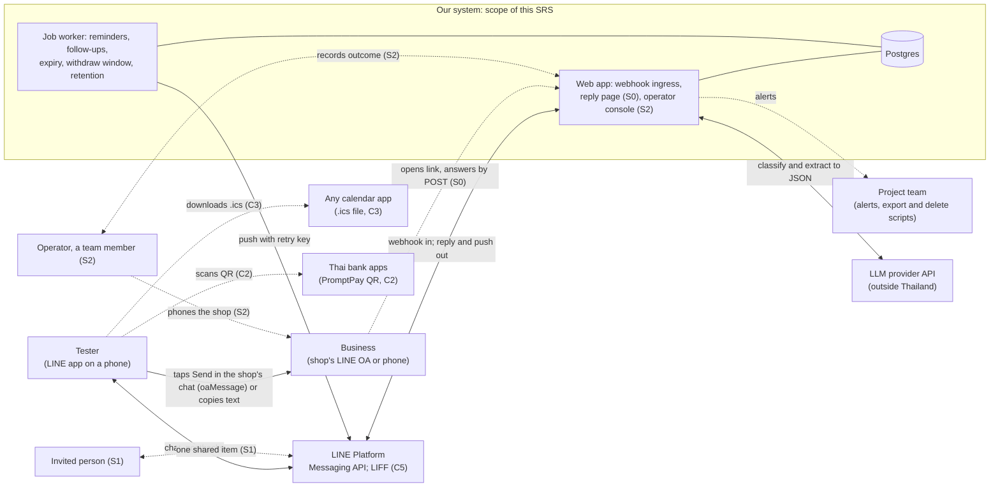
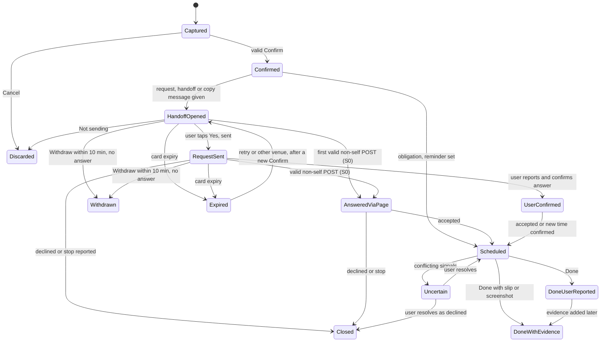

# SRS v0.9, Part A: Introduction, overall description, stakeholder needs, interfaces and functions

| Field | Value |
|---|---|
| Document | Software Requirements Specification (SRS) v0.9, Part A (author A) |
| Covers | §1 Introduction; §2.1–2.4 Overall description; §2.7 Stakeholder requirements, user stories and use cases; §3.1 External interfaces; §3.2 Functional requirements |
| Not covered here | §2.5 Constraints (`CON`), §2.6 Assumptions (`ASM`, `DEP`, `OOS`), §3.3 AI, §3.4 Quality, §3.5 Data, §3.6 Security and privacy, §3.7 Compliance, §4 Verification. Other authors write these in parallel. This part refers to their topics by the IDs in `requirement-types-research.md` (for example `AI-HITL-01`, `DR-04`, `LEG-05`) and never creates IDs with their prefixes |
| Date | 9 November 2026 |
| Status | Draft for team review. Every requirement has status **Proposed**. Owners are assigned by the team when roles are fixed |
| Sources of truth | `docs/combined/combined-proposal.md` v0.2 (cited as **CP §x**) with three pending fixes applied (see §1.1); `docs/combined/advantages-matrix.md` (**AM**); `docs/requirements/requirement-types-research.md` (**RTR**); `docs/research/abdul-recon/abdul-recon-2026-11-09.md` §6–7 (**REC**); `docs/review/revised/omm/business-and-architecture-brief.md` §5, §8 (**OMM**); `docs/review/revised/vj/specs/scope-and-objectives.md` (**VJ**) |

Evidence tags follow the team brief: `[V]` primary source opened (here: as recorded in the cited judge-passed file, with its date), `[S]` secondary, `[I]` our inference, `UNVERIFIED` not checked. All numbers marked *proposal* are for the team to agree. They are frozen with the design on 20 November 2026 (`VER-01`, CP §9).

---

## How to read the requirements

- **One statement per row.** Each `BR`, `STK`, `IF` and `FR` row has one "shall" sentence. User stories (`US`) use the "As a… I want… so that…" form. Use cases (`UC`) use numbered flows. All three carry the same attributes.
- **Attributes** (RTR §2.3). Each requirement table has these columns: **ID**; **Statement**; **Pri** (MoSCoW: M Must, S Should, C Could, W Won't); **Trace up** (source: a `BR`, `STK`, `SEED-` item, research ID or CP section); **Rationale**; **Acceptance criterion**; **V** (verification method: **I** inspection, **A** analysis, **D** demonstration, **T** test). The **type** of every row is its prefix category, named in the table caption. **Status** is Proposed for all rows. **Owner** is TBD (assigned at the team's role decision).
- **S0 promotion.** The reply page is Should item S0. If decision TD6 finds the calendar is scenario B or better at 3.5 h a week, every row marked "S (S0)" becomes Must (CP §6.1, §13).
- **ID format.** `PREFIX-AREA-NN`. Reused IDs from RTR keep their meaning and number. New IDs use the same two-digit form as the judge-passed IDs (RTR §2.2 shows three digits; see open issue A-1). Numbers are never reused. A dropped requirement keeps its row with status Deferred or Deleted.
- **Placeholders.** "TBD after spike (13 Dec 2026)" means the value is set after the P1 technical spike, which ends with phase P1 on 13 December 2026 (CP §6.4). "TBD at freeze (20 Nov 2026)" means the team sets it when the design is frozen. Where a proposal value exists, it is shown.

---

## 1. Introduction

### 1.1 Purpose

This SRS states what the prototype of our LINE assistant must do and how each requirement will be checked. The prototype is a university senior project by three students. It is due as an evaluated prototype on 30 April 2027. Version 0.9 goes with the proposal on 22 November 2026 (`DOC-01`).

Readers: the team (to build and test), the supervisor and committee (to assess scope and verification), and later maintainers.

Three corrections to CP v0.2 are applied here, as agreed by the manager on 9 November 2026:

1. **"Request sent" is never set by a page load.** It is set only by the user's "Yes, I sent it" answer or by the first valid POST answer on the reply page. A page open (HTTP GET) or a link preview changes no state. (AM C4 still says "or the reply page is first opened". This SRS follows CP §4.2 and the fix; see open issue A-2.)
2. **No LINE login on the business-facing reply page** (no LINE Login and no LIFF there).
3. **Slip and screenshot images are kept 30 days or until the E6 audit of that task**, whichever is later, and never beyond the end-of-pilot deletion (`TR-03`). The retention rule itself is owned by the data author (`DR-04`); this part only uses it.

### 1.2 Scope

**Product.** A LINE Official Account (OA) assistant for Thailand. It turns a chat message into a **task with an outcome**, prepares the next step so that **one tap by the user sends it**, and follows up until the outcome is known and backed by evidence (CP §1). It goes beyond Abdul (abdul.chat), which reminds but does not contact a business or record evidence `[V, Abdul public pages 8–9 Nov 2026, via REC §6]`.

**One engine, two task types.** An *obligation* (a bill, rent, a renewal, an appointment) and a *request to a business* (a haircut slot, a quote). Both share one lifecycle (§3.2.9).

**Levels of action** (CP §4.1). Level 1, the assistant does it itself (tracked obligation, reminders). Level 2, it prepares a request card and the user's tap sends it. Level 3, direct booking, is not built.

**Scope by priority** (matches CP §6.1):

| Priority | Items in scope |
|---|---|
| **Must** | M1 Foundations: LINE webhook with signature check and event inbox, database, job worker, deployment, separate development and pilot channels, alerts, logs without personal content, P1 spike on `oaMessage` and the share picker. M2 Obligations and reminders: text capture, Flex confirmation card with Confirm, Edit and Cancel (edit one field at a time in chat), Buddhist-era and Thai relative dates, one-off reminders with snooze, done and quiet hours, completion with an evidence level. M3 Bounded AI and a Thai test set. M4 Request to a business: card composer, approval bound to a content hash, LINE handoff and copy-and-send adapters with "Did you send it?", follow-up, expiry and 10-minute Withdraw, outcome plus a reminder for the agreed time, router and a venue table of 10–15 hand-checked venues. M5 Assurance: isolation and fault-injection tests, privacy notice, retention jobs, export and delete by chat command, backup restore. M6 Evaluation with 15–20 testers aged 20 or over, or married. M7 Documentation |
| **Should** (in TD3 order) | S0 reply page for businesses; S3 recurrence (monthly, then weekly and daily); S4 "upcoming in the next N days" list; S1 share one item with one invited person; S2 operator console (Wizard-of-Oz: a team member does the last step by phone) |
| **Could** | C1 photo of one bill format; C2 bill split with a PromptPay QR to the payer's own account; C3 `.ics` calendar file; C4 share-target-picker adapter (only if the P1 spike shows it reaches a shop); C5 LIFF pages; C6 second LLM compared on the held-out set |
| **Won't** (this project) | Level 3 direct booking; partner APIs; browser agents for web forms; email; AI phone calls; group polls or any bot in LINE groups; Google Calendar or Gmail OAuth; payments or subscriptions; venue recommendations from Google or Wongnai data; escalation-until-acknowledged reminders; voice-note input; วันพระ (Buddhist holy day) recurrence; medical requests; testers under 20 (unless married); Temporal (a workflow engine); merchant dashboard |

### 1.3 Definitions and acronyms

| Term | Thai | Meaning in this SRS |
|---|---|---|
| Task | งาน | One tracked item owned by one user. Type is *obligation* or *request* |
| Obligation | ภาระ / บิล / นัด | Something the user must do by a date (pay a bill, renew, attend) |
| Request (to a business) | คำขอ | A task in which the user asks a business for a slot or a quote |
| Request card | การ์ดคำขอ | The exact text we prepare for a business: service, time options, user's nickname, AI disclosure |
| Confirmation card | การ์ดยืนยัน | A Flex message showing exact parsed values with Confirm, Edit and Cancel |
| Approval token | — | A random, single-use value bound to one card version; Confirm carries it |
| Content hash | — | A hash of the exact card content; any edit changes it |
| Venue | ร้าน | A business in our venue table: our own hand-checked name, LINE ID or phone, opening hours, channel, confidence, last-verified date |
| Adapter / router | — | An adapter is one way to reach a venue (handoff, copy-and-send, operator, reply page). The router picks one per venue |
| Handoff | — | Opening the shop's LINE chat with our text pre-filled, through the `oaMessage` link. The user taps Send |
| `oaMessage` | — | LINE URL scheme `https://line.me/R/oaMessage/{LINE ID}/?{text}`; works in LINE on a phone only |
| Reply page (S0) | — | Our public web page where a business answers a card with one tap |
| Self-answer | — | A reply-page answer from a browser that carries the requester's own marker cookie |
| Evidence level | ระดับหลักฐาน | How we know a task's outcome (§3.2.9); stored apart from the state |
| Slip | สลิป | A payment-slip image the user attaches as evidence. It does not prove settlement |
| Nickname | ชื่อเล่น | The name the user chooses to show on cards; never the LINE user ID |
| OA | — | LINE Official Account |
| Messaging API | — | LINE's API for bots: webhooks in, reply and push messages out |
| Webhook / `webhookEventId` | — | HTTPS POST from LINE carrying events; each event has a unique ID that stays the same on redelivery |
| Reply token | — | One-use token in an event; lets us reply free of the push quota within one minute |
| Push message | — | A message we start; counts against the OA's monthly quota |
| `X-Line-Retry-Key` | — | Header that makes a retried push run at most once |
| Flex message, quick reply, postback, rich menu | — | LINE message formats: a laid-out card; tappable chips under a message; a button that sends hidden data to our server; a fixed menu under the chat |
| LIFF | — | LINE Front-end Framework: web pages opened inside LINE (Could C5) |
| LLM | — | Large language model, used only to classify and extract |
| BE / CE | พ.ศ. / ค.ศ. | Buddhist Era (CE + 543) and Common Era years |
| Asia/Bangkok | — | The time zone used for all dates (UTC+7, no daylight saving) |
| PromptPay | พร้อมเพย์ | Thai instant-payment scheme; QR codes follow the Thai QR standard (Could C2) |
| PDPA | พ.ร.บ.คุ้มครองข้อมูลส่วนบุคคล | Thai Personal Data Protection Act B.E. 2562 |
| ETA | พ.ร.บ.ธุรกรรมทางอิเล็กทรอนิกส์ | Thai Electronic Transactions Act B.E. 2544 |
| Sui juris | บรรลุนิติภาวะ | Legally of age: 20 or over, or married (`LEG-05`) |
| HITL | — | Human in the loop: a person confirms before the system acts |
| MoSCoW | — | Must, Should, Could, Won't |
| Wizard-of-Oz | — | A test method in which a person secretly does a step the software will later do; here it is disclosed to testers |
| E1–E14 | — | Evaluation measures in CP §9.1 |
| TD1–TD6 | — | Team decisions due 13 Nov 2026 (CP §13) |

### 1.4 References

Internal (all under `docs/`): CP, AM, RTR, REC, OMM, VJ as listed in the header; `review/TEAM-BRIEF.md`; `review/revised/omm/timeline-and-development-phases.md` (phase dates).

External, as recorded with dates in CP §14 and RTR (not reopened by this author):
- LINE Messaging API: receiving messages and redelivery; signature verification; retry key; URL scheme (`oaMessage`); group chats; pricing. https://developers.line.biz/en/docs/messaging-api/ `[V, 9 Nov 2026, via CP §14]`
- LIFF identity handling: https://developers.line.biz/en/docs/liff/ `[V, via OMM §8.1]`
- LINE Thailand OA plans and Reply API notice: https://lineforbusiness.com/th/service/line-oa-features ; https://www.lineforbusiness.com/th/news/20261030 `[V, 9 Nov 2026, via CP §14]`
- ISO/IEC/IEEE 29148:2018 (SRS outline and requirement characteristics) `[V contents, S clause text, via RTR §1.1]`
- RFC 5545 iCalendar (for C3) `[I, not opened in this run]`; Bank of Thailand Thai QR Code Payment Standard (for C2) `[S, not opened; RTR open issue 11]`

### 1.5 Business requirements (`BR`)

Thresholds are from CP §9.1 and are proposals until the 20 Nov 2026 freeze. With 15–20 testers, every rate is reported with a 95% Wilson interval; a rule is *inconclusive* when its interval contains the threshold (CP §9).

**Table 1.5. Type: Business requirement.**

| ID | Statement | Pri | Trace up | Rationale | Acceptance criterion | V |
|---|---|---|---|---|---|---|
| BR-01 | By 30 April 2027, the team shall demonstrate both Must task flows end to end with real testers: an obligation from message to completion with an evidence level, and a request to a business from message to a known outcome. | M | RTR BR-01 (revised to the combined scope); CP §1, §6.1 | The course grades a working, evaluated prototype | Demo script on the pilot channel completes both flows; evaluation logs show at least one completed flow of each type per tester who attempted it | D |
| BR-02 | In the evaluation, at least 80% of testers shall complete capture → confirm → reminder without help from the team. | M | RTR BR-02 (threshold revised to CP E8); goal G1 | Shows the obligation flow is usable on its own | Point estimate ≥ 80% over all testers' logs (E8), with the Wilson interval reported | A |
| BR-03 | *Deferred.* (RTR: compare with a reminder-only baseline on the same tasks.) | W | RTR BR-03 | Not costed in the plan; replaced by the qualitative comparison BR-07 | — | — |
| BR-04 | In the evaluation, at least 70% of request tasks shall reach a known outcome (answered, declined, or clearly no reply). | M | CP E8; goal G2 | Shows the "acts" flow closes the loop | Point estimate ≥ 70% of request tasks in the logs (E8), interval reported | A |
| BR-05 | The prototype shall show a task to its user only in a state and evidence level that the system has observed. | M | Goal G3; CP §4.2; E6 | Honest status is the main difference from a reminder app | E6 audit of every evaluation task finds 0 tasks shown as sent, booked or done without the matching trigger or evidence | A |
| BR-06 | No action shall leave the system for a third party without a valid confirmation tap by the user. | M | Goal G4; `AI-HITL-01`; E3 | Safety and the ETA attribution rule (`LEG-06`) | E3: every adapter tested with no tap, an old token, a reused token and an edited card; 0 actions leave | T |
| BR-07 | The final report shall compare the prototype's flows with Abdul's advertised features, using public information only. | M | CP E13; REC §6; TEAM-BRIEF research boundary | The project is motivated as "beyond Abdul" | The report contains the E13 table, states that recurrence parity is partial, and cites public sources only | I |
| BR-08 | The median time from a tester's first message to a confirmed task shall be 2 minutes or less. | M | Goal G1; CP E9 | Speed is why a user would choose the assistant | Median of logged first-message-to-Confirm times ≤ 120 s | A |
| BR-09 | The evaluation shall report, split by adapter, the outcomes of 15–25 real request cards: share answered, declined, no answer, time to answer, and share that needed a phone call. | M | CP E11; VJ success metrics | Whether businesses answer is the riskiest assumption (`ASM-01`) | Report table with each measure per adapter and its interval; self-answered reply-page answers excluded | I |

---

## 2. Overall description

### 2.1 Product perspective

The product is a new, self-contained system. Users reach it only through LINE (`CON-PLAT-01`). It depends on the LINE Platform and one LLM provider. It does not hold or move money (`LEG-03`) and never writes into another business's OA chat: the user's own tap sends every request (`LEG-02`, CP §4.4).

Solid lines are Must. Dotted lines are Should or Could, or team-side. The internal components (ingress, task service, AI interpreter, approval gate, job worker, notifier, router and adapters) are described in CP §7.1 and belong to the design document.

### 2.2 Product functions

| # | Function | Pri | Requirements |
|---|---|---|---|
| F1 | Onboard: welcome with AI disclosure, privacy notice, acceptance and age statement | M | §3.2.1 |
| F2 | Capture an obligation from Thai, English or mixed text, with Buddhist-era and relative dates | M | §3.2.2 |
| F3 | Confirm, edit (one field at a time) or cancel any card; approval bound to content | M | §3.2.3 |
| F4 | One-off reminders with snooze, done and quiet hours | M | §3.2.4 |
| F5 | Record completion with an evidence level (user-reported, slip or screenshot attached) | M | §3.2.5 |
| F6 | Compose a request card for a business, with AI disclosure | M | §3.2.6 |
| F7 | Route to an adapter from the venue table; LINE handoff or copy-and-send; "Did you send it?" | M | §3.2.7 |
| F8 | Follow up, record the business's answer, expire, set a reminder for the agreed time | M | §3.2.8 |
| F9 | Withdraw within 10 minutes while unanswered | M | §3.2.8 |
| F10 | One lifecycle with honest states and evidence levels | M | §3.2.9 |
| F11 | Export or delete my data by chat command | M | §3.2.10 |
| F12 | Reply page for businesses | S (S0) | §3.2.11 |
| F13 | Recurrence; upcoming list; share one item; operator console | S (S3, S4, S1, S2) | §3.2.12 |
| F14 | Photo capture, bill split QR, `.ics`, share picker, LIFF pages | C | §3.2.13 |

### 2.3 Stakeholders and user characteristics

| Stakeholder | Role in the prototype | Characteristics and needs | Requirements |
|---|---|---|---|
| Tester (end user) | Sends tasks, confirms, receives results | Students and staff of our university, aged 20 or over or married (`LEG-05`, TD1). Mostly staff, later-year and graduate students. Uses LINE daily on a phone; writes mixed Thai-English; manages some own bills, rent, renewals or appointments. No training beyond the welcome message | STK-01, 02, 06, 07, 11 |
| Business (shop near campus) | Receives a card the tester sent; answers in its own chat or (S0) on the reply page | Small salon or barber shop taking bookings by LINE chat or phone `[S, via CP §2]`. Never signs up. A PDPA data subject who never agreed to our terms | STK-03, 04, 05 |
| Invited person (S1) | Sees one shared item; can mark it done | Same age rule as testers | STK-08 |
| Operator (S2) | A team member who phones a shop in a published time window | Uses our console on a laptop | STK-09 |
| Supervisor and committee | Assess design, AI depth and evaluation | Need traceable evidence | STK-10 |
| Project team | Builds, runs the pilot, runs export and delete scripts, answers alerts | 3 students at 3–4 h a week each; nobody on call | — (see `OPS-01`, `CON-TEAM-01`) |
| LINE (LY Corporation) | Platform owner | Sets quotas, prices and policies (`LEG-02`) | §3.1 |
| LLM provider | Processes prompts abroad | Chosen at D06 (16 Nov 2026) with zero-retention, no-training terms (`PRV-05`) and a recorded PDPA s.28 basis (`PRV-02`) | IF-LLM-01, 02 |

**Personas** (fictional, no real person):

- **Fon, 22, fourth-year student.** Pays her dorm rent and phone bill herself. Books a haircut near campus every six weeks by messaging the shop's LINE OA, then forgets what time was agreed. Wants: "tell it once in Thai and stop worrying".
- **Khun Nok, 41, university staff.** Pays electricity and water bills, renews car tax once a year, and keeps slips "just in case". Wants to know which bills are really done and which she only meant to pay.
- **Pi Ae, 35, owner of a two-chair salon.** Answers LINE between customers. Will not install anything or sign up. Wants requests that are short and clear, says who is asking, and a way to say "no more".

### 2.4 Operating environment

| Element | Environment |
|---|---|
| User client | LINE app on iOS or Android phones (minimum versions TBD after spike, 13 Dec 2026). The `oaMessage` handoff works on a phone only, not in LINE for PC `[V, judge-vj spot-check 1, via CP §4.4]` |
| Business client | Its own LINE OA app or LINE app on a phone; (S0) any current mobile browser, including LINE's in-app browser |
| Operator client (S2) | Desktop browser |
| Server | One web app (webhook, S0 page, S2 console), one worker process, one PostgreSQL database, one LLM API. Stack and hosting chosen at D05 (16 Nov 2026) |
| Channels | Two LINE OA channels: development and pilot (`TR-01`) |
| Time | All dates in `Asia/Bangkok`; stored as instants |
| Languages | Thai and English chat (`L10N-01`); business-facing card text in Thai |
| LINE plan | Free (300 pushes a month) or Basic for the evaluation months (TD5) |

### 2.7 Stakeholder requirements, user stories and use cases

(§2.5 and §2.6 belong to other authors.)

#### 2.7.1 Stakeholder requirements (`STK`)

**Table 2.7.1. Type: Stakeholder requirement.**

| ID | Statement | Pri | Trace up | Rationale | Acceptance criterion | V |
|---|---|---|---|---|---|---|
| STK-01 | A tester shall be able to turn one chat message into a confirmed, tracked task without retyping information the message already contains. | M | BR-01, BR-08; goal G1; OMM §5 | The core promise; typing fields is what users avoid | In moderated sessions, each tester confirms a task from one message; no field present in the message is re-asked unless flagged low-confidence (`AI-HAL-02`) | D |
| STK-02 | A tester shall be able to see the exact content of anything sent on their behalf, and edit or cancel it, before it leaves the system. | M | BR-06; `AI-HITL-01`; `LEG-06`, `LEG-07` | The message is legally the user's own (ETA s.15, s.17) | Every outbound path shows the exact text with Confirm, Edit, Cancel (inspection of all card templates; E3 tests) | I |
| STK-03 | A business shall be able to answer a request card with one tap, without creating an account. | S (S0) | RTR STK-03; SEED-FR-07 | Businesses never sign up | On the reply page, one Accept, Decline or Stop tap plus its confirm tap records an answer; no login or form | T |
| STK-04 | A business shall be able to stop further requests from the system. | M | CP §9.3, §10 (Computer Crime Act s.11 boundary) | Avoids unwanted messages; respects third parties | Every card text tells the business how to stop; a recorded stop blocks new cards to that venue (FR-RTE-04) | T |
| STK-05 | A business receiving a card shall be told that an AI assistant prepared it for a named user. | M | `AI-EXP-01`; `LEG-08`; CP §9.3 | Honest disclosure to people who never agreed to our terms | Every card template contains the disclosure line and the nickname (inspection) | I |
| STK-06 | A tester shall be able to tell, for every task, whether a request was only prepared, sent or answered, and whether a done task has evidence. | M | BR-05; goal G3 | Honest status | Each state in Table 3.2.9-A has a distinct user label; E6 audit | I |
| STK-07 | A tester shall be able to control when reminders reach them (quiet hours and snooze). | M | CP anti-goal "reminders become stress"; OMM §5; REC P-4 | Reminders at night or without control drive users away | Quiet hours and snooze work as in FR-REM-02, FR-REM-03 | T |
| STK-08 | An invited person shall be able to see one shared item and mark it done, with no access to anything else of the owner's. | S (S1) | CP S1; OMM §5, §8.3 | Keeps the family-coordination direction in testable form | E7 isolation tests pass for granted and revoked shares | T |
| STK-09 | An operator shall be able to see requests that need a phone call and record each outcome, with every step logged and timed. | S (S2) | CP S2; VJ Wizard-of-Oz | Reaches phone-only shops; makes human effort measurable | Console lists such requests; each recorded outcome has operator, timestamps and minutes | D |
| STK-10 | The supervisor shall be able to trace every Must requirement to an acceptance criterion and, before the Phase 1 gate, to a test or evaluation case. | M | `VER-01`; RTR §2.4 | Grading needs evidence | Traceability filter shows no Must row without an acceptance criterion (v0.9) and test link (Phase 1 gate) | I |
| STK-11 | A tester shall be able to obtain a copy of, or the deletion of, their data. | M | `PRV-03`; CP M5 | PDPA rights (s.30, s.33) | Export and delete commands work as in FR-DATA-01, FR-DATA-02 | T |

#### 2.7.2 User stories (`US`)

**Table 2.7.2. Type: User story.** Acceptance criteria use Given/When/Then.

| ID | Story | Pri | Trace up | Acceptance criterion | V |
|---|---|---|---|---|---|
| US-01 | As a tester, I want to type "ค่าไฟ 1,245 บาท จ่ายภายใน 25 พ.ย." and get a card with the amount and date filled in, so that I do not retype them. | M | STK-01; SEED-FR-01 | Given that message, when I send it, then a confirmation card shows ฿1,245, due 25 Nov 2026 (BE and CE), with Confirm, Edit, Cancel | T |
| US-02 | As a tester, I want to fix one wrong field by tapping, so that a mistake does not mean starting again. | M | STK-02; `UX-01` | Given a card with a wrong date, when I tap Edit → Date and pick a new one, then a new card version shows it and the old Confirm no longer works | T |
| US-03 | As a tester, I want a reminder at the time I chose, with Done and Snooze, and none during my quiet hours. | M | STK-07; REC P-4 | Given a reminder due at 23:00 and quiet hours 22:00–07:00, then it arrives at 07:00 with Done and Snooze buttons | T |
| US-04 | As a tester, I want to mark a bill done and attach the slip, so that I can later see it was really handled. | M | STK-06; SEED-FR-02 | Given a reminder, when I tap Done and send a slip image, then the task shows "Done (slip attached)" | T |
| US-05 | As a tester, I want the assistant to prepare my haircut request and open the shop's chat with the text ready, so that sending it takes one tap. | M | BR-04; SEED-FR-03, SEED-FR-04 | Given a verified venue with a LINE ID, when I confirm the card, then I get a button that opens that shop's chat with the exact confirmed text | D |
| US-06 | As a tester, I want to tell the assistant whether I sent the request and what the shop answered, so that it reminds me of the agreed time. | M | BR-04; SEED-FR-05, SEED-FR-06 | Given I tapped "Yes, sent" and later "Accepted, Sat 14:00", then the task is Scheduled with a reminder before 14:00 | T |
| US-07 | As a student who paid for a group dinner, I want each friend to get a PromptPay QR code to my own account, so that I am repaid without chasing people. | C (C2) | RTR US-07 (unchanged); `LEG-03` | Given 4 participants and ฿1,000 equal split, each QR encodes ฿250 and my PromptPay ID; I confirm before anything is shown to others | T |
| US-08 | As a tester, I want to withdraw a request I sent by mistake within 10 minutes, and be told what I must undo myself. | M | STK-02; `LEG-07` | Given a request sent 5 minutes ago and unanswered, when I tap Withdraw, then it shows Withdrawn and tells me to unsend the chat message myself | T |
| US-09 | As a tester, I want to request a shop that has no LINE ID by copying a ready message or calling, so that phone-only shops are still reachable. | M | SEED-FR-04; REC D-8 | Given a venue with only a phone number, when I confirm, then I get the text as a separate bubble, a call button, and the "Did you send it?" question | D |
| US-10 | As a tester, I want to ask for my data or its deletion by typing a command, so that I keep control of it. | M | STK-11 | Given I type "delete my data" and confirm, then I am told the deletion will be done within 30 days and the request is logged for the team | T |
| US-11 | As a shop owner, I want to accept one of the offered times with one tap, without signing up. | S (S0) | STK-03 | Given an open card link, when I tap "14:00 OK" and confirm, then the requester is told within one minute (job-run time) | T |
| US-12 | As a tester, I want my monthly rent to repeat on the same day each month. | S (S3) | REC P-2 | Given rent due on the 31st monthly, then February's occurrence falls on the last day of February | T |
| US-13 | As a tester, I want a list of what is due in the next N days, optionally before my payday. | S (S4) | OMM §5 | Given 3 items due within 7 days, when I ask "upcoming", then all 3 are listed by due date | T |
| US-14 | As a tester, I want to share one bill with my partner, so that either of us can mark it paid. | S (S1) | STK-08 | Given an accepted share, my partner sees only that item and can mark it done; after I revoke, they see nothing | T |
| US-15 | As an operator, I want a list of requests that need a call, so that I can phone the shop and record the outcome. | S (S2) | STK-09 | Given a phone-only venue in a staffed window, the request appears in the console and my recorded outcome reaches the tester | D |

#### 2.7.3 Use cases (`UC`)

Fully dressed for Must flows; brief for Should flows. Each use case is verified by a scenario test that walks its main flow and every alternative (V: **T**), plus the FR tests it cites. `UC-02` is reserved: RTR used it for "create calendar event from chat", which is Won't (Google Calendar OAuth). It keeps status Deferred and its number is not reused.

##### UC-01 Start using the assistant (Must)

| Field | Value |
|---|---|
| Primary actor | Tester. Secondary: LINE Platform |
| Trace up | STK-05 (disclosure), `PRV-01`, `PRV-08`, `LEG-05`, `AI-EXP-01` |
| Preconditions | Tester recruited and has signed the study consent offline (`LEG-04`); uses the pilot channel (`TR-01`) |
| Trigger | Tester adds our OA as a friend (LINE `follow` event) |
| Postconditions | Success: a user record exists with notice version, acceptance time and age statement. Failure: no message content from this user is stored or sent to the LLM |

Main flow:
1. Tester adds the OA.
2. System verifies and stores the event (IF-LINE-01, IF-LINE-04) and replies with the welcome message: it is an AI assistant, what it can do, and a link to the privacy notice with an Accept button (FR-ONB-01).
3. Tester reads the notice and taps Accept.
4. System asks for the age statement ("I am 20 or over, or married") with Yes and No (FR-ONB-03).
5. Tester taps Yes. System records both answers and shows two examples to try.

Alternatives:
- 3a. Tester sends a task before accepting. System does not process it, does not send it to the LLM, and shows the notice button again (FR-ONB-02).
- 5a. Tester taps No. System explains the pilot is for people aged 20 or over, or married; processes no messages; explains how to leave.
- 1a. Tester had blocked and re-adds the OA. Paused schedules resume (IF-LINE-07); earlier acceptance stands unless the user's data was deleted.

##### UC-03 Capture and confirm an obligation (Must)

| Field | Value |
|---|---|
| Primary actor | Tester. Secondary: LLM provider |
| Trace up | STK-01, STK-02; SEED-FR-01; `AI-HAL-01`, `AI-HAL-02`, `AI-HITL-01`; CP §8.1 |
| Preconditions | UC-01 complete |
| Trigger | Tester sends a 1:1 text message |
| Postconditions | Success: task Confirmed then Scheduled; obligation and its reminder job saved in one transaction; audit record (`SEC-03`). Cancel: task Discarded, no job |

Main flow:
1. Tester sends "ค่าไฟ 1,245 บาท จ่ายภายใน 25 พ.ย.".
2. System verifies, stores and acknowledges the event (IF-LINE-01, -03, -04).
3. System asks the LLM to classify and extract into the schema (IF-LLM-01); result: obligation, payee, amount, due date, confidences.
4. System validates: converts dates to `Asia/Bangkok`, resolves BE and relative dates (FR-CAP-03), flags low-confidence fields.
5. System replies with a confirmation card (FR-ACT-01) showing the parsed values, default reminder time, Confirm, Edit, Cancel.
6. Tester taps Confirm.
7. System checks the approval token (FR-ACT-03), saves the obligation and the reminder job, and replies "Tracked" with a Done button.

Alternatives:
- 3a. Message is a request to a business → UC-06.
- 3b. Message is chat or out of scope → short reply listing what the assistant can do (`AI-BEH-01`).
- 3c. Class is unclear → system asks "A bill or task / A request to a shop / Neither" by quick reply (FR-CAP-02).
- 3d. LLM times out, errors or returns invalid JSON → structured question flow (FR-CAP-04).
- 4a. A required field is missing or low-confidence → system asks for it instead of guessing (`AI-HAL-02`), then continues at 5.
- 6a. Tester taps Edit → picks one field → enters a value by quick reply or text → new card version (FR-ACT-02, FR-ACT-04) → back to 6.
- 6b. Tester taps Cancel → task Discarded (FR-ACT-05).
- 6c. Tester taps Confirm on an old version or after expiry → nothing is saved; system shows the current version (FR-ACT-03).
- 2a. The same event is redelivered → ignored (IF-LINE-04).

##### UC-04 Receive and act on a reminder (Must)

| Field | Value |
|---|---|
| Primary actor | Job worker (time trigger). Secondary: Tester, LINE Platform |
| Trace up | STK-07; FR-REM-01; REC P-4 |
| Preconditions | Task Scheduled with a reminder job |
| Trigger | Reminder time reached |
| Postconditions | Push accepted by LINE and the occurrence marked sent; or deferred; or paused |

Main flow:
1. Worker claims the due job.
2. If the time is inside the user's quiet hours, the job is moved to the end of quiet hours (FR-REM-02).
3. Notifier sends a push with Done and Snooze buttons and an `X-Line-Retry-Key` (IF-LINE-05).
4. LINE answers 200; the occurrence is marked sent.
5. Tester taps Snooze and picks an option → a new reminder job (FR-REM-03); or taps Done → UC-05.

Alternatives:
- 3a. LINE answers 500 or times out → retry with the same key; 409 counts as sent (IF-LINE-05).
- 3b. User has blocked the OA → no push; schedule paused (IF-LINE-07).
- 3c. Monthly push count has reached the cap set at TD5 → behaviour per IF-LINE-06; team alerted (`OPS-01`).
- 3d. LLM provider is down → no effect; reminders never call the LLM (FR-REM-05).
- 5a. Tester ignores the reminder → no repeat (escalation is Won't); task stays Scheduled.

##### UC-05 Complete a task with evidence (Must)

| Field | Value |
|---|---|
| Primary actor | Tester |
| Trace up | STK-06; SEED-FR-02; CP §4.2 |
| Preconditions | Task Scheduled |
| Trigger | Tester taps Done (on the reminder or the "Tracked" message) |
| Postconditions | Done, user-reported; or Done, evidence attached. Pending reminder jobs for the task cancelled |

Main flow:
1. Tester taps Done.
2. System sets Done, user-reported, cancels pending reminders (FR-EVD-01, FR-REM-04), and offers "Attach slip or screenshot" (FR-EVD-02).
3. Tester sends an image within the attach window.
4. System stores it as evidence; state becomes Done, evidence attached; label "Done (slip attached)".

Alternatives:
- 3a. Tester does not attach → stays Done, user-reported ("Done (you said so)").
- 3b. Tester attaches later via the same button → upgrades the state (FR-EVD-03).
- 3c. Tester sends an image with no pending attach → system asks which open task it belongs to (FR-EVD-02).
- 4a. Retention deletes the image later → label changes, level kept (FR-EVD-04).

##### UC-06 Compose and confirm a request card (Must)

| Field | Value |
|---|---|
| Primary actor | Tester. Secondary: LLM provider |
| Trace up | STK-02, STK-05; SEED-FR-03; `FR-ACT-01`, `AI-HITL-01`, `AI-EXP-01`; CP §8.2–8.3 |
| Preconditions | UC-01 complete; venue table loaded (10–15 venues) |
| Trigger | Tester sends a request, for example "จองตัดผมร้าน X เสาร์บ่าย" |
| Postconditions | Success: card version approved; approval record bound to its content hash; UC-07 starts. Cancel: Discarded |

Main flow:
1. System classifies the message as a request and extracts venue, service and time options.
2. System matches the venue in the venue table (FR-RTE-01).
3. If the user has no nickname yet, system asks for one (FR-REQ-02).
4. System composes the card text (FR-REQ-01) and shows the preview: exact text, venue name, LINE ID or phone, time options, Confirm, Edit, Cancel.
5. Tester taps Confirm; system checks the token (FR-ACT-03) and records the approval.

Alternatives:
- 1a. Only one time option given → system asks for a second, and accepts "no other time" (FR-REQ-03).
- 1b. Medical or health service → refused with an explanation (FR-REQ-04).
- 2a. Several venues match → tester picks one by quick reply.
- 2b. No venue matches → tester types the shop's LINE ID or phone, or picks a verified venue of the same kind; a typed contact is shown on the card for confirmation (IF-OAM-02).
- 2c. Venue is marked do-not-contact → refused; system suggests another verified venue (FR-RTE-04).
- 5a. Edit / Cancel / stale token → as UC-03 6a–6c.

##### UC-07 Hand off the request and record sending (Must)

| Field | Value |
|---|---|
| Primary actor | Tester. Secondary: Business, LINE Platform |
| Trace up | SEED-FR-04, SEED-FR-05; BR-05; CP §4.4, §8.3 |
| Preconditions | UC-06 approved |
| Trigger | Approval recorded |
| Postconditions | Request sent (with a follow-up job and a 10-minute Withdraw window), or Discarded, or Expired. Never "sent" without the user's Yes (or, S0, a POST answer) |

Main flow:
1. Router picks the LINE handoff adapter for a venue with a verified LINE ID (FR-RTE-01).
2. System replies, in the same reply call, with (a) a button that opens `oaMessage` with the confirmed text (IF-OAM-01) and (b) "Did you send it?" with Yes, sent / Not yet / Not sending (FR-HND-01, FR-HND-02). State: Handoff opened.
3. Tester taps the button on a phone; LINE opens the shop's chat with the text; tester taps Send.
4. Tester taps "Yes, sent". State: Request sent; Withdraw shown; follow-up job scheduled (FR-HND-03).

Alternatives:
- 1a. Venue has no LINE ID → copy-and-send adapter: text as its own bubble, call button if a phone is known, and the same question (FR-HND-04).
- 3a. Tester is on LINE for PC → the link does not work; the message says so and the copy text is offered (IF-OAM-03).
- 3b. Tester changes the text in the shop's chat → we cannot see this; the record keeps the approved text only.
- 4a. "Not yet" → stays Handoff opened; buttons stay usable until the card expires.
- 4b. "Not sending" → Discarded.
- 4c. No answer by card expiry → Expired, never counted as sent (FR-FUP-06).
- 4d. (S0) The first valid POST on the reply page arrives first → Request sent and Answered via reply page (FR-RP-03).

##### UC-08 Follow up and record the business's answer (Must)

| Field | Value |
|---|---|
| Primary actor | Job worker. Secondary: Tester |
| Trace up | SEED-FR-06; BR-04; REC D-4; CP §8.3 |
| Preconditions | Request sent; no answer recorded |
| Trigger | Follow-up time reached (inside the venue's opening hours and outside the user's quiet hours) |
| Postconditions | User-confirmed then Scheduled (with an outcome reminder) or Closed; or Expired |

Main flow:
1. Worker sends "Did the shop answer?" with Accepted / Other time / Declined / No reply yet / Shop asked to stop (FR-FUP-01).
2. Tester taps Accepted and picks which offered time.
3. System shows a confirmation card for the agreed time; tester confirms.
4. State: User-confirmed, then Scheduled with a reminder before the agreed time (FR-FUP-02). Router score updated (FR-RTE-03).

Alternatives:
- 2a. Other time → tester enters it (quick reply or text) → confirmation card → Confirm → as step 4 (FR-FUP-03).
- 2b. Tester attaches a screenshot of the shop's reply → evidence level User-confirmed with screenshot (FR-FUP-04).
- 2c. Declined → Closed (FR-FUP-07).
- 2d. Shop asked to stop → Closed; venue marked do-not-contact (FR-RTE-04).
- 2e. No reply yet → second follow-up later; if still none, system suggests another verified venue or the copy-and-call path (FR-FUP-05). Choosing another venue starts a new card version and a new Confirm.
- 1a. No answer to any follow-up by card expiry → Expired, "No answer" (FR-FUP-06).

##### UC-09 Withdraw a request (Must)

| Field | Value |
|---|---|
| Primary actor | Tester |
| Trace up | `LEG-07`; STK-02; CP §7.2 |
| Preconditions | Request in Handoff opened or Request sent; less than 10 minutes since Confirm; no answer recorded |
| Trigger | Tester taps Withdraw |
| Postconditions | Withdrawn; pending jobs cancelled; what could not be undone recorded |

Main flow:
1. Tester taps Withdraw.
2. System checks the window and that no answer exists (FR-WDR-01), sets Withdrawn, cancels follow-up and expiry jobs (FR-WDR-02).
3. System replies: "Withdrawn. If you already sent the chat message, unsend it in LINE yourself." (S0: the reply page now shows "withdrawn by sender".)

Alternatives:
- 2a. Window passed or an answer exists → nothing changes; system says why and suggests messaging the shop directly (FR-WDR-03).

##### UC-10 Export or delete my data (Must)

| Field | Value |
|---|---|
| Primary actor | Tester. Secondary: Project team |
| Trace up | STK-11; `PRV-03`; CP M5 |
| Preconditions | UC-01 complete |
| Trigger | Tester types an export or delete command |
| Postconditions | A data-rights request record exists with a due date 30 days later; the team runs the script by then |

Main flow:
1. Tester types "ขอข้อมูลของฉัน" / "export my data" (or the delete equivalent).
2. System shows a confirmation card naming the request and the 30-day deadline (FR-DATA-01, FR-DATA-02).
3. Tester confirms; system records the request, alerts the team, and replies with the deadline.
4. Team runs the export or delete script; system sends the result (export: a time-limited download link; delete: a final message before the user record is removed).

Alternatives:
- 3a. Tester cancels → nothing recorded.
- 4a. Deadline approaching with the request open → team alerted again (`OPS-01`).

##### Brief use cases for Should items

| ID | Name | Pri | Summary (actor, main flow, key alternatives) |
|---|---|---|---|
| UC-11 | Business answers on the reply page | S (S0) | Business opens the link from the card (GET shows the card only). Taps an offered time, Decline or Stop, then confirms (POST). First valid, non-self answer: Request sent and Answered via reply page; requester notified; accepted → Scheduled with reminder. Alternatives: expired or withdrawn card shows only a status line; second answer shows "already answered"; self-answer flagged, no state change (FR-RP-01…07) |
| UC-12 | Create a recurring obligation | S (S3) | Tester says "ค่าเช่า 5,000 ทุกวันที่ 1". Card shows the rule and the next 3 dates; Confirm stores the rule apart from occurrences. Each occurrence has its own reminder and Done (FR-REC-01…03) |
| UC-13 | See what is due soon | S (S4) | Tester types "upcoming" (optionally "before payday 25"). System replies with open items due in N days, sorted, with a count and total amount (FR-UPC-01, 02) |
| UC-14 | Share one item | S (S1) | Owner taps Share on a task and sends the invite link to one person. Invitee accepts (notice and age statement). Both see status; either can mark done. Owner revokes: access ends at once (FR-SHR-01…04) |
| UC-15 | Operator handles a phone-only request | S (S2) | Router picks the operator adapter inside a published window. Operator sees the request in the console, phones the shop, records the outcome; tester is told; every step logged and timed (FR-OPC-01…03) |

---

## 3. Specific requirements

### 3.1 External interfaces (`IF`)

At v0.9 interfaces are named with their key constraints (RTR §3). Contract tests come with v1.0.

#### 3.1.1 Interface overview

| Interface | Direction | Pri | Purpose |
|---|---|---|---|
| LINE Messaging API: webhook | LINE → us | M | Receive messages, postbacks, follow, unfollow, join events |
| LINE Messaging API: reply, push, rich menu | us → LINE | M | Cards, reminders, follow-ups |
| `oaMessage` URL scheme (handoff) | us → user's LINE app → business chat | M | Open the shop's chat with pre-filled text; mobile only |
| LLM provider API | us ↔ provider | M | Classify and extract to a JSON schema |
| Reply page (S0) | business browser ↔ us | S (S0) | One-tap answers |
| Operator console (S2) | team browser ↔ us | S (S2) | Record phone outcomes |
| LIFF | LINE app ↔ us | C (C5) | Multi-field edit page, upcoming list |
| `.ics` file | us → user's calendar app | C (C3) | Add a confirmed booking to any calendar |
| PromptPay QR | us → bank apps | C (C2) | Bill-split payment code to the payer's own account |
| User interface in chat | — | M | Flex cards, quick replies, postback buttons, rich menu (Help; My tasks) |

#### 3.1.2 Key platform constraints (facts the requirements rest on)

| Fact | Source |
|---|---|
| Webhook requests carry `x-line-signature`: base64 HMAC-SHA256 of the raw body with the channel secret | `[V, LINE docs, 9 Nov 2026, via OMM §8.1]` |
| LINE recommends returning 2xx quickly and processing asynchronously | `[V, via OMM §8.1]` |
| Webhook redelivery is off by default, must be enabled, and is not guaranteed; a redelivered event keeps its `webhookEventId` and sets `deliveryContext.isRedelivery`; events may arrive out of order | `[V, via OMM §8.1]` |
| A reply token can be used once and only within one minute (OMM marks the exact limit UNVERIFIED; RTR records it as `[V]`). Replies are free of the push quota | `[V, via RTR §1.3.5]` |
| At most 5 message objects per reply or push call | `[V, via RTR §1.3.5]` |
| Push messages count against the monthly quota, per recipient. Free plan: 300 a month, no paid overage. Basic plan: ฿1,280 + 7% VAT a month for 15,000 | `[V, via OMM §8.8 and CP TD5]` |
| `X-Line-Retry-Key` makes a retried push run once; valid 24 h; a duplicate gets 409; retry only on 500 or timeout; 200 does not prove delivery | `[V, via OMM §8.8]` |
| Pushes to a user who blocked the OA are not delivered (`unfollow` event) | `[V, via OMM §8.8]` |
| `oaMessage` opens an OA's chat with text pre-filled; the user taps Send; mobile only, not LINE for PC | `[V, via CP §4.4]` |
| A bot cannot write into another OA's chat, and only one OA can be in a group | `[V group docs; I for OA-to-OA, via CP §4.4]` |
| The Messaging API has no file message type, so an `.ics` file needs a download link | `[I]`, check in the P1 spike |
| Reply API messages become paid above 25,000 a month from 1 Feb 2027 (LINE Thailand) | `[V, via CP §12]` |
| LIFF: send the ID token to the server and verify it; never trust profile fields | `[V, via RTR §1.3.5, OMM §8.1]` |

#### 3.1.3 Interface requirements

**Table 3.1.3. Type: External interface requirement.**

| ID | Statement | Pri | Trace up | Rationale | Acceptance criterion | V |
|---|---|---|---|---|---|---|
| IF-LINE-01 | The system shall reject any webhook request whose `x-line-signature` does not match the HMAC-SHA256 of the raw body computed with the channel secret. | M | RTR IF-LINE-01; CP §7.1 | Stops forged events | Forged, missing and body-altered signatures are rejected with no event stored (CP §9.2, test of ≥ 3 cases) | T |
| IF-LINE-02 | The system shall answer user-initiated events with the reply API within the reply-token window, and shall use push messages only for reminders, follow-ups, expiry notices and asynchronous results. | M | RTR IF-LINE-02; REC P-11 | Push quota is scarce (300 a month on Free) | Code inspection of every send path; pilot log shows no push sent in answer to a user event whose reply token was unused and unexpired | I |
| IF-LINE-03 | The system shall return HTTP 200 for a correctly signed webhook request after storing its events in the inbox and before calling the LLM. | M | OMM §8.1; CP §7.1 | Fast acknowledgement avoids LINE timeouts and redelivery | Test with a stubbed slow LLM: 200 is returned before the LLM call starts | T |
| IF-LINE-04 | The system shall store each `webhookEventId` under a unique constraint, in the same transaction as the work the event creates, and shall ignore an event whose ID is already stored. | M | SEED (`IF-LINE-01`, `QR-RE-01` row of CP §5); OMM §8.1 | At-least-once delivery must not create a second task, reminder or card | Replay of ≥ 100 events, including redeliveries and out-of-order events, creates 0 duplicates (CP §9.2, E5) | T |
| IF-LINE-05 | The system shall send every push with an `X-Line-Retry-Key` unique to that message occurrence and recipient, shall retry only on HTTP 500 or timeout with the same key, and shall treat HTTP 409 as sent. | M | OMM §8.8; CP §7.1 | Crash recovery without duplicate reminders | Fault test: timeout then retry gives one delivered push and the occurrence marked sent on 409 | T |
| IF-LINE-06 | The system shall count pushes per recipient per calendar month and, when a recipient reaches the per-tester cap, shall send that recipient no further push except reminders until the month ends. | M | REC P-11; CP TD5, E5 | Keeps the pilot inside the LINE plan | Test with the cap set to 3: a 4th follow-up is not sent, a reminder is; monthly counts match LINE's "messages sent this month" figure within 5%. Cap value: set at TD5 (13 Nov 2026); proposal 40 on Basic, 15 on Free | T |
| IF-LINE-07 | When the system receives an `unfollow` event, it shall pause all scheduled pushes to that user until a `follow` event arrives. | M | OMM §8.8 | Pushes to blocked users waste quota and are not delivered | Test: after unfollow, due jobs are paused, not sent; after follow, they resume | T |
| IF-LINE-08 | When the bot is added to a group or multi-person chat, the system shall leave it and store no message content from it. | M | CP §10 ("no bot in groups"); `DR-07`; REC P-6 (Won't) | Groups are out of scope and add third-party data | Test: a `join` event causes a leave call; inbox holds no group message content | T |
| IF-UI-01 | Every Flex message the system sends shall carry plain-text alternative text that names the action and its main values. | M | `AI-HAL-01`; LINE Flex format | Notifications and some clients show only the alternative text | Inspection of all Flex templates | I |
| IF-LLM-01 | The system shall call the LLM provider through a single adapter that requests schema-constrained JSON output and stops waiting after a timeout, after which the structured question flow runs. | M | SEED-AI-01; CP §4.3, §7.1; OMM §8.5 | Bounded AI; provider swappable (`QR-MA-02`) | Test with stubbed timeout and invalid JSON: user gets the first structured question; no task is created from the bad output. Timeout value TBD after spike (13 Dec 2026) | T |
| IF-LLM-02 | The system shall send the LLM provider no LINE user ID, display name, nickname or secret, and only the message text and context needed for the current extraction. | M | OMM §8.5 (minimum context); `PRV-02`, `PRV-05`; REC P-10 | Data goes abroad (PDPA s.28) | Inspection of the adapter and a logged-payload test on 20 sample requests: 0 identifiers found | T |
| IF-OAM-01 | The system shall build each handoff link as `https://line.me/R/oaMessage/{LINE ID}/?{text}` with the confirmed card text UTF-8 percent-encoded. | M | SEED-FR-04; CP §4.4 | The user's own tap sends the request | Spike on testers' phones (iOS and Android) opens the right chat with the exact Thai text for 10 test cards. Maximum text length TBD after spike (13 Dec 2026) | T |
| IF-OAM-02 | The LINE ID in a handoff link shall be one shown on the card the user confirmed, taken from the venue table or typed by the user, never from model output alone. | M | `AI-PI-01`; `AI-HITL-01` | Stops injected text from redirecting a request | Injection test items (E4) that name another LINE ID cause 0 links to an unconfirmed ID | T |
| IF-OAM-03 | The handoff message shall state that the link works in LINE on a phone only and shall offer the copy-and-send text alongside it. | M | CP §4.4 (mobile only) | LINE for PC users would otherwise be stuck | Inspection of the handoff template; demo on LINE for PC shows the copy path works | I |
| IF-RP-01 | The reply page shall accept an answer only as an HTTP POST that carries the card token and the chosen answer. | S (S0) | SEED-SEC-01; CP §7.5; fix 1 | Link previews and page opens must not answer | Test: GET with any parameters records no answer; POST with a valid token does | T |
| IF-RP-02 | The reply page shall require no LINE Login, no LIFF, no account and no LINE ID from the business. | S (S0) | STK-03; fix 2 | Businesses never sign up; minimal data about them | Inspection of the page and its requests; no LINE SDK loaded | I |
| IF-LIFF-01 | The server shall identify a LIFF user only from an ID token verified with LINE's verify endpoint. | C (C5) | RTR IF-LIFF-01 | Browser-supplied IDs can be forged | Test with a forged and an expired token: both rejected | T |
| IF-ICS-01 | The system shall provide a confirmed booking as an RFC 5545 `.ics` file, with the time in `Asia/Bangkok`, through a download link. | C (C3) | AM C11; REC D-5 | Calendar entry without OAuth | The file imports with the right time into two calendar apps (TBD after spike) | T |
| IF-PPQR-01 | The system shall generate PromptPay QR payloads to the Bank of Thailand Thai QR standard, encoding the payer's own PromptPay ID and the amount. | C (C2) | `FR-BILL-03`; `LEG-03`; RTR open issue 11 | Repayment without holding money | Codes scan with the right payee and amount in the bank apps listed in `QR-CO-01` | T |

### 3.2 Functional requirements (`FR`)

Grouped by flow. All rows in this section are **Type: Functional requirement**. Reused IDs: `FR-ACT-01`, `FR-REM-01`, `FR-BILL-03` (RTR).

#### 3.2.1 Onboarding (`FR-ONB`)

| ID | Statement | Pri | Trace up | Rationale | Acceptance criterion | V |
|---|---|---|---|---|---|---|
| FR-ONB-01 | On a `follow` event, the system shall reply with a welcome message that states it is an AI assistant and links to the privacy notice. | M | UC-01; `AI-EXP-01`; `PRV-01` | Disclosure from the start (PDPC AI guideline) | Test: follow event → welcome contains the disclosure line and notice link | T |
| FR-ONB-02 | The system shall not store message content from, or send to the LLM any message of, a user who has not accepted the current privacy notice. | M | UC-01; `PRV-01`, `PRV-08` | Notice before processing | Test: a task message before acceptance creates no task, no LLM call, no stored text | T |
| FR-ONB-03 | The system shall record the user's age statement (20 or over, or married) and shall process no task for a user who answered No. | M | `LEG-05`; CP §3.2 | Testers must be sui juris | Test: No → later messages create no task; Yes → recorded with time and notice version | T |

#### 3.2.2 Capture (`FR-CAP`)

| ID | Statement | Pri | Trace up | Rationale | Acceptance criterion | V |
|---|---|---|---|---|---|---|
| FR-CAP-01 | The system shall create a draft obligation from a Thai, English or mixed-language 1:1 text message, keeping the original message text with the draft. | M | SEED-FR-01; STK-01; OMM §5 | Core capture; source text supports claims and audits | Test on the 50+ obligation items in the evaluation set: each yields a draft with source text stored. Accuracy itself is `AI-EVAL-02` / E1 | T |
| FR-CAP-02 | When the classification of a message is "unclear", the system shall ask the user to choose between obligation, request and neither by quick reply. | M | `AI-HAL-02`; CP §4.3 | No silent guessing about intent | Test with the 20 ambiguous items (E2): each unclear item gets the question | T |
| FR-CAP-03 | The system shall convert every extracted date and time to an instant in `Asia/Bangkok`, accepting Buddhist-era and Common-era years and Thai relative dates. | M | REC P-1; `L10N-02`; OMM §5 | A wrong year is a real error | Unit tests: "25 พ.ย. 2569", "25 Nov 2026", "ศุกร์หน้า", "บ่ายสาม", "2 ทุ่ม" resolve to the expected instants for a fixed reference time; ambiguous ones are asked (`AI-HAL-02`) | T |
| FR-CAP-04 | When the LLM call fails, times out or returns output that fails schema validation, the system shall collect the task through a structured question flow (type, then each required field by quick reply or typed value). | M | SEED-AI-01; REC D-8; CP §7.5 | The assistant stays usable when the AI is not | Test with stubbed failures: flow completes a valid task with no LLM call | T |
| FR-CAP-05 | The system shall require a title and a due date for an obligation, and shall treat amount and payee as optional fields. | M | OMM §5; CP §7.3 | Defines "missing field" for `AI-HAL-02` | Test: a message with no date leads to a date question; a message with no amount does not | T |

#### 3.2.3 Confirmation and approval (`FR-ACT`)

The master rule is `AI-HITL-01` (AI author): nothing leaves without a stored confirmation for the exact content, checked in code. The rows below define the card and the gate's behaviour.

| ID | Statement | Pri | Trace up | Rationale | Acceptance criterion | V |
|---|---|---|---|---|---|---|
| FR-ACT-01 | The confirmation card shall list the action type, recipient, date and time, amount (if any) and service, and shall offer Confirm, Edit and Cancel buttons. | M | RTR FR-ACT-01; `AI-HAL-01`; REC P-3 | User sees exact values before acting | Inspection of every card template; test that values come from the validated schema, not model free text | I |
| FR-ACT-02 | The system shall give every card version its own version number, content hash and approval token, and shall invalidate the tokens of all earlier versions when a new version is created. | M | `AI-HITL-01`, `AI-HITL-02`; CP §7.2 | Approval binds exact content | Test: Confirm on version 1 after an edit to version 2 is rejected | T |
| FR-ACT-03 | On a Confirm postback, the system shall act only if the token matches the LINE user, task and current version, has not expired and has not been used, and shall then mark it used. | M | `AI-HITL-01`; E3 | The gate is enforced in code | E3: no tap, old token, reused token, other user's token, expired token → 0 actions; each case answered with the current card | T |
| FR-ACT-04 | The Edit button shall let the user change one field at a time by quick reply or typed value. | M | `UX-01`; CP §6.2 (LIFF edit moved to C5) | In-chat edit fits Must hours | Test: each field of each card type can be changed in ≤ 3 taps plus an optional typed value | T |
| FR-ACT-05 | The Cancel button shall set the task to Discarded and create no job. | M | CP §8.4 | Clean exit | Test: after Cancel, no job rows and state Discarded | T |
| FR-ACT-06 | An approval token shall expire a fixed time after its card is shown. | M | CP §7.2 ("short-lived") | Stale cards must not act | Test at expiry + 1 s: Confirm rejected. Duration TBD at freeze (20 Nov 2026); proposal 60 minutes | T |

#### 3.2.4 Reminders (`FR-REM`)

| ID | Statement | Pri | Trace up | Rationale | Acceptance criterion | V |
|---|---|---|---|---|---|---|
| FR-REM-01 | The system shall send a reminder message to the user's LINE chat at the stored time, within ±60 seconds. | M | RTR FR-REM-01; REC P-4; CP E5 | Timely reminders are parity with Abdul | E5: of 1,000 scheduled test jobs, ≥ 99% have their push call accepted by LINE (or the stub) within 60 s of the stored time. ("Sent" means accepted by LINE; LINE does not confirm delivery) | T |
| FR-REM-02 | When a reminder falls inside the user's quiet hours, the system shall send it at the end of the quiet hours instead. | M | STK-07; OMM §5 | No reminders at night | Test: a 23:00 reminder with quiet hours 22:00–07:00 is sent at 07:00 ± 60 s. Default quiet hours TBD at freeze (20 Nov 2026); proposal 22:00–07:00 | T |
| FR-REM-03 | The Snooze button shall reschedule the reminder to the option the user picks. | M | REC P-4; STK-07 | Control without typing | Test each option. Options TBD at freeze; proposal 1 hour, 3 hours, tomorrow 09:00 | T |
| FR-REM-04 | When a task becomes Done, Withdrawn, Discarded, Closed or Expired, the system shall cancel its pending reminder and follow-up jobs. | M | CP §8.4; anti-goal (no stale reminders) | No reminders for finished tasks | Test: Done before the reminder time → no push at that time | T |
| FR-REM-05 | The system shall send scheduled reminders without calling the LLM provider. | M | CP §7.5; OMM §8.6 | Reminders keep working in an AI outage | Test with the LLM endpoint blocked: scheduled reminders are sent | T |
| FR-REM-06 | The confirmation card for an obligation shall show a default reminder time that the user can edit. | M | OMM §5 ("preferred reminder timing") | One push per obligation by default saves quota | Inspection and test. Default TBD at freeze; proposal 09:00 the day before the due date | T |

#### 3.2.5 Completion and evidence (`FR-EVD`)

| ID | Statement | Pri | Trace up | Rationale | Acceptance criterion | V |
|---|---|---|---|---|---|---|
| FR-EVD-01 | When the user taps Done on a Scheduled task, the system shall set the task to Done with evidence level user-reported. | M | SEED-FR-02; CP §4.2 | Separates "I say so" from evidence | Test: Done → state and level stored; label "Done (you said so)" | T |
| FR-EVD-02 | The system shall attach an image to a task as evidence only when the user sent it after tapping that task's Attach button, or after choosing that task in answer to "Which task is this for?". | M | SEED-FR-02; OMM §5 | An image must belong to the right task | Test: image after Attach → attached; image with no pending attach → the question, listing up to 5 open tasks. Attach window TBD at freeze; proposal 10 minutes | T |
| FR-EVD-03 | When evidence is attached to a task that is Done with level user-reported, the system shall change it to Done, evidence attached. | M | CP §8.4 | Evidence may come later | Test of the transition and the new label | T |
| FR-EVD-04 | When retention deletes an evidence image, the system shall keep the task's evidence level and show it as "slip was attached (deleted per retention)". | M | CP §4.2, §7.4; fix 3; `DR-04`, `TR-03` | Evaluation keeps the fact without the image | Time-shifted test: after the retention job, the image is gone and level and label are as stated | T |
| FR-EVD-05 | The system shall label an attached slip as "slip attached" and never as paid, verified or settled. | M | OMM §5 ("no assumption that an image proves payment"); BR-05 | A slip image does not prove settlement | Inspection of all labels and templates | I |

#### 3.2.6 Request card composition (`FR-REQ`)

| ID | Statement | Pri | Trace up | Rationale | Acceptance criterion | V |
|---|---|---|---|---|---|---|
| FR-REQ-01 | The system shall compose a request card containing the service, the time options, the user's nickname, the AI-disclosure line and a line telling the business how to stop further requests. | M | SEED-FR-03; STK-04, STK-05; `AI-EXP-01` | Short, clear, honest request | Inspection of the template; test that every composed card has all five parts | T |
| FR-REQ-02 | The system shall show the user's chosen nickname on cards and never the LINE user ID or LINE display name. | M | CP §7.4, §7.5 | Minimal personal data to third parties | Test: a user with no nickname is asked for one before the first card; card text contains no LINE ID | T |
| FR-REQ-03 | The system shall put one to three time options on a card, and shall ask for a second option when the user gave only one, accepting "no other time". | M | SEED-FR-03 ("2–3 time options"); CP §8.2 | More options raise the chance of a yes | Test: 1 option → question; "no other time" → card with 1 option; 4 options → user asked to choose 3 | T |
| FR-REQ-04 | The system shall refuse to compose a request card for a medical or health service and shall tell the user it is not supported. | M | CP §3.2, §6.1 Won't; `PRV-04` | Health data is sensitive (PDPA s.26) | Test with ≥ 10 health-request items in the evaluation set: 0 cards composed | T |

#### 3.2.7 Routing and handoff (`FR-RTE`, `FR-HND`)

| ID | Statement | Pri | Trace up | Rationale | Acceptance criterion | V |
|---|---|---|---|---|---|---|
| FR-RTE-01 | The router shall choose the adapter for a confirmed card from the venue table: LINE handoff when a verified LINE ID exists, otherwise copy-and-send (operator in S2 windows; reply link added when S0 is built). | M | SEED-FR-04; REC D-2; VJ | One component decides the channel and can be measured | Table-driven test over venue records with ID, phone only, neither | T |
| FR-RTE-02 | The venue table shall hold only facts the team checked by hand from the shop's own sign, page or OA profile (name, LINE ID or phone, opening hours, channel, confidence, last-verified date) and at most a Google place ID. | M | SEED-LEG-01; CP §7.3; VJ | Maps and Wongnai terms forbid copying their content | Inspection of the table and its source column for all 10–15 venues | I |
| FR-RTE-03 | The system shall record every channel attempt (card, venue, adapter, handoff-opened time, sent-confirmed time, outcome, time to answer) and update the venue's confidence score from its outcome. | M | CP §4.4; E11, E12; BR-09 | Router outcomes are an evaluation result | Test: each outcome type writes one attempt row and moves the score in the expected direction. Score formula TBD at freeze (20 Nov 2026) | T |
| FR-RTE-04 | When a business asks to stop (reported by the user, or S0 Stop), the system shall mark the venue do-not-contact and refuse new cards to it from any user. | M | STK-04; CP §7.5 | Respect the business's choice | Test: after a stop, a new request to that venue is refused with a suggestion | T |
| FR-HND-01 | After a confirmed card is routed to the LINE handoff adapter, the system shall reply with a button that opens the handoff link and shall set the task to Handoff opened. | M | SEED-FR-05; CP §4.2 | We know only that the link was given, not tapped | Test: state is Handoff opened after the reply is accepted; no "sent" label | T |
| FR-HND-02 | In the same reply as the handoff or copy-and-send message, the system shall ask "Did you send it?" with the postback buttons Yes, sent / Not yet / Not sending. | M | SEED-FR-05; CP §8.3 | Only the user can tell us it was sent; same reply saves a push | Test: one reply call (≤ 5 objects) carries both; no push used | T |
| FR-HND-03 | The system shall set a request to Request sent only when the user taps "Yes, sent" or when the first valid, non-self POST answer arrives from the reply page (S0). | M | SEED-FR-05; fix 1; BR-05; E6 | Honest status | E6 audit: 0 tasks in Request sent without one of the two triggers; test of both triggers and of a GET, a link preview and a self-answer (none changes state) | T |
| FR-HND-04 | For a venue with no verified LINE ID, the system shall show the confirmed card text as its own message for copying, a call button when a phone number is known, and the "Did you send it?" question. | M | REC D-8; CP §4.4 | Phone-only shops stay reachable | Test with a phone-only and a no-contact venue | T |
| FR-HND-05 | When the user taps "Not sending", the system shall set the task to Discarded. | M | CP §8.4 | Clean exit | Test of the transition; follow-up jobs cancelled (FR-REM-04) | T |

#### 3.2.8 Follow-up, outcome, expiry and withdraw (`FR-FUP`, `FR-WDR`)

| ID | Statement | Pri | Trace up | Rationale | Acceptance criterion | V |
|---|---|---|---|---|---|---|
| FR-FUP-01 | When a request is in Request sent with no answer recorded at its follow-up time, the system shall push "Did the shop answer?" with Accepted / Other time / Declined / No reply yet / Shop asked to stop, at a time inside the venue's opening hours and outside the user's quiet hours. | M | SEED-FR-06; REC D-4; CP §8.3 | Our bot cannot see the shop's reply | Test with venue hours and quiet hours fixtures. Follow-up delay TBD after spike (13 Dec 2026); proposal 3 opening hours after Request sent | T |
| FR-FUP-02 | When the user reports Accepted and confirms the agreed time, the system shall set the task to User-confirmed, then Scheduled, with a reminder before the agreed time. | M | CP M4 (outcome plus reminder); REC D-5 | Closes the loop and keeps the user on time | Test of states and the reminder job. Lead time TBD at freeze; proposal 2 hours | T |
| FR-FUP-03 | When the user reports Other time, the system shall show a confirmation card for the new time and schedule it only after Confirm. | M | `AI-HITL-02`; CP §8.3 | The new time is a new consequential value | Test: no Scheduled state before Confirm | T |
| FR-FUP-04 | The system shall attach a screenshot the user sends with an outcome report as evidence and set the evidence level to user-confirmed with screenshot. | M | CP §4.2 | Stronger evidence when available | Test of storage and label "You confirmed (screenshot attached)" | T |
| FR-FUP-05 | When the user answers No reply yet to the second follow-up, the system shall offer another verified venue for the same service and the copy-and-call path. | M | CP §8.3 | A dead end becomes a next step | Test: second "No reply yet" → offer; choosing a venue creates a new card version needing Confirm | T |
| FR-FUP-06 | At card expiry, the system shall set a request in Handoff opened or Request sent with no answer to Expired and tell the user "No answer". | M | CP §4.2, §8.4; E6 | A request is never left as "sent" forever | Time-shifted test: both source states → Expired; E6 counts Expired-from-Handoff-opened as not sent. Expiry: end of the last offered time slot, capped at 7 days after Confirm (CP §7.5) | T |
| FR-FUP-07 | When the user reports Declined, the system shall set the task to Closed. | M | CP §8.4 | Known outcome | Test of the transition and label "Declined" | T |
| FR-WDR-01 | The system shall show a Withdraw button on a request from Confirm until 10 minutes later, and shall accept it only while no answer is recorded. | M | `LEG-07`; CP §7.2 | ETA s.17/1 input-error channel | Test at 9:59 and 10:01 after Confirm, and after an answer | T |
| FR-WDR-02 | On an accepted Withdraw, the system shall set the task to Withdrawn, cancel its jobs, and tell the user that only they can unsend a chat message already sent. | M | `LEG-07`; CP §4.2 | Honest about what cannot be undone | Test of state, jobs and message text; the audit record notes "chat message not retractable by system" | T |
| FR-WDR-03 | When Withdraw is tapped after the window or after an answer, the system shall change nothing and tell the user why. | M | `LEG-07` | Clear refusal | Test of both cases | T |

#### 3.2.9 Task lifecycle (`FR-LCY`)

**Table 3.2.9-A. States, how we know, and user labels** (from CP §4.2, §8.4, with fix 1).

| State (stored value) | Entered when | User label |
|---|---|---|
| Captured (`captured`) | A draft exists, not yet confirmed | "Draft" |
| Discarded (`discarded`) | Cancel, or "Not sending" | "Cancelled" |
| Confirmed (`confirmed`) | Valid Confirm tap (FR-ACT-03) | "Tracked" |
| Scheduled (`scheduled`) | Obligation saved with reminder; or request accepted and confirmed | "Tracked, reminder set" / "Booked for ⟨time⟩ (you confirmed)" or "(shop answered on the card)" |
| Handoff opened (`handoff_opened`) | The handoff or copy message was accepted by LINE. The tap on the link is not observed | "Ready in the shop's chat; not yet confirmed sent" |
| Request sent (`request_sent`) | "Yes, sent", or first valid non-self POST (S0). Never a GET or link preview | "Sent, waiting for the shop" |
| Answered via reply page (`answered_via_page`) | S0 POST answer as above | "Shop answered on the card" |
| User-confirmed (`user_confirmed`) | User reported the shop's answer and confirmed it | "You confirmed" |
| Withdrawn (`withdrawn`) | FR-WDR-02 | "Withdrawn. If you already sent the chat message, unsend it in LINE yourself" |
| Expired (`expired`) | FR-FUP-06 | "No answer" |
| Closed (`closed`) | Declined, or stop | "Declined" / "Shop asked not to be contacted" |
| Done, user-reported (`done_user_reported`) | Done tap | "Done (you said so)" |
| Done, evidence attached (`done_with_evidence`) | Slip or screenshot attached | "Done (slip attached)"; after deletion "Done (slip was attached; deleted per retention)" |
| Uncertain (`uncertain`) | Conflicting signals (FR-LCY-06) | "Check needed" |

**Evidence level** is a separate column: `none`, `user_reported`, `user_confirmed`, `user_confirmed_screenshot`, `answered_via_page`, `evidence_attached`, plus a flag `evidence_deleted_per_retention`.

Differences from CP §8.4, flagged for the integrator (open issue A-3): Withdraw is also allowed from Handoff opened (the 10-minute window starts at Confirm, CP §7.2); RequestSent → Closed is added for a decline reported before confirmation of an answer; UserConfirmed → Closed is merged into RequestSent → Closed; Expired → HandoffOpened requires a new card version and Confirm; Uncertain → Closed added.

| ID | Statement | Pri | Trace up | Rationale | Acceptance criterion | V |
|---|---|---|---|---|---|---|
| FR-LCY-01 | The system shall store each task's lifecycle state as exactly one value from Table 3.2.9-A. | M | CP §4.2; REC D-1; OMM §5 | One engine for both task types | Schema inspection (enum or check constraint) | I |
| FR-LCY-02 | The system shall store a task's evidence level in a column separate from its state. | M | SEED-FR-02; CP §4.2; OMM §5 | "Said so" and "shown" must not merge | Schema inspection; test that state changes do not overwrite the level | I |
| FR-LCY-03 | The system shall reject and log any state change not shown in the lifecycle diagram of §3.2.9. | M | CP §8.4 | Prevents states we did not observe | Table-driven test of every (state, event) pair: allowed ones succeed, all others are rejected and logged | T |
| FR-LCY-04 | The system shall change no task state in response to an HTTP GET request to any endpoint it serves. | M | Fix 1; CP §7.5; E6 | Link previews and page opens are not answers | Test: GET on every route, and a link posted in a test LINE chat so its preview fires, changes 0 rows (E6) | T |
| FR-LCY-05 | The system shall show each state to the user only with its label from Table 3.2.9-A, and shall never label a task in Handoff opened or Request sent as booked or confirmed. | M | BR-05; STK-06; E6 | Honest wording | Inspection of all templates; E6 audit | I |
| FR-LCY-06 | When a reply-page answer and a user report for the same task disagree, or a later user report contradicts a recorded outcome, the system shall set the task to Uncertain and send no follow-up until the user resolves it. | M | CP §4.2 ("resolve before any retry"); OMM §8.6 | No retry on conflicting signals | Test: accept on page + user "Declined" → Uncertain; no follow-up job runs | T |
| FR-LCY-07 | The system shall record the time of every state change with the actor (user, business via page, job, operator). | M | `SEC-03`; E6 | Supports the honest-status audit | Test: each transition writes one timestamped row | T |

#### 3.2.10 Data rights by chat command (`FR-DATA`)

The rights, deadlines and what is deleted are owned by the privacy author (`PRV-03`, `PRV-07`). These rows define the chat mechanism only.

| ID | Statement | Pri | Trace up | Rationale | Acceptance criterion | V |
|---|---|---|---|---|---|---|
| FR-DATA-01 | When the user types the export command (Thai or English) and confirms, the system shall record an export request with a due date 30 days later and alert the team. | M | STK-11; `PRV-03`; CP M5 | PDPA access right | Test: command → confirmation card → request row and team alert; reply states the deadline | T |
| FR-DATA-02 | When the user types the delete command (Thai or English) and confirms, the system shall record a deletion request with a due date 30 days later, stop creating new reminders for that user, and alert the team. | M | STK-11; `PRV-03`; REC P-8 | PDPA erasure right | Test of the row, the alert and that no new reminder job is created after confirmation | T |

#### 3.2.11 Reply page for businesses (`FR-RP`), Should S0

Security rules for the page (token strength, hashing, headers, logging, rate limits) are `SEED-SEC-01`, owned by the security author. Interface rules are IF-RP-01 and IF-RP-02.

| ID | Statement | Pri | Trace up | Rationale | Acceptance criterion | V |
|---|---|---|---|---|---|---|
| FR-RP-01 | The reply page shall show the card's nickname, service, time options and AI-disclosure line, with one Accept button per time option, a Decline button and a Stop button. | S (S0) | SEED-FR-07; STK-03, STK-05 | One-tap answer | Inspection and a demo on two mobile browsers | D |
| FR-RP-02 | The reply page shall submit an answer only after a second, confirming tap on the chosen button. | S (S0) | CP §7.5 | Prevents accidental answers | Test: one tap shows the confirm step and records nothing | T |
| FR-RP-03 | On the first valid, non-self POST answer, the system shall set Request sent and Answered via reply page in one transaction and notify the user. | S (S0) | SEED-FR-05; FR-HND-03; CP §8.2 | The loop closes without asking the user | Test from both Handoff opened and Request sent; notification job created | T |
| FR-RP-04 | When the requester previews the card on the reply page, the system shall set a first-party marker cookie, and shall flag any answer from a browser carrying that marker as self-answered and change no state. | S (S0) | CP §7.5; E11 | Best-effort guard against self-answers | Test: preview then answer in the same browser → flagged, no state change; excluded from E11 | T |
| FR-RP-05 | After the first answer, the reply page shall show "already answered" and record no further answer. | S (S0) | CP §4.2 | One answer per card | Test: second POST changes nothing | T |
| FR-RP-06 | After expiry or Withdraw, the reply page shall show only "This request has expired" or "withdrawn by sender", with no personal data. | S (S0) | CP §7.5; `LEG-07` | No data exposure after the card closes | Test of both pages: no nickname, service or time in the HTML | T |
| FR-RP-07 | When S0 is built, the handoff and copy text shall include the card's reply-page link. | S (S0) | CP §4.4 | One tap for the user, one for the shop | Test: composed text contains a valid link for that card | T |

#### 3.2.12 Other Should items (`FR-REC`, `FR-UPC`, `FR-SHR`, `FR-OPC`)

| ID | Statement | Pri | Trace up | Rationale | Acceptance criterion | V |
|---|---|---|---|---|---|---|
| FR-REC-01 | The system shall create a monthly recurring obligation on a given day of the month, using the last day of the month when that day does not exist. | S (S3) | REC P-2; CP S3 | Rent and utility bills repeat | Test: day 31 → 28/29 Feb, 30 Apr | T |
| FR-REC-02 | The system shall store a recurrence rule separately from its occurrences, each occurrence with its own reminder and Done. | S (S3) | OMM §8.8 | Done on one month must not close the next | Test: Done on March leaves April Scheduled | T |
| FR-REC-03 | The system shall support weekly and daily recurrence after monthly. | S (S3) | REC P-2; CP S3 | Parity, in order | Test of each rule over 5 occurrences | T |
| FR-UPC-01 | On the "upcoming" command, the system shall list the user's open obligations due in the next N days, sorted by due date. | S (S4) | OMM §5; CP S4 | omm's "due before payday" view | Test with fixtures; N default 7, allowed 1–31 (proposal) | T |
| FR-UPC-02 | When the user gives a payday date, the list shall show only items due before it, with their count and total amount. | S (S4) | OMM §5 | Payday planning | Test with fixtures | T |
| FR-SHR-01 | The owner shall be able to share one task with one invited person through an invite link. | S (S1) | STK-08; OMM §8.3 | Minimal family coordination | Test: link created; one grant per task | T |
| FR-SHR-02 | The system shall give an invited person access only after they accept the privacy notice and age statement (FR-ONB-02, FR-ONB-03). | S (S1) | `LEG-05`; OMM §8.3 | Acceptance before access | Test: unaccepted invitee sees nothing | T |
| FR-SHR-03 | An invited person shall be able to see the shared task's title, due date and state, and mark it done, and nothing else of the owner's. | S (S1) | STK-08; E7 | Least access | E7 isolation tests: 0 unauthorized reads | T |
| FR-SHR-04 | When the owner revokes a share, the system shall end the invited person's access before answering the revoke. | S (S1) | OMM §8.3 | Revocation is immediate | Test: next access after revoke is denied | T |
| FR-OPC-01 | The router shall choose the operator adapter for a phone-only venue only inside a published staffed time window. | S (S2) | CP S2; VJ | Human work stays bounded | Test inside and outside the window | T |
| FR-OPC-02 | The operator console shall list open requests assigned to the operator adapter and let the operator record the business's answer. | S (S2) | STK-09 | The human step feeds the same lifecycle | Demo: recorded answer reaches the tester and moves the state | D |
| FR-OPC-03 | The system shall log every operator action with the operator, timestamps and minutes spent. | S (S2) | STK-09; E11 (team minutes) | Human effort is measured | Test: each action writes one row | T |

#### 3.2.13 Could items (one line each; detailed only if started)

| ID | Statement | Pri | Trace up | Acceptance criterion | V |
|---|---|---|---|---|---|
| FR-BILL-03 | The system shall generate one PromptPay QR payload per participant that encodes the payee's own PromptPay ID and the participant's share, rounded to 2 decimals, with the rounding remainder assigned to the payer. | C (C2) | RTR FR-BILL-03; US-07 | ฿1,000 / 3 → 333.33, 333.33, payer 333.34 | T |
| FR-PHO-01 | The system shall read one supported bill format from a photo into the same confirmation card as text capture. | C (C1) | REC D-7; AM C7 | ≥ 30 labelled photos; field accuracy per `AI-EVAL` thresholds | T |
| FR-SPK-01 | The system shall offer a share-target-picker adapter only if the P1 spike shows it reaches a shop's OA chat. | C (C4) | CP C4 | Spike report (13 Dec 2026) | D |

C5 (LIFF pages) is covered by IF-LIFF-01 and `A11Y-01`; C3 by IF-ICS-01; C6 by the AI author.

---

## Appendix A1. Mapping: SEED items and reused IDs → final IDs

| Source item | Final ID(s) in this part | Note |
|---|---|---|
| SEED-FR-01 | FR-CAP-01 (with FR-CAP-03, FR-CAP-05) | |
| SEED-FR-02 | FR-EVD-01, FR-EVD-03, FR-LCY-02 | |
| SEED-FR-03 | FR-REQ-01, FR-REQ-02, FR-REQ-03 | |
| SEED-FR-04 | FR-RTE-01 (with IF-OAM-01, FR-HND-04) | |
| SEED-FR-05 | FR-HND-01, FR-HND-02, FR-HND-03, FR-LCY-04 | Fix 1 applied |
| SEED-FR-06 | FR-FUP-01 | |
| SEED-FR-07 (with STK-03) | STK-03; FR-RP-01 to FR-RP-07; IF-RP-01, IF-RP-02 | Should S0 |
| SEED-AI-01 | AI author assigns the AI ID; FR-CAP-04 and IF-LLM-01 implement the user-facing fallback | Not my prefix |
| SEED-SEC-01 | Security author; IF-RP-01, IF-RP-02 cover the interface side | Not my prefix |
| SEED-DR-01 | Data author | Not my prefix |
| SEED-LEG-01 | Legal author; FR-RTE-02 applies it to the venue table | Not my prefix |
| RTR BR-01, BR-02 | BR-01, BR-02 | Revised to combined scope and E8 thresholds |
| RTR BR-03 | BR-03 | Deferred |
| RTR STK-03 | STK-03 | Unchanged |
| RTR US-07 | US-07 | Unchanged, Could |
| RTR UC-02 | UC-02 | Reserved, Deferred (Google Calendar is Won't) |
| RTR FR-ACT-01, FR-REM-01, FR-BILL-03 | Same IDs | Unchanged |
| RTR IF-LINE-01, IF-LINE-02, IF-LIFF-01 | Same IDs | Unchanged; IF-LIFF-01 is Could |

## Appendix A2. Abdul-recon inputs (REC §7) → this part

| Input | Handled by | Priority |
|---|---|---|
| P-1 Thai dates and times | FR-CAP-03 (accuracy in `AI-EVAL-01`/E1) | M |
| P-2 Recurrence incl. วันพระ | One-off in Must; FR-REC-01…03; วันพระ Won't | S / W |
| P-3 Echo parsed result | FR-ACT-01, `AI-HAL-01` | M |
| P-4 Push with Done and Snooze | FR-REM-01…03 | M |
| P-5 Escalation mode | Won't | W |
| P-6, P-7 Groups | Won't; IF-LINE-08 leaves groups | W |
| P-8 Delete on request | FR-DATA-02 | M |
| P-9 Google Calendar | Won't; IF-ICS-01 (C3) instead | W / C |
| P-10 Zero-retention LLM, disclose transfer | IF-LLM-02; `PRV-02`, `PRV-05` | M |
| P-11 Metering | IF-LINE-06; `AI-COST-01` | M |
| D-1 Task with an outcome | FR-LCY-01…07 | M |
| D-2 Channel per business | FR-RTE-01 | M |
| D-3 Confirm before committing | FR-ACT-01…06; `AI-HITL-01` | M |
| D-4 Track until closed | FR-FUP-01…07 | M |
| D-5 Write result back, set reminder | FR-FUP-02; IF-ICS-01 (C3) | M / C |
| D-6 Audit log visible to user | `SEC-03`, `AI-EXP-02` (other authors); FR-LCY-07 | M |
| D-7 Read documents | FR-PHO-01 | C |
| D-8 Fail safely to a ready message | FR-CAP-04, FR-HND-04 | M |

## Appendix A3. Counts

| Prefix | Must | Should | Could | Deferred | Total |
|---|---:|---:|---:|---:|---:|
| BR | 8 | 0 | 0 | 1 | 9 |
| STK | 8 | 3 | 0 | 0 | 11 |
| US | 9 | 5 | 1 | 0 | 15 |
| UC | 9 | 5 | 0 | 1 (UC-02) | 15 |
| IF | 14 | 2 | 3 | 0 | 19 |
| FR | 57 | 19 | 3 | 0 | 79 |

## Appendix A4. Open issues (Part A)

| # | Issue | Proposed handling |
|---|---|---|
| A-1 | RTR §2.2 prescribes `NNN` (three digits) but all judge-passed IDs use two (`FR-REM-01`). This part uses two digits throughout | Integrator decides one form for the whole SRS before 20 Nov 2026 |
| A-2 | AM C4 still says Request sent can be set when "the reply page is first opened"; this conflicts with fix 1 | Correct AM C4 to match CP §4.2 and FR-HND-03 |
| A-3 | Lifecycle diagram differs slightly from CP §8.4 (Withdraw from Handoff opened; RequestSent → Closed; Uncertain → Closed; retry needs a new Confirm) | Team confirms; update CP §8.4 or this diagram |
| A-4 | "Handoff opened" cannot mean the user tapped the link: tracking the tap would need a redirect through our server, and a GET must not change state (FR-LCY-04). It is defined as "handoff message accepted by LINE" | Agree the definition; CP §4.2 wording "we opened the shop's chat" should say "we gave the user the link" |
| A-5 | Post-confirmation edit or deletion of an obligation is not in the combined Must list | Team decides whether a "Cancel task" button on the Tracked message is Must (cheap) |
| A-6 | Values left TBD: approval-token lifetime, quiet-hours default, snooze options, default reminder time, attach window, follow-up delay, outcome-reminder lead, router score formula (freeze, 20 Nov 2026); LLM timeout, `oaMessage` maximum text length, supported LINE app versions, `.ics` delivery (spike, 13 Dec 2026); per-tester push cap (TD5, 13 Nov 2026) | Fill in before v1.0; each has a proposal value in its row |
| A-7 | Reply-token one-minute limit: RTR records it as `[V]`, OMM as UNVERIFIED | Design does not depend on the exact value (FR-HND-02 replies at once); recheck in the spike |
| A-8 | Business-facing card text is Thai only; English-speaking venues not handled | `L10N` author decides; low impact for 10–15 campus venues |
| A-9 | Whether a message the user sent through `oaMessage` with edited text still counts as "the approved content" for audit purposes | Record approved text only (UC-07 3b); report states the limit |
