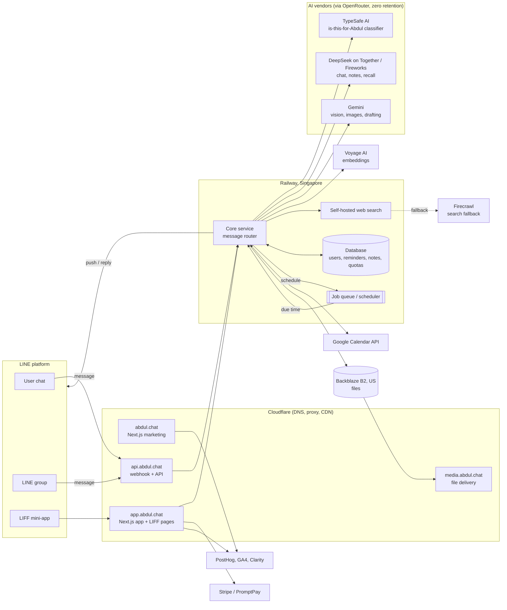

# Abdul (อับดุล) passive recon, 9 November 2026

- Author: Abdul reverse-engineering analyst (research run of 9 November 2026).
- Builds on: `docs/research/ai-assistant-jui/2026-11-08-abdul-teardown.md` (the "teardown"). This file adds infrastructure, history, and public-source findings, corrects one point in the teardown (pricing: the shown prices are yearly ÷ 12, see section 4.4), adds pricing details the teardown left out, and adds a gap analysis and a list of requirements inputs.
- Revision: 2026-11-09, judge fixes D-1 to D-11 applied (see `docs/review/judge/judge-abdul-recon.md`).
- Scope rule: the "Abdul research boundary" in `docs/review/TEAM-BRIEF.md`. Passive, public information only. Section 9 lists what was deliberately not done.
- Raw command outputs: `raw-notes/` in this folder.

## How to read the tags

| Tag | Meaning |
|---|---|
| [V] | Verified. We opened the primary source (Abdul's own page, DNS, a registry, a certificate log) on the date given. |
| [S] | Secondary source, such as a search-engine snippet or a third-party listing. |
| [I] | Our inference. Reasoned from [V] facts, but not observed directly. |
| UNVERIFIED | Not checked, or could not be checked within the boundary. |

All web sources were accessed on **2026-11-09** unless another date is given. "Snapshot 2026-11-08" means the saved copies in `~/tools/re-kit (local, not in repo)/evidence/abdul-2026-11-08/`.

---

## 1. Methods and tools

| Step | Tool | What it touched | Rate |
|---|---|---|---|
| DNS records (A, AAAA, CNAME, MX, TXT, NS, CAA, SOA, DMARC) | `dig` (macOS built-in) | Public DNS resolvers only | About 40 queries, once |
| Domain registration dates | `whois`, RDAP via `rdap.org` (with `curl` and `jq`) | Registry databases | 1 query per domain |
| Certificate transparency (CT, the public log of every TLS certificate issued) | `crt.sh` JSON API via `curl` | crt.sh, not Abdul | 1 query per domain, 5 s apart |
| Passive subdomain discovery | `subfinder` 2.17.0, default passive sources, no brute force, `-rl 2` | Third-party data sources, not Abdul | 1 run per domain |
| Hostname resolution of what subfinder found | `dig` | DNS only. We did **not** open these hosts in HTTP | Once |
| Response headers of public pages | `curl -I` | abdul.chat, abdul-ai.com, the public sign-in landing of app.abdul.chat (headers only), nativelabs.studio, robots.txt | 1 request per URL, 3 s apart |
| Technology fingerprint | `webanalyze` 0.3.9 with Wappalyzer signatures | 4 public pages, `-crawl 0 -worker 1` | 1 request per page |
| Third-party hosts, meta tags, JSON-LD (structured data in the page) | `grep`, `jq`, Python on the **saved** 8 Nov HTML | Local files | None |
| History | Wayback Machine CDX and availability APIs | archive.org only | 7 queries |
| Public sources | Web search, and one fetch each of the LINE OA profile, nativelabs.studio, the App Store listing of a same-name app, and a same-name GitHub repo | Public pages | Normal browsing |

Installs are recorded in `~/tools/re-kit (local, not in repo)/README.txt` (section dated 2026-11-09).

---

## 2. Infrastructure findings

### 2.1 Domains and dates

| Domain | Role | Registered | Registrar and DNS | Evidence |
|---|---|---|---|---|
| abdul-ai.com | First brand domain. Contact e-mail (hello@abdul-ai.com) and the link on the LINE OA profile still use it | **2026-06-17** (re-registration; see below) | Cloudflare Registrar; Cloudflare DNS (harlee/thomas). Registrant: Bangkok, TH; organisation redacted | [V] whois, 2026-11-09 |
| abdul.chat | Current brand domain: marketing site, app, media, API | **2026-09-02** | Cloudflare Registrar; Cloudflare DNS (**meg/titan**) | [V] RDAP, 2026-11-09 |
| nativelabs.studio | The studio named in the footer ("Made by nativelabs.studio") | **2026-08-24** | Cloudflare Registrar; Cloudflare DNS (**meg/titan**) | [V] RDAP, 2026-11-09 |

Points that follow:
- The terms of service are dated 2026-06-18 and abdul-ai.com was registered on 2026-06-17. So Abdul as a product **started around 17-18 June 2026** [V dates; I launch].
- abdul.chat came about 11 weeks later (2 September 2026). The brand moved from abdul-ai.com to abdul.chat [I]. abdul-ai.com still serves the same Next.js site from the same Railway edge today [V headers].
- abdul.chat and nativelabs.studio use the same Cloudflare name-server pair (meg/titan) [V DNS, RDAP]. Cloudflare usually gives all zones in one account the same pair, but each pair is shared by very many unrelated accounts, so this alone is weak evidence. Both domains also use Cloudflare Registrar, and their registry records were last changed about seven minutes apart on 2026-09-07 [V RDAP]. Together this is consistent with one operator managing both domains [I, low-to-moderate confidence]. abdul-ai.com uses a different pair (harlee/thomas), which shows the pair does not reliably track ownership. The footer credit "Made by nativelabs.studio" remains the main evidence linking the studio to Abdul [V].
- abdul-ai.com had an earlier life. Certificates were issued for it from April 2023 to April 2024 [V crt.sh], and the Wayback Machine holds a 23 July 2023 capture of a **Budibase** (low-code app builder) instance at abdul-ai.com/builder [V archive.org]. The domain lapsed and was registered again on 2026-06-17. We found nothing that links the 2023 owner to today's team. Treat it as unrelated [I].

### 2.2 DNS records (2026-11-09) [V, `raw-notes/dns-2026-11-09.txt`]

| Record | abdul.chat | abdul-ai.com | nativelabs.studio |
|---|---|---|---|
| A / AAAA | Cloudflare anycast (104.21.x, 172.67.x, 2606:4700::) | Cloudflare anycast | Cloudflare anycast |
| MX | none | `smtp.google.com` (Google Workspace) | none |
| TXT | none | `google-site-verification=...` only | none |
| SPF / DMARC | none | none | none |
| CAA | none | none | none |

What this tells us:
- **E-mail runs on Google Workspace, on the old domain only** [V MX]. abdul.chat cannot receive mail. That fits the contact address staying on abdul-ai.com.
- **No SPF or DMARC** on any domain [V]. Anyone could spoof mail "from" abdul-ai.com. It also tells us they send no transactional e-mail from these domains (no SendGrid, Mailgun, Resend, or similar verification records) [I]. Their user channel is LINE, not e-mail.
- **No SaaS verification records** apart from Google. TXT records often reveal vendors (Atlassian, HubSpot, Microsoft, Stripe domains). Here they reveal nothing more [V].

### 2.3 Hostnames from certificate transparency and passive sources

| Hostname | Source | Resolves to | Purpose (inference) |
|---|---|---|---|
| abdul.chat | CT, DNS | Cloudflare | Marketing site [V] |
| app.abdul.chat | Public HTML links, subfinder | Cloudflare | Web workspace and LIFF app (LIFF is LINE's in-app web view) [V privacy policy] |
| api.abdul.chat | subfinder (passive) | Cloudflare | Backend API, probably the LINE webhook receiver [I] |
| media.abdul.chat | subfinder (passive) | Cloudflare | File and photo delivery from Backblaze B2 through Cloudflare, as the privacy policy describes [I] |
| app., api., admin.abdul-ai.com | subfinder (passive) | Cloudflare | The same layout under the old domain, plus an admin console [I] |

- Certificates for abdul.chat are a single host cert (Let's Encrypt, 2026-09-02) and then a **wildcard** `*.abdul.chat` (SSL.com, 2026-09-04) [V crt.sh]. Wildcards hide subdomain names, which is why CT shows so little. This is normal for Cloudflare's edge certificates.
- We resolved the passive hostnames in DNS only. We did **not** send HTTP requests to api.* or admin.*. They are not public pages.
- The nativelabs.studio CT log shows an `n8n.nativelabs.studio` certificate (2026-09-07) and 4 per-client project hostnames (Sept-Oct 2026) [V crt.sh]. The client names are unrelated to Abdul and are redacted in `raw-notes/` for data minimisation. n8n is an open-source workflow-automation tool. The studio's site says it builds AI agents for Thai businesses [V nativelabs.studio]. An n8n hostname certificate suggests it uses n8n [I]. Abdul is likely one of several studio projects [I]. We did not open any of these hosts.

### 2.4 Hosting, CDN and response headers [V, `raw-notes/headers-2026-11-09.txt`]

| Header | Value | Meaning |
|---|---|---|
| `server` | cloudflare | Cloudflare proxy and CDN in front of everything |
| `x-powered-by` | Next.js | Next.js (React framework) for both the site and app.abdul.chat |
| `x-railway-edge` | sin1 | **Railway** hosting, Singapore edge. This confirms the privacy policy's "Railway, Singapore" from the network side |
| `x-railway-request-id`, `x-hikari-trace` | per request | Railway's edge proxy tracing |
| `x-middleware-rewrite` | /th | Next.js middleware picks the Thai locale by default |
| `cf-cache-status` | DYNAMIC | HTML is not cached; it is rendered on each request |
| app.abdul.chat `/` | 307 to `/home` | The app is a separate Next.js deployment with its own routes |

`webanalyze` agreed: Next.js, React, Webpack, HTTP/3, Cloudflare on abdul.chat, /en and app.abdul.chat [V, `raw-notes/webanalyze-2026-11-09.txt`]. nativelabs.studio runs Next.js with the **Payload** CMS [V header `x-powered-by: Next.js, Payload`].

### 2.5 Third-party hosts in the public HTML (snapshot 2026-11-08) [V, `raw-notes/html-hosts-2026-11-08-snapshot.txt`]

- Script hosts: only first-party `/_next/static/chunks/` plus **Google Tag Manager** (`googletagmanager.com`). No Stripe, LINE SDK or chat widget loads on the marketing page.
- Analytics IDs visible in the page: Google Analytics 4 (`G-JFX73Z53T3`) and a PostHog public project key. This matches the privacy policy (Google Analytics and PostHog on the website; Microsoft Clarity inside the LINE app only) [V].
- Links out: `lin.ee/6z0oLc2` (LINE add-friend link), app.abdul.chat, nativelabs.studio, googleapis.com (the Calendar scope URL in the privacy policy).
- robots.txt allows everything and **explicitly welcomes AI crawlers** (GPTBot, ClaudeBot, PerplexityBot, Google-Extended and others) [V `raw-notes/robots-2026-11-09.txt`]. They want to be found and quoted by AI search.
- Sitemap has 6 URLs (TH and EN home, privacy, terms). All `lastmod` 2026-11-06 [V snapshot]. There is no public help centre, blog or changelog.

---

## 3. History

### 3.1 What the Wayback Machine holds

- **abdul.chat: zero captures.** **page.line.me/319gqomd: zero captures.** abdul-ai.com: only the 2023 captures of the previous owner [V archive.org CDX and availability API, `raw-notes/wayback-cdx-2026-11-09.txt`].
- So we cannot reconstruct page-by-page history from the archive. The timeline below is built from dates in registries, certificates, legal pages, and leftover text inside the current page.

### 3.2 Reconstructed timeline

| Date | Event | Evidence |
|---|---|---|
| 2026-06-17 | abdul-ai.com registered; first certificates issued | [V] whois, crt.sh |
| 2026-06-18 | Terms and privacy policy take effect. Terms say: beta, possibly invite-only, **free during beta**, paid plans may come later | [V] terms |
| 2026-06-19 | Terms last updated (still unchanged on 8 Nov) | [V] terms |
| 2026-08-15/16 | abdul-ai.com certificates renewed | [V] crt.sh |
| 2026-08-24 | nativelabs.studio registered | [V] RDAP |
| 2026-09-02 | **abdul.chat registered**, first certificate | [V] RDAP, crt.sh |
| 2026-09-04 | Wildcard certificate for *.abdul.chat | [V] crt.sh |
| 2026-09-07 | RDAP last-changed event on both nativelabs.studio (09:22Z) and abdul.chat (09:30Z) | [V] RDAP |
| Unknown | LINE OA had 31,443 friends (search-engine cached snippet, undated) | [S] |
| 2026-10-25 | Privacy policy updated (lists OpenRouter, TypeSafe AI, Voyage AI, Firecrawl, PostHog, Clarity, Stripe, Railway, Backblaze) | [V] privacy policy |
| 2026-11-06 | Sitemap `lastmod` for all pages; current pricing page | [V] snapshot |
| 2026-11-08 | LINE OA: 41,573 friends | [V] teardown |
| 2026-11-09 | LINE OA: 41,998 friends (42,003 a few hours later in the judge's check). The public OA page data has `"badgeType":"certified"`, LINE's certified (blue) badge | [V] page.line.me data |

The two dated friend counts differ by 425 in about one day. The 8 Nov count may have been taken at a different hour, so treat "about 400 new friends a day" as a rough **estimate** only. Friends are not active users; people add and block OAs freely.

### 3.3 Positioning shift (from leftover text in today's page)

The current page still carries older text in its structured data. Comparing it with the visible copy shows a clear shift [V snapshot; I interpretation]:

| Older layer (JSON-LD, meta keywords, terms) | Current visible copy (8 Nov) |
|---|---|
| "Capture notes, photos, voice and files by chatting on LINE"; "Recall anything later with natural Thai-language search"; keyword "second brain" | Headline: "อับดุล ผู้ช่วยเตือนความจำใน LINE" (a reminder assistant in LINE). Use cases: mother's medicine, card bill, client follow-up, shop group |
| Offer: price 0, "Free during beta, no credit card required" | Four paid tiers, PromptPay or Stripe, 14-day Pro trial |
| LINE OA description: "AI ผู้ช่วยส่วนตัว" (AI personal assistant) | Footer: "A reminder assistant in LINE, for work, for home, and in your groups" |
| Invite-only beta with onboarding survey (age range, most wanted feature, referral source) | Open sign-up, "add friend and type" |

Reading: Abdul launched in June as a broad **AI second brain** (save and recall anything). By November it had **narrowed to reminders**, added **group reminders as the paid driver**, and turned on **subscriptions**. Memory, Q&A, and image generation stay as included extras [I]. The reminder focus is the part people pay for.

---

## 4. Product behaviour from public sources

### 4.1 Public footprint

Searches on 2026-11-09 for Pantip threads, TikTok, Facebook, X, Instagram, YouTube demos, news coverage, founder interviews, and job ads found **nothing about this Abdul** (searched 2026-11-09, no hits; absence is not proof). The product is about five months old and grows through LINE itself (add-friend links, groups) rather than press.

Beware of four unrelated products with the same name [V each]:
1. NECTEC's **ABDUL** chatbot platform on AI for Thai (a government chatbot builder for teachers).
2. A 2024 Thai PBS World story about a Thai generative AI called "Abdul".
3. **"Abdul AI Assistant"** on the iOS App Store by TechSolve Solution (abdul.app), a general chat app with one rating.
4. A November 2026 hackathon web chat on GitHub (Techfrontiers/abdul).

None of these links to abdul.chat, abdul-ai.com or nativelabs.studio.

Company registration: the footer names only "nativelabs.studio". The studio site gives no legal name, address or registration number. A web search for a Thai company named Native Labs / เนทีฟ แล็บส์ found no match. We did not query the DBD (Department of Business Development) database directly. **UNVERIFIED.**

### 4.2 Conversation flows we can reconstruct

All examples are Abdul's own demo text on the homepage [V snapshot 8 Nov]. The step-by-step logic is [I].

**Flow A: personal one-off reminder**
1. User types: "ศุกร์ 10 โมง โทรตามลูกค้า ABC เรื่องใบเสนอราคา".
2. Abdul confirms the parse: "ศุกร์ 10:00 · โทรตามลูกค้า ABC", labelled "เตือนครั้งเดียว" (one-off).
3. At 10:00 Friday, Abdul pushes: "ได้เวลาโทรตามลูกค้า ABC เรื่องใบเสนอราคาแล้วครับ".
4. The reminder card has buttons "เรียบร้อย" (done) and "อีก 1 ชม." (snooze one hour).

**Flow B: recurring reminder**
- "ทุกวัน 2 ทุ่ม เตือนให้แม่กินยาความดัน" becomes "ทุกวัน 20:00", labelled "เตือนซ้ำทุกวัน".
- "ทุกวันที่ 25 เตือนจ่ายค่าบัตรเครดิต" becomes "ทุกวันที่ 25", labelled "เตือนซ้ำทุกเดือน".
- The FAQ says it understands "บ่ายสาม", "2 ทุ่ม", "ศุกร์หน้า", "ทุกวันที่ 25", "ทุกวันพระ" (every Buddhist holy day), and typos.

**Flow C: "can't miss" escalation**
- If the user says an item must not be missed, Abdul "ทักซ้ำจนกว่าคุณจะตอบ" (keeps messaging until you answer) [V FAQ]. How often, and for how long, is UNVERIFIED.

**Flow D: group reminder for another person**
1. In a group: "@อับดุล 5 โมงเย็นเตือน @เก่ง เช็กสต็อกก่อนปิดร้าน".
2. Abdul: "ได้ครับ 17:00 ผมเตือน @เก่ง ในกลุ่มนี้ให้".
3. At 17:00 it posts "@เก่ง ได้เวลา..." in the group.
- Only the payer needs a plan. "คนอื่นในกลุ่มไม่ต้องสมัคร" (others need not sign up) [V].
- Group use needs ร่างทอง (3 groups) or เถ้าแก่ (10 groups) [V].

**Flow E: daily team summary in a group**
- "@อับดุล ทุกเช้า 8 โมงสรุปงานวันนี้ให้ทีมด้วย" leads to a summary of that day's items posted in the group at 08:00 [V].
- Separately, the FAQ says it can "สรุปเรื่องที่คุยกัน" (summarise the group discussion) [V].

**Flow F: morning briefing (personal)**
- At 08:00: "อรุณสวัสดิ์ครับคุณ... วันนี้มี 6 เรื่อง เรื่องแรก 10:00 ..." [V demo]. The pricing page lists "สรุปประจำวัน" (daily recap) as **coming soon** on the paid tiers. So the demo shows a feature that may not be fully live [V both; I conflict].

**Flow G: calendar**
- With Google Calendar connected (วัยรุ่น and above), Abdul "เตือนล่วงหน้าก่อนถึงเวลานัดให้เอง" (reminds ahead of appointments) [V pricing], reads events to brief the user, and creates or edits events when asked in natural language [V privacy policy, scope `calendar.events`].

**Flow H: memory and recall**
- The user sends text, photos, files or links. Abdul stores them, embeds them with Voyage AI, and answers later questions by search [V privacy]. Audio and video "may not be fully processed" [V privacy].

**Flow I: delete**
- "บอกคำเดียวก็ลบออกให้หมด" (one word and everything is deleted). Deleting one item or all is possible; files and the search index go too; deleted files sit in a 24-hour trash [V FAQ, privacy].

**Flow J: onboarding and paying (inside LINE)**
- Add friend, then register through the LIFF app. Registration collects **mobile number**, nickname and an optional survey (age range, occupation, wanted feature, referral source) [V privacy].
- Pay by PromptPay (monthly or yearly, no card) or by card through Stripe checkout for auto-renewal [V FAQ, privacy].

### 4.3 The reminder engine (inferred)

From the flows above, the engine must hold, per reminder [I]:
- owner (user or group), optional target member (mention), text;
- schedule type: one-off, daily, weekly, monthly by date, lunar (วันพระ);
- next fire time in Asia/Bangkok;
- state: active, fired, done, snoozed, escalating;
- an escalation policy for "can't miss" items;
- quota counters: recurring slots in use, fires this month (personal and per group).

"วันพระ" needs a Thai lunar calendar table, because holy days follow the moon, not the Gregorian calendar [I].

### 4.4 Limits per plan (homepage, snapshot 8 Nov) [V]

| | เบบี๋ (Free) | วัยรุ่น | ร่างทอง (recommended) | เถ้าแก่ (business) |
|---|---|---|---|---|
| Price shown | ฟรี, no expiry | ฿83 /month | ฿125 /month | ฿409 /month |
| Billed yearly | none | ฿990 | ฿1,490 | ฿4,900 |
| Recurring reminders (slots) | 8 | 20 | 40 | 40 |
| Personal reminders a month | 15 | 100 | 200 | 200 |
| LINE groups | none | none | 3 | 10 |
| Reminders per group a month | none | none | 200 (own quota per group) | 500 (own quota per group) |
| File storage | 1 GB | 5 GB | 100 GB + 10 GB per group | 100 GB + 50 GB per group |
| Image generation | 2 a week | 7 a week | 20 a week | 30 a week |
| Google Calendar | no | yes | yes | yes |
| Permanent memory, unlimited chat | yes | yes | yes | yes |
| Coming soon | none listed | rename Abdul, choose Abdul's gender | daily recap, Google Drive, personality, rename, gender | same as ร่างทอง |
| Annual bonus | none | none | "ฟรี 2 เดือน" | "ฟรี 2 เดือน" |

**Correction to the teardown.** The prices shown by default (฿83, ฿125, ฿409) are the yearly price divided by 12, rounded up (990/12 = 82.5, shown as ฿83; 1,490/12 ≈ 124.2, shown as ฿125; 4,900/12 ≈ 408.3, shown as ฿409). The page has a monthly/yearly toggle, a "save up to 38%" badge, and the text templates "หรือ {perMonth}/เดือน เมื่อจ่ายรายปี" and "ปกติ" (normally). So the **monthly-billing price is higher than the figure shown** [V numbers; I reading]. The ร่างทอง and เถ้าแก่ cards carry a "ฟรี 2 เดือน" seal, which implies monthly billing of about ฿149 and ฿490 (yearly ÷ 10). The "save up to 38%" figure most likely applies to วัยรุ่น, implying about ฿133 a month (**estimates**, UNVERIFIED until test T31). The real monthly price is set by page script after load. We did not run or read that script. A team member can check it by clicking the "รายเดือน" toggle in a normal browser.

**Additions to the teardown's pricing table:** วัยรุ่น includes 7 images a week; ร่างทอง and เถ้าแก่ also include Google Calendar; recurring slots are 40 on both top tiers; personal reminders on เถ้าแก่ are 200 a month; groups get extra storage of 10 GB (ร่างทอง) or 50 GB (เถ้าแก่) each [V].

### 4.5 Failure cases (expected, not observed)

We found **no public user complaints** (Pantip, app reviews, social posts). The failure modes below are predicted from the design. The manual test script is meant to confirm or reject them [I]:

1. Ambiguous times: "บ่าย 2" vs 02:00; "ศุกร์นี้" on a Friday evening; "พรุ่งนี้" just after midnight.
2. Buddhist-era years (2569) and Thai month names.
3. Quota exhaustion on the free plan (15 a month) and what the bot says when it is reached.
4. Group noise: the classifier wrongly treating a normal group message as a command, or ignoring a real one.
5. Mentioning a group member who has not added Abdul as a friend.
6. Late or missed pushes during LINE or Railway outages. Terms say availability is not guaranteed.
7. "Done" pressed by the wrong person in a group.
8. Calendar edits made from a misread message (the only external write Abdul has).
9. Audio messages: the privacy policy says they may not be processed.
10. The demo morning summary versus "daily recap: coming soon".

---

## 5. Inferred architecture

Everything in this diagram is [I], assembled from [V] facts: headers (Cloudflare, Next.js, Railway sin1), DNS (api., media., app.), and the vendor list in the privacy policy.

Inferred request path for "พรุ่งนี้ 9 โมง จ่ายค่าไฟ" [I]:
1. LINE posts a webhook to api.abdul.chat.
2. In a group, the classifier decides if the message is for Abdul. Members are replaced by codes before it is sent.
3. DeepSeek extracts {text, time, recurrence, target}. A Thai time parser (an LLM, a rule layer, or both) resolves "พรุ่งนี้ 9 โมง" in Asia/Bangkok.
4. The core checks quota, saves the reminder, and enqueues a job. It replies with a confirmation (a free reply message).
5. At the due time the job sends a **push** message with Done and Snooze buttons. Push messages count against the OA's paid LINE message quota. This is the most likely reason for the hard monthly reminder limits on every plan [I].
6. A button press comes back as a postback event and updates the state.

---

## 6. Gap analysis: Abdul versus our "assistant that acts"

| Capability | Abdul today | Our target | Gap type |
|---|---|---|---|
| Understand Thai time and recurrence | Strong, including วันพระ [V] | Must match | Baseline: we must equal it |
| Remind on time, done/snooze, escalation | Yes [V] | Must match | Baseline |
| Group reminders with mentions | Yes, paid [V] | Useful for family coordination | Baseline for omm's family direction |
| Memory and recall | Yes [V] | Supporting feature only | Not our focus |
| Google Calendar read and write | Yes, the only external write [V] | Yes | Baseline |
| **Book an appointment with a business** | No [V feature list; I] | Core | **Our opening** |
| **Send a request to a business and get an answer** (request card, form, LINE handoff) | No | Core (jui level 2, vj router) | **Our opening** |
| **Pay or prepare a bill** (fill a PromptPay QR, show a due amount) | No. It only reminds to pay | Candidate | **Our opening**, but high risk |
| **Close the loop** (confirm it happened, reschedule with the other party) | No. "Done" is self-reported | Core | **Our opening** |
| **Track obligations with documents** (renewal dates read from a photo of a car tax or insurance slip) | Partial: it stores photos, Gemini reads images; no structured obligations [V; I] | Core for omm | **Partial gap** |
| Proactive suggestions from context | Calendar pre-reminders only [V] | Nice to have | Small gap |
| Trust controls for actions (confirm before acting, audit log, undo) | Not needed: it does not act | Required for us | **New requirement Abdul never had** |

Bottom line: Abdul is a good **reminder and memory** product with a clean PDPA story. Every outside-world action except calendar edits is missing. Its group and calendar features show that the "doing" step is technically close for them, so we should not assume the gap stays open for long [I]. Our edge must come from what is slow to copy: business-side reach (venue channels, request cards) and a closed loop with confirmation.

---

## 7. Implied requirements

**Requirements inputs, not specification items.** The P-x and D-x items below are inputs to the requirements specification. They are not specification items yet. The specification author must add priority, rationale and a testable acceptance criterion to each (for example, "D-3: no committing action without an explicit confirm tap, verified by test X"), and must not copy them verbatim. P-5's "stop rule" is our own addition, not Abdul's claim. P-10 is a design constraint rather than a functional requirement. Note that these D-x IDs are requirement inputs and are unrelated to the judge's defect IDs D-1 to D-11.

### 7.1 Parity requirements (Abdul already does these; users will expect them)

| ID | Requirement | Source |
|---|---|---|
| P-1 | Parse Thai natural-language dates and times, including colloquial hours (บ่ายสาม, 2 ทุ่ม), relative days (ศุกร์หน้า), monthly dates, and typos, in Asia/Bangkok | [V] FAQ |
| P-2 | Support one-off, daily, weekly, monthly and Thai lunar (วันพระ) recurrence | [V] FAQ |
| P-3 | Echo the parsed result back before saving ("ศุกร์ 10:00 · ...") so the user can catch errors | [V] demo |
| P-4 | Deliver due reminders as LINE push messages with Done and Snooze quick actions | [V] demo |
| P-5 | Offer an escalation mode that repeats until acknowledged, with a stop rule | [V] FAQ |
| P-6 | Work in LINE groups: only respond when addressed, remind a mentioned member, post a scheduled summary | [V] homepage |
| P-7 | Keep personal and group data separate; group data visible only to that group | [V] homepage |
| P-8 | Delete one item or everything on request, including files and search index entries | [V] FAQ, privacy |
| P-9 | Connect Google Calendar with the narrowest scope that allows create and edit | [V] privacy |
| P-10 | Use zero-retention, no-training LLM routing and disclose cross-border transfer | [V] privacy |
| P-11 | Meter usage (push messages, LLM calls) per user and per group, because LINE push messages cost money | [I] |

### 7.2 Differentiating requirements (what "acts" means)

| ID | Requirement | Source |
|---|---|---|
| D-1 | Turn a request into a structured **task with an outcome** (booked, confirmed, declined, failed), not just a reminder | [I] gap table §6 ("close the loop"); TEAM-BRIEF product goal (assistant that acts) |
| D-2 | Route each task to a channel per business: API, web form, LINE handoff, request card, or manual concierge | vj direction (booking router); jui direction (levels 2-3), per TEAM-BRIEF |
| D-3 | Ask for explicit user confirmation before any action that commits the user (booking, cancelling, sharing personal data with a business) | [I] §6 "trust controls" row; PDPA consent duty (cf. Abdul privacy policy [V]) |
| D-4 | Track the task until it closes. Tell the user the result. Retry or escalate when a business does not answer in time | [I] §6 "close the loop" row |
| D-5 | Write the confirmed result back to the user's calendar and set the matching reminder automatically | Abdul has calendar write [V privacy]; [I] combination is ours |
| D-6 | Keep an audit log of every action taken on the user's behalf, visible to the user | [I] §6 "trust controls" row |
| D-7 | Read obligation documents (bill, tax, insurance photo) into structured due dates, with the user confirming the extracted values | omm direction (obligations), per TEAM-BRIEF; Abdul stores photos and reads images [V privacy] |
| D-8 | Fail safely: if a step is uncertain, fall back to a reminder plus a ready-made message the user can send themselves | [I] our design choice; loosely analogous to Abdul's privacy-routing rule that a request "fails rather than" goes to a non-compliant provider [V privacy policy] |

### 7.3 Non-functional notes

- Latency: a confirmation reply should arrive within a few seconds, or LINE users retype. Reminder pushes should fire within a minute of the due time (**target, not measured**).
- Cost: push quota and LLM calls drive cost. Abdul answers this with hard monthly caps; we will need the same metering.
- PDPA: Abdul's privacy policy is a good model for listing processors and transfers. Ours will add businesses as recipients when we act.

---

## 8. What could not be verified

| Item | Why |
|---|---|
| Real monthly-billing prices | Rendered by page script after load; we did not execute or read the script. Check by hand in a browser |
| Escalation frequency and duration for "can't miss" | Only observable by using the bot. See test script |
| Whether the daily summary is live or "coming soon" | Homepage demo and pricing table disagree |
| Active users, retention, revenue | Not public. Friend count only |
| Legal entity behind Native Labs; DBD registration | No legal name published; DBD not searched directly |
| Founders, team size, funding, job ads | No public sources found |
| User complaints and reviews | None found on Pantip, social media or news on 2026-11-09 |
| Feature and price history before 8 Nov | No Wayback captures of abdul.chat |
| The model behind the Thai time parser | Not disclosed |
---

## 9. Boundary: what was deliberately not done

The user asked for reverse engineering "with anything". Abdul's terms forbid users to "reverse-engineer, disrupt, scrape, probe, or exploit Abdul or the systems behind it" [V terms], and the team brief limits us to passive public information. The boundary won. We did **not**:

1. Sign in to app.abdul.chat, register through the LIFF flow, or start a trial. (We fetched only the response headers, the redirect to /home, and one webanalyze fingerprint of the public, signed-out landing page. This is the outer edge of the boundary. Future runs should not request app.* at all; the marketing site already shows the same stack.)
2. Chat with the bot, by hand or automated. The manual test script is for a team member acting as an ordinary user, not for automation.
3. Capture, proxy or intercept any app, LIFF or webhook traffic. No HAR files, no certificate installs.
4. Download, de-minify, decompile or read Abdul's JavaScript bundles. Pricing logic computed in script was left unread.
5. Send any HTTP request to api.abdul.chat, media.abdul.chat, admin.abdul-ai.com, or any studio client host. These were resolved in DNS only.
6. Port-scan, directory-scan, or brute-force subdomains. subfinder ran in passive mode only.
7. Scrape social media or LINE at volume. One fetch of the OA profile page.
8. Collect personal data about individuals. No founder names, no user posts, no phone numbers. Company facts only.
9. Submit "Save Page Now" requests to the Wayback Machine. Recommended instead: a team member can archive abdul.chat, /en, the privacy policy, the terms and the OA page once a month, by hand, to build the history we could not find.
