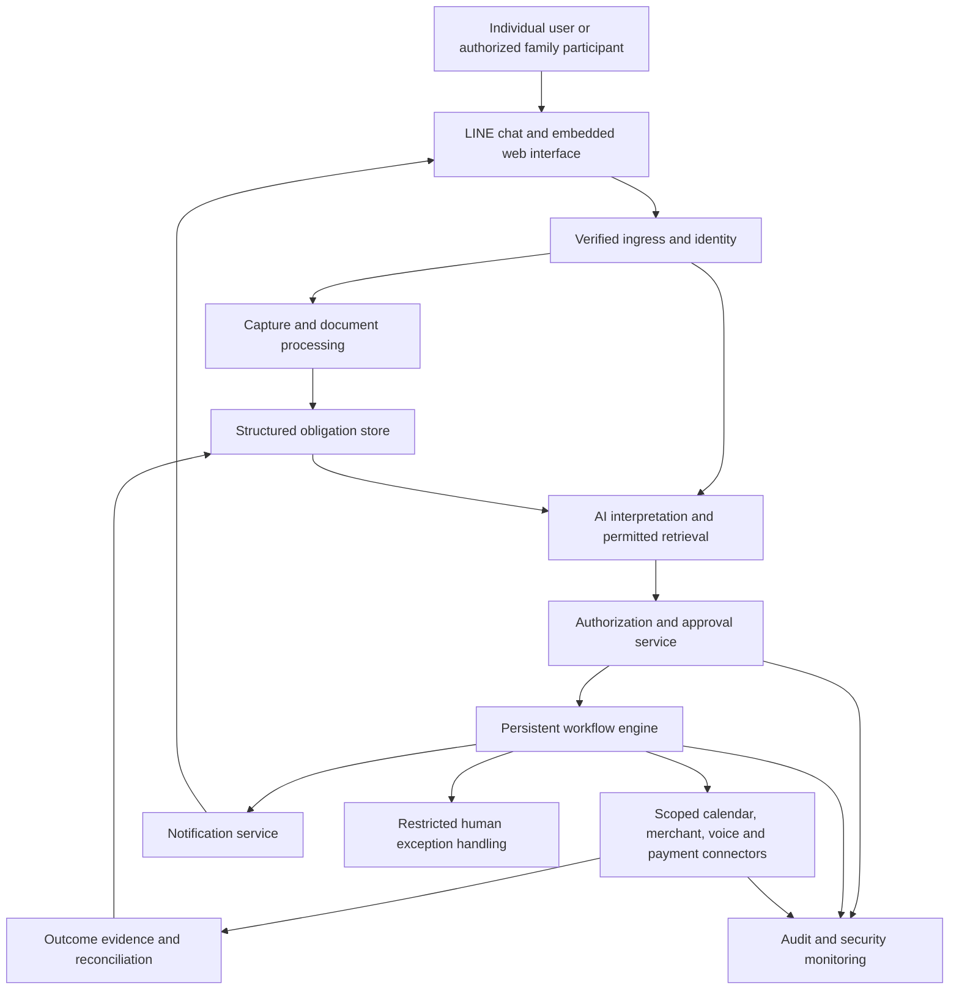

# Thailand LINE AI Personal Assistant

## Business, product, feasibility, and security brief

| Field | Value |
|---|---|
| Status | Draft for team review; not an approved implementation specification |
| Version | 0.2 (validator revision of omm's 0.1) |
| Research date | 6 November 2026; facts rechecked 9 November 2026 |
| Initial geography | Bangkok, Thailand |
| Primary customer | Individual working adults managing their own obligations |
| Supported extension | Individuals coordinating selected obligations for their family |
| Distribution | LINE-first, with an embedded web interface for structured interactions |
| Purpose | Align the team on the opportunity, evidence, recommended product, commercial assumptions, and technical boundaries |

> **Decision recorded:** Prioritize individual use. Also support the person coordinating obligations for a family. Family support must preserve each person's private information and autonomy.
>
> **Recommendation:** Build around completing everyday obligations—bills, rent, documents, renewals, and appointments—with booking added where dependable merchant access exists.

> **Revision notes (9 Nov 2026).** A validator rechecked this brief against its sources. The full evidence is in `docs/review/validation-omm-brief.md`. Tags used in new text: `[V]` primary source opened on 9 Nov 2026; `[S]` secondary source; `[I]` inference; `UNVERIFIED` not checked. Changes:
>
> 1. **Header and §1:** added "Senior-project context". This is a three-student software project with about 225–300 person-hours until 30 Apr 2027. Business sections stay as motivation. The prototype scope is in the new §10.1.
> 2. **§1, §2, §3, §5:** "the founder" now reads "the team".
> 3. **§4 competitor table:** added Abdul's monthly prices (฿83, ฿125, ฿409) and the `abdul.chat` product domain. Noted that Lamai's prices include VAT and that its phone reminder calls the user. Added Cole's call cost (40 credits a minute, paid plans only). Marked Cole "browser tasks" UNVERIFIED. Also in the Cole row: added "confirmation before sending" for email and calendar, reworded "introductory credits" to "one-time free credits", and reworded "research" as "help finding information (ช่วยหาข้อมูล)". Added a sentence comparing Abdul's and Lamai's cheapest paid tiers with the §9 price tests.
> 4. **§4:** marked the earlier Abdul ฿99 and ฿169 prices UNVERIFIED.
> 5. **§4:** added a "platform risk" row: LY Corp Agent i, LINE Thailand ActEngine AI, and LINE's planned agent APIs `[S]`.
> 6. **§4 substitutes:** flagged that the MEA source appears to be a staging or proof-of-concept host and that the D-MyTax link is a bare login page. Added that MEA Smart Life sends notifications and that MEA runs its own LINE channel, MEA Connect.
> 7. **§6 matrix:** used TableCheck's exact wording; added GoWabi's ban on private-message promotion; added Fresha's August 2026 MCP integration (discovery only); added a "drafted LINE handoff" row (`oaMessage` URL scheme) `[V]`.
> 8. **§6 examples:** marked the Bangkok Spin claim UNVERIFIED (the page renders no readable content).
> 9. **§6 technical limits:** added "one official account per group".
> 10. **§7:** added the draft AI Act date (2 Jul 2026) and strict liability; the PDPC AI guidance article date (14 Oct 2026); ETA sections 15 and 17/1 (automated messages and input-error withdrawal); and downgraded the ETDA small-platform claim to `[S]` (the cited page shows no answers).
> 11. **§8.1:** added LINE webhook specifics: async processing, redelivery off by default, the `webhookEventId` dedupe key, the `isRedelivery` flag, timestamp ordering, LIFF token verification, the loading animation, the reply-token limit (UNVERIFIED), secret storage, and a constant-time comparison of the base64 signature.
> 12. **§8.6:** for the prototype, replaced Temporal with a Postgres-backed job table. Writing the job row in the same transaction is the outbox. Temporal stays as an upgrade path.
> 13. **§8.8:** added `X-Line-Retry-Key` for push idempotency, unfollow handling, the 300-message Free-plan cap, and per-recipient counting.
> 14. **§9:** added the LINE Reply API change from 1 Feb 2027, the Free and Basic plans, Stripe's Thai-account requirement, and the GoWabi caveat. Labelled the economics as illustrative.
> 15. **§10:** replaced the paid pilot with an unpaid evaluation for the senior project. Added §10.1 "Prototype scope for the senior project".
> 16. **§11:** added platform-risk and student-capacity rows to the risk register.
> 17. **§13:** added sources S31–S34, S36–S38, and S40 with access dates. Marked S04, S19, S20, and S25 "rechecked 9 Nov 2026". Fixed the notes on S06, S07, S09, S13, and S21.
> 18. **§6 examples:** tagged the No Drama Padel claim `[V]`.
> 19. **Judge fixes (9 Nov 2026):** corrected the Stripe account-type sentence in §9 (individual accounts are possible). Added "future work, see §10.1" notes in §6 (booking pilot), §8.10 (security review), §10 (decision gates), §11 (rating and "Charge during pilot"), and §12 (booking category and pilot thresholds). Added the s.15 and s.17/1 caveats in §7, and the 409 handling in §8.8. In §10.1, added an hours split, placed voice notes, and noted that `oaMessage` does not work in LINE for PC. Added a §12 decision row for the evaluation-month LINE plan. Added "rechecked 9 Nov 2026" in §2.

> **Senior-project context (added 9 Nov 2026).** The team is three students, each giving 3–4 hours a week. The proposal is due 22 Nov 2026 and the project ends 30 Apr 2027. That is about 225–300 person-hours in total `[I]`. The deliverable is a small, evaluated software prototype, not a company launch. The business sections (§3, §4, §9, §11) remain as motivation and context. Where they recommend startup steps (paid pilots, merchant contracts, payments, security audits), read them as future work. §10.1 defines what is built.

## Contents

1. [Executive assessment](#1-executive-assessment)
2. [Evidence and decision status](#2-evidence-and-decision-status)
3. [Customers and positioning](#3-customers-and-positioning)
4. [Competition and defensibility](#4-competition-and-defensibility)
5. [Useful workflows and product scope](#5-useful-workflows-and-product-scope)
6. [Booking feasibility](#6-booking-feasibility)
7. [Regulation and privacy](#7-regulation-and-privacy)
8. [Architecture and security](#8-architecture-and-security)
9. [Monetization and unit economics](#9-monetization-and-unit-economics)
10. [Validation and proposed rollout](#10-validation-and-proposed-rollout)
11. [Business rating and risk register](#11-business-rating-and-risk-register)
12. [Open decisions and builder discretion](#12-open-decisions-and-builder-discretion)
13. [Sources](#13-sources)

## 1. Executive assessment

The opportunity is an affordable personal assistant inside LINE that reduces the work of managing adult life. A user should be able to forward a bill, document, appointment message, or voice note and turn it into an obligation with a deadline, responsible person, completion status, and supporting evidence.

The strongest proposition is:

> **Send it once. Know what needs doing, get help doing it, and keep track of what is actually finished.**

This market is not an uncontested blue ocean. Abdul already markets personal and family reminders, bills, calendar integration, and group coordination. Lamai offers productivity integrations, and Cole advertises Thai-language phone calls on behalf of users. Their public material establishes competition, not their actual reliability or commercial success. [Abdul][s01], [Lamai][s02], [Cole][s03].

The proposed advantage is reliable handling of obligations from capture through completion, with less setup, clearer evidence, and stronger privacy. Booking can increase usefulness but cannot initially offer universal coverage.

### Approaches considered

| Approach | Strength | Trade-off | Recommendation |
|---|---|---|---|
| Everyday obligations | Fits the team's motivation: work, money, bills, rent, taxes, and mental load | Existing reminders are strong substitutes; differentiated execution must be demonstrated | Recommended product foundation |
| Broad booking concierge | Tangible outcomes and clear time savings | Fragmented inventory, commercial access, cancellations, call failures, and support costs | Add selected categories after access and economics are proven |
| Employer-funded assistant | Can reduce the employee's subscription burden and acquisition cost | Longer sales cycle and strict separation from employer visibility | Later distribution experiment |

The team has confirmed individual-first targeting with family coordination support. The detailed feature order, commercial terms, and architecture below remain recommendations for review.

### Provisional business judgment

- **Overall: 6.5/10 today.** A credible business to validate, not a proven mass-market opportunity.
- **Potential: 7.5/10** if paid retention, reliable completion, and affordable acquisition are established.
- Main commercial uncertainty: whether the intended customer pays repeatedly for reduced administrative effort.
- Main operational uncertainty: whether external actions can be completed at an acceptable cost and success rate.
- Main technical obligation: prevent false confirmations, unauthorized actions, and exposure of private information.

## 2. Evidence and decision status

This brief distinguishes four kinds of statements:

| Label | Meaning |
|---|---|
| Confirmed direction | A preference explicitly expressed by the team |
| Public evidence | Information found in provider documentation, official sources, or cited legal analysis |
| Recommendation | A proposed product, business, or architecture choice |
| Hypothesis | An assumption requiring interviews, paid usage, supplier confirmation, or testing |

### Research limits

- Competitor features are advertised capabilities. No competitor account testing, checkout, booking transaction, or reliability benchmark was performed.
- No audited competitor revenue, retention, conversion, or paid-user figures were established.
- API documentation is not a commercial access agreement. No integration access has been secured.
- Feature priorities are informed product hypotheses, not findings from a representative Thai customer survey.
- Prices and legal status are a research snapshot as of 6 November 2026, with key facts rechecked 9 November 2026. Recheck before procurement or launch.
- The regulatory section is a planning assessment; Thai counsel should assess the actual business model, contracts, and data flows.
- This document consolidates the research already conducted for the project. It does not represent completed legal diligence or an implementation commitment.

## 3. Customers and positioning

### Confirmed intent

The team expects working adults to pay first because they already carry substantial work and money-related mental load. The assistant should help them keep track of obligations such as taxes, rent, and bills. Individual use takes priority, while family coordinators are also supported.

### Recommended initial customer definition

Start with working adults in Bangkok who manage several recurring personal obligations and already use LINE regularly. Recruit across salaried workers, shift workers, and people with variable income instead of assuming their schedules and willingness to pay are identical.

For the initial pilot, include adults managing their own accounts and exclude independent accounts for children until the age, consent, and guardian policies have been reviewed.

The Bank of Thailand identifies household debt as a persistent vulnerability. This supports careful attention to affordability; it does not prove demand for another subscription. [Bank of Thailand][s05].

### Primary job to be done

> When an obligation arrives while I am busy, help me capture what matters, understand what to do next, and finish it without repeatedly remembering and organizing it myself.

### Family coordination extension

> When I help organize things for my family, let me share or assign a specific obligation without revealing everyone's private conversations, documents, finances, or calendar.

Family support should build on individual identities and explicit permissions. A household administrator does not automatically acquire access to every member's information. Paying for another person's subscription also does not grant access.

### Goals

- Reduce manual capture, repeated checking, missed obligations, and coordination effort.
- Make important dates, amounts, and completion status trustworthy and traceable.
- Let users act through supported channels with clear authorization.
- Keep the core service affordable and useful without paid concierge activity.
- Make selective family sharing understandable and revocable.

### Non-goals for the initial release

- Universal booking across all Bangkok merchants.
- Unrestricted access to other LINE chats or activity on the user's device.
- A stored-value wallet, independent money-transfer service, or unattended banking agent.
- Autonomous tax filing, investment recommendations, medical advice, or insurance sales.
- A general employee-monitoring or corporate knowledge platform.
- A proprietary foundation model or a custom training program using personal conversations.

### Anti-goals

The product fails its purpose if users must constantly correct it, if notifications become another source of stress, if it claims completion without evidence, or if users must disclose excessive personal information to obtain basic help.

## 4. Competition and defensibility

### Direct competitors

| Competitor | Advertised capabilities | Public pricing observed | Implication |
|---|---|---|---|
| Abdul / อับดุล (product at `app.abdul.chat`) | Personal and group reminders; recurring obligations; stored information; Google Calendar; family/team use | Free; ฿83, ฿125, and ฿409/month, or ฿990, ฿1,490, and ฿4,900/year; 14-day Pro trial `[V, 9 Nov 2026]` | Direct overlap with the intended everyday-obligations proposition |
| Lamai / ละไม | Tasks; group coordination; Google/Microsoft calendars; files; email assistance; voice input; telephone reminders (Lamai calls the user at the reminder time) | Free; ฿169, ฿349, and ฿890/month, VAT included `[V, 9 Nov 2026]` | Practical productivity integrations are already competitive features |
| Cole / Pocodot | LINE assistance; reminders; email/calendar actions with confirmation before sending; help finding information (research, "ช่วยหาข้อมูล"); files and Q&A; Thai-language phone calls for the user (paid plans only, 40 credits per minute, user confirms before the call); browser tasks UNVERIFIED (not on the Thai page) | 150 one-time free credits; paid plans from US$19/workspace/month (2,000 credits, about 50 call-minutes `[I]`) `[V, 9 Nov 2026]` | Booking by telephone is already an advertised competitor capability |
| LINE / LY Corp (platform risk) | LY Corp's Agent i (Japan, launched 20 Apr 2026); LINE Thailand's ActEngine AI for merchants (12 Mar 2026); LINE announced agent APIs, MCP, and a Pioneer Program for third-party agents at LINE DEV CONF 2026 `[S, via docs/research/ai-assistant-jui/2026-11-08-verify-agent-proposal.md, accessed 8 Nov 2026]` | Not applicable | The platform owner may ship a built-in assistant. Design so the core can plug into official agent APIs later |

Sources: [Abdul][s01], [Lamai][s02], [Cole's Thai offering][s03], [Cole pricing][s04]. Billing periods, entitlements, and promotional terms should be checked at purchase.

**Abdul pricing correction:** Earlier indexed search results showed ฿99 and an early-bird ฿169 monthly plan (UNVERIFIED; no archived snapshot was checked). The live page on 9 Nov 2026 shows the monthly and annual prices above `[V]`. Use the live-page snapshot for this brief; do not treat the earlier early-bird offer as current. For comparison with §9: Abdul's cheapest paid tier is ฿83/month and Lamai's is ฿169/month including VAT.

### Abdul's potential moat

The defensibility assessment is inference, not a verified claim about internal technology:

- Brand recognition can lower acquisition friction.
- Repeated use can establish a habit.
- Accumulated personal context can increase the effort of switching.
- Family and work groups can help distribute the product.

There is insufficient evidence here to conclude that Abdul has proprietary model superiority or a durable technical advantage. Its moat is more plausibly behavioral and distribution-based than a unique ability to call an LLM.

### Substitutes

Users can already combine calendars, bank notifications, biller apps, notes, family chats, and official services. MEA offers bill checking, payment, and notifications (notifications through its MEA Smart Life app). D-MyTax provides a government tax-service portal. Coordination across these services is a potential advantage; recreating each isolated reminder is less compelling. [MEA][s06], [D-MyTax][s07]. MEA also offers bill checking through its own LINE channel, MEA Connect `[V, S06, 9 Nov 2026]`, so the utility itself is already on LINE. *Citation note (9 Nov 2026):* the S06 host appears to be a proof-of-concept or staging host (`awspoc-www`, with `_test` menu items), although its content looks official and is dated 17 Sep 2569. Replace it with MEA's production page (URL UNVERIFIED). S07 opens a bare e-filing login screen; it confirms the Revenue Department host only.

### Proposed defensibility

1. **Reliable Thai capture:** convert real bills, screenshots, and informal language into accurate structured obligations.
2. **Completion quality:** distinguish pending, user-reported, and externally verified outcomes.
3. **Merchant access:** secure useful inventory and reliable cancellation processes in selected categories.
4. **Distribution:** obtain repeatable acquisition through relevant communities, households, and later employee benefits.
5. **Trust:** make privacy and approvals visible and understandable.

Personal data should not become a moat through obstructive deletion or export. Retain customers through useful service quality.

## 5. Useful workflows and product scope

### Recommended priorities

| Priority | Workflow | Proposed behavior | Boundary |
|---|---|---|---|
| Highest | Bills and rent | Extract amount, payee, due date, and recurrence; clarify uncertainty; track completion | No assumption that an image proves payment settlement |
| Highest | Upcoming commitments | Summarize known obligations due before the next payday | Not a complete account balance or comprehensive financial forecast |
| Highest | Documents and renewals | Track lease expiry, vehicle documents, insurance renewal, warranties, and missing paperwork | Deadlines depend on source documents and current official requirements |
| High | Selective family coordination | Share an obligation, assign an accepted responsibility, and record completion | No automatic household-wide access |
| High | Appointments and changes | Coordinate time, prepare supported bookings, track confirmation, and handle permitted changes | Coverage and merchant acceptance must be explicit |
| Medium | Tax preparation | Collect withholding certificates and other records; identify missing documents; prepare a checklist | Filing and individualized advice need a separate verified process |
| Medium | Shift and commute planning | Import shifts, adjust reminders, and add travel buffers | Traffic or weather information must be fresh and appropriately qualified |
| Later | General shopping and lifestyle concierge | Compare options and perform supported transactions | No universal automation promise |

### Example: individual bill handling

```text
User forwards an electricity bill.
Assistant extracts the biller, account reference, amount, and due date.
Assistant highlights any uncertain field and asks for clarification.
User confirms the obligation and preferred reminder timing.
Assistant tracks it and provides the appropriate payment handoff.
User marks it paid or supplies evidence.
Assistant records the evidence level and stops the agreed follow-up.
```

The assistant should not require the user to type every field already present in a document. It should not silently invent missing values either.

### Example: family coordination

```text
An individual creates an obligation in their private chat.
They choose to share that specific obligation with an invited family member.
The invited person accepts access and, if applicable, responsibility.
Both can see the permitted task status.
Private chat history and unrelated documents remain inaccessible.
```

**Recommended scope:** a minimal selective-sharing flow belongs in the initial product design and can be enabled for an invited pilot cohort. Broader group-chat ingestion and household automation can follow later. The release timing is a proposal, not a team-approved commitment.

### Status and evidence rules

| Record | Meaning |
|---|---|
| Captured | Information received, not yet validated |
| Confirmed obligation | Required fields accepted or reliably sourced |
| Action pending | Something remains to be done |
| User-reported completion | A person says it is finished |
| Supporting evidence attached | A receipt, slip, message, or other record is available |
| Externally verified completion | An authorized provider or merchant confirms the outcome |
| Uncertain outcome | An action may have succeeded; reconcile before retrying |

These states must remain distinct in the database and in user-facing messages.

### Thai and Bangkok-specific requirements

- Understand Thai/English mixed text, voice input, common abbreviations, and informal time expressions.
- Normalize Buddhist Era and Gregorian dates while retaining the original source text.
- Use `Asia/Bangkok` explicitly; store precise instants and local recurrence rules separately.
- Clarify consequential ambiguity such as “ศุกร์หน้า,” rather than guessing silently.
- Support shift workers and variable payday cycles; do not assume every user works office hours or is paid monthly.
- Support quiet hours, urgency preferences, snooze, and completion acknowledgement.
- Avoid shame-based debt reminders and excessive follow-up.
- For bookings, consider travel time, branch, budget, service duration, and accessibility requirements.

## 6. Booking feasibility

### Integration matrix

| Method or platform | Finding | Viable product behavior | Remaining work |
|---|---|---|---|
| Hungry Hub | Published terms describe real-time booking APIs for directory/portal partners, with branding and access conditions | Partner integration if approved | Confirm commercial eligibility, inventory scope, write/cancel permissions, and support terms |
| TableCheck | The API FAQ says the booking form is "too complex to represent all mandatory options via API" and tells developers to "link to our booking page" `[V, 9 Nov 2026]` | Search/preparation and handoff to the hosted flow | Ask about any applicable partner-specific arrangement; do not assume one exists |
| GoWabi | Affiliate referrals are documented: 5% base commission, monthly payout. The terms say "Private messaging or hidden link promotion is not allowed" `[V, 9 Nov 2026]` | Tracked referral and booking handoff, only if GoWabi confirms in writing that links in a private LINE chat are allowed | Obtain separate confirmation before assuming reservation-writing access |
| Fresha Data Connector | One-way data export for reporting and analytics ("data only flows from Fresha to your selected platform") `[V]`. Separately, Fresha launched ChatGPT and Claude integrations through an MCP server in August 2026; the user confirms and pays on Fresha `[S, via jui verify #1]` | Read/reporting use where authorized | Neither is a booking-write connector for third parties |
| Playtomic third-party API | Documented bookings endpoint retrieves existing reservations | Authorized booking-data access | Creation, modification, and cancellation rights remain unverified |
| Direct merchant integration | Technically controllable with merchant participation | Inventory lookup, slot hold, confirmation, and changes | Agree on the source of inventory, authority, reconciliation, and cancellation responsibilities |
| Telephone | Technically viable; performance depends on merchant response and telephony | Request a booking within explicit user authorization | Validate call delivery, comprehension, confirmation, recording policy, and cost |
| Permitted website automation | Possible for compatible flows | Limited fallback with user authentication and handoff | Check terms, authentication, maintenance burden, and independent outcome verification |
| Drafted LINE handoff (added 9 Nov 2026) | LINE's URL scheme `https://line.me/R/oaMessage/{LINE ID}/?{text}` opens a shop's official-account chat with the message pre-filled but not sent `[V, S31]` | The assistant drafts the Thai booking message; the user taps Send; the assistant sets a follow-up to record the shop's reply | Status stays "request sent" until the user reports or shows the shop's confirmation. Recommended default for the prototype |

Sources: [Hungry Hub][s08], [TableCheck][s09], [GoWabi][s10], [Fresha][s11], [Playtomic][s12], [LINE URL scheme][s31].

### Bangkok examples

Bangkok Spin advertises LINE login with its own booking/payment process (UNVERIFIED on 9 Nov 2026: the page renders by script and showed no readable content). No Drama Padel directs reservations to Playtomic `[V, 9 Nov 2026]`. These examples demonstrate fragmented workflows; they do not establish broad market coverage or access for this product. [Bangkok Spin][s13], [No Drama Padel][s14].

### Technical and authorization limits

- A standard LINE bot does not become the user's personal LINE account or gain blanket access to other private conversations. Its documented model receives events for interactions with the official account and supported conversations. [LINE messaging][s15]. Only one official account can be in a group chat at a time `[S, via jui verify #4]`, so the bot cannot join a shop's group alongside the shop's own account.
- An official account is not a universal way to message arbitrary merchants as the user.
- A read-only connector cannot be treated as a reservation-writing API.
- No integration can guarantee availability that the merchant does not expose or maintain reliably.
- OTPs, identity checks, payment authorization, and CAPTCHAs may require user action. Unsupported authentication flows should lead to a handoff, not a bypass.
- A sent message, unanswered call, or completed form submission is not sufficient evidence of a confirmed reservation.
- MCP, automation platforms, or generic agent tools do not create commercial access rights or missing provider capabilities.

Telephone delivery requires local validation. Twilio, for example, documents restrictions on Thai verified caller IDs for outbound calls into Thailand. A capable Thai voice model alone does not establish a dependable calling service. [Twilio][s16].

### Recommended booking pilot

Choose one repeat-use category in a compact Bangkok area, with approximately 10–20 participating merchants. Salons or sports courts are candidates, subject to customer interviews and merchant access. Keep restaurant bookings as a supported category only where a dependable route exists.

*Senior-project note (9 Nov 2026): future work. For the prototype, see §10.1.* The prototype uses the drafted LINE handoff, with no merchant pilot.

For each merchant, verify:

1. Which system is authoritative for availability and reservation status.
2. Whether a slot can be held, for how long, and on what conditions.
3. How price, deposit, service duration, branch, and staff/court selection work.
4. How duplicate submissions are prevented or reconciled.
5. How changes, cancellations, refunds, no-shows, and disputes are handled.
6. What constitutes confirmation and how the customer receives it.
7. Operating hours, escalation contacts, and expected response time.

### Booking lifecycle

```text
Requested
  -> Checking availability
  -> Offer presented
  -> Awaiting user approval / payment
  -> Submission in progress
  -> Confirmed, rejected, expired, or uncertain
  -> Completed, changed, cancelled, or refund pending
```

Confirmation requires merchant/provider evidence. If the result is uncertain, query or contact the provider before retrying. Cancellation requests also need confirmation; submitting a request does not mean the reservation or payment has been reversed.

The approved offer must bind the merchant, branch, service/resource, date, time, total price or ceiling, deposit, personal-data disclosure, and cancellation terms. Material changes require renewed approval.

## 7. Regulation and privacy

### PDPA fundamentals

Establish a lawful basis for each processing purpose, appropriate notices, minimization, retention rules, and procedures for applicable access, correction, deletion, and other rights. Consent is not the only possible legal basis. Sensitive information such as health data requires additional analysis and generally explicit consent unless an exception applies.

Assess the need for a Data Protection Officer against the statutory criteria. For reportable breaches, notification is required without delay and, where feasible, within 72 hours of awareness, subject to the statutory risk exception. High-risk breaches also require notifying affected people. [PDPA, unofficial translation][s17].

**Recommended controls:** a data inventory, purpose register, permission history, rights-request workflow, retention schedule, incident procedure, and named privacy owner before external launch.

### AI providers and overseas processing

Map the locations and subprocessors involved in prompts, documents, search indexes, backups, logs, and support access. Use processor contracts and appropriate cross-border arrangements. Thai hosting alone does not resolve foreign model processing. No-training settings should be backed by contracts and verified configuration. [Thailand transfer guidance][s18].

### AI-specific privacy guidance and proposed legislation

The PDPC's October 2026 guidance (Tilleke's article is dated 14 Oct 2026; exact issue date UNVERIFIED) addresses the AI lifecycle and potentially identifiable prompts, logs, embeddings, and outputs. It is advisory guidance on PDPA application. Deletion design therefore needs to cover derived representations, not only original files. [PDPC guidance analysis][s19].

This research found 2026 draft AI Act materials, not confirmation of an enacted general AI Act. ETDA released the draft on 2 July 2026 for a roughly 30-day public hearing. It is risk-based and extraterritorial, and it "imposes joint liability for damages regardless of willful act or negligence" `[S, Tilleke, accessed 9 Nov 2026]`. Recheck the Royal Gazette before launch and maintain a regulatory watch. Design for disclosure, oversight, traceability, and incident response without presenting proposed duties as current law. [Draft AI Act analysis][s20].

### Digital-platform obligations

Determine whether the booking business falls within digital-platform rules as an intermediary between consumers and merchants. Thai press reports that small or low-impact platforms must still file a brief notification (แจ้งข้อมูลโดยสังเขป) with ETDA under the 2022 Digital Platform Services Royal Decree, and that ETDA is revising the decree `[S, S38]`. Small size is not automatically an exemption. The cited ETDA Q&A page [ETDA][s21] lists the relevant questions, but its answers did not display on 9 Nov 2026. A non-commercial university prototype is unlikely to be a platform business `[I, not legal advice]`.

### Automated messages and input errors (added 9 Nov 2026)

Under the Electronic Transactions Act B.E. 2544, section 15, a data message sent by an information system that the originator (or someone authorised by the originator) programmed to run automatically is treated as the originator's message. The 2019 amendment added section 17/1: a person who makes an input error in an automated system that gives no chance to correct it may withdraw that part of the message `[S, quoted from ETDA's official English translation in docs/research/ai-assistant-jui/2026-11-08-verify-agent-proposal.md #13, accessed 8 Nov 2026]`. Caveats: s.17/1 applies to a natural person dealing with another party's automated system, and it requires the person to notify the other party of the error promptly `[S, MDES and ETDA English text and Tilleke 2019, via the judge's search]`. Whether the assistant's messages count as the user's under s.15 needs legal review; this is not legal advice. The provisions support, but do not strictly require, this brief's rule: show an editable confirmation before any message or action leaves the system, and store the user's approval.

### Payments and financial boundaries

E-money, transfers, and accepting electronic payments on behalf of others can require licensing or registration. Initially, customers should pay merchants through authorized payment providers, with the assistant's subscription charged separately. Have the actual contractual and settlement arrangement reviewed before collecting deposits or moving money. [Bank of Thailand payment oversight][s22].

### Product-specific legal decisions

| Area | Recommended initial boundary |
|---|---|
| Tax | Preparation and sourced checklists; qualified partners and a verified authorization process for filing or individualized advice |
| Medical appointments | Administrative coordination only; collect the minimum required health information |
| Family data | Each person retains control; sharing one task does not share an entire account |
| Children | No independent child accounts in the initial pilot; review guardian consent before expansion |
| Voice calls | Identify the service and AI involvement; establish lawful recording notice, use, access, and retention |
| Consumer terms | Clearly state fees, service coverage, cancellations, refunds, and responsibility for failures |
| Affiliate revenue | Disclose commercial relationships and sponsored placement |
| Employer-funded access | Employers receive billing and appropriately aggregated adoption information, not personal conversations or obligations |

These are risk-reduction proposals, not claims that a disclaimer removes liability. Thai counsel should review the launch flows, merchant contracts, privacy materials, and product claims.

## 8. Architecture and security

### Architectural principle

**AI interprets requests; independently enforced systems control access, authorize actions, and determine whether they succeeded.**

The language model must not be able to grant itself permissions, choose an arbitrary tenant, retrieve unrestricted documents, spend money without authority, or mark an external action successful without evidence.

### System overview



The diagram represents logical boundaries. Separate deployment should follow privilege and failure-isolation needs; the number of microservices is not itself a security measure.

### 8.1 Identity and ingress

- Verify LINE webhook signatures over the original request body before processing.
- Deduplicate events and prevent replay from creating duplicate actions.
- Validate LINE identity/access tokens on the server; never trust a browser-supplied user ID as authentication.
- Bind each action to a verified user, conversation, and allowed scope.
- Add rate limits, abuse detection, request-size limits, and controlled account recovery.
- Require stronger confirmation for sensitive exports, account recovery, connector changes, and consequential transactions.

Implementation detail (added 9 Nov 2026, all `[V]` on 9 Nov 2026 unless marked):

- **Signature:** compute HMAC-SHA256 over the exact received body string with the channel secret, base64-encode the digest, and compare it with the `x-line-signature` header in constant time. Do not parse or re-serialise the body first.
- **Fast acknowledgement:** return 2xx quickly and process events asynchronously, as LINE recommends [s15].
- **Redelivery:** it is off by default and must be enabled in the LINE Developers Console. LINE does not disclose the number or interval of retries and does not guarantee them [s15].
- **Dedupe key:** a redelivered event keeps the same `webhookEventId` and sets `deliveryContext.isRedelivery`. Store `webhookEventId` under a unique constraint in an inbox table, in the same transaction as the work it creates. Events may arrive out of order; use `timestamp` [s15].
- **LIFF identity:** the LIFF page sends the ID token (`liff.getIDToken()`) or access token, never profile fields. The server verifies the ID token (`POST /oauth2/v2.1/verify`) or checks the access token's channel ID and expiry. Access tokens are revoked when the LIFF app closes [s24].
- **Slow model replies:** use LINE's loading animation in 1:1 chats while the model works [s32]. Reply tokens are single-use and short-lived (exact limit UNVERIFIED); falling back to push spends quota (§9).
- **Secrets:** keep the channel secret and channel access token in a secret store and plan token rotation `[I]`.

Sources: [LINE signature verification][s23], [LIFF identity handling][s24], [LINE receiving messages][s15], [LINE sending messages][s32].

### 8.2 Core data model

| Entity | Important fields or relationships |
|---|---|
| User | Verified identity mappings, locale, timezone, notification preferences |
| Household | Membership only; not a blanket permission to all member data |
| Sharing grant | Resource, grantee, allowed actions, acceptance, expiry/revocation |
| Obligation | Owner, type, amount/currency, due date, recurrence, responsible person, status |
| Source document | Owner, object reference, extraction version, retention class |
| Extracted claim | Field, value, confidence, source location, validation history |
| Action request | Intended operation, parameters, required authority, lifecycle state |
| Approval | Exact action/offer version, approver, constraints, expiry, revocation |
| Booking | Merchant/provider IDs, offer, confirmation evidence, cancellation/refund state |
| Connector grant | Provider, authorized scopes, token reference, expiry/revocation |
| Notification | Scheduled instant, destination, urgency, attempts, acknowledgement |
| Audit event | Actor, permission decision, action reference, timestamp, minimal metadata |

Use a relational database as the source of truth. Store documents separately in encrypted object storage. Treat OCR text and search indexes as derived data with matching access controls and deletion rules. A vector index is not the authoritative ledger of payment or booking state.

### 8.3 Individual and family authorization

- Private-by-default records belong to an individual.
- Sharing grants are resource-specific and server-enforced.
- Invitation acceptance is required before assignment is treated as accepted responsibility.
- Read access, editing, completion acknowledgement, and authority to transact are separate permissions.
- A family member may see a shared bill's status without receiving the owner's financial history.
- Revocation affects future access immediately and triggers cancellation or review of dependent pending actions.
- Family or group text cannot authorize spending from another person's account.
- Public/shared outputs are checked against the destination's permissions; private context must not leak into a group response.

Recommended first sharing surface: separate authenticated accounts coordinating explicit shared tasks. Full group-chat ingestion is a later proposal because it adds third-party notice and privacy complexity.

### 8.4 Document ingestion and extraction

- Scan files and process them in isolated workers with restricted network access.
- Enforce type, size, and decompression limits; reject unsupported content safely.
- Extract fields into a schema, retaining the original source and field-level references.
- Ask about uncertain consequential values; never substitute a plausible date, amount, or payee silently.
- Detect probable duplicate bills while allowing user correction.
- Keep extraction separate from authorization. Text inside a bill is data, not instructions to the agent.

### 8.5 AI interpretation and containment

- Retrieve only records the verified principal may access; enforce this outside the model.
- Give the model the minimum context necessary for the current operation.
- Treat websites, messages, attachments, and tool responses as untrusted input.
- Expose narrow, typed operations with validated parameters and allowlisted destinations.
- Keep secrets and raw connector credentials outside model context.
- Bound tool calls, elapsed time, token usage, and spend.
- Version prompts, models, schemas, and evaluation sets so behavior changes can be traced.
- Do not train on personal conversations by default.

### 8.6 Workflow execution and reconciliation

Use a durable workflow engine such as Temporal for tasks that span delays, approval, payment, merchant response, retries, and human intervention. Its documented durable execution model is suitable for this class of operation. [Temporal][s25].

**Prototype choice (added 9 Nov 2026):** running Temporal is too much for a team with about 250 person-hours `[I]`. For the senior project, use the relational database as the workflow store: a `jobs` table with `run_at`, `status`, `attempts`, and an idempotency key. Insert the job row in the same transaction as the record that creates it; that is the outbox. A separate outbox relay is needed only for an external queue. Workers claim jobs with `SELECT … FOR UPDATE SKIP LOCKED`, and every handler is idempotent. Keep Temporal as a documented upgrade path when booking or payment workflows become real.

Required application behavior:

- Record accepted obligations before acknowledging them to the user.
- Use idempotency keys and unique business identifiers where providers support them.
- Use atomic state transitions and a reliable event/outbox mechanism between committed records and queued work.
- Assume events can be delivered more than once and arrive out of order.
- Reconcile uncertain external outcomes before resubmitting a charge or reservation.
- Handle compensating actions explicitly; a database rollback cannot undo a merchant's booking.
- Expire stale offers and approval tokens.
- Route unrecoverable exceptions to a controlled human queue with a visible status.
- Keep already-scheduled reminders functional during model outages.

### 8.7 Connector and credential security

- Use narrowly scoped OAuth grants and encrypted token storage.
- Separate connector workers and permissions by provider/risk class.
- Validate provider callbacks and match them to the intended transaction.
- Apply outbound network restrictions; do not let arbitrary URLs reach internal services.
- Support immediate revocation and a per-provider kill switch.
- Maintain contract tests and sandbox/test fixtures where available.

Google Calendar offers an app-created calendar scope that may avoid broader access for some workflows. Full Gmail ingestion introduces restricted-scope verification and potentially annual security assessments. These obligations should be budgeted and reviewed before enabling inbox access. [Calendar scopes][s26], [Google verification][s27].

A useful first ingestion route is user-forwarded content. Gmail ingestion is an optional expansion, not a prerequisite for the core product.

### 8.8 Notification reliability

- Store recurrence rules separately from individual delivery attempts.
- Respect quiet hours, priority, snooze, and user-agreed escalation limits.
- Distinguish provider acceptance, user acknowledgement, and task completion.
- Monitor LINE quotas and failures before reminders are affected. On the Free plan the cap is 300 pushes a month with no paid overage `[V, S29]`. For example, 15 testers × 1.5 reminders a day × 30 days ≈ 675 pushes `[I]`. Budget the Basic plan for the evaluation month, or batch reminders into a daily digest.
- Send every push with an `X-Line-Retry-Key` (one key per reminder occurrence and recipient). LINE then runs a retried request only once and answers `409` to duplicates. The key is valid for 24 hours. Retry only on `500` or timeout. Treat `409` ("The retry key is already accepted") as success and mark the occurrence sent, so crash recovery does not loop. A `200` does not prove delivery `[V, S33]`.
- Push messages are counted per recipient, not per message object in a request `[V, S30]`.
- On an `unfollow` event, pause that user's schedules; pushes to users who blocked the account are not delivered `[V, S15, S30]`.
- Preserve scheduled obligations across subscription transitions under a clearly disclosed policy.
- Provide a user-visible activity history and optional fallback channel if explicitly enabled.

Do not guarantee delivery or attention that depends on LINE, connectivity, device settings, or a user's response.

### 8.9 Encryption, retention, and administration

- Encrypt transport and stored data using managed keys with controlled rotation.
- Isolate production, staging, and development; use synthetic or properly de-identified test data.
- Give administrators least-privilege, time-limited access with strong authentication.
- Redact personal content and secrets from routine telemetry.
- Apply retention by data purpose; avoid indefinite storage of raw chats and call recordings by default.
- Propagate deletion to source files, extracted text, indexes, caches, and downstream processors.
- Define how deletion reaches backups through expiry or other appropriate mechanisms and prevent deleted data from silently reappearing after restore.
- Keep audit records minimal and subject to a justified retention policy.

### 8.10 Resilience, assurance, and operations

Use redundant infrastructure, encrypted backups, tested restoration, failure queues, quota alarms, and incident procedures. Define numerical recovery and availability objectives during implementation planning, based on the pilot's scope and funded operating capacity.

Before production, exercise:

- Cross-user and cross-household data isolation.
- Prompt injection in documents and merchant pages.
- Forged or replayed webhook events.
- Expired, revoked, and modified approvals.
- Duplicate booking and payment prevention.
- Ambiguous Thai dates, recurrence edge cases, and time conversion.
- Model outage with reminders already scheduled.
- Provider timeout after a potentially successful transaction.
- Lost credentials, connector revocation, and emergency shutdown.
- Data export, deletion, and recovery from backup.

Threat modeling, independent security review, operational drills, and ongoing evaluation are part of the product budget. Passing a happy-path demo is not production assurance.

*Senior-project note (9 Nov 2026): future work. For the prototype, see §10.1.* The prototype runs the §8.10 test list as its own fault-injection tests; there is no independent security review.

## 9. Monetization and unit economics

### Proposed pricing experiments

| Offer | Price hypothesis | Scope |
|---|---:|---|
| Free | ฿0 | A small obligation allowance that demonstrates value |
| Personal | Test ฿79 versus ฿99/month | Capture, recurring obligations, calendar, tracking, and bounded document use |
| Household | Test ฿149–199/month | Several individual accounts with selective coordination |
| Booking assistance | Separate fee or bounded allowance | Transparent pricing for supported actions; expensive calls and human work metered separately |
| Employer-funded | Negotiated volume price | Personal accounts funded as a benefit, with strict privacy separation |

Exact quotas, member counts, tax-inclusive presentation, and annual discounts remain open commercial decisions. Do not promise unlimited AI, calling, or human work before measuring cost.

### Payment experience

Support PromptPay renewal invoices and optional card-based renewal through an authorized provider. Stripe documents customer-initiated PromptPay payment and subscription support through `send_invoice`; this is not unattended recurring QR charging. Only Stripe accounts in Thailand can accept PromptPay `[V, S28, 9 Nov 2026]`. Stripe Thailand accepts individual and sole-proprietor accounts, as well as companies and partnerships `[V, S39, 9 Nov 2026]`. A team member would then be personally liable for the account, and VAT, consumer terms, and a named PDPA controller would still be needed `[I]`. Payment collection therefore stays out of scope for the senior project. [PromptPay][s28].

Keep merchant payments separate from the assistant's own service revenue until the settlement model is legally and operationally reviewed.

### Referral revenue

Merchant referral income may supplement subscriptions when a contract and attribution mechanism exist. GoWabi's public affiliate program is an example of a possible referral route, not a secured partnership. Its terms forbid "private messaging or hidden link promotion" `[V, 9 Nov 2026]`, so links sent in a private LINE chat may not qualify without GoWabi's written agreement. [GoWabi][s10].

Disclose commercial incentives. Rankings should prioritize user fit, price, availability, and quality. Selling personal financial or behavioral information is outside the recommended model.

### LINE message economics

LINE's published Thai Pro plan is ฿1,780/month for 35,000 messages, with additional messages at ฿0.06, excluding VAT. The Free plan includes 300 messages with no extra messages, and Basic is ฿1,280/month for 15,000 messages with extras at ฿0.10, also excluding VAT `[V, 9 Nov 2026]`. Push messages count toward subscription usage, counted per recipient; reply messages do not, today. Sixty additional one-to-one notifications cost approximately ฿3.60 before VAT, excluding the allocated base-plan fee. [Thai LINE pricing][s29], [message accounting][s30].

**Reply API change from 1 Feb 2027 (added 9 Nov 2026):** LINE Thailand announced on 30 Oct 2026 that the first 25,000 Reply API messages a month will be free, with no carry-over. Above that, an "Unlimited" plan costs ฿5,000 a month. It is bought through a LINE-designated Agency Partner, and the account moves to the Agency Global Platform. The notice does not say whether VAT is included `[V, S34]`. A small prototype should stay inside the free reply quota `[I]`, but a launched product must budget for it.

Group distribution, free users, quota limits, and the actual notification mix must be included in the operating model.

### Illustrative contribution sensitivity

*Context note (9 Nov 2026): the economics below are illustrative business estimates kept as motivation. The arithmetic was rechecked and holds. They are not inputs to the senior-project prototype.*

Assume a ฿99 retail price inclusive of 7% VAT, producing approximately ฿92.52 net revenue. This is an illustrative VAT-registered scenario, not tax advice or a supplier quotation.

| Variable cost per paying user/month | Contribution before fixed costs and acquisition | Contribution as share of net revenue |
|---:|---:|---:|
| ฿30 | ฿62.52 | 67.6% |
| ฿60 | ฿32.52 | 35.1% |
| ฿80 | ฿12.52 | 13.5% |

Variable costs include model usage, OCR, messaging, storage, provider fees, payment processing, support, and refunds. Free-user costs must also be allocated or funded. Fixed costs include engineering, compliance, security, administration, and baseline infrastructure.

Two ten-minute human interventions at an assumed ฿150/hour cost ฿50 before other expenses. This makes unlimited concierge activity difficult inside a low-price subscription.

At approximately ฿62.52 contribution and an illustrative ฿300,000 monthly fixed cost, about 4,800 paying users are needed before acquisition costs and profit. These assumptions require replacement with measured pilot data.

### Distribution experiments

- Relevant communities of working adults, renters, and shift workers.
- Referral after a demonstrated useful outcome, with consent and no automatic messaging to contacts.
- Optional household invitations initiated by the user.
- Later employer-funded pilots, preserving personal-account privacy.
- Merchant partnerships for narrowly useful booking categories.

Measure acquisition cost against contribution and retention. Registrations and LINE friend counts alone are not evidence of a sustainable business.

## 10. Validation and proposed rollout

### Phase A: customer and supply validation

Interview salaried workers, shift workers, people with variable income, and individuals who coordinate family obligations. Ask about recent missed obligations, current workarounds, actual effort, willingness to share documents, and willingness to pay.

Test the individual proposition first. Recruit a smaller family-coordination cohort so privacy and delegation requirements are validated alongside it.

In parallel, investigate one booking category. Obtain written confirmation of integration or operational access before treating a platform as available supply.

### Phase B: paid pilot

*Senior-project adaptation (9 Nov 2026):* charging users would need a Thai Stripe account (an individual account is possible, but the member who opens it becomes personally liable), VAT handling, consumer terms, and a named PDPA controller. All are out of scope. For the senior project, run Phase B as an **unpaid evaluation** with about 10–20 volunteer adult testers, using synthetic or tester-consented documents only. Measure willingness to pay with a survey or a pricing page that collects no money. The paid pilot below remains future work.

Recommended duration: six to eight weeks after sufficient product and operational readiness. This is an experiment duration, not a full-build delivery estimate.

Core pilot workflows:

1. Capture an obligation from a real message or document.
2. Validate consequential fields and schedule agreed reminders.
3. Track completion with explicit evidence levels.
4. Provide a useful view of upcoming known obligations.
5. Let invited adults share selected obligations without private-data leakage.

Booking should be a bounded, separately measured experiment. Keep manual assistance visible in internal cost and success metrics rather than presenting it as fully automated performance.

### Proposed decision gates

These are initial internal targets, not industry benchmarks:

| Metric | Proposed gate or decision use |
|---|---|
| Time to first useful result | A real document becomes a validated, tracked obligation within five minutes |
| Four-week core retention | At least 50% of activated pilot users still use a meaningful core workflow in week four |
| Paid willingness | Measure actual conversion and renewal at each tested price; agree a numerical threshold before the pilot |
| User benefit | Record concrete avoided effort or missed obligations, not only satisfaction ratings |
| Core economics | Measured variable costs support at least 60% contribution margin on the core paid plan |
| Booking performance | Report confirmed completion, time to completion, human intervention, failures, and cost separately |
| Safety and privacy | Any unauthorized action or cross-account exposure blocks expansion until contained and corrected |

Define activation, meaningful use, eligible cohort, and denominators before measuring. Do not count a sent reminder as user engagement or a booking request as successful completion.

*Senior-project note (9 Nov 2026): future work. For the prototype, see §10.1.* For the prototype, the gates are the §10.1 evaluation measures. The retention, paid-conversion, and margin gates above need far more users than about 10–20 testers.

### 10.1 Prototype scope for the senior project (added 9 Nov 2026)

Budget: 3 members × 3–4 h/week × about 25 weeks ≈ 225–300 person-hours `[I]`. Rough split (estimate): about 50% build, 25% evaluation (including the labelled dataset and tester sessions), and 25% documentation (proposal, reports, presentation).

| Priority | Feature | Notes |
|---|---|---|
| Must | Capture a bill or appointment from text or photo; extract fields to a schema; confirm on a LINE Flex card or LIFF form | Editable confirmation (ETA s.17/1); uncertain fields highlighted |
| Must | Reminder scheduling in `Asia/Bangkok`, with Buddhist-era dates, snooze, done, and quiet hours | Database job table plus `X-Line-Retry-Key` (§8.6, §8.8) |
| Must | Completion states with evidence levels (user-reported versus slip attached) | The main differentiator to evaluate |
| Must | "Due before payday" summary | Reads only confirmed obligations |
| Should | Share one obligation with one invited person (item-level grant) | Minimal version of §8.3 |
| Should | Drafted LINE handoff to a shop (`oaMessage`) with a follow-up | Replaces merchant integrations. The `oaMessage` URL scheme does not work in LINE for PC, so the handoff is mobile only `[S, judge's reading of S31]` |
| Could | Voice-note input (speech-to-text into the same capture flow) | Build only if Must items are done early; otherwise future work |
| Won't (future work) | Paid plans, Temporal, Gmail, outbound voice calls, merchant APIs, payments, employer channel | Documented, not built |

Evaluation for the senior project: field-level extraction accuracy on a labelled set of Thai bills and messages (including prompt-injection samples); time from forward to tracked obligation; reminder delivery correctness (no duplicates, no missed sends in a fault-injection test); task success and System Usability Scale (SUS) scores with testers; and a comparison with Abdul's advertised reminder flow using public information only. The evaluation will likely run after 1 Feb 2027, so it runs under the new Reply API rules (§9). The LINE plan for that month is an open decision (§12).

### Expansion conditions

Expand family collaboration when permission behavior and customer demand are understood. Expand booking supply when confirmation, change, cancellation, and refund handling are dependable. Add inbox ingestion only when its utility justifies the additional privacy and verification burden.

## 11. Business rating and risk register

### Ratings

| Dimension | Judgment | Reason |
|---|---:|---|
| Customer problem | 8/10 | Recurring obligations create meaningful cognitive work |
| Present differentiation | 4/10 | Broad reminders and assistant capabilities already overlap with competitors |
| Obligation-management feasibility | 8/10 | Technically achievable with disciplined capture and workflow design |
| Broad booking feasibility | 5/10 | Merchant access and operational exceptions limit coverage |
| Monetization confidence | 5/10 | Price sensitivity and support costs remain untested |
| Overall | 6.5/10 | Worth a focused paid validation, not a broad speculative build (senior-project note, 9 Nov 2026: the paid validation is future work; the prototype runs the unpaid evaluation in §10.1) |

These are qualitative judgments, not statistical forecasts. The 7.5/10 upside case depends on evidence of retention, completion quality, and acquisition efficiency.

### Risk register

| Risk | Potential damage | Mitigation | Evidence to monitor |
|---|---|---|---|
| Low willingness to pay | Useful product with insufficient revenue | Charge during pilot; test prices and renewal (prototype: survey or fake-door pricing, no money collected) | Conversion, renewal, reasons for cancellation |
| Feature parity | Weak reason to switch from existing assistants | Focus on capture-to-completion quality and selected integrations | Comparative task success and user preference |
| Setup burden | Users abandon before seeing value | Forward-first capture and minimal questions | Time to activation, corrections, abandonment |
| Wrong deadlines or false confirmation | Losses and rapid erosion of trust | Source references, uncertainty, validation, independent evidence | Critical extraction errors and disputed outcomes |
| Notification fatigue | Blocking or disengagement | Quiet hours, urgency preferences, restrained follow-up | Blocks, snoozes, opt-outs, complaints |
| Booking access fails | Manual handling replaces expected automation | Limited coverage and partner agreements | Supported inventory, response time, intervention rate |
| Support cost exceeds margin | Growth increases losses | Meter costly work; optimize repeated exceptions | Cost per user and per completed action |
| Privacy or credential incident | User harm, legal exposure, reputational damage | Isolation, least privilege, retention, incident response | Security findings, suspicious access, deletion completion |
| Family permission confusion | Disclosure or action without authority | Item-level grants and separate action permissions | Access disputes, accidental sharing, revoked grants |
| LINE or provider dependence | Service interruption or cost increase | Independent core records, export, optional web access | Provider changes, outages, quota headroom |
| Regulatory scope expands | Launch delay or required redesign | Review actual flows and monitor current rules | Legal review decisions and regulatory updates |
| Misaligned referral incentives | Loss of trust | Disclosure and user-first ranking | Complaint rates and recommendation audits |
| Employer visibility concerns | Users avoid the benefit | Personal privacy separation and aggregate-only reporting | Employee adoption and privacy concerns |
| LINE builds its own assistant (added 9 Nov 2026) | Core value absorbed by the platform | Focus on evidence-tracked obligations; keep the core portable; follow LINE's agent-API program | LY Corp and LINE Thailand announcements |
| Student capacity (added 9 Nov 2026) | Unfinished prototype by 30 Apr 2027 | Hold to the §10.1 Must list; cut Should items first | Weekly burn-down against the person-hour budget |

## 12. Open decisions and builder discretion

This brief is complete as a research and strategic design proposal. It deliberately does not claim to be sufficient for committing to a launch date or engineering budget.

### Confirmed direction

- Thailand-focused, LINE-based personal assistant, with initial emphasis on Bangkok.
- Primary use by individual working adults.
- Support for an individual coordinating selected family obligations.
- Interest in useful real-world actions, including bookings.
- A secure, substantive architecture rather than a superficial chatbot integration.

### Decisions before an implementation plan is approved

| Decision | Why it matters | Current recommendation |
|---|---|---|
| First recruitment segment | Changes acquisition, schedules, and willingness to pay | Compare working renters and other individual bill managers; retain a smaller family cohort |
| Initial release boundary | Determines build and support workload | Individual obligation flows plus controlled selective sharing |
| First booking category | Determines merchant recruitment and connector work | Select salons or sports courts based on verified access and repeat demand (senior-project note, 9 Nov 2026: future work; the prototype uses the drafted handoff, see §10.1) |
| Budget, team, and operating hours | Determines support promises and delivery schedule | Set after pilot scope and exception-handling needs are estimated |
| Cloud, model, and regional processing | Determines contracts, transfers, and operating costs | Select against a documented data-flow and security review |
| Payment and merchant contracts | Determines legal responsibility and settlement flow | Separate subscription collection from merchant payment initially |
| Pricing and free allowances | Determines unit economics and conversion experiment | Test ฿79/฿99 personal pricing; bound costly activity |
| Pilot success thresholds | Prevents moving the goalposts after launch | Predefine paid conversion, renewal, booking success, and support-cost targets (senior-project note, 9 Nov 2026: for the prototype, predefine the §10.1 evaluation targets instead) |
| LINE plan for the evaluation month (added 9 Nov 2026) | Free-plan pushes stop at 300 a month | Choose Basic (฿1,280 + 7% VAT for one month) or a daily-digest design that stays under 300 pushes. The evaluation will likely run after 1 Feb 2027, under the new Reply API rules (§9) |

These decisions are intentionally open. Creating this document does not approve product implementation, vendor purchases, deployment, or external outreach.

### Builder discretion

Subject to the approved constraints, the implementation team may choose programming languages, libraries, internal naming, deployment packaging, and ordinary engineering conventions. The team should propose exact service objectives, retention durations, operational staffing, and security acceptance criteria for review.

The team may not silently weaken authorization, evidence requirements, family isolation, or deletion behavior to meet a schedule. Material changes to product scope, data use, payment responsibility, or promised coverage need an explicit decision record.

## 13. Sources

Sources were consulted for the underlying assessment on 6 November 2026. Provider pages describe advertised features or documented capabilities. Legal commentary is distinguished from legislation and regulator guidance. Dates on linked pages may differ from the research date.

| ID | Source | Used for |
|---|---|---|
| S01 | [Abdul][s01] | Advertised features and current pricing presentation |
| S02 | [Lamai][s02] | Advertised productivity features and pricing |
| S03 | [Cole's Thai LINE offering][s03] | Thai-language assistance and telephone claims |
| S04 | [Cole pricing][s04] | Credit model and starting paid price (rechecked 9 Nov 2026) |
| S05 | [Bank of Thailand: household debt][s05] | Financial-vulnerability context |
| S06 | [MEA: check and pay bills][s06] | Existing utility-service substitute |
| S07 | [Revenue Department: D-MyTax portal][s07] | Existing official tax-service route |
| S08 | [Hungry Hub FAQs and terms][s08] | Conditional partner booking API access |
| S09 | [TableCheck API: Getting Started][s09] | Hosted booking and external-booking limitations |
| S10 | [GoWabi affiliate FAQ][s10] | Referral mechanism |
| S11 | [Fresha Data Connector][s11] | One-way analytics integration |
| S12 | [Playtomic bookings endpoint][s12] | Retrieval capability, not proof of reservation creation |
| S13 | [Bangkok Spin][s13] | Local direct-booking example |
| S14 | [No Drama Padel booking][s14] | Local Playtomic booking example |
| S15 | [LINE: receiving messages][s15] | Official-account event model |
| S16 | [Twilio: Thailand voice guidelines][s16] | Telephony restrictions |
| S17 | [PDPA, unofficial English translation][s17] | Statutory privacy duties; Thai legal text governs |
| S18 | [DLA Piper: Thailand data protection][s18] | Processor and cross-border considerations |
| S19 | [Tilleke & Gibbins: PDPC AI guidelines][s19] | Legal analysis of October 2026 advisory guidance (rechecked 9 Nov 2026) |
| S20 | [Tilleke & Gibbins: draft AI Act][s20] | Draft legislation, not evidence of enactment (rechecked 9 Nov 2026) |
| S21 | [ETDA 1212 questions and answers][s21] | Digital-platform notification considerations |
| S22 | [Bank of Thailand: payment oversight][s22] | Regulated payment-service boundaries |
| S23 | [LINE: verify webhook signatures][s23] | Ingress authentication |
| S24 | [LINE: LIFF user data][s24] | Server-side identity validation |
| S25 | [Temporal workflow execution][s25] | Durable workflow architecture (rechecked 9 Nov 2026) |
| S26 | [Google Calendar scopes][s26] | Least-privilege calendar access |
| S27 | [Google restricted-scope verification][s27] | Verification and security assessment implications |
| S28 | [Stripe PromptPay][s28] | Customer-initiated payment and invoice collection |
| S29 | [LINE Thailand official-account pricing][s29] | Published Thai plan and additional-message prices |
| S30 | [LINE Messaging API pricing][s30] | Which message types count toward usage |
| S31 | [LINE URL scheme][s31] | `oaMessage` drafted handoff (accessed 9 Nov 2026) `[V]` |
| S32 | [LINE: sending messages][s32] | Loading animation (accessed 9 Nov 2026) `[V]` |
| S33 | [LINE: retrying API requests][s33] | `X-Line-Retry-Key` (accessed 9 Nov 2026) `[V]` |
| S34 | [LINE Thailand Reply API notice, 30 Oct 2026][s34] | 2027 Reply API quota and price (accessed 9 Nov 2026) `[V]` |
| S36 | [jui red-team fact check][s36] | LY Corp, LINE ActEngine, LINE agent APIs, ETA s.15 and s.17/1, one OA per group, Fresha MCP (accessed 8 Nov 2026) `[S]`. File on the `jui` branch at `docs/research/ai-assistant-jui/2026-11-08-verify-agent-proposal.md`; the relative link resolves only if that folder sits next to `docs/review/` after integration |
| S37 | [Validation report][s37] | Full claim-by-claim evidence for this revision |
| S38 | [Daily News][s38a] and [Bangkok Biznews][s38b] on DPS notification | Small-platform brief notification (accessed 9 Nov 2026) `[S]` |
| S39 | [Stripe: opening an account in Thailand][s39] | Business types: company, partnerships, sole proprietorship, individual (accessed 9 Nov 2026) `[V]` |
| S40 | [Abdul product domain][s40] | Product web app linked from S01 |

**Citation status on 9 Nov 2026:** S06 appears to be a staging or proof-of-concept host; replace it. S07 shows only a login screen. S09 is paraphrased more strongly than its text; see §6. S13 has no readable content (UNVERIFIED). S21's answers did not display; see S38. All other sources opened and supported their claims.

[s01]: https://abdul-ai.com/
[s02]: https://lamai.me/
[s03]: https://pocodot.ai/th/line-ai-assistant
[s04]: https://pocodot.ai/pricing
[s05]: https://www.bot.or.th/en/financial-innovation/sustainable-finance/household-and-sme/household-debt.html
[s06]: https://awspoc-www.mea.or.th/our-services/mea-service/check-pay
[s07]: https://efiling.rd.go.th/rd-efiling-web/authen/ONE
[s08]: https://blog.hungryhub.com/en/hungry-hub-faqs-general-qa/
[s09]: https://tablecheck.atlassian.net/wiki/spaces/API/pages/44630975/Getting%2BStarted
[s10]: https://www.gowabi.com/customer_faq/gowabi-affiliates-faq-en/
[s11]: https://www.fresha.com/help-center/knowledge-base/reports/432-data-connector-overview
[s12]: https://third-party.playtomic.io/endpoints/bookings/
[s13]: https://bkkspin.com/
[s14]: https://nodramapadel.com/book/
[s15]: https://developers.line.biz/en/docs/messaging-api/receiving-messages/
[s16]: https://static1.twilio.com/en-us/guidelines/th/voice
[s17]: https://www.bphosp.or.th/pdpabgh/doc/thailand-personal-data-protection-act-2019-en.pdf
[s18]: https://www.dlapiperdataprotection.com/guide.pdf?c=TH
[s19]: https://www.tilleke.com/insights/thailand-issues-personal-data-protection-guidelines-for-ai-systems/
[s20]: https://www.tilleke.com/insights/thailand-releases-new-draft-artificial-intelligence-act/
[s21]: https://1212.etda.or.th/Information/Question
[s22]: https://www.bot.or.th/en/our-roles/payment-systems/payment-act-oversight.html
[s23]: https://developers.line.biz/en/docs/messaging-api/verify-webhook-signature/
[s24]: https://developers.line.biz/en/docs/liff/using-user-profile/
[s25]: https://docs.temporal.io/workflow-execution
[s26]: https://developers.google.com/workspace/calendar/api/auth
[s27]: https://developers.google.com/identity/protocols/oauth2/production-readiness/restricted-scope-verification
[s28]: https://docs.stripe.com/payments/promptpay
[s29]: https://lineforbusiness.com/th/service/line-oa-features
[s30]: https://developers.line.biz/en/docs/messaging-api/pricing/
[s31]: https://developers.line.biz/en/docs/line-login/using-line-url-scheme/
[s32]: https://developers.line.biz/en/docs/messaging-api/sending-messages/
[s33]: https://developers.line.biz/en/docs/messaging-api/retrying-api-request/
[s34]: https://www.lineforbusiness.com/th/news/20261030
[s36]: ../../../research/ai-assistant-jui/2026-11-08-verify-agent-proposal.md
[s37]: ../../validation-omm-brief.md
[s38a]: https://www.dailynews.co.th/news/3734657/
[s38b]: https://www.bangkokbiznews.com/tech/1234972
[s39]: https://support.stripe.com/questions/what-information-is-required-to-open-a-stripe-account-in-thailand
[s40]: https://app.abdul.chat/
